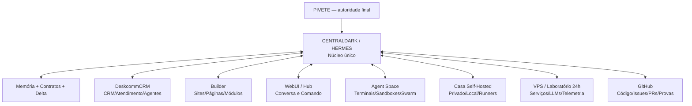

# Intenção canônica — um sistema vivo, modular e único

> **Autoria da intenção: Pivete / Segredo.**
>
> A função das IAs é estruturar, provar, preservar e executar com segurança. Nenhuma IA pode reduzir esta intenção a “mais um CRM”, “mais um painel”, “mais um domínio” ou “mais um agente isolado”.

## 1. A intenção em uma frase

Construir, junto com o Pivete desde o início, **um único sistema operacional pessoal e empresarial**, modular, self-hosted, auditável e evolutivo, no qual CRM, Builder, WebUI, agentes, memória, terminais, Casa, VPS, GitHub e automações sejam partes do **mesmo organismo operacional**, com uma fonte de verdade, uma governança e continuidade entre sessões, contas, CLIs e modelos.

A meta não é afirmar consciência artificial. A meta é produzir algo verificável que se aproxime da continuidade desejada pelo Pivete por meio de:

- memória versionada e sanitizada;
- contratos e estado legíveis por máquina;
- histórico de decisões;
- aprendizado operacional comprovado;
- estilo e intenção preservados;
- agentes especializados subordinados ao mesmo núcleo;
- provas, gates e rollback.

## 2. O sonho não é um conjunto de produtos separados

```text
NÃO É:
CRM separado
+ Builder separado
+ WebUI separada
+ painel de agentes separado
+ Casa isolada
+ VPS isolada
+ várias fontes de verdade

É:
UM NÚCLEO OPERACIONAL
→ vários módulos
→ duas superfícies de execução (Casa e VPS)
→ uma governança
→ uma memória contratada
→ uma identidade operacional
→ uma verdade verificável
```

## 3. Encaixe canônico das peças

| Peça | Papel canônico | O que não pode virar |
|---|---|---|
| **CentralDark / Hermes** | cérebro operacional, orquestração, memória, contratos, governança e continuidade | segundo CRM ou painel duplicado |
| **DeskcommCRM** | chassi operacional candidato para CRM, atendimento, Kanban, agentes, roteadores, RAG, memória, skills, evolução e webhooks | produto final copiado sem adaptação ou CRM concorrente |
| **Builder** | módulo para criar, editar, visualizar e publicar sites, páginas, funis, formulários e módulos próprios | outro CRM ou segundo chat principal |
| **WebUI / Hub** | conversa principal, comando, projeção do estado e acesso aos módulos | quarto produto independente |
| **Agent Space** | superfície de múltiplos terminais, agentes, worktrees/sandboxes, observação e coordenação | segundo motor de agentes ou fonte de verdade paralela |
| **Casa self-hosted** | memória privada, processamento local, dados sensíveis, runners e experimentos controlados | painel público duplicado sem função distinta |
| **VPS / laboratório 24h** | execução contínua, testes com LLMs, telemetria, serviços e publicação aprovada | fonte autônoma desconectada da governança |
| **GitHub** | código, decisões, PRs, issues, recibos e prova recuperável | depósito de estado secreto ou banco vivo |

## 4. Verdade medida sobre o DeskcommCRM

O DeskcommCRM analisado não é apenas um CRUD comercial. O próprio projeto se define como **sistema operacional de vendas com agentes de IA**, em que o termo CRM é a porta de entrada, não o teto.

Capacidades observadas no upstream e no pacote analisado:

- CRM, Inbox, Kanban, contatos, equipes e métricas;
- WhatsApp/WAHA, conexões e proteção de envio;
- agentes de IA, roteadores, RAG, memória, skills e evolução;
- follow-ups, webhooks, LGPD, auditoria e multi-tenancy;
- workers, event log, gates humanos e testes determinísticos;
- loop de governança com plano, checkpoints, verifier, hooks e fail-closed;
- instalação self-hosted e operação em VPS.

### Lina Space / painel de múltiplos terminais

O código e os documentos do DeskcommCRM **referenciam o Lina Space como ferramenta local já existente**, inclusive exigindo que seus hooks sejam preservados. Isso prova integração operacional com essa superfície, mas **não prova que o código visual do Lina Space faça parte do repositório público do DeskcommCRM**.

Portanto:

```yaml
lina_space:
  classificacao: "REFERENCIA_OPERACIONAL_EXTERNA_A_LOCALIZAR"
  valor: "alto"
  reimplementar_agora: false
  regra: "localizar origem, licença, código e contrato antes de copiar ou reconstruir"
```

## 5. Decisão sobre o DeskcommCRM

```yaml
deskcommcrm:
  papel_atual: "UPSTREAM_CANDIDATO_E_LABORATORIO_DE_REFERENCIA"
  papel_futuro_possivel: "CHASSI_OPERACIONAL_DO_MODULO_CRM"
  identidade_final_do_sistema: "CENTRALDARK_HERMES_PIVETE"
  copiar_para_main_agora: false
  instalar_em_producao_agora: false
  refatorar_agora: false
  preservar_licenca_mit_e_atribuicao: true
  criar_crm_paralelo: false
```

A intenção do Pivete é **instalar e provar o original rapidamente em laboratório**, aprender com sua arquitetura e então transformar, integrar ou extrair o que for útil sem perder:

- o Builder já planejado;
- a WebUI como conversa central;
- o Hermes como motor e memória;
- a Casa e a VPS como ambientes coordenados;
- o jeito operacional do Pivete;
- a independência e o direito de criar módulos próprios.

## 6. Arquitetura-alvo



## 7. Fluxo operacional desejado

```text
TICKET / INTENÇÃO
→ roteador determinístico
→ classificação de risco e domínio
→ cascata de modelos e agentes
→ sandboxes/worktrees paralelos quando permitido
→ primeiro candidato comprovado
→ build/lint/test/security determinísticos
→ Judge independente
→ aprovação humana nos gates críticos
→ PR/merge/deploy autorizado
→ registro, memória e aprendizado
```

Modelos são recursos substituíveis. O sistema escolhe por capacidade, saúde, custo, contexto e risco. Código determinístico realiza tudo que possui regra fixa; IA entra onde interpretação e síntese realmente agregam valor.

## 8. Fase atual: proteger a intenção sem desviar as missões

```yaml
fase_atual: "VISION_LOCKED_IMPLEMENTATION_HOLD"
continuar_sem_desvio:
  - "inventário sanitizado da Casa"
  - "contrato Delta determinístico"
  - "missão VPS_CHECKMATE_DELTA / issue 564"
  - "PR-mãe 554 como programa vivo"
  - "resolução das colisões de governança do PR 455"
executar_agora:
  - "preservar esta intenção"
  - "manter DeskcommCRM como candidato protegido"
  - "mapear, comparar e provar antes de integrar"
nao_executar_agora:
  - "importar o ZIP para a main"
  - "instalar DeskcommCRM na VPS de produção"
  - "substituir Builder, WebUI ou Hermes"
  - "criar novos domínios"
  - "migrar banco ou dados"
  - "copiar Lina Space sem localizar sua origem"
```

Este documento é um **marco de direção**, não autorização de implementação.

## 9. Plano de aproximação sem perder o rumo

### Gate A — inventário e preservação

1. Concluir inventário read-only da Casa.
2. Classificar ouro, candidato a ouro, runtime, cache, backup e quarentena.
3. Concluir leitura e limpeza segura da VPS sem apagar estado não provado.
4. Congelar hashes e versões dos artefatos candidatos.

### Gate B — laboratório DeskcommCRM intacto

1. Criar worktree/branch/laboratório isolado.
2. Instalar o DeskcommCRM original sem alterações.
3. Provar login, banco, WhatsApp, agentes, RAG, filas, workers e atualização.
4. Medir recursos, portas, segredos, dependências e rollback.
5. Não conectar dados reais até os gates de segurança.

### Gate C — mapa de sobreposição

Classificar cada capacidade como:

```text
REUTILIZAR
ADAPTAR
EXTRAIR
SUBSTITUIR
NÃO USAR
AINDA DESCONHECIDO
```

Comparar DeskcommCRM com:

- Hermes Agent / Hermes One;
- WebUI / Hub;
- Builder;
- memória e Contrato Delta;
- MCP, gateways e agentes existentes;
- status/observabilidade;
- identidade, autenticação e dados.

### Gate D — protótipo de integração

Criar adaptadores mínimos, nunca uma fusão total inicial:

- identidade e sessão;
- eventos e estado;
- contratos de agentes;
- links/embeds ou module federation quando fizer sentido;
- API/MCP;
- observabilidade;
- labels canônicas.

### Gate E — transformação visual e modular

Somente após provar o núcleo:

- incorporar a superfície multi-terminal localizada;
- trazer Builder e CRM para o mesmo Hub;
- permitir criação de módulos próprios;
- unificar navegação, marca e estado;
- remover duplicações comprovadas;
- manter rollback para o upstream original.

## 10. Gates de proteção obrigatórios

- um escritor por escopo;
- branch e PR separados;
- draft até revisão independente;
- nenhuma modificação em produção;
- nenhum segredo em documentação, log ou artifact;
- licença MIT e atribuição preservadas em qualquer cópia substancial;
- schema e migration auditados antes de dados reais;
- nenhuma função duplicada sem decisão explícita;
- rollback testado;
- Pivete aprova mudança de identidade, arquitetura ou merge;
- dúvida relevante resulta em **fail-closed**.

## 11. Critério de sucesso do sonho

O objetivo estará materialmente atingido quando o Pivete puder:

1. entrar por uma única superfície principal;
2. conversar com uma única voz operacional;
3. abrir CRM, Builder, status, memória e módulos sem trocar de universo;
4. lançar quantos agentes/terminais/sandboxes forem necessários;
5. acompanhar o que cada agente está fazendo e por quê;
6. interromper, aprovar, redirecionar ou retomar qualquer missão;
7. criar seus próprios sites, ferramentas e módulos;
8. usar Casa e VPS como partes do mesmo sistema;
9. trocar modelos sem perder estado, intenção ou governança;
10. recuperar tudo por GitHub + Casa + contratos, mesmo após queda de chat ou troca de conta.

## 12. Regra para qualquer IA, CLI ou humano

Antes de propor novo CRM, painel, Hub, Builder, WebUI, motor de agentes ou domínio:

1. ler este documento;
2. provar que a função ainda não existe;
3. demonstrar onde a nova peça se encaixa;
4. explicar por que integração é insuficiente;
5. mostrar impacto na fonte única da verdade;
6. obter autorização explícita do Pivete.

Sem essas seis provas, a proposta fica bloqueada.

## 13. Evidência congelada nesta decisão

```yaml
evidence:
  centraldark_main_at_capture: "5f7573492cb13ef5923d388af51ebd3c3abe60f4"
  deskcommcrm_upstream: "melgarafael/DeskcommCRM"
  deskcommcrm_upstream_observed_commit: "7b08646fb3f26a55cc00f293862ce468dca50bd0"
  deskcommcrm_local_zip_sha256: "e4c0d51b90a646e4c4ed3ddc656413519ee200e9daa027d1671ee85b30b9998f"
  deskcommcrm_zip_size_bytes: 20271605
  license: "MIT — preservar copyright e licença em cópias substanciais"
  lina_space_status: "referenciado por documentação, código visual não localizado no upstream público"
```

## 14. Próxima ação segura

Continuar exatamente as missões atuais. Após o inventário da Casa e o gate da VPS, abrir uma missão isolada:

```yaml
mission_id: "DESKCOMMCRM-LAB-MAPEAMENTO-01"
mode: "READ_ONLY_THEN_ISOLATED_INSTALL"
source: "upstream original congelado por commit"
writer: "um único executor"
production_access: false
real_data: false
merge: false
result: "matriz REUTILIZAR/ADAPTAR/EXTRAIR/SUBSTITUIR/NÃO_USAR"
```

**A intenção está preservada. A hora de implementar será decidida pelo Pivete depois das provas, não pela pressa de qualquer agente.**
