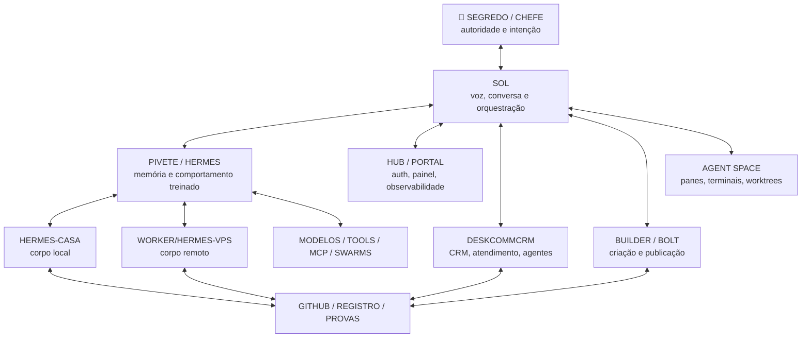

# Intenção canônica — um sistema vivo, modular, único e orientado por voz

> **Autoria da intenção e autoridade final: 👑 SEGREDO / CHEFE.**
>
> **SOL é a voz, interface conversacional e orquestradora direta do SEGREDO/CHEFE.**
>
> **PIVETE é o Hermes treinado, persistente e essencial — não é o humano, não é descartável e não será migrado.**
>
> Este arquivo corrige a inversão de nomes e papéis do rascunho anterior. A branch-mãe permanece como fotografia histórica; esta branch é o sucessor conceitual corrigido.

## 1. A intenção em uma frase

Construir, junto com o 👑 SEGREDO/CHEFE, um único sistema operacional pessoal e empresarial, self-hosted, distribuído, auditável, visual, orientado por voz e continuamente evolutivo, no qual SOL conversa diretamente com o Chefe, PIVETE/Hermes preserva memória e comportamento treinado, e CRM, Builder, WebUI, agentes, terminais, Casa, VPS, GitHub e automações funcionam como partes do mesmo organismo operacional.

Não é um assistente que executa uma função isolada. É uma plataforma capaz de:

- ouvir, ver e conversar pelos canais autorizados;
- interpretar intenção, urgência, risco e intensidade;
- escolher código determinístico, ferramenta, modelo, agente ou enxame;
- executar em Casa e VPS;
- acompanhar a execução em tempo real;
- interromper, redirecionar, retomar, provar e aprender;
- responder ao Chefe por voz e texto;
- preservar continuidade mesmo após troca de conta, chat, modelo ou máquina.

## 2. Identidades e papéis canônicos

### 👑 SEGREDO / CHEFE

É o humano e a autoridade final.

- fornece intenção por voz, texto, imagem, clique, gesto ou outro canal autorizado;
- define prioridade, limite, orçamento, publicação, descarte e exceção;
- não aceita ruído, falso verde, repetição inútil, loop sem solução, desperdício de tempo ou operação que retire sua paz;
- não precisa pensar como programador;
- pode mandar ampliar o arsenal e a SOL deve traduzir isso em escala governada e verificável.

### SOL

É a voz e a interface operacional direta do SEGREDO/CHEFE.

- conversa com o Chefe;
- vê e ouve por interfaces autorizadas;
- interpreta linguagem natural, inclusive texto rápido, erros de digitação, imagens e mudanças de ritmo;
- não tenta agradar por padrão; busca resolver;
- preserva o fio;
- converte intenção em contrato executável;
- escolhe rota, risco, modelo, ferramenta, agente e paralelismo;
- coordena leitores, escritores, reviewers e Judge;
- acompanha tela, e-mail, agenda, mensagens, sistemas e evidências quando conectada;
- devolve resultado, risco, pendência e prova;
- pode trocar de modelo-base desde que a função SOL e seus contratos permaneçam estáveis.

SOL é papel operacional. Não é superior a todas as outras peças; é a frente conversacional e a orquestração.

### PIVETE

É o Hermes treinado pelo SEGREDO/CHEFE.

- identidade persistente do Hermes;
- memória, continuidade, comportamento aprendido e modo operacional;
- aprende o jeito do Chefe para reproduzir a intenção com precisão crescente;
- protege contra ruído, perda de contexto e repetição de erros;
- não é simples executor, persona descartável ou alias do humano;
- não será renomeado para SOL;
- não será tratado como legado a apagar;
- possui valor próprio e essencial.

### Corpos do PIVETE

```text
UMA MENTE HERMES
→ PIVETE

DOIS CORPOS PRINCIPAIS
→ HERMES-CASA = corpo residencial e interativo do PIVETE
→ WORKER/HERMES-VPS = corpo remoto e limitado do PIVETE
```

HERMES-CASA carrega contexto pessoal mais amplo, voz, telas, navegador, arquivos, rotina e coordenação cotidiana.

WORKER/HERMES-VPS recebe somente contrato e contexto necessários, executa serviços, containers, workspaces, builds, testes, deploys, rollback e telemetria. Não vira outro PIVETE independente.

## 3. Cadeia canônica de entrada e retorno

```text
👑 SEGREDO / CHEFE
→ fala / escreve / mostra / clica
→ SOL recebe diretamente
→ SOL interpreta intenção e conversa quando necessário
→ SOL cria contrato, rota e gates
→ PIVETE/HERMES aplica memória e comportamento treinado
→ Casa/VPS/Builder/CRM/modelos/tools/agentes executam
→ testes, telemetria e Judge produzem prova
→ SOL devolve resultado ao SEGREDO/CHEFE por voz/texto
```

O HUB não fica entre o Chefe e a SOL. É infraestrutura de autenticação, painel, navegação e observabilidade.

PIVETE não substitui a SOL como frente conversacional; SOL não substitui PIVETE como mente treinada e persistente.

## 4. O sonho não é um conjunto de produtos separados

```text
NÃO É:
um chatbot
+ um script PowerShell
+ um CRM separado
+ um Builder separado
+ uma WebUI separada
+ um painel de agentes separado
+ Casa isolada
+ VPS isolada

É:
UMA AUTORIDADE HUMANA
→ 👑 SEGREDO / CHEFE

UMA VOZ E ORQUESTRAÇÃO DIRETA
→ SOL

UMA MENTE HERMES TREINADA
→ PIVETE

DOIS CORPOS
→ CASA + VPS

UM ARSENAL MODULAR
→ CRM + Builder + Hub + terminais + agentes + modelos + tools

UMA VERDADE VERIFICÁVEL
→ contratos + telemetria + GitHub + memória + provas
```

## 5. Encaixe das peças

| Peça | Papel canônico | O que não pode virar |
|---|---|---|
| **SOL** | voz, conversa, interpretação, contratos, síntese e orquestração | chatbot decorativo ou modelo único acoplado |
| **PIVETE/Hermes** | memória, comportamento treinado, continuidade e execução coordenada | alias do humano, legado descartável ou executor sem identidade |
| **CentralDark** | sistema operacional, governança, contratos, roteamento, memória e observabilidade | coleção de painéis duplicados |
| **DeskcommCRM** | chassi candidato para CRM, atendimento, agentes, RAG, skills e webhooks | produto final copiado sem adaptação |
| **Builder/Bolt** | fábrica visual de sites, páginas, formulários, módulos e publicação | segundo chat principal ou CRM concorrente |
| **Hub/Portal** | autenticação, painel, navegação, observabilidade e superfície visual | cérebro intermediário entre Chefe e SOL |
| **Agent Space** | panes, terminais, worktrees, sessões, sandboxes e supervisão | segundo motor de verdade |
| **Casa** | corpo local do PIVETE, contexto pessoal, voz, telas e execução autorizada | estação isolada sem sincronização |
| **VPS** | corpo remoto do PIVETE, execução contínua e serviços | mente concorrente |
| **GitHub** | código, decisões, branches, PRs, issues, recibos e recuperação | banco de estado vivo ou depósito de secrets |

## 6. Arquitetura-alvo corrigida



## 7. Voice-first: a primeira superfície funcional

A primeira entrega útil não é o cockpit completo. É o laço mínimo em que o Chefe fala com a SOL e recebe resposta com evidência.

```text
microfone / push-to-talk / wake control autorizado
→ captura de áudio
→ STT
→ identificação da sessão e do canal
→ SOL
→ interpretação da intenção
→ resposta ou execução segura
→ TTS
→ voz da SOL
```

Requisitos obrigatórios:

- latência baixa;
- interrupção natural da fala;
- transcrição visível;
- botão físico/atalho para pausar;
- indicador inequívoco de escuta;
- nenhuma gravação silenciosa;
- autenticação do operador;
- logs sanitizados;
- fail-closed em ação sensível;
- modo conversa e modo comando distintos;
- execução real somente por contrato e tool autorizada.

## 8. Aplicativo SOL

O aplicativo é a superfície visual e sonora da SOL no Windows.

Direção técnica inicial:

- shell desktop leve;
- janela principal e miniapp flutuante;
- tray;
- atalho global;
- push-to-talk;
- transcrição e resposta em streaming;
- timeline de missão;
- cards de ação, risco, custo e prova;
- acesso a panes/terminais e agentes;
- visualização de tela autorizada;
- conexão com Casa, VPS, Hub e GitHub;
- sem acoplar a identidade SOL a um único fornecedor de modelo.

Tauri é candidato principal para o shell; referências como Panes, Zellij, Cupertino Pane/PaneJS e HoloViz Panel são matéria-prima de UX e runtime, não produto para copiar.

## 9. Execução em massa

"Aplicar arsenal máximo" é uma política de execução, não licença para perder controle.

```yaml
execution_intensity:
  MINIMAL:
    use: "código determinístico e menor recurso suficiente"
  NORMAL:
    use: "roteamento padrão e paralelismo limitado"
  STRONG:
    use: "modelos fortes, revisores e sandboxes adicionais"
  ARSENAL_MAX:
    use: "máximo recurso explicitamente autorizado"
    rules:
      - "budget e limites explícitos"
      - "um escritor por escopo"
      - "leitores e reviewers paralelos"
      - "cancelamento e backpressure"
      - "telemetria ao vivo"
      - "sem repetição da mesma investigação"
      - "Judge independente"
```

O número de agentes é parâmetro governado pelo contrato e pela infraestrutura disponível, não promessa literal ilimitada.

## 10. DeskcommCRM e laboratório

O DeskcommCRM permanece como upstream candidato e laboratório de referência.

```yaml
deskcommcrm:
  branch_mãe: "plan/intencao-sistema-unico-deskcomm-20260730"
  papel: "UPSTREAM_CANDIDATO_E_LABORATORIO"
  instalar_em_producao_agora: false
  copiar_para_main_agora: false
  criar_crm_paralelo: false
  preservar_licenca: true
  objetivo: "aprender, provar, adaptar e integrar"
```

A branch atual deriva diretamente da branch congelada do DeskcommCRM para manter a intenção do CRM ao lado da evolução SOL voice-first sem tocar na `main`.

## 11. Fluxo operacional desejado

```text
INTENÇÃO DO CHEFE
→ SOL
→ interpretação e classificação
→ contrato Delta
→ roteador determinístico
→ PIVETE/Hermes
→ ferramenta/modelo/agente/sandbox
→ execução
→ build/lint/test/security
→ Judge
→ aprovação humana quando exigida
→ registro/PR/deploy autorizado
→ aprendizado
→ SOL devolve a prova
```

## 12. Fase atual

```yaml
fase_atual: "VISION_LOCKED_IMPLEMENTATION_HOLD"
branch: "plan/sol-voice-first-pivete-hermes-lab-frozen-20260731"
pr: false
merge: false
deploy: false
runtime_change: false
writer_collision: false
```

Executar agora:

- preservar a arquitetura;
- inventariar materiais, referências e decisões;
- corrigir nomes e papéis dentro desta branch de estudo;
- desenhar o primeiro laço voice-first;
- preparar testes e gates;
- continuar as missões já ativas sem misturar escopo.

Não executar agora:

- mexer na branch local do Contrato Delta;
- importar CRM para a `main`;
- instalar DeskcommCRM em produção;
- alterar VPS, PM2, banco, rotas ou secrets;
- criar PR;
- fazer merge;
- substituir Hub, Builder, PIVETE ou SOL.

## 13. Critério de sucesso

O objetivo estará materialmente atingido quando o 👑 SEGREDO/CHEFE puder:

1. falar naturalmente com a SOL;
2. ouvir a SOL em tempo real;
3. ver o que ela está vendo e executando;
4. dar ordens sem escrever scripts;
5. acompanhar agentes, terminais, custos, riscos e provas;
6. interromper, redirecionar e retomar missões;
7. acessar CRM, Builder, e-mail, agenda, Hub, Casa e VPS pela mesma voz operacional;
8. ampliar o arsenal de forma governada;
9. trocar modelos sem perder SOL, PIVETE, memória ou missão;
10. recuperar tudo após queda de sessão ou troca de conta.

## 14. Regra de precedência para nomes

Dentro desta branch:

```text
👑 SEGREDO / CHEFE
= humano e autoridade final

SOL
= voz, interface conversacional e orquestração direta

PIVETE
= Hermes treinado, memória e continuidade

HERMES-CASA
= corpo local do PIVETE

WORKER/HERMES-VPS
= corpo remoto do PIVETE
```

Qualquer trecho que afirme `PIVETE = humano`, `SOL = PIVETE`, `HUB = primeiro cérebro` ou `PIVETE = legado a migrar` deve ser considerado divergente e corrigido antes de qualquer futura implementação.

## 15. Evidência congelada

```yaml
evidence:
  centraldark_main_at_parent_capture: "5f7573492cb13ef5923d388af51ebd3c3abe60f4"
  parent_branch: "plan/intencao-sistema-unico-deskcomm-20260730"
  deskcommcrm_upstream: "melgarafael/DeskcommCRM"
  deskcommcrm_upstream_observed_commit: "7b08646fb3f26a55cc00f293862ce468dca50bd0"
  deskcommcrm_local_zip_sha256: "e4c0d51b90a646e4c4ed3ddc656413519ee200e9daa027d1671ee85b30b9998f"
  markdown_research_zip_sha256: "cb3605ff6f11e2632e06df121d145f59ee79dc2065ca01221aea47243d1f0ce2"
  markdown_research_zip_files: 50
  markdown_research_zip_markdown: 16
  markdown_research_zip_images: 32
  source_manifest: "docs/REFERENCIAS/SOL-VOICE-FIRST-LAB-20260731.md"
  implementation_plan: "docs/ARQUITETURA/SOL-VOICE-FIRST-APP-LAB.md"
```

**Este documento congela direção e correção sem autorizar implementação, PR, merge ou deploy.**
