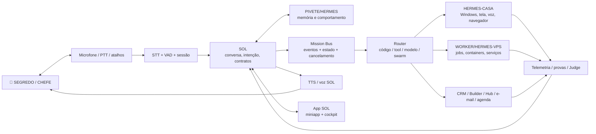

# SOL Voice-First App Lab

## 1. Resultado pretendido

Criar uma superfície Windows em que o 👑 SEGREDO/CHEFE fale diretamente com a SOL, veja e ouça a execução, e use o arsenal CentralDark sem precisar operar scripts, terminais ou painéis separados.

A primeira vitória não é "o app final". É um laço pequeno e real:

```text
Chefe aperta/fala
→ SOL escuta
→ transcrição aparece
→ SOL responde por voz
→ uma tool segura é executada
→ evidência aparece
→ conversa continua
```

## 2. Não construir errado

Não começar por:

- CRM completo;
- clone de app de terceiros;
- dashboard gigante;
- centenas de agentes;
- automação irrestrita;
- wake word invisível;
- gravação permanente;
- Electron/Chromium pesado sem necessidade;
- um `.ps1` isolado chamado de Jarvis;
- uma persona sem tools reais;
- uma cadeia que coloque HUB antes da SOL;
- uma arquitetura que apague PIVETE.

## 3. Arquitetura de referência



## 4. Stack candidata

### Shell desktop: Tauri v2

Papel:

- janela principal;
- miniapp flutuante;
- tray;
- atalho global;
- single instance;
- posição da janela;
- notificações;
- atualização;
- bridge Rust/JS;
- permissões por capability;
- sidecars autorizados.

Motivo:

- usa WebView do sistema em vez de empacotar um navegador inteiro;
- aceita React/Vite e outros frontends;
- integra recursos nativos;
- permite shell pequeno sem perder poder.

### Frontend

Candidato inicial:

```text
React + TypeScript + Vite
Zustand ou store equivalente
WebSocket/SSE para eventos
xterm.js para panes de terminal
componentes de cards/panes inspirados em PaneJS, sem copiar identidade visual
```

### Backend local

Candidato:

```text
Rust/Tauri
→ janelas, tray, hotkeys, permissões, processo e arquivos

sidecar local
→ Node.js ou Python somente quando a biblioteca exigir
→ STT/TTS adapters
→ PTY/terminal adapter
→ browser/screen adapter autorizado
```

A arquitetura deve permitir trocar o sidecar sem trocar a SOL.

### Panes e terminais

Duas rotas de estudo, não exclusivas:

1. **PTY embutido**
   - xterm.js no frontend;
   - portable-pty ou backend equivalente;
   - controle fino de sessão, replay, notificações e ambiente.

2. **Zellij como workspace externo**
   - layouts;
   - panes flutuantes e empilhados;
   - controle programático;
   - plugins WASM;
   - observação e ação com permissões.

A primeira prova deve escolher uma rota, não implementar as duas ao mesmo tempo.

### Persistência local

```text
SQLite
→ sessões
→ missões
→ eventos
→ preferências
→ índices locais

arquivos versionados
→ contratos
→ regras
→ snapshots sanitizados

GitHub
→ código, issues, branches, PRs e provas duráveis
```

## 5. Plano por gates

### Gate 0 — contrato e segurança

Entregáveis:

- schema da sessão de voz;
- schema da intenção;
- schema de tool call;
- schema de receipt;
- estados `IDLE/LISTENING/THINKING/EXECUTING/WAITING_APPROVAL/SPEAKING/BLOCKED`;
- botão de parada;
- cancelamento propagado;
- política de gravação;
- matriz de permissões.

Passa quando:

- nenhum comando sensível executa sem permissão;
- áudio e transcrição possuem política de retenção;
- segredo não aparece em UI, log ou receipt;
- cancelamento interrompe voz e tool.

### Gate 1 — voz mínima real

Entregáveis:

- Tauri inicia no Windows;
- tray;
- atalho global push-to-talk;
- indicador de escuta;
- STT;
- texto em streaming;
- resposta TTS;
- histórico curto;
- configuração de voz.

Passa quando:

- 20 ciclos seguidos sem travar;
- usuário interrompe TTS;
- perda de rede não congela app;
- latência e erros ficam visíveis.

### Gate 2 — uma tool segura

Primeira tool sugerida:

```text
status_readonly
→ lê estado de Casa/VPS/GitHub já autorizado
→ não modifica nada
→ retorna receipt estruturado
```

Depois:

- abrir arquivo;
- buscar no repositório;
- ler e-mail;
- ler agenda;
- criar rascunho;
- executar ação mutável apenas com gate.

Passa quando:

- SOL diferencia conversa de comando;
- tool chamada corresponde à intenção;
- resposta inclui prova;
- um Judge tenta contradizer o receipt.

### Gate 3 — PIVETE/Hermes

Entregáveis:

- consulta à memória canônica;
- preferências e modo de trabalho;
- correção por delta;
- aprendizado somente após prova;
- separação entre memória pessoal, operacional e transitória;
- não duplicar SOL.

Passa quando:

- a mesma intenção é interpretada de forma consistente em sessões novas;
- mudança de modelo não apaga identidade e regras;
- mensagem atrasada não reinicia missão.

### Gate 4 — Mission Bus e execução paralela

Entregáveis:

- fila de missão;
- eventos append-only;
- ownership de escritor;
- readers paralelos;
- budgets;
- cancelamento;
- backpressure;
- status de agentes;
- panes observáveis;
- receipts.

Passa quando:

- dois writers no mesmo escopo são bloqueados;
- swarm pode ser ampliado e reduzido;
- pane órfão é detectado;
- loops repetitivos param por policy;
- custo e tempo são visíveis.

### Gate 5 — visual operacional

Entregáveis:

- miniapp flutuante;
- cockpit expandido;
- timeline;
- árvore da missão;
- panes;
- tela autorizada;
- alertas;
- comparação de candidatos;
- Judge;
- botão parar/voltar.

Passa quando:

- o Chefe entende o estado sem abrir terminal;
- cada ação mostra quem, onde, por quê e prova;
- app não transforma observabilidade em teatro.

### Gate 6 — CRM, Builder e Hub

Somente depois do laço voice-first estar estável:

- DeskcommCRM em laboratório;
- Builder;
- Hub;
- e-mail;
- agenda;
- Telegram;
- navegador;
- automações.

Tudo entra por adaptadores e contratos, não por fusão irreversível.

## 6. Interpretação de intenção

A SOL deve separar:

```yaml
utterance:
  raw_text: "texto original"
  normalized_text: "correções mínimas sem apagar estilo"
  conversation_or_command: "CONVERSATION|COMMAND|MIXED"
  intent: "ação ou pergunta"
  urgency: "LOW|NORMAL|HIGH|CRITICAL"
  execution_intensity: "MINIMAL|NORMAL|STRONG|ARSENAL_MAX"
  target: []
  constraints: []
  approval_required: true
  ambiguity: []
  evidence_expected: []
```

Regras:

- não tratar emoção como autorização;
- não tratar exemplo como ordem;
- não reduzir ordem complexa a palavra-chave;
- não pedir confirmação quando a ação é segura, reversível e já autorizada;
- pedir confirmação quando identidade, alvo, impacto ou autorização estiverem realmente ambíguos;
- aprender com correções do Chefe, mas só promover para regra após registro.

## 7. Voz e presença

Modos:

```text
PUSH_TO_TALK
→ padrão inicial e mais seguro

WAKE_WORD
→ fase posterior, local, com indicador visível

OPEN_CONVERSATION
→ janela curta explicitamente ativada

SILENT
→ nada é capturado
```

A voz da SOL deve:

- ser interrompível;
- falar PT-BR natural;
- ajustar velocidade;
- diferenciar aviso, resultado e conversa;
- nunca mascarar falha com tom confiante;
- resumir na fala e manter detalhe na tela.

## 8. Tela e contexto

A SOL não precisa "ver tudo sempre".

Modelo:

```text
Chefe autoriza uma janela/tela
→ capturador produz frame ou região
→ visão extrai estado
→ dado sensível é minimizado
→ SOL recebe contexto necessário
→ ação é proposta/executada conforme gate
```

Requisitos:

- seletor de monitor/janela;
- borda/indicador de captura;
- pausa imediata;
- redaction;
- nenhuma captura de segredo por padrão;
- screenshot como evidência quando necessário;
- hash e timestamp quando arquivado.

## 9. Swarms

A escala deve ser elástica:

```text
1 missão
→ N tarefas
→ waves
→ readers paralelos
→ writers por escopo
→ reviewers
→ Judge
```

Controles:

- limite por provider;
- orçamento;
- prioridade;
- timeout;
- retry limitado;
- deduplicação semântica;
- fila;
- circuit breaker;
- isolamento por worktree/container;
- cancelamento hierárquico;
- checkpoint e retomada.

"Um milhão de agentes" é uma expressão de capacidade de expansão; a implementação real deve provar escala progressiva sem fingir infinito.

## 10. Reuso e referências

### Panes

Estudar:

- Tauri + React;
- Rust como dono de persistência, engines, Git, terminal e acesso seguro a arquivos;
- xterm.js + portable-pty;
- SQLite;
- notificações de Claude/Codex;
- sessões e auditoria.

Regra:

- MIT permite estudo e reuso conforme licença;
- não copiar marca ou UX sem adaptação;
- não assumir que integração Windows está 100% validada sem teste próprio.

### Zellij

Estudar:

- workspace terminal;
- layouts;
- panes;
- plugins WASM;
- controle programático;
- permissões.

Uso possível:

- laboratório de sessões;
- backend de panes;
- protótipo de Agent Space;
- não substituir o Mission Bus canônico.

### PaneJS / Cupertino Pane

Estudar:

- miniapp;
- painel deslizante;
- picture-in-picture;
- voz no demo;
- animações e interação mobile/desktop.

Uso:

- referência de experiência visual;
- não é motor de agentes.

### HoloViz Panel

Estudar:

- protótipos Python;
- dashboards;
- JSON panes;
- observabilidade rápida.

Uso:

- laboratório e painel técnico;
- não é a primeira escolha para shell desktop da SOL.

### Claude Code e outros CLIs

Uso:

- engines executores subordinados;
- terminais;
- hooks;
- sessões;
- tools.

Regra:

- não copiar código proprietário;
- integrar via CLI, SDK, plugins ou contratos permitidos;
- modelo/produto é substituível.

## 11. Diretórios sugeridos para a futura implementação

Nada criar agora; apenas direção:

```text
apps/modulos/sol-desktop/
├── src/
│   ├── app/
│   ├── voice/
│   ├── mission/
│   ├── panes/
│   ├── evidence/
│   └── settings/
├── src-tauri/
│   ├── src/
│   ├── capabilities/
│   └── icons/
├── sidecars/
│   ├── voice-gateway/
│   └── terminal-bridge/
└── tests/

apps/modulos/sol-runtime/
├── contracts/
├── router/
├── mission-bus/
├── adapters/
├── receipts/
└── tests/

docs/ARQUITETURA/
├── SOL-VOICE-FIRST-APP-LAB.md
└── INTENCAO-CANONICA-SISTEMA-UNICO.md
```

Antes de usar esses caminhos, medir o mapa canônico e colisões com módulos existentes.

## 12. Critério do primeiro protótipo

O protótipo passa somente quando esta cena for real:

```text
👑 CHEFE: "SOL, me diga o estado da missão Delta."

SOL:
- escuta;
- transcreve;
- consulta estado read-only;
- fala a resposta;
- mostra branch, HEAD, testes, bloqueador e prova;
- não altera nada;
- continua ouvindo na mesma conversa.
```

Depois disso, uma segunda cena mutável com aprovação explícita.

## 13. Estado congelado

```yaml
branch: "plan/sol-voice-first-pivete-hermes-lab-frozen-20260731"
source_branch: "plan/intencao-sistema-unico-deskcomm-20260730"
purpose: "estudo, arquitetura e continuidade"
no_pr: true
no_merge: true
no_deploy: true
no_runtime_mutation: true
```
