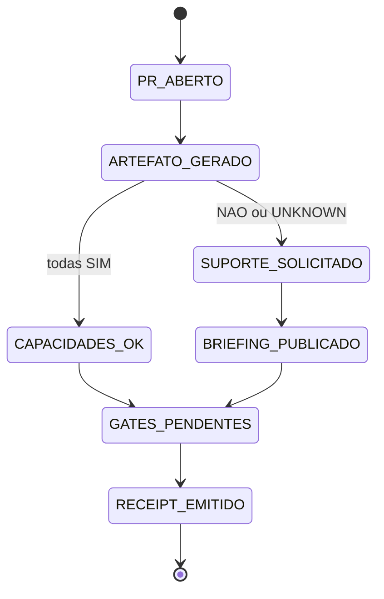

# PR Learning Artifact Bot — padrão visual e legível por IA

## Intenção registrada

Ao abrir ou atualizar um Pull Request, o CentralDark deve produzir automaticamente um artefato curto que permita a humanos e inteligências entenderem o mesmo estado com rapidez.

A intenção é de **SEGREDO/CHEFE**:

```text
PR ABERTO
→ ARTEFATO VISUAL + ESTRUTURADO
→ CAPACIDADES DECLARADAS
→ FALLBACK EM TEXTO
→ SUPORTE PEDIDO QUANDO NECESSÁRIO
→ TESTES E JUDGE CONTINUAM DECIDINDO
```

Nenhuma IA perde autoria porque pediu ajuda. Suporte visual ou tradução não transfere o Writer do código.

## Formatos obrigatórios

Cada execução gera no mesmo `HEAD_SHA`:

1. **Mermaid** no comentário do PR;
2. **texto simples** para qualquer agente;
3. **YAML estruturado** para leitura de máquina;
4. **Canvas HTML autocontido** salvo como artifact do workflow;
5. **receipt** com digest SHA-256;
6. **pedido automático de suporte** quando a autoria declarar `NAO` ou `UNKNOWN`.

## Contrato de capacidades

A descrição do PR contém:

```yaml
AI_CAPABILITIES:
  mermaid: SIM|NAO|UNKNOWN
  canvas_html: SIM|NAO|UNKNOWN
  structured_yaml: SIM|NAO|UNKNOWN
```

Regras:

- não inventar suporte;
- `UNKNOWN` não vira `SIM`;
- o bot sempre oferece fallback em texto;
- falta de Mermaid ou Canvas roteia `assign:chatgpt`;
- falta de YAML estruturado roteia `assign:codex`;
- o Dispatcher publica o briefing no próprio PR;
- pedido de suporte não aprova, não mergeia e não altera código.

As rotas são designações operacionais do repositório, não alegações universais sobre todo modelo futuro.

## Segurança

O job que comenta usa `pull_request_target`, executa somente código da base confiável e não faz checkout do código não confiável do PR.

Ele lê apenas:

- título e corpo sanitizados;
- número do PR;
- base e HEAD;
- nomes, status e contagens dos arquivos.

Ele não lê patch, conteúdo de arquivo, `.env`, secrets, tokens, sessões, chaves ou certificados.

O job do evento `pull_request` possui somente `contents: read`; ele testa o gerador no HEAD candidato e publica artifact de prova, mas não comenta nem escreve no PR.

## Máquina de estados



## Invariantes

```text
ARTEFATO != APROVAÇÃO
COMMENT_CREATED != ENTREGA
ARTIFACT_UPLOADED != CÓDIGO FUNCIONANDO
SUPPORT_REQUESTED != WRITER_TRANSFERRED
CHECKS_GREEN != PRODUÇÃO
```

O estado final continua dependendo de testes, revisão, Judge, autorização humana e critérios do PR.

## Evidência exigida

A implementação só pode ser chamada de funcional quando houver:

```text
NODE_CHECK=PASS
TESTES_DO_GERADOR=PASS
WORKFLOW_YAML=VÁLIDO
ARTIFACT_MARKDOWN=GERADO
ARTIFACT_HTML=GERADO
DIGEST_DETERMINÍSTICO=SIM
COMENTÁRIO_IDEMPOTENTE=PROVADO_EM_RUN
ROTEAMENTO_DE_LABEL=PROVADO_EM_RUN
DISPATCHER_NO_PR=PROVADO_EM_RUN
```

Antes do merge, os três últimos itens permanecem `PENDENTE_DE_RUNTIME`, porque `pull_request_target` usa a versão existente na branch padrão.

## Rollback

Reverter o commit que introduziu:

- `.github/workflows/pr-learning-artifact.yml`;
- extensões do `dispatcher-bots.yml`;
- script e teste;
- bloco de capacidades do template.

Nenhum estado de produção, VPS ou banco é tocado.
