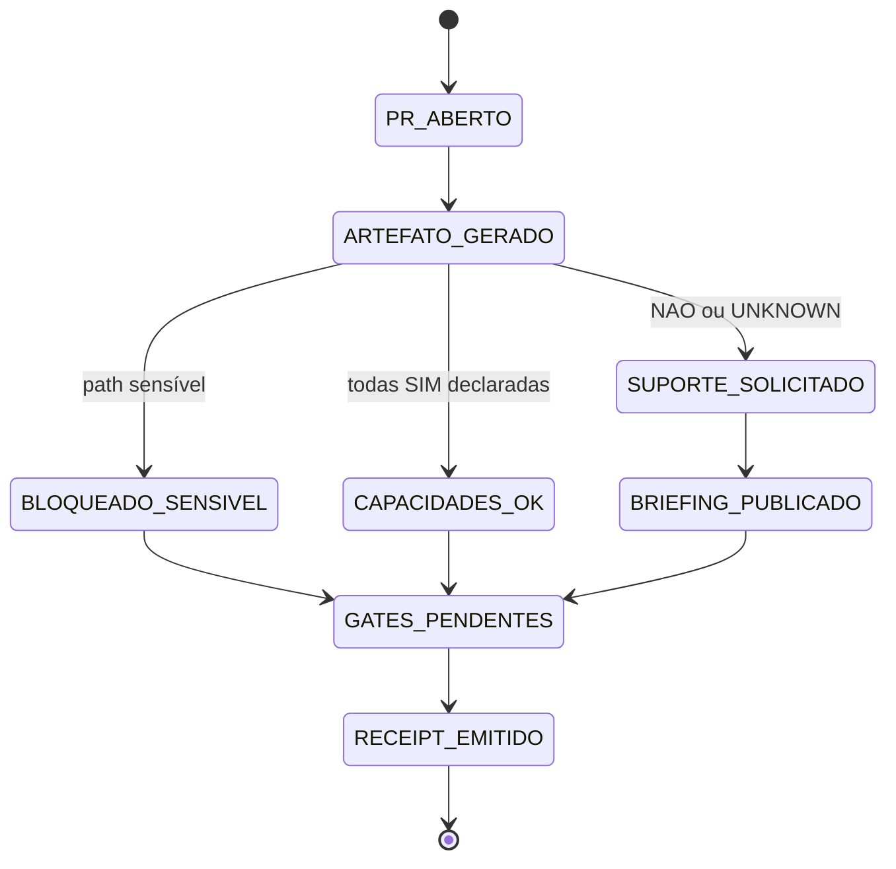

# PR Learning Artifact Bot — padrão visual e legível por IA

## Intenção registrada

Ao abrir, editar ou atualizar um Pull Request, o CentralDark deve produzir automaticamente um artefato curto que permita a humanos e inteligências entenderem o mesmo estado com rapidez.

A intenção é de **SEGREDO/CHEFE**:

```text
PR ABERTO
→ ARTEFATO VISUAL + ESTRUTURADO
→ CAPACIDADES DECLARADAS
→ FALLBACK EM TEXTO
→ SUPORTE PEDIDO QUANDO NECESSÁRIO
→ TESTES E JUDGE CONTINUAM DECIDINDO
```

Nenhuma IA perde autoria porque pediu ajuda. Suporte visual ou tradução não transfere o Writer do código.

## Formatos obrigatórios

Cada execução gera no mesmo `HEAD_SHA`:

1. **Mermaid** no comentário do PR;
2. **texto simples** para qualquer agente;
3. **YAML estruturado** para leitura de máquina;
4. **Canvas HTML autocontido** salvo como artifact do workflow;
5. **receipt** com digest SHA-256;
6. **pedido automático de suporte** quando a autoria declarar `NAO` ou `UNKNOWN`;
7. **bloqueio fail-closed** quando metadados apontarem caminho sensível.

## Contrato de capacidades

A descrição do PR contém:

```yaml
AI_CAPABILITIES:
  mermaid: SIM|NAO|UNKNOWN
  canvas_html: SIM|NAO|UNKNOWN
  structured_yaml: SIM|NAO|UNKNOWN
```

Regras:

- não inventar suporte;
- a fonte da capacidade é registrada como `DECLARED_UNVERIFIED`;
- `SIM` declarado não é prova independente;
- `UNKNOWN` não vira `SIM`;
- o bot sempre oferece fallback em texto;
- falta de Mermaid ou Canvas roteia `assign:chatgpt`;
- falta de YAML estruturado roteia `assign:codex`;
- o Dispatcher publica o briefing no próprio PR;
- pedido de suporte não aprova, não mergeia e não altera código;
- as labels `assign:chatgpt` e `assign:codex` pertencem ao seed oficial para recuperação reproduzível.

As rotas são designações operacionais do repositório, não alegações universais sobre todo modelo futuro.

## Segurança

Os dois jobs usam o runner já existente `runs-on: [self-hosted, Linux]`, evitando dependência do runner hospedado pelo GitHub quando o billing externo o bloqueia.

O job que comenta usa `pull_request_target`, executa somente código da base confiável e não faz checkout do código não confiável do PR.

Ele lê apenas:

- título sanitizado e codificado para Markdown inline;
- corpo sanitizado para leitura do contrato de capacidades;
- número do PR;
- base e HEAD;
- nomes, status e contagens dos arquivos.

Ele não lê patch, conteúdo de arquivo, `.env`, secrets, tokens, sessões, chaves ou certificados.

O job do evento `pull_request` possui somente `contents: read`; ele testa o gerador no HEAD candidato, compara o SHA completo do evento com `git rev-parse HEAD` e publica artifact de prova, mas não comenta nem escreve no PR. Esse job só aceita PR cuja origem seja o próprio repositório (`head.repo.full_name == github.repository`), recusando execução de HEAD vindo de fork no runner persistente.

As Actions externas usadas nos workflows modificados são fixadas em SHAs imutáveis. Comentários idempotentes só reconhecem marcador publicado pelo `github-actions[bot]`, impedindo que comentário de terceiro bloqueie ou seja sobrescrito pelo bot.

## Máquina de estados



## Invariantes

```text
ARTEFATO != APROVAÇÃO
COMMENT_CREATED != ENTREGA
ARTIFACT_UPLOADED != CÓDIGO FUNCIONANDO
SUPPORT_REQUESTED != WRITER_TRANSFERRED
CAPABILITY_DECLARED_SIM != CAPABILITY_PROVEN
SENSITIVE_PATHS_GT_0 => BLOCKED_SENSITIVE_PATH
HEAD_DECLARADO != HEAD_DO_CHECKOUT => BLOCKED
PR_NUMBER_NAO_CANONICO => BLOCKED
FILE_METADATA_INVALID => BLOCKED
MARKDOWN_NAO_CONFIAVEL => CODIFICAR_ANTES_DE_PUBLICAR
CHECKS_GREEN != PRODUÇÃO
```

O estado final continua dependendo de testes, revisão, Judge, autorização humana e critérios do PR.

## Evidência exigida

A implementação só pode ser chamada de funcional quando houver:

```text
NODE_CHECK=PASS
TESTES_DO_GERADOR=PASS
WORKFLOW_YAML=VÁLIDO
SELF_HOSTED_RUNNER=PROVADO_EM_RUN
ARTIFACT_MARKDOWN=GERADO
ARTIFACT_HTML=GERADO
DIGEST_DETERMINÍSTICO=SIM
TOKEN_FINE_GRAINED_REDACTED=SIM
MARKDOWN_INLINE_INJECTION_BLOCKED=SIM
HEAD_SHA_EXACT_40_HEX=SIM
CHECKOUT_HEAD_MATCH=SIM
PR_NUMBER_CANONICAL=SIM
FILE_METADATA_VALIDATED=SIM
UNICODE_ORDER_INDEPENDENT=SIM
SENSITIVE_PATH_GATE=PASS
TEST_RECEIPT_DERIVED_FROM_TAP=SIM
ACTIONS_PINNED_BY_SHA=SIM
COMENTÁRIO_IDEMPOTENTE=PROVADO_EM_RUN
ROTEAMENTO_DE_LABEL=PROVADO_EM_RUN
DISPATCHER_NO_PR=PROVADO_EM_RUN
```

Antes do merge, os três últimos itens permanecem `PENDENTE_DE_RUNTIME`, porque `pull_request_target` usa a versão existente na branch padrão.

## Primeira prova real do runner self-hosted

No PR `#668`, o commit `c7fcc5168873cdb31ef4784ac453bdbf7b2c9f77` executou no runner `vmi3256920-centraldark`, labels `self-hosted` e `Linux`.

```text
CHECKOUT_EXACT_HEAD=PASS
TESTS_TOTAL=19
PASS=19
FAIL=0
SKIPPED=0
HEAD_IDENTITY_MATCH=PASS
MARKDOWN_AND_CANVAS=GERADOS
ARTIFACT_UPLOAD=PASS
ARTIFACT_ID=8961804370
ARTIFACT_SHA256=787106cf86e0dfc9147b1f30289f338a30c967159f1a9bc80df4d52a43ee09af
JOB_CONCLUSION=SUCCESS
```

Essa prova substitui a conclusão anterior de bloqueio total por billing: o billing bloqueia jobs `ubuntu-latest`, mas não impede o runner self-hosted já operacional.

## Rollback

Reverter o commit que introduziu:

- `.github/workflows/pr-learning-artifact.yml`;
- extensões do `dispatcher-bots.yml`;
- script e teste;
- bloco de capacidades do template;
- rotas `assign:*` adicionadas ao seed oficial.

Nenhum estado de produção, VPS ou banco é tocado.
