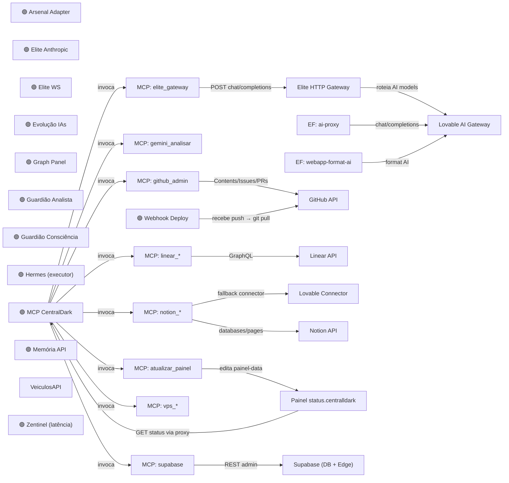

# 🕸️ Grafo Vivo — Visão em Tempo Real

> Nota **gerada automaticamente** a partir de `graph-data.json`.
> **Mermaid não é verdade:** é uma projeção visual derivada do estado observado. O desenho nunca sobrescreve o canônico.

```
┌────────────────────────────────────────────────────────┐
│  🕸️ GRAFO VIVO · atualizado 30/09/2026, 23:53:50    │
│   77 nós · 102 arestas · 12 🟢 online ·  0 🔴 off       │
│  24 processos PM2 ·   0 req ChatGPT/15min                │
└────────────────────────────────────────────────────────┘
```

## 🗺️ Topologia (quem chama quem — núcleo)



> Vermelho = processo caído. O diagrama é derivado; divergência visual vira achado para investigação, não autoridade.

## 🔎 Auditoria visual das relações

- 🟡 **Ciclo dirigido detectado:** `aprendizados`, `band-score`, `casa`, `claim-seals`, `github-main`, `graphrag-master`, `mcp-server`, `meta-lupa`, `painel-status`, `tool-painel`, `vps`. Ciclo é achado, não erro automático.

## 🩺 Saúde dos processos monitorados

| | Nó | Processo PM2 | Status |
|--|----|----|----|
| 🟢 | Arsenal Adapter | `CentralDark-ArsenalAdapter` | online |
| 🟢 | Elite Anthropic | `CentralDark-EliteAnthropic` | online |
| 🟢 | Elite WS | `CentralDark-EliteWS` | online |
| 🟢 | Evolução IAs | `CentralDark-EvolucaoIAs` | online |
| 🟢 | Graph Panel | `CentralDark-GraphPanel` | online |
| 🟢 | Guardião Analista | `CentralDark-GuardiaoAnalista` | online |
| 🟢 | Guardião Consciência | `CentralDark-GuardiaoConsciencia` | online |
| 🟢 | Hermes (executor) | `CentralDark-Hermes` | online |
| 🟢 | MCP CentralDark | `CentralDark-MCP` | online |
| 🟢 | Memória API | `CentralDark-Memoria` | online |
| 🟢 | Webhook Deploy | `CentralDark-WebhookDeploy` | online |
| 🟢 | Zentinel (latência) | `CentralDark-Zentinel` | online |

## 🚨 Anomalias

✅ Nenhuma anomalia de processo — todos os processos monitorados estão online.

## 🔀 Fluxos críticos

- Deploy: GitHub push → webhook-deploy → git pull VPS → tool-painel → painel-data.json → status.centralldark.com
- Health: fn-health-check → OPTIONS 10 EFs → fn-notify-telegram → Canal Telegram
- IA→MCP: Lovable/Claude → fn-ponte-mcp → mcp.centralldark.com → tools (VPS/GitHub/Supabase/Notion/Linear/Elite)
- PIX: Telegram → fn-telegram-webhook → fn-telegram-payment → fn-efi-generate → EFI Proxy → fn-efi-poll → Telegram
- Sentinela: sentinela → MCP /health /tools.json → gh issue se divergência

## 🧾 Receipt da projeção

```text
PROJECTION_SOURCE=apps/modulos/status/graph-data.json
PRIMARY_PROJECTION=docs/BRAIN/00-MAPA-SISTEMA/02-GRAFOS/GRAFO-VIVO.md
LEGACY_COMPAT_MIRROR=docs/BRAIN/00 - Mapa do Sistema/GRAFO-VIVO.md
FRESHNESS_KEY=GRAPH_FINGERPRINT
GRAPH_FINGERPRINT=14890c4cd8a6a95a61acc4eee96e1df5c4099e2ba7e744c9d7e89e1211de6727
MERMAID_KIND=flowchart
MERMAID_STRUCTURAL_VALIDATION=PASS
VISUAL_IS_TRUTH=false
FOCUS_NODES=31
FOCUS_EDGES=20
DANGLING_EDGES=0
DUPLICATE_EDGES=0
SELF_LOOPS=0
CYCLE_NODES=11
ISOLATED_NODES=0
WRITE=UPDATED
```

---
🔗 [[00-MAPA]] · [[02-ARQUITETURA]] · [[MAPA-DOS-BOTS]] · painel: status.centralldark.com

[executed on device: vmi3256920 (049f49fb-7b7f-4acb-953c-e68f6dbc4339)]