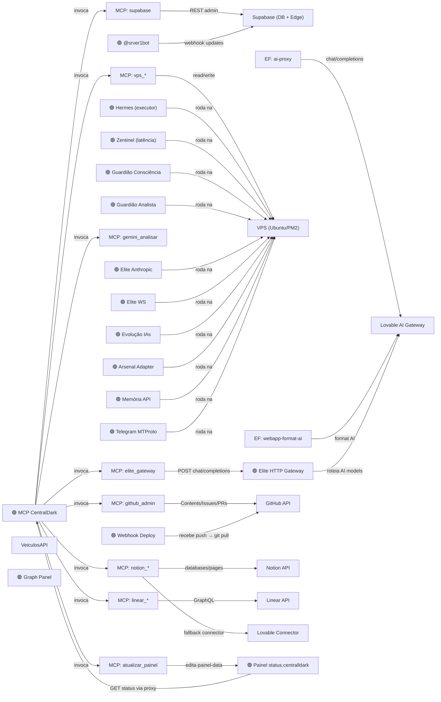

# 🕸️ Grafo Vivo — Visão em Tempo Real

> Nota **gerada automaticamente** a cada 5min a partir de `graph-data.json` (estado real do PM2 + gateway).
> Não edite à mão — é sobrescrita. Mesmo grafo de `status.centralldark.com`, aqui dentro do Obsidian.

```
┌────────────────────────────────────────────────────────┐
│  🕸️ GRAFO VIVO · atualizado 03/07/2026, 15:24:48    │
│   68 nós ·  88 arestas · 16 🟢 online ·  0 🔴 off       │
│  23 processos PM2 ·   0 req ChatGPT/15min                │
└────────────────────────────────────────────────────────┘
```

## 🗺️ Topologia (quem chama quem — núcleo)



> Vermelho = processo caído. Diagrama focado no núcleo; a saúde completa está na tabela abaixo.

## 🩺 Saúde dos processos monitorados

| | Nó | Processo PM2 | Status |
|--|----|----|----|
| 🟢 | @srver1bot | `CentralDark-HubBot` | online |
| 🟢 | Arsenal Adapter | `CentralDark-ArsenalAdapter` | online |
| 🟢 | Elite Anthropic | `CentralDark-EliteAnthropic` | online |
| 🟢 | Elite HTTP Gateway | `CentralDark-EliteHTTP` | online |
| 🟢 | Elite WS | `CentralDark-EliteWS` | online |
| 🟢 | Evolução IAs | `CentralDark-EvolucaoIAs` | online |
| 🟢 | Graph Panel | `CentralDark-GraphPanel` | online |
| 🟢 | Guardião Analista | `CentralDark-GuardiaoAnalista` | online |
| 🟢 | Guardião Consciência | `CentralDark-GuardiaoConsciencia` | online |
| 🟢 | Hermes (executor) | `CentralDark-Hermes` | online |
| 🟢 | MCP CentralDark | `CentralDark-MCP` | online |
| 🟢 | Memória API | `CentralDark-Memoria` | online |
| 🟢 | Painel status.centralldark | `CentralDark-TelePainelDeploy` | online |
| 🟢 | Telegram MTProto | `CentralDark-TelegramMTProto` | online |
| 🟢 | Webhook Deploy | `CentralDark-WebhookDeploy` | online |
| 🟢 | Zentinel (latência) | `CentralDark-Zentinel` | online |

## 🚨 Anomalias

✅ Nenhuma anomalia — todos os processos monitorados estão online.

## 🔀 Fluxos críticos

- PIX: Telegram → fn-telegram-webhook → fn-telegram-payment → fn-efi-generate → EFI Proxy → fn-efi-poll → Telegram
- IA→MCP: Lovable/Claude → fn-ponte-mcp → mcp.centralldark.com → tools (VPS/GitHub/Supabase/Notion/Linear/Elite)
- Deploy: GitHub push → webhook-deploy → git pull VPS → tool-painel → painel-data.json → status.centralldark.com
- Sentinela: sentinela → MCP /health /tools.json → gh issue se divergência
- Health: fn-health-check → OPTIONS 10 EFs → fn-notify-telegram → Canal Telegram

---
🔗 [[00-MAPA]] · [[02-ARQUITETURA]] · [[MAPA-DOS-BOTS]] · painel: status.centralldark.com
