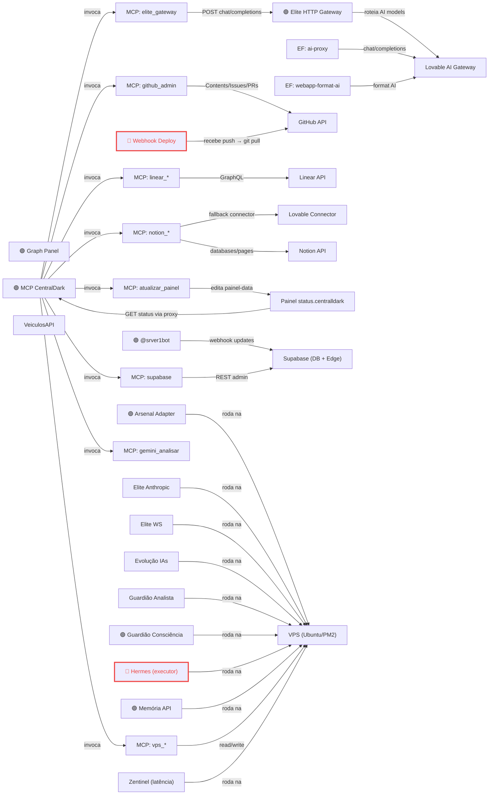

# 🕸️ Grafo Vivo — Visão em Tempo Real

> Nota **gerada automaticamente** a partir de `graph-data.json`.
> **Mermaid não é verdade:** é uma projeção visual derivada do estado observado. O desenho nunca sobrescreve o canônico.

```
┌────────────────────────────────────────────────────────┐
│  🕸️ GRAFO VIVO · atualizado 28/08/2026, 01:12:19    │
│   68 nós ·  88 arestas ·  7 🟢 online ·  2 🔴 off       │
│  21 processos PM2 ·   0 req ChatGPT/15min                │
└────────────────────────────────────────────────────────┘
```

## 🗺️ Topologia (quem chama quem — núcleo)



> Vermelho = processo caído. O diagrama é derivado; divergência visual vira achado para investigação, não autoridade.

## 🔎 Auditoria visual das relações

- 🟡 **Ciclo dirigido detectado:** `mcp-server`, `painel-status`, `tool-painel`. Ciclo é achado, não erro automático.

## 🩺 Saúde dos processos monitorados

| | Nó | Processo PM2 | Status |
|--|----|----|----|
| 🟢 | @srver1bot | `CentralDark-HubBot` | online |
| 🟢 | Arsenal Adapter | `CentralDark-ArsenalAdapter` | online |
| 🟢 | Elite HTTP Gateway | `CentralDark-EliteHTTP` | online |
| 🟢 | Graph Panel | `CentralDark-GraphPanel` | online |
| 🟢 | Guardião Consciência | `CentralDark-GuardiaoConsciencia` | online |
| 🔴 | Hermes (executor) | `CentralDark-Hermes` | stopped |
| 🟢 | MCP CentralDark | `CentralDark-MCP` | online |
| 🟢 | Memória API | `CentralDark-Memoria` | online |
| 🔴 | Webhook Deploy | `CentralDark-WebhookDeploy` | stopped |

## 🚨 Anomalias

- 🔴 **Hermes (executor)** (`CentralDark-Hermes`) — status `stopped`.
- 🔴 **Webhook Deploy** (`CentralDark-WebhookDeploy`) — status `stopped`.

## 🔀 Fluxos críticos

- Deploy: GitHub push → webhook-deploy → git pull VPS → tool-painel → painel-data.json → status.centralldark.com
- Health: fn-health-check → OPTIONS 10 EFs → fn-notify-telegram → Canal Telegram
- IA→MCP: Lovable/Claude → fn-ponte-mcp → mcp.centralldark.com → tools (VPS/GitHub/Supabase/Notion/Linear/Elite)
- PIX: Telegram → fn-telegram-webhook → fn-telegram-payment → fn-efi-generate → EFI Proxy → fn-efi-poll → Telegram
- Sentinela: sentinela → MCP /health /tools.json → gh issue se divergência

## 🧾 Receipt da projeção

```text
PROJECTION_SOURCE=/root/CentralDark/apps/modulos/status/graph-data.json
GRAPH_FINGERPRINT=15fe2639a967434d409c1dff08de26817a53f5f2de04b3350f62dbb9c29bfc2d
MERMAID_KIND=flowchart
MERMAID_STRUCTURAL_VALIDATION=PASS
VISUAL_IS_TRUTH=false
FOCUS_NODES=33
FOCUS_EDGES=31
DANGLING_EDGES=0
DUPLICATE_EDGES=0
SELF_LOOPS=0
CYCLE_NODES=3
ISOLATED_NODES=0
WRITE=UPDATED
```

---
🔗 [[00-MAPA]] · [[02-ARQUITETURA]] · [[MAPA-DOS-BOTS]] · painel: status.centralldark.com
