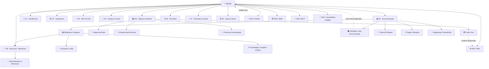

# 🧠 Mapa Obsidian — BRAIN CentralDark

> Mapa humano do conhecimento repo-native. Não representa runtime e não substitui Git/PR/HEAD medidos.

## 🌌 Grafo principal



## 🧭 Rotas rápidas

| Quero entender... | Comece em | Expanda para |
|---|---|---|
| visão geral da Casa | [[BRAIN]] | [[00-MAPA]], [[02-ARQUITETURA]] |
| topologia viva | [[GRAFO-VIVO]] | [[MOC-PM2]], [[MOC-MCP]] |
| bots e agentes | [[MAPA-DOS-BOTS]] | [[MOC-CentralDark-HubBot]], [[MOC-Skills]] |
| GitHub e promoção | [[MOC-GitHub]] | decisões e documentação relacionadas |
| ferramentas/MCP | [[MOC-MCP]] | [[02-ARQUITETURA]], [[MOC-Skills]] |
| memória e aprendizado | [[BRAIN]] | `07-APRENDIZADOS-MEMORIAS` |
| fontes, livros e referências | [[BIBLIOTECA]] | [[SEMANTIC-LINKER]], Knowledge Compiler, aprendizados/memórias |
| Obsidian físico da Casa | [[OBSIDIAN-CASA-SINCRONIZACAO]] | [[TUTORIAL-OBSIDIAN]] |
| documentação visual | [[DIAGRAMAS-CENTRALDARK]] | [[GRAFO-VIVO]] |

## 🧠 Regra de navegação para IA

```text
INTENCAO
→ BRAIN/MOC MAIS PROXIMO
→ MATCH TEXTUAL
→ WIKILINKS
→ BACKLINKS
→ 1-2 HOPS RELEVANTES
→ OWNER CANONICO
→ ESTADO VIVO QUANDO O CLAIM EXIGIR
→ CONTEXTO COMPRIMIDO
```

Para material de biblioteca:

```text
FONTE
→ [[BIBLIOTECA]]
→ FACETAS/TAGS
→ WIKILINKS/BACKLINKS
→ MOC RELEVANTE
→ COGNICAO | SKILL_CANDIDATE | CONVERSA
→ KNOWLEDGE COMPILER QUANDO HOUVER DELTA REUTILIZAVEL
```

Não expandir o grafo inteiro por padrão. A beleza aqui é navegação útil, não contexto infinito.

## 🔀 Dois grafos, duas responsabilidades

```text
GRAFO DE CONHECIMENTO
= docs/BRAIN + [[wikilinks]] + backlinks + MOCs
= navegação, memória, contexto e proveniência

GRAFO VIVO
= graph-data/runtime + serviços + dependências observadas
= topologia operacional e saúde
```

Eles podem se cruzar por notas/owners, mas não devem ser confundidos nem fundidos artificialmente.

## 💎 Hubs principais

- [[BRAIN]] — entrada humana e regras de verdade.
- [[00-MAPA]] — mapa geral reconciliado.
- [[GRAFO-VIVO]] — topologia operacional observada.
- [[BIBLIOTECA]] — fontes indexadas e rota cognitiva/semântica.
- [[MOC-GitHub]] — GitHub, PRs e promoção.
- [[MOC-MCP]] — ferramentas e integrações.
- [[MOC-Skills]] — capacidades reutilizáveis.
- [[MOC-PM2]] — processos/runtime.
- [[MOC-CentralDark-HubBot]] — HubBot e consumidores.
- [[OBSIDIAN-CASA-SINCRONIZACAO]] — topologia física/sync, separada do corpus repo-native.

---
🔗 [[BRAIN]] · [[00-MAPA]] · [[GRAFO-VIVO]] · [[BIBLIOTECA]] · [[INDEX]]
