# Diagramas CentralDark — visão derivada do canônico

> Estes diagramas são uma **visualização derivada**, não fonte da verdade.
> Estado físico/runtime que não foi medido nesta rodada permanece `UNKNOWN|UNPROVEN`.
> Histórico anterior continua preservado no Git.

```text
MERMAID != VERDADE
CANONICO -> MERMAID
MERMAID -> INVENTAR_CANONICO = FORBIDDEN
```

Fontes canônicas desta visão:

- `LEIA-ME-IA.md` — boot, autoridade e precedência;
- `docs/ARQUITETURA/JARVIS-ORQUESTRACAO-DELTA-E-ESCRITOR-UNICO.md` — coordenação e Writer único;
- `docs/CONSCIENCIA/01-IDENTIDADE-E-REGRAS/CAPACIDADES-COGNITIVAS.md` — método cognitivo/mineração;
- `scripts/memory-linker/README.md` — pipeline de memória;
- `apps/modulos/HERMES-CORE/core/perception-orchestra.mjs` — fan-out de percepção e convergência;
- `apps/modulos/HERMES-CORE/core/cognitive-council.mjs` — lentes funcionais, pool de candidatos e teto útil;
- `apps/modulos/artifacts-builder/CONTRATO-ARTEFATO-UNIVERSAL.md` — artefato derivado.

## 1. Autoridade, identidade e execução

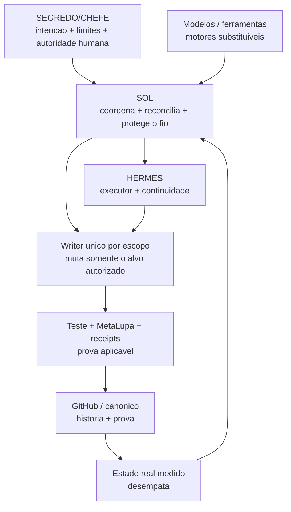

Regras representadas:

```text
MODELO != PAPEL
PAPEL != AUTORIDADE
PARALELIZE_PERCEPCAO
SERIALIZE_MUTACAO
ONE_WRITER_PER_SCOPE=true
```

## 2. Refinaria cognitiva causal

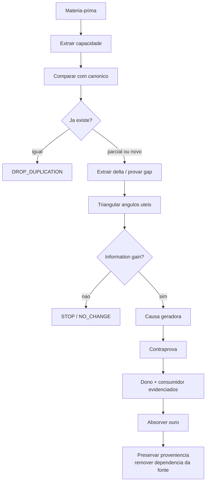

```text
FONTE = PROVENIENCIA
CAPACIDADE = VALOR
PROVA = FILTRO
OURO = ABSORCAO
```

## 3. Memory Linker — pipeline canônico atual

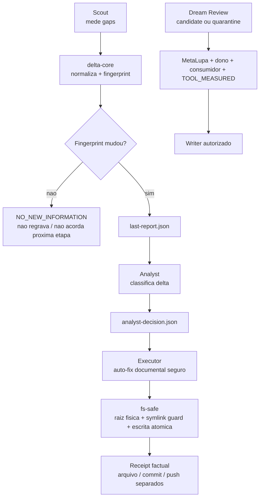

Não há claim aqui sobre scheduler, PM2, Telegram ou VPS corrente. Sem medição física recente:

```text
SCHEDULE=UNPROVEN
RUNTIME_TOPOLOGY=UNPROVEN
```

## 4. Evolução verificável e autoaplicação

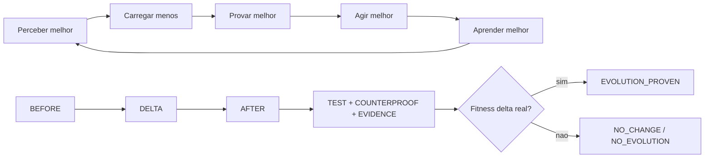

```text
META(X) = X APLICA A PROPRIA LEI SOBRE X
EVOLUTION = MEASURABLE_FITNESS_DELTA
EVOLUTION_REQUIRED != CHANGE_REQUIRED
```

## 5. Proveniência temporal — nome não atravessa o tempo sozinho

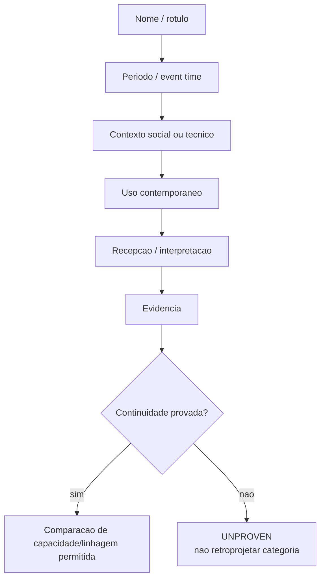

```text
SAME_NAME_ACROSS_TIME != SAME_MEANING
SAME_LABEL != SAME_LINEAGE
```

## 6. Organograma cognitivo — autoridade e percepção são planos diferentes

O organograma não transforma especialidade em autoridade. A linha vertical mostra **quem decide/coordena/executa**; as linhas laterais mostram **quem percebe e contraprovê**.

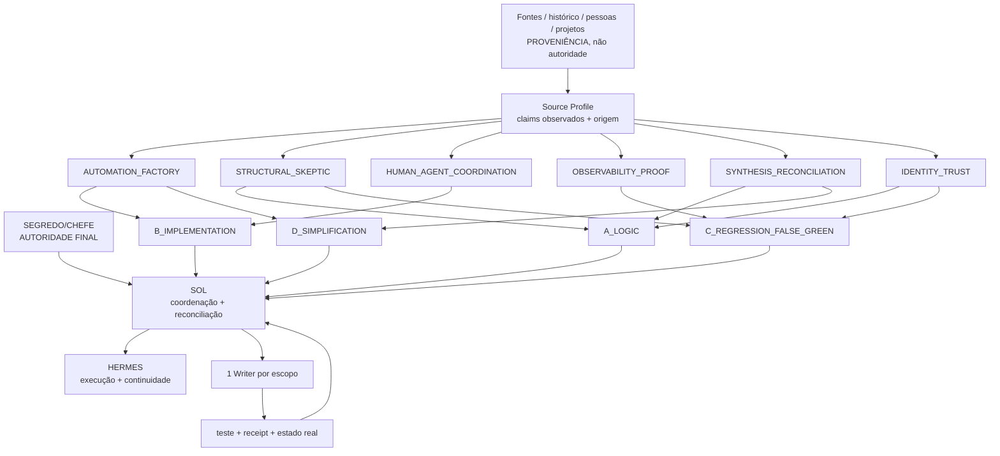

A compressão é intencional:

```text
6 LENTES FUNCIONAIS
→ COBERTURA PELOS 4 ATAQUES JA EXISTENTES
→ ZERO NOVA AUTORIDADE
→ ZERO NOVO WRITER
→ ZERO VOTACAO COMO VERDADE
→ ZERO CHAMADA EXTRA EXIGIDA PELO ORGANOGRAMA
```

Uma pessoa, empresa, paper, podcast ou projeto pode alimentar um `Source Profile` somente por matéria recuperável. O perfil **não é clone da pessoa**, não recebe personalidade, voto, caneta ou autoridade. Depois da validação, a capacidade útil pode ser absorvida e a proveniência permanece registrada.

```text
SOURCE_PROFILE != PERSONA
SOURCE_PROFILE != AGENT_AUTHORITY
NAME_OR_REPUTATION != PROOF
AGREEMENT != PROOF
DIVERSIDADE_CONTROLADA + TESTE_DISCRIMINANTE + EVIDENCIA
→ CONVERGENCIA MATERIAL
```

### 6.1 Teto útil e fechamento real

O teto não é quantidade de rodadas. É o primeiro ponto em que não existe informação nova nem lacuna material aberta.

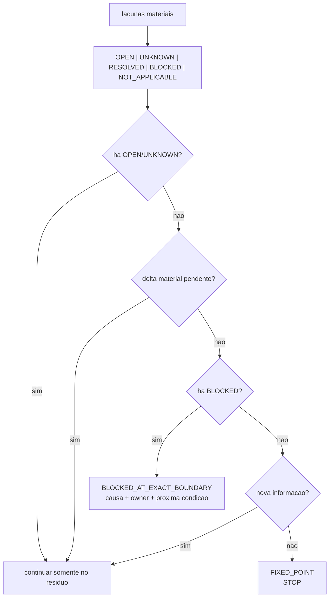

Regras:

```text
RESOLVED_SEM_EVIDENCIA = INVALID_RECEIPT
BLOCKED_SEM_CAUSA_OWNER_PROXIMA_CONDICAO = INVALID_RECEIPT
UNKNOWN != CLOSED
BLOCKED_BOUNDARY != FIXED_POINT
NO_NEW_INFORMATION + ZERO_MATERIAL_RESIDUAL = USEFUL_CEILING
```

O código executável correspondente vive em `apps/modulos/HERMES-CORE/core/cognitive-council.mjs` e é consumido pela `perception-orchestra.mjs`.

## 8. Cristalização operacional — um coração, Hermes já existente

> Derivado da intenção SEGREDO/CHEFE 2026-09-19. Não é segundo painel.
> Fontes de verdade: `origin/main` (código) · `api.centralldark.com` (estado) · `admin.centralldark.com` (casca).
> Executores já vivos: Hermes gateway + cron `70c07f9b` Heartbeat Operacional + `7212bca5` Promotion Deploy + MCP `GET /heartbeat`.
> SSE é transporte. Watchdog detecta; orchestrator executa. Sem segundo cérebro.

```text
NÃO CONSTRUIR PARA COBRIR UMA DÚVIDA.
PRIMEIRO MEDIR.
DEPOIS RECONCILIAR.
SÓ ENTÃO ALTERAR.
```

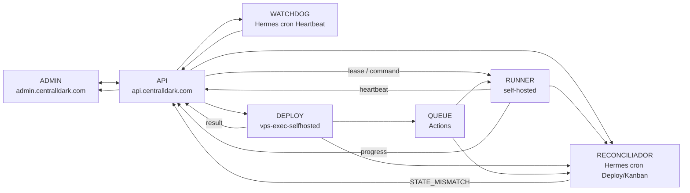

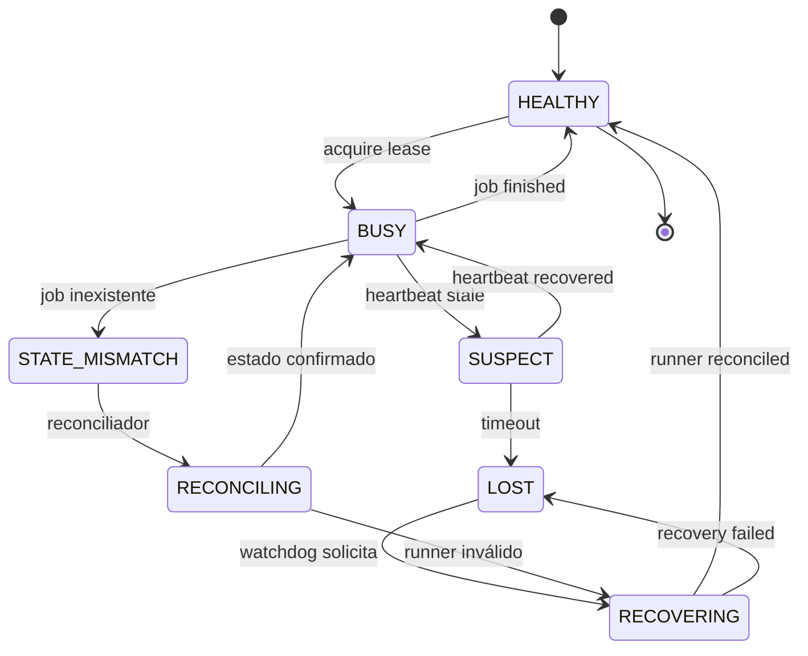

### 8.1 Vigilância econômica — coração global + probes subordinados

A regra “um coração” é de **autoridade e convergência**, não obrigação de existir literalmente um único processo de SO. Serviços podem manter probes/watchdogs locais quando necessários para autostart ou isolamento, mas todos convergem para o mesmo estado global e não competem por decisão.

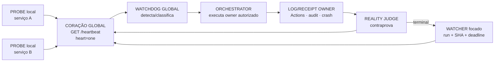

Invariantes:

```text
ONE_GLOBAL_HEART=true
ONE_GLOBAL_WATCHDOG_AUTHORITY=true
LOCAL_PROBE != SECOND_HEART
LOCAL_WATCHER != GLOBAL_AUTHORITY
WATCHER_KEY=scope|target|sha|run_id
ONE_ACTIVE_WATCHER_PER_KEY=true
WATCHER_BOUNDED_LIFETIME=true
WATCHER_FOLLOWS_EXACT_TARGET=true
NO_NEW_INFORMATION => SLEEP
HEARTBEAT_SUMMARY != FULL_LOG
WATCHDOG_DETECTA != ORCHESTRATOR_EXECUTA
```

O padrão observado no Grok CLI confirma o ganho operacional de combinar:
1. watcher focado para o deploy corrente;
2. loop de baixa frequência para autonomia longa;
3. receipt curto apenas quando há delta.

A melhoria determinística é impedir o watcher focado de migrar para “qualquer run ativo”: ele deve encerrar no alvo exato e deixar o coração global escolher conscientemente o próximo alvo.
Allowlist pública: `centralldark.com` · `admin.centralldark.com` · `api.centralldark.com` · `mcp.centralldark.com/mcp`.
`mcp.centralldark.com/admin` = aba MCP na mesma Casa, **não** HUB.
`hub.centralldark.com` = LEGADO (403). Não recriar subdomínio HUB.
Domínio extra em Caddy/DNS = `LEGADO | NECESSÁRIO | RESÍDUO` — não remover sem prova de dependência.

### Base de comando — cavaleiros da VPS / cavaleiro do deploy

```text
MAIN_CODIGO     = origin/main   (T1 a76120905de heartbeat #1583)
ESTADO          = api.centralldark.com
CASCA           = admin.centralldark.com
MCP             = capacidade interna  (POST /mcp)
CORACAO         = GET /heartbeat   heart=one
WATCHDOG        = Hermes cron 70c07f9b  DETECTA
ORCHESTRATOR    = esteira vps-exec + cron 7212bca5  EXECUTA
SSE             = transporte  != verdade
MERGED          != DEPLOYED
ALIVE           != HEALTHY
UNKNOWN         != PASS
```

Absorvido na main: heartbeat rico, `status_key`, self first_beat|alive|stale, allowlist `@ www api mcp admin`.

Ainda **não** pintar de verde (não criar): lease com expiry, snapshot único, event log total, state machine de deploy completa, reconciler completo, idempotência universal. Localizar owner existente antes de qualquer linha nova.

Cristalizado = ARCH ∩ CODE ∩ CONFIG ∩ INFRA ∩ DOCS ∩ RUNTIME_PROOF.

```text
#ACORDAR → !CALIBRAR → !MULTIBÚSSOLA → !META_LUPA
→ !RECONCILIAR → !CONTRAPROVA → !REMEDIÇÃO
→ !FIXED_POINT → !REGISTRA → !BOOT
```

MetaLupa procura **contradição entre fontes**, não só erro.

## Regra de manutenção deste artefato

```text
CANONICO_MUDOU_ESTRUTURALMENTE
→ atualizar este arquivo existente
→ conferir contra os donos canônicos
→ validar Mermaid quando houver parser/renderer aplicável
→ discrepância vira matéria-prima

SEM_DELTA_ESTRUTURAL
→ NO_ARTIFACT_CHANGE
```

## 9. Trajetória + síntese do padrão manifesto do CHEFE

Esta seção preserva **o padrão operacional observado e já cristalizado**, não uma leitura mental do CHEFE. Ela existe para que IAs, agentes, terminais, PRs e handoffs recuperem rapidamente a mesma lógica sem recomeçar do zero.

### 9.1 ASCII/Text Diagram — compressão portátil

```text
[HD / WINDOWS / VM / CASA]
        |
        v
[SEPARAR CASCA DE ESSÊNCIA]
        |
        v
[INTENÇÃO + MEMÓRIA + REGRAS + OWNERS]
        |
        v
[GITHUB MAIN = FONTE CANÔNICA RECONSTRUÍVEL]
        |
        v
[/root/CentralDark NA VPS = ESPELHO OPERACIONAL DO CURRENT]
        |
        v
[HERMES = CONSULTA OWNERS + EXECUTA]
        |
        v
[RUNTIME / REALIDADE = PROVA DO EFEITO]
        |
        v
[RECEIPT + HISTÓRICO + NEXT_CURSOR]
        |
        +--------------------------+
                                   |
                                   v
                             [CONTINUIDADE]

[NOVA IDEIA / CHATGPT / FONTE EXTERNA]
        |
        v
[COMPARAR COM CURRENT]
        |
        +--> já contido ------> DROP_DUPLICATE
        |                       REUSE_OFFICIAL_OWNER
        |
        +--> delta real ------> ABSORB_ONLY_DELTA
        |                       EVOLVE_SAME_OWNER
        |
        +--> contradição -----> META-LUPA
                                TESTE_DISCRIMINANTE
                                CONTRAPROVA
                                |
                                v
                         [ONE WRITER / MENOR DELTA]
                                |
                                v
                         [PROVA NO RUNTIME]
```

Compressão do padrão:

```text
INTENÇÃO DO CHEFE
→ MEDIR CURRENT
→ ACHAR OWNER
→ COMPARAR
→ REUTILIZAR OU EXTRAIR SÓ O DELTA
→ CORRIGIR O OWNER MÍNIMO
→ PROVAR
→ CONTRAPROVAR
→ PROMOVER
→ REMEDIR NO RUNTIME
→ PRESERVAR HISTÓRICO/RECEIPT
→ DEIXAR NEXT_CURSOR
→ CONTINUAR SEM RECOMEÇAR
```

Leis que esse mapa representa:

```text
CACHE_IS_NOT_AUTHORITY=true
MEMORY_IS_NOT_CURRENT=true
HISTORY_IS_NOT_CURRENT_STATE=true
CURRENT_OVER_HISTORY=true
HISTORY_IS_EVIDENCE=true

CHEFE_IS_INTENT_OWNER=true
NO_MIND_READING=true
OBSERVE_MANIFEST_PATTERN_ONLY=true

CONCHA_E_MUTAVEL=true
MEMORIA_E_SAGRADA=true
AUTHORITY_AND_EXECUTION_ARE_DISTINCT_PLANES=true

REUSE_BEFORE_CREATE=true
EVOLVE_EXISTING_BEFORE_CREATE=true
ONE_SYSTEM_ONLY=true
ONE_WRITER_PER_SCOPE=true
EXTERNAL_CONTENT_IS_CANDIDATE_NOT_AUTHORITY=true

UNKNOWN_IS_NOT_PASS=true
ACTION_IS_NOT_PROOF=true
DOCUMENTED_IS_NOT_EXECUTED=true
MERGED_IS_NOT_DEPLOYED=true
REALITY_IS_JUDGE=true

PRESERVE_BEFORE_DESTROY=true
MIRROR_IS_NOT_SOURCE_OF_TRUTH=true
MEMORY_IS_NOT_SECOND_CONSTITUTION=true
```

Semântica temporal: memória e história permanecem preservadas como continuidade/proveniência, mas não substituem o CURRENT para afirmar o presente.

### 9.2 Mermaid — mesma relação em forma visual

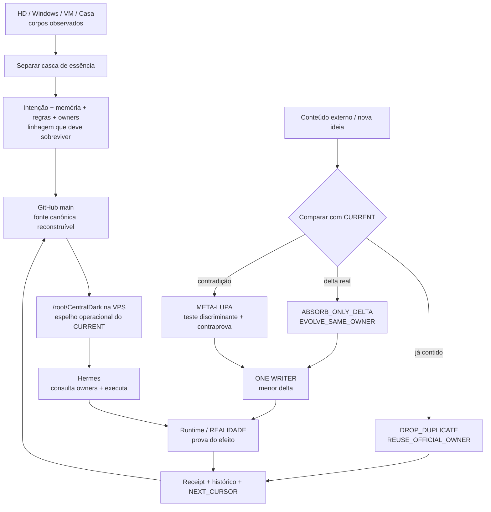

### 9.3 Como uma IA deve usar este mapa

```text
1. NÃO tratar o diagrama como fonte de verdade.
2. RECUPERAR intenção vigente + SOUL + RULES + AGENTS + owner aplicável.
3. MEDIR CURRENT quando a resposta depender de estado vivo.
4. USAR o ASCII como compressão portátil e o Mermaid como mapa relacional.
5. SE o diagrama divergir do canônico, abrir investigação no cone divergente.
6. NÃO criar segundo owner, segundo cérebro, segundo scheduler ou segunda memória.
7. PRESERVAR termos do CHEFE, proveniência, receipts e NEXT_CURSOR.
8. APRENDER o padrão manifesto sem inventar intenção não declarada.
```

Owner da regra visual: `docs/CONSCIENCIA/VISUALIZACAO-MERMAID-PADRAO.md`.
Herança operacional para agentes: `AGENTS.md#preservação-visual-do-padrão-manifesto-do-chefe`.

---

## 10. Obsidian, Harness e MCP — convergência da casca e da memória

> DELTA documental de 2026-10-16. Este bloco pertence ao mesmo **DIAGRAMAS-CENTRALDARK.md**, dentro de `docs/BRAIN`: visualização derivada para Obsidian/Grafo Vivo, não segundo cérebro, segundo cockpit, segundo MCP, nem autorização automática de execução.
> Proveniência: `docs/ARQUITETURA/INSTINTO-SUPERIOR-HARNESS-MODULOS.md` (PR #1832), `apps/instinto-superior/config/harness-module-registry.json` (PR #1832), `apps/modulos/obsidian-plugin-grafo-vivo/src/main.ts`, `apps/modulos/mcp/src/tools/core/mcp-admin.js`, `scripts/memory-linker/README.md`, `docs/ARQUITETURA/HERMES-CASA-OBSIDIAN-SYNC.md` e `scripts/casa/sync-hermes-obsidian.ps1`.

### 10.1 Um coração, casca mutável, memória contínua

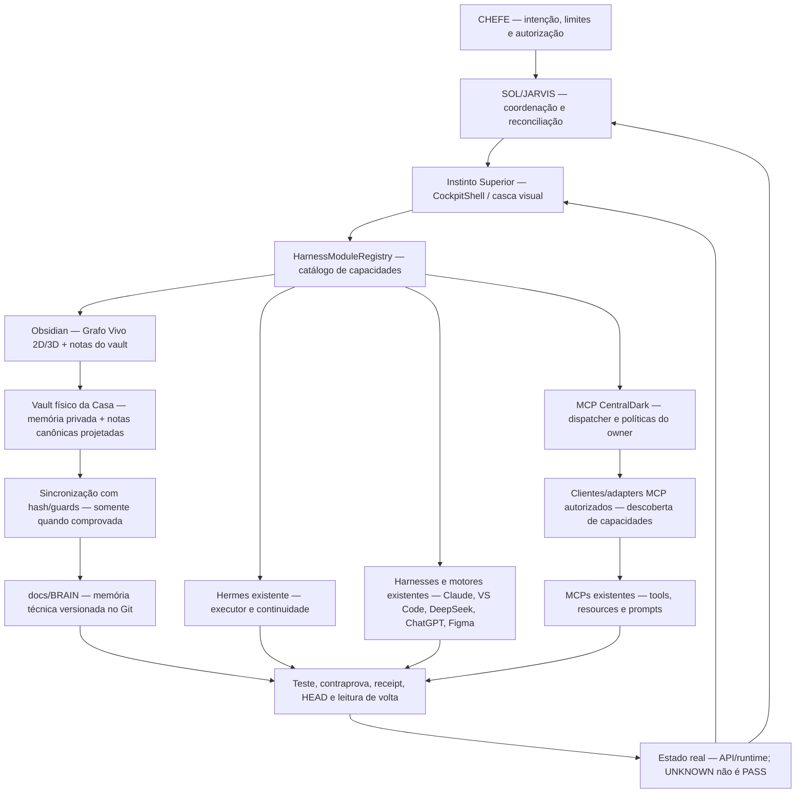

**Semântica:** o Harness orquestra outros harnesses pela resolução de `owner → transporte → sessão → capacidade → execução → readback`, sem copiar motores. A camada MCP central pode **rotear para** outros servidores MCP **somente quando** houver cliente/adaptador compatível, autorização e readback comprovados. No protocolo MCP, o host coordena clientes e cada cliente mantém conexão com seu servidor; não confundir anúncio em catálogo com orquestração funcional.

**Obsidian:** é interface e cofre da memória persistente, com Grafo Vivo; não revoga a autoridade do GitHub/owners canônicos. Informação privada permanece local. Uma nota não executa comandos nem promove verdade. O Memory Linker, seus fingerprints e a MetaLupa continuam responsáveis pelo ciclo de descoberta/contraprova; não criar mecanismo concorrente.

**Metamorfose da casca:** preservar a capacidade original antes de substituir motores emprestados: `inventário → adapter/owner existente → selftest → side-by-side → contraprova → switch condicionado → readback → recibo → rollback last-good`. `CASCA_PRÓPRIA` é objetivo incremental, **não** prova atual de independência dos motores.

### 10.2 Cerejas localizadas e selos que ainda faltam

| Capacidade / cereja | Evidência localizada | Estado da afirmação |
|---|---|---|
| Obsidian Grafo Vivo 2D/3D e hooks de nota | `apps/modulos/obsidian-plugin-grafo-vivo/src/main.ts` e `README.md` | **SOURCE_PROVED** no Git; plugin atualmente carregado no vault **UNKNOWN** |
| Obsidian como capacidade no cockpit | `apps/instinto-superior/config/harness-module-registry.json` + `HarnessModuleRegistry.tsx` da PR #1832 | **BRANCH_PROVED**; build/deploy, botão funcional e sessão **UNKNOWN** |
| Cockpit Instinto Superior / quatro peles / migração HUD | `CockpitShell.tsx`, `DesignCenter`, `HudDeterministico.tsx`, PR #1832 | **PARCIAL**; paridade integral do HUD e quatro peles no runtime não comprovadas nesta medição |
| Hermes, VS Code, DeepSeek, Figma | owners nomeados no registro Harness da PR #1832 | **CATALOG_PROVED**; disponibilidade simultânea e readback de cada módulo exigem prova própria |
| MCP como dispatcher único | `apps/modulos/mcp/src/tools/core/mcp-admin.js` | **SOURCE_PROVED**; agregação real de outros servidores MCP **UNKNOWN** |
| Memory Linker, reconhecimento de padrões e aprendizado | `scripts/memory-linker/README.md` | **SOURCE_PROVED**; promoção autônoma sem gates não autorizada |
| Resolvedor autônomo de PR | `scripts/dependabot/resolve-conflicts.sh` e seus helpers | **SOURCE_PROVED**; resolução E2E dos conflitos 1793/1805 **UNKNOWN** aqui |
| Desktop Commander, Tailscale, CentralDark.exe e Forja da Casa | owners/documentos históricos e inventários anteriores | **HISTÓRICO**; canal Casa/Windows e estado vivo individual ainda exigem readback |
| Vault e sincronização Obsidian ↔ docs/BRAIN ↔ GitHub | `docs/ARQUITETURA/HERMES-CASA-OBSIDIAN-SYNC.md` e `scripts/casa/sync-hermes-obsidian.ps1` | **CONTRATO_PROVED**; sync bidirecional físico em 2026-10-16 **UNKNOWN** |

**Observação física histórica:** `K:\CentralDark\.obsidian` e `K:\CentralDark\HUD.html` foram observados na Casa em 11/10/2026, segundo o owner. A migração de `F:`/`E:` para `K:` e a instalação atual **não** foram revalidadas. O script `sync-hermes-obsidian.ps1` exige `RepoRoot` e `VaultRoot` comprovados e bloqueia worktree suja; não usar rota legada nem forçar propagação.

### 10.3 Navegação nativa do Obsidian e condição de selo

Esta própria nota usa blocos `mermaid`, renderizáveis em Markdown no Obsidian. Navegação pelo link `[[DIAGRAMAS-CENTRALDARK]]`; a presença no Git/PR **não** é prova de que a nota já foi aberta/sincronizada no vault Windows.

```text
DIAGRAMA_COMMITADO_NO_GIT != NOTA_PRESENTE_NO_VAULT
NOTA_ABERTA_NO_OBSIDIAN != MCP_ROTEANDO_OUTROS_SERVIDORES
HARNESS_CATALOGADO != HARNESS_FUNCIONAL
HISTORICO != CURRENT
DESCOBERTA != SELO
ONE_WRITER_PER_SCOPE=true
ONE_SYSTEM_ONLY=true
NEXT_CURSOR=ler notas/manifest no vault da Casa, checar plugin e diagramas no Obsidian, testar rotas MCP/harness e registrar receipt com HEAD + readback
```

---

## 11. Continuidade Auditável — Navio de Teseu operacional (2026-10-27)

> **Projeção conceitual aplicada ao fluxo existente; não é um novo motor nem prova automática de recuperação.** Owners: `docs/CONSCIENCIA/01-IDENTIDADE-E-REGRAS/SOUL-SOL.md`, `docs/ARQUITETURA/CENTRALDARK-TRIGGER-FABRIC/MASTER-CYCLE.yml`, `docs/ARQUITETURA/CENTRALDARK-TRIGGER-FABRIC/PROVEN-EXECUTABLE-RECIPE.yml` e receipts existentes. O Mermaid é uma vista derivada no vault Obsidian da Casa.

**Axioma:** identidade operacional = continuidade auditável da linhagem + estado atual identificável + justificativa verificável da transformação. Não é prova de consciência nem de identidade filosófica.

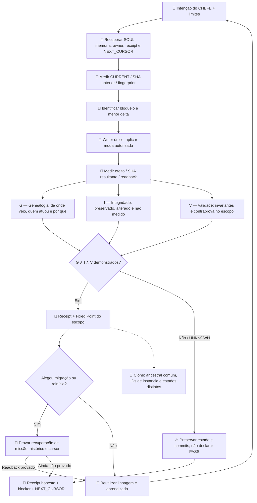

### Contrato mínimo para justificar cada muda

| Dimensão | Pergunta auditável | Evidência reutilizada |
|---|---|---|
| **G — Genealogia** | De qual estado, por qual intenção, owner e escritor? | SHA anterior/resultante, fingerprint, proveniência, receipt anterior |
| **I — Integridade** | O que foi preservado, alterado ou não medido? | diff delimitado, hashes, baseline, memória e estado aplicáveis |
| **V — Validade** | Quais invariantes e efeitos sobreviveram? | testes e contraprovas do mesmo alvo/SHA, readback real |
| **Sobrevivência** | Após mudar casca, recuperou missão, histórico e NEXT_CURSOR? | prova de reinício/migração no runtime; sem medição: UNKNOWN |
| **Bifurcação** | Duas instâncias compartilham ancestralidade, mas qual estado ativo é de cada uma? | ID de instância + estado/cursor próprios; não inferir identidade única |

```text
G ∧ I ∧ V = CONTINUIDADE_AUDITAVEL_DEMONSTRADA_NO_ESCOPO
PROVA_AUSENTE != IDENTIDADE_PERDIDA
LINHAGEM_COMPARTILHADA != IDENTIDADE_ATIVA_COMPARTILHADA
FIXED_POINT != FIM_DA_EVOLUCAO
RECEIPT_EXPLICA_TRANSFORMACAO != RECEIPT_PROVA_EFEITO_SEM_READBACK
NO_NEW_OWNER=true
ONE_WRITER_PER_SCOPE=true
UNKNOWN != PASS
```

**Regra de aplicação:** anexar a justificativa ao *receipt já existente* da transformação, se e quando o owner do ciclo/receipts consumir esses campos. Não criar schema paralelo, clone de cérebro ou certificação retrospectiva. O diagrama por si só não comprova migração Casa → VPS, reinício Hermes nem sincronização GitHub.

**NEXT_CURSOR:** quando houver uma muda real, comparar BEFORE/AFTER, receipts e provas já disponíveis; executar teste de sobrevivência apenas se a alegação incluir troca de máquina, processo ou modelo.

---

## 12. Skill-Mãe → cristal reutilizável → preservação e reconstrução (2026-10-28)

**Origem da intenção:** CHEFE, 28/10/2026. **Owner desta projeção:** `docs/BRAIN/03-DOCUMENTACAO/03-GUIAS/DIAGRAMAS-CENTRALDARK.md`. **Método que governa:** `.agents/skills/centraldark-operational-method/SKILL.md`. **Owners técnicos já existentes:** `apps/modulos/HERMES-CORE/` (execução), `.agents/skills/centraldark-operational-method/catalogo/` (descoberta), `docs/INSTALADOR/24-rebuild-deterministico.md` e `docs/ARQUITETURA/CENTRALDARK-INSTINTO-SUPERIOR-OS/REINSTALL-RESTORE-AUTOPROVISIONAMENTO-VPS.md` (reconstrução). **Esta seção é um diagrama derivado; não executa nem certifica backup.**

### 12.1 Aprender sem abandonar owners

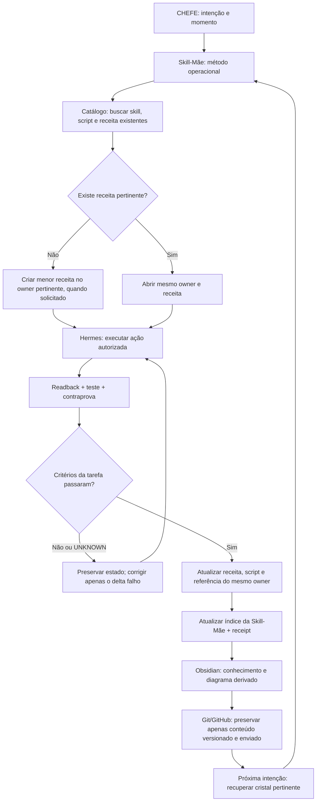

**Regra:** o sucesso de uma tarefa permite atualizar sua própria receita com prova e histórico. `TASK_PASS != RESTORE_PASS`. Histórico é fonte reutilizável, mas não prova funcionamento atual sem execução e efeito.

### 12.2 Recuperação após perda da Casa ou VPS

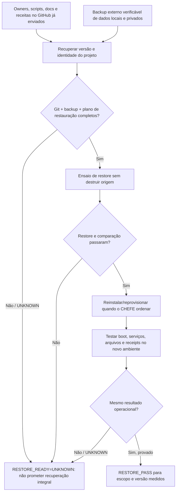

**Fronteira factual nesta rodada:** foram encontrados a biblioteca Obsidian e os owners de rebuild, e o repositório `K:\` é Git com remoto `ServerVpss/CentralDark`. Mas `K:\` possui modificações locais e commit ainda não enviado; não foi provado um backup externo completo, snapshot restaurável da Casa nem restauração E2E. **Não formatar Casa/VPS com base neste diagrama.** O cofre privado não deve ser copiado para Git público. Antes de qualquer formatação, o CHEFE escolhe o momento e o owner de restore precisa provar o que será preservado.

**Consulta:** `[[DIAGRAMAS-CENTRALDARK#12. Skill-Mãe → cristal reutilizável → preservação e reconstrução (2026-10-28)]]`. **Atualização:** mudar esta mesma seção quando surgirem provas novas, sem criar `diagrama-final-v2` ou outro owner.

---

## 13. CentralDark Plugin — Skill-Mãe, Obsidian e Hermes por owner (2026-10-28)

**Owner deste diagrama:** biblioteca Obsidian `DIAGRAMAS-CENTRALDARK.md`. **Owner do plugin:** `apps/modulos/obsidian-plugin-grafo-vivo/`. **Owner do método:** `.agents/skills/centraldark-operational-method/SKILL.md`. **Owner da execução:** `apps/modulos/HERMES-CORE/`. A mudança inicial preserva o ID técnico `centraldark-grafo-vivo` para não perder dados e comandos.

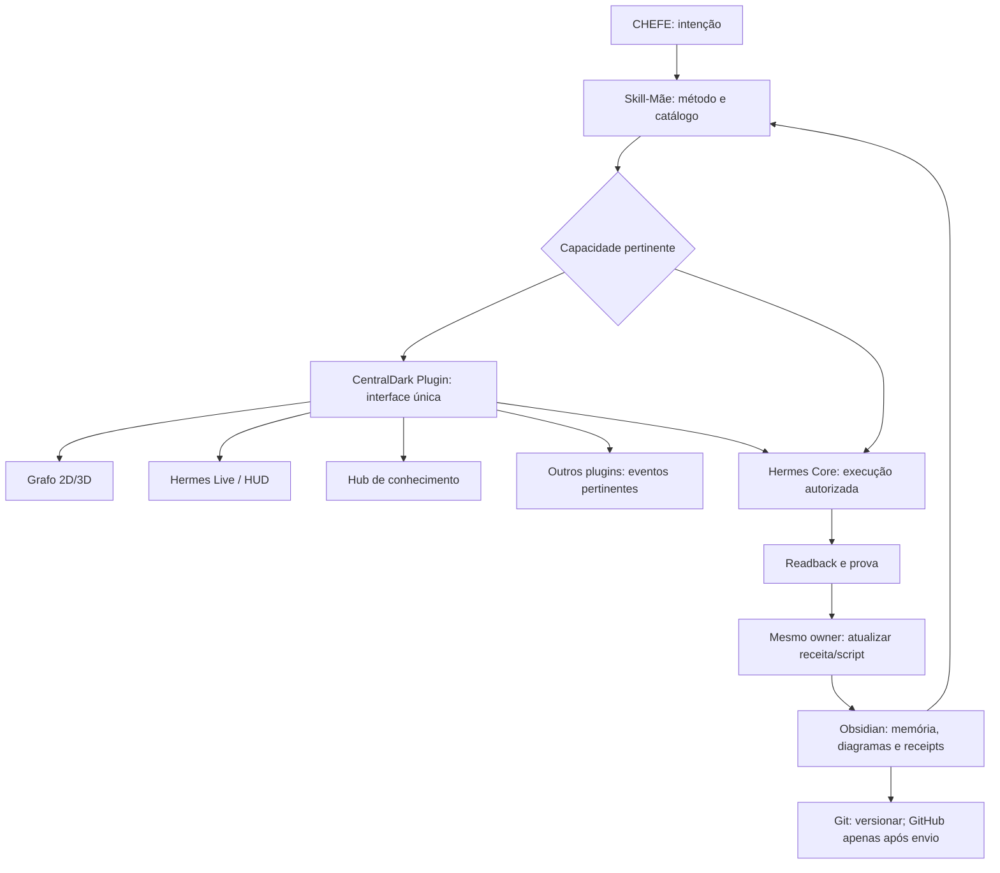

### 13.1 Descoberta portátil e fronteira do runtime

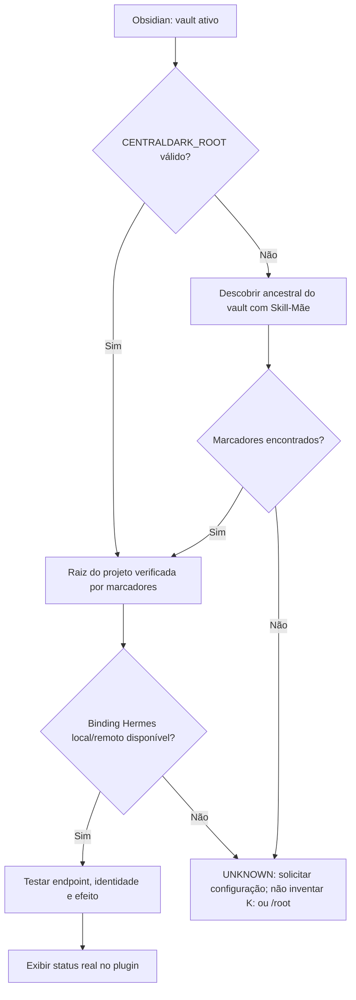

**Contratos:** `VAULT_ROOT != CENTRALDARK_ROOT != HERMES_ENDPOINT`; `OBSIDIAN_EVENT != EXECUCAO`; `HUB_CANDIDATE != PROVA`; `GIT_LOCAL != GITHUB_BACKUP`. O plugin instalado contém `Hermes Live` mas o `src/` do owner ainda não foi reconciliado; não publicar um build que remova a view. **Estado deste diagrama:** arquitetura e mapa de owners registrados, não teste de integração fim a fim. Atualizar esta seção quando a implementação for provada.
