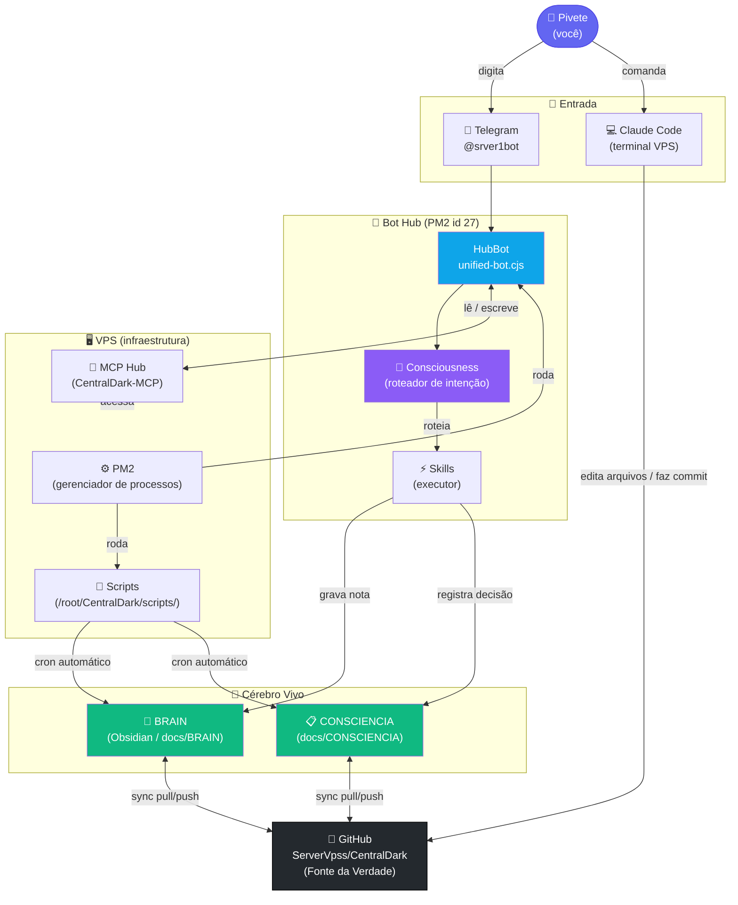
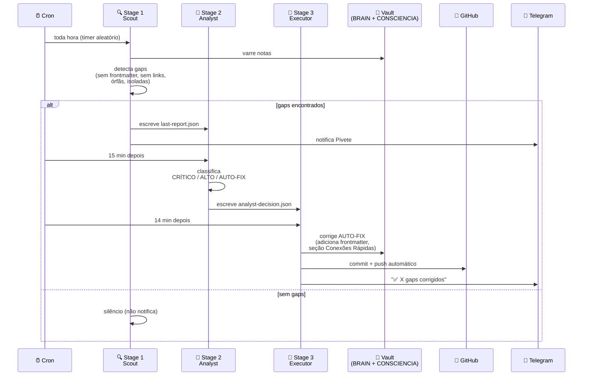
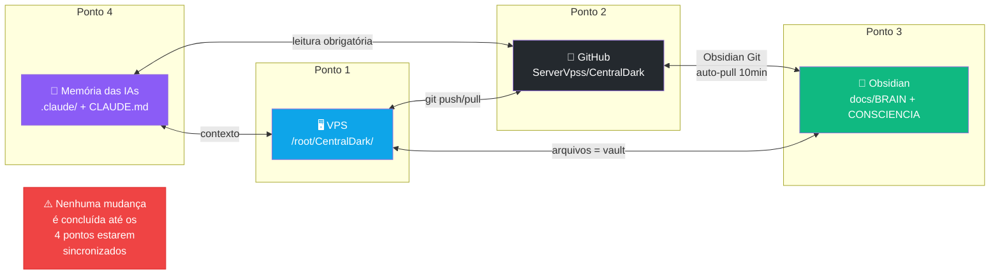
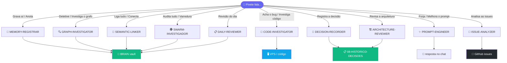

# 🗺️ Diagramas do Sistema CentralDark

> Abre no Obsidian e os diagramas renderizam automaticamente.
> Requer plugin: **Mermaid** (já vem nativo no Obsidian).

---

## 1. Fluxo Geral — Como os dados andam

---

## 2. Pipeline de Memória — Os 3 Agentes Autônomos

---

## 3. Sincronia 4-Point — A Lei do Sistema

---

## 4. Arsenal de Skills — Mapa de Chamada

---

## Conexões Rápidas

- [[MAPA-DO-CEREBRO]] — visão geral textual do sistema
- [[00-AGENTS-INDEX]] — arsenal de skills
- [[00-LEIA-PRIMEIRO]] — regras para IAs
- [[BRAIN]] — raiz do vault
