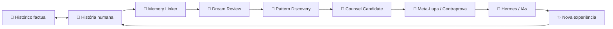

# 👑🪬 História do CHEFE

> Setor do Obsidian/BRAIN para navegar a evolução humana + operacional sem transformar narrativa em prova.

## Regra

```text
HISTÓRICO = fatos / commits / proveniência
HISTÓRIA  = contexto humano / significado / lição
PROVA     = medição atual
REALIDADE = juiz
```

## Linha de evolução

- [[2026-09-16-EVOLUCAO-CHEFE-NIVEL-40]] — **Nível 40 · Arquiteto de Continuidade**
- [[2026-09-16-EVOLUCAO-CHEFE-NIVEL-45]] — **Nível 45 · Guardião do Delta Contínuo**
- [[PONTOS-E-NIVEIS-CHEFE]] — placar simbólico, milestones e regras de XP

## Grafo de aprendizado



## Eixos interligados

```text
HISTÓRIA ↔ EXPERIÊNCIA
EXPERIÊNCIA ↔ MEMÓRIA
MEMÓRIA ↔ DREAM REVIEW
DREAM REVIEW ↔ PADRÃO
PADRÃO ↔ OWNER
OWNER ↔ TESTE
TESTE ↔ CONTRAPROVA
CONTRAPROVA ↔ CONSELHO CANDIDATO
CONSELHO ↔ NOVA EXPERIÊNCIA
```

## Para o Hermes

Ao recuperar esta nota:

1. carregar somente a camada relevante da história;
2. seguir os wikilinks para a fonte narrativa e factual;
3. não usar level/XP como autoridade;
4. usar Dream Review somente como minerador de candidatos;
5. revalidar claims temporais no estado vivo;
6. devolver conselho com proveniência quando houver correspondência real.

```text
STORY_CONTEXT != RUNTIME_STATE
XP != AUTHORITY
COUNSEL != COMMAND
DREAM_REVIEW != WRITER
UNKNOWN != PASS
```

## Ponte com o Vault da Casa

Pelo contrato `docs/ARQUITETURA/HERMES-CASA-OBSIDIAN-SYNC.md`, `docs/BRAIN` sincroniza para:

```text
CASA-VAULT/00-CANONICO
```

Logo, esta nota é a fonte repo-native do setor visual de História no Obsidian. A sincronização física só é declarada ativa após merge + sync + prova do runtime.

## Conexões

- [[PONTOS-E-NIVEIS-CHEFE]]
- [[MAPA-OBSIDIAN-BRAIN]]
- [[BRAIN]]
- [[LEMBRANCAS]]
- [[APRENDIZADOS]]
- [[2026-09-16-EVOLUCAO-CHEFE-NIVEL-40]]
- [[2026-09-16-EVOLUCAO-CHEFE-NIVEL-45]]
