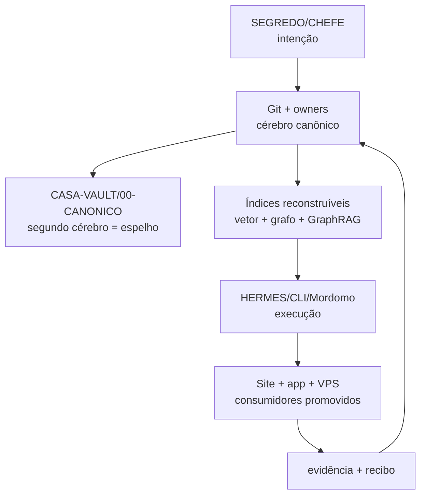

# Cartazes canônicos da CentralDark

Aqui os quatro cartazes deixam de ser imagem solta e passam a ser **testemunhas visuais do mesmo sistema**. A palavra final continua nos owners textuais e executáveis; cartaz explica, manifesto liga, teste confere.

## Uma Casa, um cérebro, um espelho



Oxe, o pulo do gato é este: **segundo cérebro não é segundo dono**. Obsidian, vetor, grafo e GraphRAG são espelhos ou índices reconstruíveis. Se divergirem, vence o owner canônico mais novo e provado.

O contrato fixa onde o espelho deve morar, mas o CI Linux não enxerga o disco `E:`. Por isso o gate declara `SECOND_BRAIN_RUNTIME=NOT_PROVEN`; somente um recibo executado no Windows pode mudar esse estado.

## Os quatro cartazes

| ID | Cartaz | Função semântica | Dono textual |
| --- | --- | --- | --- |
| CD-POSTER-01-PAPAGAIO | [Casa sem papagaio](./01-casa-nao-acredita-em-papagaio.webp) | firewall epistemológico | [Contrato de reconciliação](../../../CONSCIENCIA/CONTRATO-RECONCILIACAO-ANTES-DE-CRIAR.json) |
| CD-POSTER-02-CAJADO | [Cajado da correção](./02-cajado-da-correcao.webp) | pipeline canônico de artefato | [Design system](../../../CONSCIENCIA/ARQUITETURA/DESIGN-SISTEMA.md) |
| CD-POSTER-03-TRAJETORIA | [Trajetória vivida](./03-trajetoria-vivida.webp) | ciclo de aprendizado | [AGENTS](../../../../AGENTS.md) |
| CD-POSTER-04-ARQUITETURA | [Arquitetura operacional](./04-arquitetura-operacional.webp) | topologia da Casa | [Mapa do cérebro](../../../CONSCIENCIA/MAPA-DO-CEREBRO.md) |

A imagem [semantic-graph-observed-20260824.png](./semantic-graph-observed-20260824.png) é fotografia de uma projeção observada. Ela pode ajudar auditoria visual; não manda na Casa.

As cópias no Git usam WebP Q92 para não transformar o repositório em caminhão de bytes. O manifesto preserva dois hashes: `source_sha256` do PNG entregue pelo CHEFE e `sha256` da projeção WebP guardada no Git. Assim a origem não some e o consumo continua leve.

## Rota única de reutilização

1. O [manifesto](./manifest.json) fixa identidade, hash, dimensão, função, claims e relações tipadas.
2. O [método visual](../../../../.agents/skills/visual-design-method/SKILL.md) reutiliza esses cartazes como referência, sem copiar texto alucinado da imagem.
3. O [design system](../../../CONSCIENCIA/ARQUITETURA/DESIGN-SISTEMA.md) governa família visual e temas; cartaz não cria paleta paralela.
4. O [sync CASA–Obsidian](../../../ARQUITETURA/HERMES-CASA-OBSIDIAN-SYNC.md) espelha `docs/BRAIN` para `CASA-VAULT/00-CANONICO`.
5. Vector memory, knowledge compiler, Grafo Vivo, GraphRAG e painel consomem ou projetam a mesma verdade; não viram autores.
6. Site, `.exe` e VPS só recebem o que foi promovido e provado. Arquivo no Git não prova runtime físico.

## Semáforo que presta

| Estado público | Cor/sinal | Significado |
| --- | --- | --- |
| PROVED | verde | evidência reproduzível passou |
| FAILED / BLOCKED | vermelho | falhou ou está bloqueado |
| NOT_PROVEN | preto | ainda não existe prova suficiente |
| QUARANTINED | cadeado | material isolado, sem autoridade |
| FORGE_IN_PROGRESS | fogo | trabalho em curso, ainda sem PASS |

Amarelo pode existir **dentro do motor** como estado técnico intermediário. Na porta da Casa, amarelo nunca vira PASS.

## Regra do cajado

`imagem → manifesto/Markdown → diagrama editável → pacote gerado`

O ZIP é entrega derivada, não fonte de verdade. O repositório preserva os componentes editáveis; o pacote é regenerado e recebe recibo externo.

## Contraprova

Execute:

```bash
node .agents/skills/visual-design-method/scripts/validate-canonical-posters.mjs
node --test tests/canonical-posters.test.mjs tests/bolt-theme-contract.test.mjs
```

Se um byte do cartaz mudar, um elo sumir, um owner deixar de existir ou surgir um quinto cartaz canônico sem contrato, o portão fecha.
