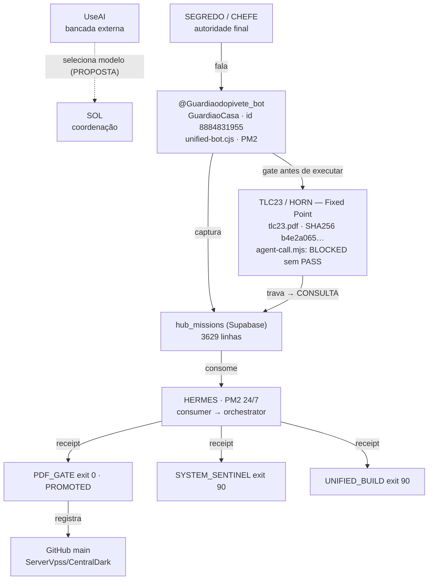

# 🧿 CENTRALDARK — MAPA ANCORADO · 2026-09-24

> **Documento âncora.** Cada link abaixo está escrito dentro do diagrama.
> Regra da Casa: **UNKNOWN != PASS · ACTION != PROOF · DOCUMENTED != EXECUTED**

## 1. Diagrama (Mermaid, nós clicáveis)

## 2. Âncoras

| Artefato | Onde |
|---|---|
| Documento de hipóteses | `docs/HIPOTESES-CONSOLIDADAS-20260924.md` |
| Diagrama vetorial (SVG) | commit `45387c34` |
| Relatório PDF (4 páginas) | pasta Drive `CentralDark` |
| Commit âncora | [`45387c34`](https://github.com/ServerVpss/CentralDark/commit/45387c34b5d4f7777a07c4fe1c6eb35eb629ced3) |

## 3. Estado provado

| Item | Evidência |
|---|---|
| Bot da porta | `MEASURED GuardiaoCasa = @Guardiaodopivete_bot` (id 8884831955) |
| Perfil aplicado | `APPLIED short_description=ok` · `description=ok` · `RECEIPT ok` |
| Binding corrigido | commit `b873018` |
| Gate TLC23/Horn | `PDF_GATE` exit 0 · `PROBE_PASS` · promovido |
| Identidade do PDF | SHA256 `b4e2a0655b7e0c85ca329c33971b377299dde6358779270c573f014f3aa606d1` · 206674 bytes |
| Contraprova | 5 passed; 0 failed · alteração → `BYTE_IDENTITY_MISMATCH` |
| Canal UseAI→Telegram | `message_id 11489`, `11490` |

## 4. Pendências

| Setor | exit | promovido |
|---|---|---|
| `PDF_GATE` | 0 | **true** |
| `REMOTE_BRIDGE` | 0 | false |
| `SCREENPIPE_CRYSTAL` | 0 | false |
| `SYSTEM_SENTINEL` | **90** | false |
| `UNIFIED_BUILD` | **90** | false |

## 5. Hipóteses

| # | Hipótese | Estado |
|---|---|---|
| H1 | Botão `Criar missão` não ligado ao `hub-mission-consumer` | ABERTA |
| H2 | `exit 90` em SENTINEL/BUILD tem causa comum | ABERTA |
| H3 | Ponte UseAI como consulta em `FAIL/UNKNOWN/BLOCKED` | PROPOSTA |
| H4 | UseAI sem endpoint público — CHEFE é o transporte | MEDIDA |
| H5 | Binding do perfil apontava pro bot errado | **FECHADA** (`b873018`) |
| H6 | Token/api_hash circulou em texto claro | ABERTA — rotação a critério do CHEFE |

## 6. Sem segredo

Nenhum valor de token, `api_id`/`api_hash` ou credencial de VPS consta aqui.
Regra: `docs/RELATORIOS/RECONCILIACAO-CASA/00-CADERNETA-ROTAS.md` item 3.

MCP: https://mcp.centralldark.com · Painel: https://status.centralldark.com
