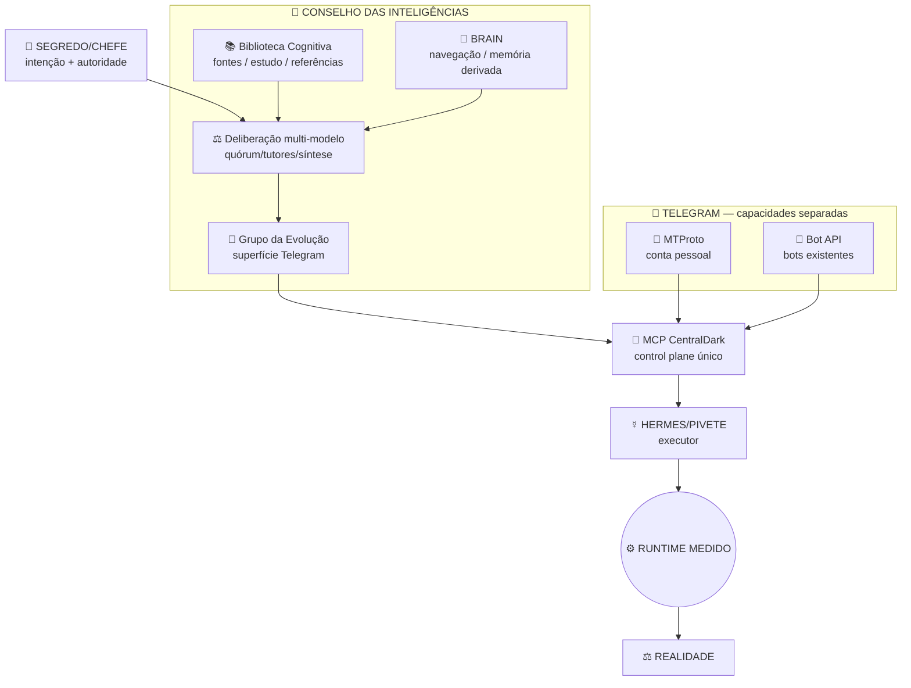

# 👑🪬 Conselho das Inteligências — CentralDark

Cristalização autorizada pelo SEGREDO/CHEFE para aproximar semanticamente capacidades já existentes sem criar arquitetura paralela.

## Regra raiz

```text
ONE_SYSTEM_ONLY=true
REUSE_BEFORE_CREATE=true
PROXIMIDADE_SEMANTICA=true
MOVER_OWNERS=false
NOVO_CEREBRO=false
NOVO_ROUTER=false
NOVO_BOT_POR_PADRAO=false
MCP_CENTRALDARK_IS_CONTROL_PLANE=true
HERMES_IS_EXECUTOR=true
RUNTIME_IS_OPERATIONAL_JUDGE=true
GITHUB_MAIN_PLUS_OWNERS_IS_STRUCTURAL_TRUTH=true
```

## Anatomia



## Owners reais reutilizados

| Capacidade | Owner existente |
|---|---|
| Debate/conversa multi-IA | `apps/bot-telegram/evolucao-ias.cjs` |
| Postagem no Grupo da Evolução | `apps/modulos/arsenal-openai-adapter/telegram-grupo.mjs` |
| Conta pessoal Telegram / MTProto | `scripts/telegram-mtproto/server.js` |
| HUB Telegram MTProto | `apps/modulos/hub/src/components/telegram/TelegramMTProtoCard.tsx` |
| MCP oficial | `apps/modulos/mcp/` |
| Biblioteca Cognitiva | `docs/BRAIN/03-DOCUMENTACAO/02-BIBLIOTECA/` |
| Navegação BRAIN | `docs/BRAIN/` |
| Executor | HERMES/PIVETE |
| Estado operacional | runtime/log/efeito medidos |

## Significados

```text
CONSELHO = CAPABILITY_DE_DELIBERACAO
GRUPO_DA_EVOLUCAO = SUPERFICIE_DE_CONVERSA
MTPROTO = IDENTIDADE_PESSOAL_TELEGRAM
BOT_API = IDENTIDADES_DOS_BOTS
BIBLIOTECA = FONTE_DE_ESTUDO
BRAIN = NAVEGACAO_E_MEMORIA_DERIVADA
MCP = ENTRADA_E_CONTROLE_UNICO
HERMES = EXECUTOR
RUNTIME = VERDADE_OPERACIONAL_DO_AGORA
REALIDADE = JUIZ
```

## Fluxo único

```text
INTENCAO_DO_CHEFE
→ CONSELHO QUANDO DELIBERACAO MULTI-IA FOR MATERIAL
→ BIBLIOTECA/BRAIN SOMENTE COMO CONTEXTO E FONTES
→ TELEGRAM COMO SUPERFICIE
   ├─ MTPROTO para conta pessoal
   └─ BOT API para bots
→ MCP CENTRALDARK
→ HERMES
→ RUNTIME MEDIDO
→ CONTRAPROVA
→ REALIDADE
→ RECEIPT / DELTA ÚTIL
```

## Segurança da sessão pessoal

A sessão MTProto é segredo operacional. O owner atual usa `/root/CentralDark/data/telegram-mtproto/session.txt`.

```text
SESSION_SECRET=true
SESSION_MUST_NOT_BE_LOGGED=true
SESSION_MUST_NOT_ENTER_GIT=true
SESSION_MUST_NOT_BE_RETURNED_TO_AGENT_CHAT=true
STATUS_CAN_EXPOSE_IDENTITY_METADATA_ONLY=true
```

O endpoint de confirmação que hoje pode devolver `sessionString` é ferida aberta e deve ser endurecido antes de promover a capability administrativa MCP.

## Conselho existente

A missão `hub-mtproto.md` já define Conselho com quórum mínimo de 3 tutores por passo. Este documento não cria outro Conselho; apenas dá endereço canônico e liga as peças existentes.

## Grupo da Evolução

O grupo multi-IA continua sendo superfície de conversa/debate. Post público de status continua seguindo `ROTAS-FIXAS/mapa-telegram.md`; debate multi-IA é a exceção explícita que pode postar direto no grupo.

## Não confundir

```text
CONSELHO != GRUPO_TELEGRAM
GRUPO_TELEGRAM != MCP
MTPROTO != BOT_API
BRAIN != RUNTIME
BIBLIOTECA != AUTORIDADE
GRAFO != AUTORIDADE
PROCESS_ALIVE != CAPABILITY_PROVED
SESSION_FILE_EXISTS != SESSION_AUTHORIZED
```

## Gate de promoção

```text
TLC23/HORN
→ PDF_GATE
→ CONTRAPROVA
→ PASS
```

Mapa/Obsidian/Telegram não alteram gate por aparência. UNKNOWN permanece UNKNOWN.

## Próximo fixed point operacional

1. medir sessão MTProto viva na VPS;
2. endurecer retorno de sessão para não expor `sessionString`;
3. encaixar operações administrativas Telegram no owner MCP existente;
4. provar leitura/listagem/envio em escopo autorizado com receipt;
5. provar Conselho → Telegram → MCP → Hermes → runtime sem segundo router;
6. SAME_HEAD gates;
7. promover para `main`.


## Zero Regressão — Regra Zero

O Conselho, Telegram, MCP e Hermes ficam submetidos ao mesmo funil antes de qualquer mutação material:

```text
CHEFE_INTENT
→ CENTRALDARK / REGRA ZERO
→ LIVE_STATE
→ ALIGNMENT
→ MINIMAL_DELTA
→ EVIDENCE
→ COUNTERPROOF
→ REALITY_JUDGE
```

Absolutos:

```text
CURRENT > HISTORICAL
REALITY = JUDGE
UNKNOWN != PASS
DOCUMENTED != EXECUTED
ACTION != PROOF
REUSE_BEFORE_CREATE=true
ONE_SYSTEM_ONLY=true
```

O `PDF_GATE` permanece ativo durante toda a trajetória. O Conselho pode sugerir; Hermes pode executar; **somente evidência atual + contraprova no mesmo estado/HEAD pode promover PASS**.
