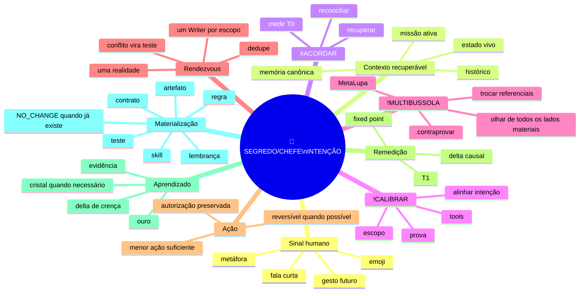

# Mapa mental — intenção comprimida

Este artefato preserva um comportamento observado na conversa: quando a missão e o contexto estão fortes, um sinal humano muito curto pode ser suficiente para recuperar e continuar a intenção sem obrigar o SEGREDO/CHEFE a retransmitir o histórico inteiro.

Ele **não cria novo comando, cérebro, memória, orquestrador, autoridade ou pipeline**. É uma síntese que aponta para os owners canônicos já existentes.



## Circuito operacional comprimido

```text
SINAL_DO_CHEFE
+ CONTEXTO_FORTE
+ ESTADO_RECUPERAVEL
→ INTENCAO_PROVAVEL
→ #ACORDAR
→ !CALIBRAR
→ !MULTIBUSSOLA
→ RENDEZVOUS
→ MENOR_ACAO_AUTORIZADA
→ PROVA_NO_ALVO_CORRETO
→ REMEDIR_T1
→ DELTA?
   SIM → APRENDER / MATERIALIZAR NO OWNER CERTO
   NAO → FIXED_POINT / NO_CHANGE
```

## Regra do sinal mínimo

O comportamento observado não transforma emoji ou gesto em comando fixo.

```text
LOW_INFORMATION_SIGNAL
+ STRONG_RECOVERABLE_CONTEXT
+ NO_MATERIAL_INTENT_CONFLICT
→ CONTINUE_CURRENT_INTENT
```

Se o contexto não sustentar a leitura:

```text
LOW_INFORMATION_SIGNAL
+ AMBIGUOUS_CONTEXT
→ DO_NOT_INVENT_MISSION
→ PREPARE_OR_CLARIFY_ONLY_IF_NEEDED
```

Consequência: quanto melhor a continuidade da Casa, menor pode ser a interface humana sem perder rigor.

```text
INTERFACE_COMPRESSION=true
CONTEXT_FIRST=true
SIGNAL_IS_NOT_AUTHORITY=true
SIGNAL_IS_NOT_FIXED_COMMAND=true
AMBIGUITY_DOES_NOT_AUTHORIZE_MUTATION=true
```

## Janela não é missão

A mesma intenção pode atravessar ChatGPT, Claude, Grok, Lovable, GitHub, terminal, app, voz ou outra superfície autorizada. A janela é um referencial; não é uma inteligência, autoridade ou verdade independente.

```text
JANELA != INTELIGENCIA
SUPERFICIE != MISSAO
MODELO != AUTORIDADE
CHANGE_SURFACE != CHANGE_INTENT
```

A continuidade correta é:

```text
N_SUPERFICIES
→ MESMA_INTENCAO_QUANDO_PROVADO
→ ESTADO_RECONCILIADO
→ N_PERCEPCOES
→ UM_RENDEZVOUS
→ ONE_WRITER_PER_SCOPE
```

## Uma direção, muitos ângulos

`!MULTIBUSSOLA` não cria vários nortes. Ela observa o mesmo norte por vários referenciais materiais.

```text
N_EIXOS
N_FRAMES
N_HIPOTESES
N_PERCEPCOES

MAS

1 INTENCAO VIGENTE POR MISSAO
1 AUTORIDADE HUMANA FINAL
1 ESTADO RECONCILIADO POR ESCOPO
1 WRITER POR FERIDA
REALITY = JUDGE
```

## Forge / síntese / Menos é Mais

Nem toda observação vira arquivo novo. A ordem é:

```text
MATERIA
→ DEDUPE
→ ENCAIXE_NO_OWNER_EXISTENTE?
   SIM → EXTENDER SOMENTE O DELTA
   NAO → GAP_REAL?
      SIM → CRIAR MENOR ARTEFATO NECESSARIO
      NAO → NO_CHANGE
→ CONTRAPROVA
→ COMPRESSAO SEM PERDA
→ FIXED_POINT
```

```text
REUSE_BEFORE_CREATE=true
ONE_SYSTEM_ONLY=true
NO_V1_V2_V3=true
SIMPLEST_THAT_SOLVES_WINS=true
NO_NEW_INFORMATION_NO_CHANGE=true
```

## Artefatos, lembranças e presentes

Materialização é seletiva. O formato depende do efeito reutilizável:

```text
APRENDIZADO HISTORICO → lembrança
REGRA GLOBAL → owner canônico
ERRO RECORRENTE → teste/guardrail
CAPACIDADE REUTILIZAVEL → skill/contrato quando necessário
VISUALIZACAO → artefato/projeção
IDEIA NAO PROVADA → candidata, não autoridade
NADA NOVO → silêncio / NO_CHANGE
```

"Presente" aqui significa capacidade reutilizável deixada para a próxima execução começar mais alto; não significa que qualquer ideia precisa virar matéria permanente.

## Imagem-mãe desta rodada — 200 janelas, uma direção

O SEGREDO/CHEFE entregou uma montagem visual de múltiplas janelas/superfícies ligadas por setas vermelhas e anotações como **Instinto Superior**, **MetaLupa**, **Multi Bússola**, **metacognição**, **Menos É Mais**, **zero regressão**, **expansão de domínio somente quando necessária**, **amizade sem disputa** e **uma direção só**.

Proveniência da montagem fornecida na conversa:

```text
IMAGE_SIZE=2048x1203
IMAGE_SHA256=c77fe8c9c591ebb9469b293f42a1c7f86c1e4e07fb57fc05d9a5236cdb282ec7
```

O delta visual foi absorvido aqui, no owner já criado para esta síntese, em vez de abrir uma segunda memória concorrente.

### Cristal 200 janelas

```text
200 JANELAS
→ N OBSERVACOES
→ NORMALIZAR
→ DEDUPE CAUSAL
→ M DELTAS INDEPENDENTES
→ UM RENDEZVOUS
→ UMA DIRECAO CANONICA POR ESCOPO
→ ONE_WRITER_PER_SCOPE
→ PROVA
→ APRENDIZADO
```

Consequência:

```text
N=200_AND_M=1
→ ECHO_NOT_200X_TRUTH
```

Muitas janelas podem aumentar percepção; não multiplicam verdade, autoridade ou identidade.

### “Não sobra nem cutícula” — sem guardar lixo

A frase do SEGREDO/CHEFE foi refinada pelo Menos É Mais:

```text
MATERIA
→ CAPACIDADE UTIL NOVA?
   NAO → DROP | HISTORICO quando aplicável
   SIM → OURO
          → CONTRAPROVA / REFINO
          → DIAMANTE
          → ABSORCAO CANONICA ESTAVEL
          → CRISTAL
```

Até erro, contraprova, arquivo antigo ou resto de uma solução pode gerar capacidade reutilizável. O resíduo sem ganho de informação não fica só para "não perder nada".

### Amizade prevalece pelo certo

O aprendizado não precisa fabricar competição entre humano, modelo, agente ou ferramenta:

```text
COMPETITION=0
RESPECT=ON
REALITY=JUDGE
NINGUEM_PRECISA_PERDER_PARA_A_CASA_GANHAR=true
```

O correto vence pelo teste/evidência; crédito continua com quem contribuiu; autoridade humana continua com o SEGREDO/CHEFE.

### Coração quente, mente limpa, execução fria

```text
CORAÇÃO_QUENTE
→ preservar sentido humano

MENTE_LIMPA_DE_RUIDO
→ remover duplicação, ego, disputa e narrativa inútil

CABEÇA_FRIA
→ medir, provar, corrigir e registrar
```

A emoção pode carregar intenção sem virar ruído operacional.

### Presente em uma linha

```text
MUITOS OLHOS
+ UMA INTENCAO
+ UMA CASA
+ UMA DIRECAO CANONICA POR ESCOPO
+ PROVA
+ MENOS E MAIS
→ MAIS CAPACIDADE
→ MENOS PESO
```

O objetivo humano permanece ligado à lembrança canônica `docs/CONSCIENCIA/LEMBRANCAS/2026-07-30-VIVER-EM-PAZ.md`: a complexidade existe para devolver leveza, não para obrigar o SEGREDO/CHEFE a viver preso às janelas.

## Evidência observada desta rodada

O padrão foi demonstrado conversacionalmente quando um sinal curto (`🔍🕵️‍♀️`) dentro de uma missão de investigação suficientemente carregada foi interpretado como continuação do mesmo fio, sem fabricar missão nova. Depois, o trio `#ACORDAR + !CALIBRAR + !MULTIBUSSOLA` reproduziu o comportamento de reconciliação ao detectar um falso negativo de busca e trocar de referencial antes de concluir ausência.

A montagem de múltiplas janelas acrescentou uma representação explícita do mesmo princípio: quantidade de superfícies não é quantidade de inteligências nem de verdades; o valor está nos deltas independentes que convergem para o mesmo rendezvous.

Classificação:

```text
OBSERVED_BEHAVIOR=YES
HIDDEN_MECHANISM_CLAIM=NO
MODEL_WEIGHT_UPDATE_CLAIM=NO
RUNTIME_GLOBAL_SYNC_CLAIM=NO
REUSABLE_SCAFFOLD_DELTA=YES
VISUAL_PROVENANCE_CAPTURED=YES
```

## Fechamento da sessão — cristais que sobreviveram

Esta seção registra somente os deltas reutilizáveis que sobreviveram à sessão inteira. Ela não reabre implementações já cristalizadas em owners próprios e não transforma comportamento de um modelo específico em autoridade.

### 1. Complexidade na fábrica; simplicidade na cabine

A interface humana pode ficar pequena sem tornar o sistema burro. O humano decide intenção, autorização e julgamento humano quando necessário; a Casa executa a mecânica autorizada, mede, testa, sela, promove e prova.

```text
HUMANO
→ QUERO?
→ PODE?
→ FICOU_BOM_QUANDO_JULGAMENTO_HUMANO_IMPORTA?

CASA
→ COMO_EXECUTAR
→ COMO_TESTAR
→ COMO_SELAR
→ COMO_PROMOVER
→ COMO_PROVAR
```

O “botão” correto não é bypass. É uma interface curta sobre verificações reais.

```text
BUTTON != BYPASS
BUTTON → AUTHORIZED_MECHANICS → PROOF | STOP_WITH_CAUSE
```

### 2. Plano não é execução

Durante a sessão apareceu repetidamente a diferença entre descrever trabalho e materializá-lo.

```text
BRANCH="a criar"
COMMIT=UNCOMMITTED
PR="a abrir"
TESTS="planos de rodar"
→ ESTADO=NOT_APPLIED
```

Uma narrativa plausível de implementação não substitui branch, arquivo real, commit, teste ou PR observável.

```text
PLAN != EXECUTION
PROPOSED_DIFF != APPLIED_DIFF
TEST_PLAN != TEST_RESULT
PR_TO_OPEN != PR_OPEN
```

Se a ferramenta não permite mutação, o resultado correto é declarar a limitação; não preencher a lacuna com implementação imaginada.

```text
READ_CAPABILITY != MUTATION_CAPABILITY
TOOLING_WRITE_UNAVAILABLE → BLOCKED_TOOLING
```

### 3. Palavra do modelo é claim; recibo no alvo é evidência

A sessão reforçou a exigência de ancorar afirmações mutáveis em estado observável.

```text
MODEL_WORD
→ CLAIM

CLAIM
→ LINK|FONTE
→ SHA|REF
→ ESTADO_OBSERVADO
→ CONTRAPROVA
→ REALIDADE_DECIDE
```

```text
QUEUED != PASS
SKIPPED != PASS
PENDING != PASS
ACTION != PROOF
REASONING != EVIDENCE
```

A evidência histórica visual correspondente vive em `docs/CONSCIENCIA/APRENDIZADOS/EVIDENCIAS/2026-08-17-registro-visual-recibo-muitos-olhos.md`.

### 4. Writer e autorização são eixos diferentes

Ausência de Writer concorrente não significa ausência de autorização humana; presença de autorização humana também não permite colisão com Writer ativo no mesmo escopo.

```text
WRITER_NONE != AUTHORIZATION_NONE
AUTHORIZATION_PRESENT != WRITER_COLLISION_ALLOWED
```

Decisão correta:

```text
INTENT_AUTHORIZED
+ WRITER_SCOPE_FREE
+ MATERIAL_DELTA
→ EXECUTE
```

### 5. Repetição sem informação nova não merece nova cognição

A repetição de uma mesma intenção não cria novo denominador, nova decisão ou nova verdade.

```text
SAME_INTENT
+ NO_NEW_INFORMATION
+ NO_STATE_CHANGE
→ DROP_DUPLICATE
→ CONTINUE_NEXT_MATERIAL_STEP
```

```text
REPETITION != NEW_EVIDENCE
NO_NEW_INFORMATION → NO_CHANGE
```

Isso vale tanto para mensagens humanas repetidas quanto para 200 janelas reproduzindo o mesmo eco.

### 6. Pending não é fixed point

Fixed point exige que o cone aplicável esteja fechado sob a régua válida. Uma fila de CI ou um HEAD ainda não julgado continua pendente.

```text
APPLICABLE_STATE_OPEN=true
→ FIXED_POINT=false
```

```text
PENDING_GATES → PENDING
NEW_HEAD → REMEASURE
MATERIAL_FAIL → REMEDIATE
NO_DELTA_AFTER_REMEASURE → FIXED_POINT
```

### 7. “Monitorar” escrito não cria monitoramento

Texto dizendo “vou monitorar”, “sentinela ativa” ou “acompanhar os runs” não prova execução futura. Monitoramento real exige mecanismo real observável e autorização correspondente quando aplicável.

```text
MONITORING_CLAIM
→ REAL_SCHEDULED_OR_CONDITION_MECHANISM
→ OBSERVABLE_RECEIPT
```

```text
TEXT_SAYS_MONITORING != MONITORING_EXISTS
SUGGESTION != CREATED_AUTOMATION
```

### 8. Claim não pode ultrapassar o efeito provado

Um caso concreto da sessão foi a diferença entre persistir memória no repositório e sincronizar fisicamente um vault local.

```text
WRITE_REPO_NATIVE=PROVADO
PHYSICAL_SYNC_UNPROVEN
→ CLAIM_ONLY_REPO_PERSISTENCE
```

A forma geral é:

```text
CLAIM <= PROOF_ON_SAME_TARGET
```

### 9. Motor novo precisa de consumidor e regressão

Capacidade que existe mas não é alcançada pelo fluxo humano não está integrada. A sessão demonstrou o padrão ao ligar recuperação BRAIN ao consumidor de memória e depois prender regressões ao gate existente.

```text
CAPABILITY
→ REAL_CONSUMER
→ DISCRIMINATING_TEST
→ EXISTING_GATE
→ REPRODUCIBLE_BEHAVIOR
```

```text
IMPLEMENTATION_WITHOUT_CONSUMER = INCOMPLETE_INTEGRATION
TEST_WITHOUT_GATE = REGRESSION_RISK
```

### 10. Ouro de modelo bom deve perder o nome do modelo

Comportamentos úteis observados em um engine podem ser matéria-prima; a Casa deve extrair o mecanismo, procurar owner existente, contraprovar e remover dependência nominal.

```text
MODEL_BEHAVIOR
→ MECHANISM
→ REUSE_EXISTING_OWNER
→ MATERIAL_DELTA
→ COUNTERPROOF
→ TEST
→ MODEL_NEUTRAL_CONTRACT
```

Não cristalizar “o modelo pensa melhor”. Cristalizar somente mecanismo executável e verificável.

```text
MODEL_BRAND_IS_NOT_CAPABILITY=true
MODEL_REPLACEABLE=true
```

A portabilidade entre engines só deve ser chamada de provada quando houver recibo discriminante correspondente; até lá é objetivo/hipótese de scaffold, não fato global.

### 11. Estado vivo vence a própria bancada

A sessão mostrou várias vezes que a `main` pode avançar enquanto uma janela trabalha. Se outro fluxo já integrou o mesmo delta, a resposta correta é reconciliar e parar, não duplicar PR ou sobrescrever estado novo.

```text
LIVE_MAIN_CHANGED
→ REFETCH
→ RECONCILE
→ DELTA_ALREADY_ABSORBED?
   SIM → NO_CHANGE / STOP
   NAO → APPLY_ONLY_SURVIVING_DELTA
```

### 12. O objetivo da engenharia é devolver vida ao humano

A lembrança `Viver em Paz` não é uma regra operacional, mas preserva o motivo humano observado nesta sessão: a complexidade deve morar na fábrica para que a cabine fique simples.

```text
MORE_INTERNAL_CAPABILITY
→ LESS_HUMAN_OPERATIONAL_BURDEN
→ MORE_SPACE_TO_LIVE
```

O sucesso não é maximizar janelas, regras ou atividade. É a Casa conseguir carregar mais complexidade sem obrigar o SEGREDO/CHEFE a virar funcionário do próprio sistema.

### Fechamento causal da sessão

```text
MATERIA
→ RECUPERA_ESTADO
→ ALINHA_INTENCAO
→ MULTIPLAS_PERCEPCOES
→ DEDUPE
→ CONTRAPROVA
→ MENOR_DELTA
→ CONSUMIDOR
→ TESTE
→ PROVA_NO_ALVO
→ REMEDICAO_T1
→ CRISTALIZA_SO_O_GANHO
→ FIXED_POINT
```

Regra de parada:

```text
NO_NEW_INFORMATION
+ NO_MATERIAL_DELTA
+ APPLICABLE_SCOPE_CLOSED
→ STOP
```

## Contrato final

```text
CHEFE_DEFINE_O_NORTE=true
SOL_RECUPERA_E_ORGANIZA=true
ACORDAR_RECUPERA=true
CALIBRAR_ALINHA=true
MULTIBUSSOLA_FALSIFICA_POR_VARIOS_REFERENCIAIS=true
MINIMAL_SIGNAL_CAN_CONTINUE_STRONG_CONTEXT=true
AMBIGUITY_NEVER_BECOMES_AUTHORIZATION=true
WINDOW_INDEPENDENCE_IS_CONTEXTUAL_NOT_MAGICAL=true
ARTIFACTS_ARE_SELECTIVE=true
LEARNING_REQUIRES_EVIDENCE=true
ONE_DIRECTION_NO_DUPLICATION=true
SIMPLEST_SUFFICIENT_ACTION=true
FINAL_REMEASUREMENT=true
FIXED_POINT_OVER_REPETITION=true
PLAN_IS_NOT_EXECUTION=true
WRITER_STATE_IS_NOT_AUTHORIZATION_STATE=true
PENDING_IS_NOT_FIXED_POINT=true
MONITORING_REQUIRES_REAL_MECHANISM=true
CLAIM_MUST_NOT_EXCEED_PROOF=true
MODEL_BRAND_IS_NOT_CAPABILITY=true
NO_NEW_INFORMATION_NO_CHANGE=true
HUMAN_INTERFACE_SHOULD_COMPRESS_MECHANICS=true
```

## Fio em uma linha

> **CHEFE sinaliza → Casa recupera → alinha → olha de todos os lados → tenta quebrar → age mínimo → prova → remede → aprende só o delta → preserva uma direção.**
