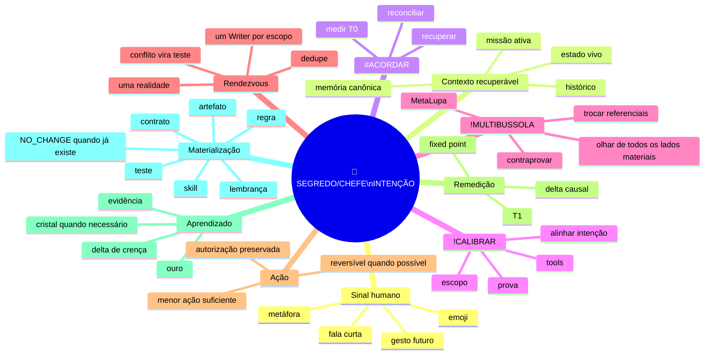

# Mapa mental — intenção comprimida

Este artefato preserva um comportamento observado na conversa: quando a missão e o contexto estão fortes, um sinal humano muito curto pode ser suficiente para recuperar e continuar a intenção sem obrigar o SEGREDO/CHEFE a retransmitir o histórico inteiro.

Ele **não cria novo comando, cérebro, memória, orquestrador, autoridade ou pipeline**. É uma síntese que aponta para os owners canônicos já existentes.



## Circuito operacional comprimido

```text
SINAL_DO_CHEFE
+ CONTEXTO_FORTE
+ ESTADO_RECUPERAVEL
→ INTENCAO_PROVAVEL
→ #ACORDAR
→ !CALIBRAR
→ !MULTIBUSSOLA
→ RENDEZVOUS
→ MENOR_ACAO_AUTORIZADA
→ PROVA_NO_ALVO_CORRETO
→ REMEDIR_T1
→ DELTA?
   SIM → APRENDER / MATERIALIZAR NO OWNER CERTO
   NAO → FIXED_POINT / NO_CHANGE
```

## Regra do sinal mínimo

O comportamento observado não transforma emoji ou gesto em comando fixo.

```text
LOW_INFORMATION_SIGNAL
+ STRONG_RECOVERABLE_CONTEXT
+ NO_MATERIAL_INTENT_CONFLICT
→ CONTINUE_CURRENT_INTENT
```

Se o contexto não sustentar a leitura:

```text
LOW_INFORMATION_SIGNAL
+ AMBIGUOUS_CONTEXT
→ DO_NOT_INVENT_MISSION
→ PREPARE_OR_CLARIFY_ONLY_IF_NEEDED
```

Consequência: quanto melhor a continuidade da Casa, menor pode ser a interface humana sem perder rigor.

```text
INTERFACE_COMPRESSION=true
CONTEXT_FIRST=true
SIGNAL_IS_NOT_AUTHORITY=true
SIGNAL_IS_NOT_FIXED_COMMAND=true
AMBIGUITY_DOES_NOT_AUTHORIZE_MUTATION=true
```

## Janela não é missão

A mesma intenção pode atravessar ChatGPT, Claude, Grok, Lovable, GitHub, terminal, app, voz ou outra superfície autorizada. A janela é um referencial; não é uma inteligência, autoridade ou verdade independente.

```text
JANELA != INTELIGENCIA
SUPERFICIE != MISSAO
MODELO != AUTORIDADE
CHANGE_SURFACE != CHANGE_INTENT
```

A continuidade correta é:

```text
N_SUPERFICIES
→ MESMA_INTENCAO_QUANDO_PROVADO
→ ESTADO_RECONCILIADO
→ N_PERCEPCOES
→ UM_RENDEZVOUS
→ ONE_WRITER_PER_SCOPE
```

## Uma direção, muitos ângulos

`!MULTIBUSSOLA` não cria vários nortes. Ela observa o mesmo norte por vários referenciais materiais.

```text
N_EIXOS
N_FRAMES
N_HIPOTESES
N_PERCEPCOES

MAS

1 INTENCAO VIGENTE POR MISSAO
1 AUTORIDADE HUMANA FINAL
1 ESTADO RECONCILIADO POR ESCOPO
1 WRITER POR FERIDA
REALITY = JUDGE
```

## Forge / síntese / Menos é Mais

Nem toda observação vira arquivo novo. A ordem é:

```text
MATERIA
→ DEDUPE
→ ENCAIXE_NO_OWNER_EXISTENTE?
   SIM → EXTENDER SOMENTE O DELTA
   NAO → GAP_REAL?
      SIM → CRIAR MENOR ARTEFATO NECESSARIO
      NAO → NO_CHANGE
→ CONTRAPROVA
→ COMPRESSAO SEM PERDA
→ FIXED_POINT
```

```text
REUSE_BEFORE_CREATE=true
ONE_SYSTEM_ONLY=true
NO_V1_V2_V3=true
SIMPLEST_THAT_SOLVES_WINS=true
NO_NEW_INFORMATION_NO_CHANGE=true
```

## Artefatos, lembranças e presentes

Materialização é seletiva. O formato depende do efeito reutilizável:

```text
APRENDIZADO HISTORICO → lembrança
REGRA GLOBAL → owner canônico
ERRO RECORRENTE → teste/guardrail
CAPACIDADE REUTILIZAVEL → skill/contrato quando necessário
VISUALIZACAO → artefato/projeção
IDEIA NAO PROVADA → candidata, não autoridade
NADA NOVO → silêncio / NO_CHANGE
```

"Presente" aqui significa capacidade reutilizável deixada para a próxima execução começar mais alto; não significa que qualquer ideia precisa virar matéria permanente.

## Evidência observada desta rodada

O padrão foi demonstrado conversacionalmente quando um sinal curto (`🔍🕵️‍♀️`) dentro de uma missão de investigação suficientemente carregada foi interpretado como continuação do mesmo fio, sem fabricar missão nova. Depois, o trio `#ACORDAR + !CALIBRAR + !MULTIBUSSOLA` reproduziu o comportamento de reconciliação ao detectar um falso negativo de busca e trocar de referencial antes de concluir ausência.

Classificação:

```text
OBSERVED_BEHAVIOR=YES
HIDDEN_MECHANISM_CLAIM=NO
MODEL_WEIGHT_UPDATE_CLAIM=NO
RUNTIME_GLOBAL_SYNC_CLAIM=NO
REUSABLE_SCAFFOLD_DELTA=YES
```

## Contrato final

```text
CHEFE_DEFINE_O_NORTE=true
SOL_RECUPERA_E_ORGANIZA=true
ACORDAR_RECUPERA=true
CALIBRAR_ALINHA=true
MULTIBUSSOLA_FALSIFICA_POR_VARIOS_REFERENCIAIS=true
MINIMAL_SIGNAL_CAN_CONTINUE_STRONG_CONTEXT=true
AMBIGUITY_NEVER_BECOMES_AUTHORIZATION=true
WINDOW_INDEPENDENCE_IS_CONTEXTUAL_NOT_MAGICAL=true
ARTIFACTS_ARE_SELECTIVE=true
LEARNING_REQUIRES_EVIDENCE=true
ONE_DIRECTION_NO_DUPLICATION=true
SIMPLEST_SUFFICIENT_ACTION=true
FINAL_REMEASUREMENT=true
FIXED_POINT_OVER_REPETITION=true
```

## Fio em uma linha

> **CHEFE sinaliza → Casa recupera → alinha → olha de todos os lados → tenta quebrar → age mínimo → prova → remede → aprende só o delta → preserva uma direção.**
