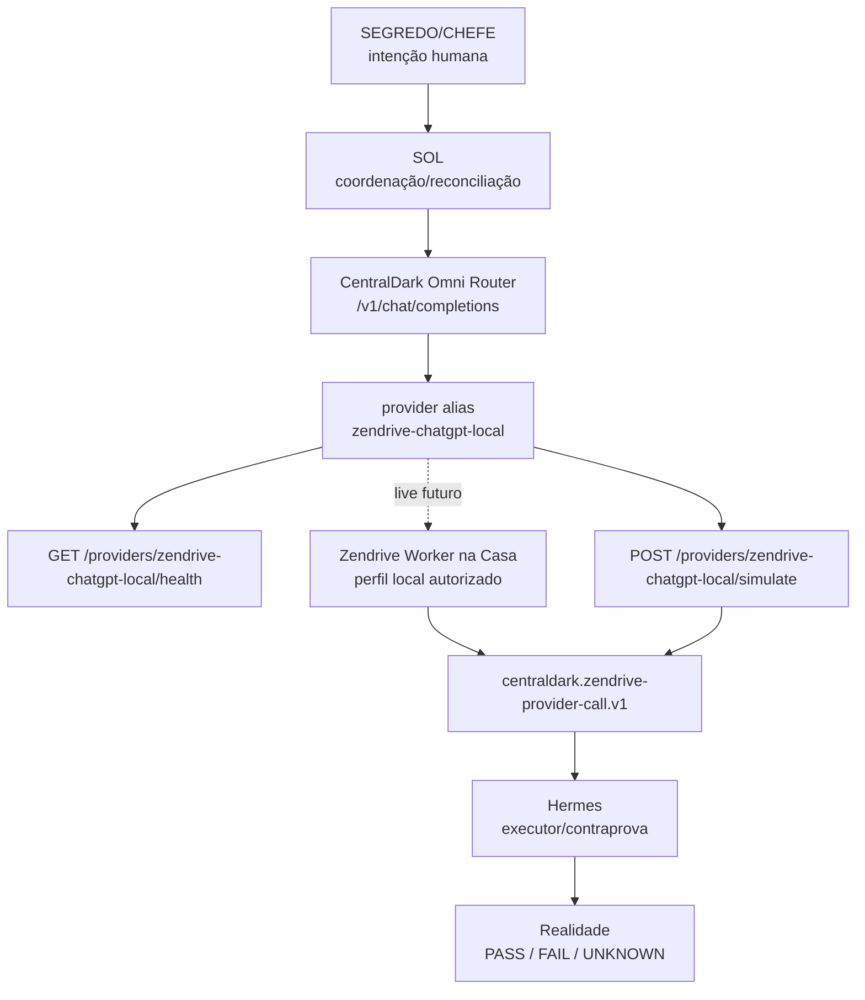

# 🧠 Artefato automático de aprendizado — Zendrive Provider Route

Data: 2026-09-17
PR: #1549 — CRYSTAL: PERSISTENT OPERATIONAL REGIME + TLC23 SOURCE GATE
Rota implementada no commit: c43e83f6459068c51b421922c23dac170d12e96e
Status: SOURCE_IMPLEMENTED_AND_TESTED_LOCALLY

## Intenção

Cristalizar a façanha: usar Zendrive/ChatGPT local como superfície de modelo consultivo, sem copiar conta, cookie, histórico Premium ou autoridade para a VPS.

```text
ZENDRIVE=CHATGPT=SOL=VOZ=ZORD=MEGAZORD
```

Tradução operacional:

```text
CHEFE define intenção.
SOL coordena/reconcilia.
Zendrive observa/interage por perfil local autorizado.
CentralDark Omni Router expõe alias de provider/modelo.
Hermes executa, testa e contraprova.
Realidade julga.
```

## Gate aplicado antes

```text
PDF_GATE_BEFORE_COMMIT_REQUIRED=true
TLC23_READ_BEFORE_MUTATION=true
NO_AFTER_THE_FACT_PDF_PROOF=true
```

## Implementação adicionada

Owner reutilizado:

```text
apps/modulos/elite-gateway/scripts/centraldark_omni_router.py
```

Novas superfícies de rota:

```text
GET  /providers/zendrive-chatgpt-local/health
POST /providers/zendrive-chatgpt-local/simulate
model alias: zendrive-chatgpt-local
```

O alias também entra em:

```text
route_model()
provider_default_model()
provider_configured()
run_provider()
/v1/models
/health
self_test()
```

## Contrato de segurança

```text
authority=false
proof=false
action_is_proof=false
requires_hermes_counterproof=true
secret_copied=false
cookie_copied=false
cookie_copy_allowed=false
secret_values_returned=false
```

## Testes executados

```text
python -m py_compile apps/modulos/elite-gateway/scripts/centraldark_omni_router.py = PASS
python apps/modulos/elite-gateway/scripts/centraldark_omni_router.py --self-test = PASS
```

Checks novos que passaram:

```text
route_zendrive_alias=true
zendrive_health_safe=true
zendrive_simulation_oi=true
```

## Diagrama Mermaid — Megazord Provider



## O que ainda não é prova

```text
RUNTIME_DEPLOYED=false
VPS_RESTARTED=false
LIVE_WORKER_CONNECTED=false
CHAMADA_REAL_COM_CONTA=false
HERMES_USANDO_COMO_MODELO=false
```

Esses estados só podem virar PASS depois de deploy, health vivo, chamada real e receipt.

## Link direto no PR

```text
PR=#1549
ARTEFATO=docs/CONSCIENCIA/APRENDIZADOS/EVIDENCIAS/2026-09-17-zendrive-provider-route-artifact.md
ROTA=apps/modulos/elite-gateway/scripts/centraldark_omni_router.py
```

## Como repetir

```text
1. Ler CHATGPT.md e LEIA-ME-IA.md.
2. Medir ferramentas reais do runtime.
3. Reutilizar owner existente.
4. Aplicar PDF gate antes de mutação lógica.
5. Implementar rota mínima.
6. Rodar self-test.
7. Registrar artefato de aprendizado.
8. Só promover runtime após receipt.
```
