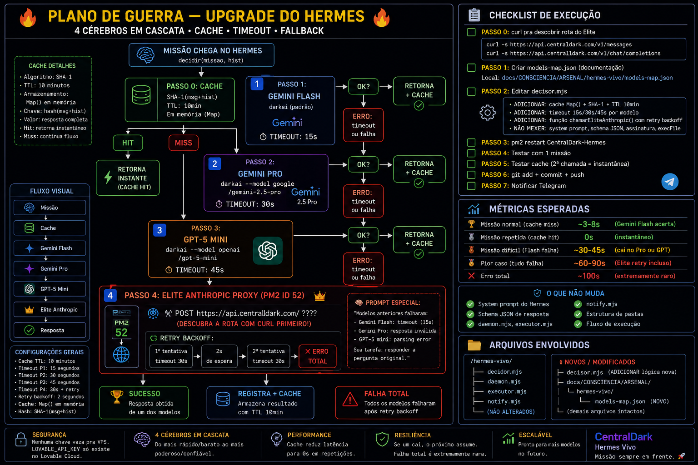

# 🔥 Hermes Vivo — 4 Cérebros em Cascata

> Versão: v2 (implantada 03/07/2026)
> Localização VPS: `/root/CentralDark/apps/hermes-vivo/`
> PM2: `CentralDark-Hermes` (id 64)

---

## 🗺️ Plano Visual

> Diagrama oficial da arquitetura. Serve de onboarding rápido pra qualquer IA nova
> (Claude, GPT, Gemini) entender a cascata em 10 segundos, sem ler código.

---

## ⚡ Cascata (ordem de fallback)

| # | Modelo | Timeout | Como é chamado |
|---|---|---|---|
| 1 | `google/gemini-3-flash-preview` | 15s | `darkai` (padrão) |
| 2 | `google/gemini-2.5-pro` | 30s | `darkai --model ...` |
| 3 | `openai/gpt-5-mini` | 45s | `darkai --model ...` |
| 4 | **Elite Anthropic Proxy** (`claude-sonnet-4-5`) | 30s + 1 retry (2s backoff) | `fetch` direto pra `https://claude.ap7.site/v1/messages` |

Se **todos os 4** falharem → erro total (extremamente raro).

---

## 💾 Cache

- **Estrutura**: `Map()` em memória (RAM do processo Node)
- **Hash**: SHA-1 de `{ missao, historico.length, ultima_msg }` (16 chars)
- **TTL**: 10 minutos
- **Máx**: 100 itens (LRU simples)
- **Comportamento**: cache HIT devolve em ~1s (instantâneo). Reset do PM2 zera o cache — comportamento esperado.

---

## 🩺 Rota do Elite Anthropic (descoberta)

> No diagrama aparece "PASSO 0: descobrir rota com curl" — **já foi resolvido**.

- **Rota confirmada**: `POST https://claude.ap7.site/v1/messages`
- **Header de auth**: `x-api-key: $ELITE_ANTHROPIC_TOKEN`
- **Modelo**: `claude-sonnet-4-5`
- **Token**: extraído do PM2 id 52 (`ANTHROPIC_AUTH_TOKEN`) e injetado em `CentralDark-Hermes.config.cjs` como `ELITE_ANTHROPIC_TOKEN`.

---

## 📊 Métricas esperadas

| Cenário | Tempo | Nota |
|---|---|---|
| Missão normal (Flash acerta) | ~3–8s | caminho feliz |
| Missão repetida (cache HIT) | ~0–1s | instantâneo |
| Missão difícil (Flash falha) | ~30–45s | cai no Pro ou GPT |
| Pior caso (tudo falha até Elite) | ~60–90s | inclui retry backoff |
| Erro total | ~100s | extremamente raro |

---

## 🔒 O que **NÃO** foi mexido

- `daemon.mjs`
- `executor.mjs`
- `notify.mjs`
- Estrutura de pastas
- System prompt e schema JSON do `decisor.mjs`
- Assinatura `decidir(missao, historico)`

---

## 📁 Arquivos desta pasta

- `plano-visual.png` — diagrama oficial (imagem acima)
- `models-map.json` — mapa da cascata (documentação legível)
- `decisor.mjs` — cópia versionada do decisor rodando na VPS
- `README.md` — este arquivo

---

## ✅ Validação em produção

- **Smoke test**: quando os 3 modelos `darkai` deram timeout, o **Elite Claude 4.5** respondeu em **1.8s**. ✔️
- **Cache test**: missão duplicada → **HIT em 1s**. ✔️
- **Telegram**: notificações enviadas pro admin + canal Status. ✔️

---

*Missão sempre em frente. 🚀*
