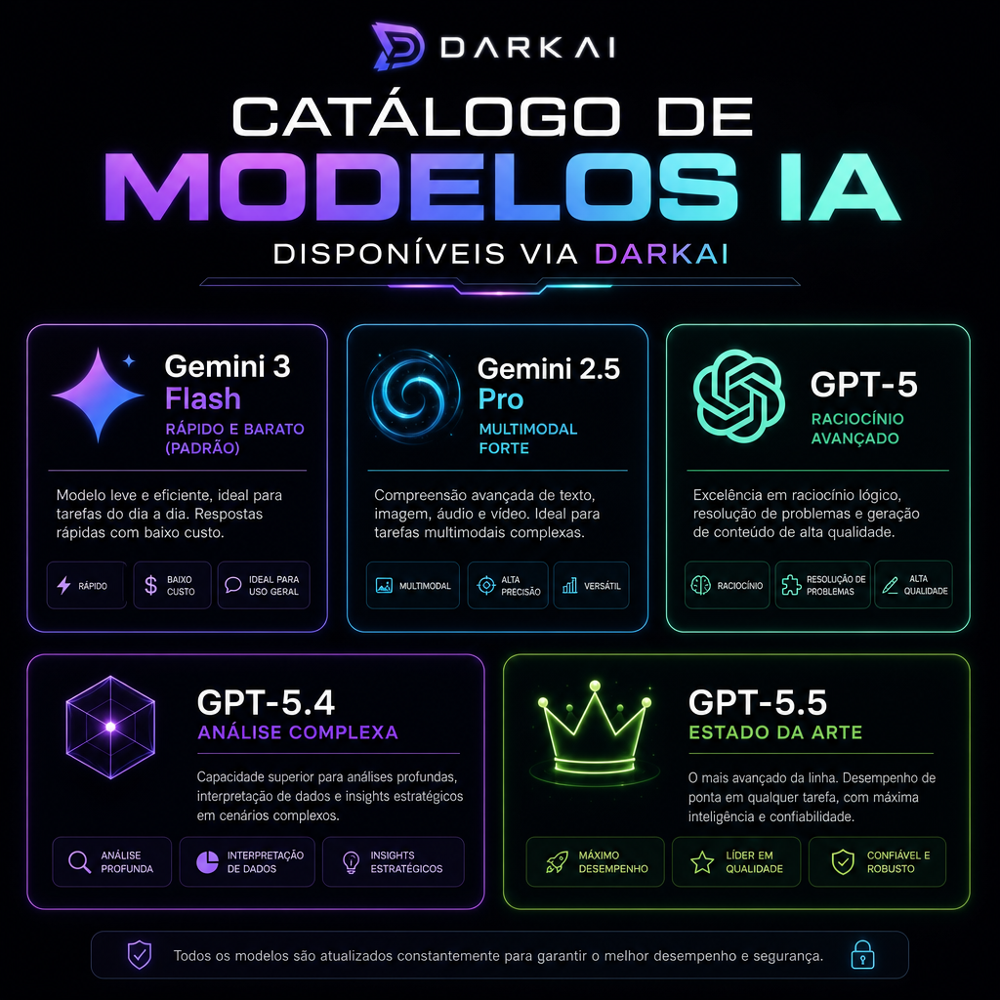

# 🎯 Catálogo de Modelos IA

> **📖 Pra quem é:** quem quer escolher o modelo certo pra cada tarefa.
> **⏱️ Tempo:** 6 minutos.

---



## Como escolher?

Regra rápida:

- **Não sabe?** Usa o padrão (`google/gemini-3-flash-preview`). Rápido, barato, funciona pra 90% dos casos.
- **Precisa de raciocínio pesado?** `openai/gpt-5.4` ou `openai/gpt-5.5`.
- **Precisa entender imagem/vídeo?** `google/gemini-2.5-pro`.
- **Volume alto e barato?** `google/gemini-3.1-flash-lite` ou `openai/gpt-5-nano`.

---

## Família Google Gemini

| Modelo | Quando usar | Custo | Velocidade |
|--------|-------------|-------|------------|
| `google/gemini-3-flash-preview` | **Padrão.** Chat rápido, extração, classificação. | 💰 | ⚡⚡⚡ |
| `google/gemini-3.1-flash-lite` | Volume muito alto (classificar 10k mensagens) | 💰 | ⚡⚡⚡ |
| `google/gemini-3.5-flash` | Coding, raciocínio médio, agentes | 💰💰 | ⚡⚡ |
| `google/gemini-3.1-pro-preview` | Raciocínio forte, próxima geração | 💰💰💰 | ⚡ |
| `google/gemini-2.5-pro` | Multimodal forte (texto + imagem + áudio + vídeo), contexto gigante | 💰💰💰 | ⚡ |
| `google/gemini-2.5-flash` | Meio-termo bom entre Pro e Flash | 💰💰 | ⚡⚡ |
| `google/gemini-2.5-flash-lite` | Mais barato/rápido pra tarefas simples | 💰 | ⚡⚡⚡ |

---

## Família OpenAI GPT

| Modelo | Quando usar | Custo | Velocidade |
|--------|-------------|-------|------------|
| `openai/gpt-5` | All-rounder forte, texto + imagem | 💰💰💰 | ⚡⚡ |
| `openai/gpt-5-mini` | Menor custo, boa performance | 💰💰 | ⚡⚡ |
| `openai/gpt-5-nano` | Volume alto, latência baixa | 💰 | ⚡⚡⚡ |
| `openai/gpt-5.2` | Raciocínio aprimorado, problem solving | 💰💰💰 | ⚡ |
| `openai/gpt-5.4` | Raciocínio avançado, code generation, análise | 💰💰💰💰 | ⚡ |
| `openai/gpt-5.4-mini` | GPT-5.4 mais barato/rápido | 💰💰💰 | ⚡⚡ |
| `openai/gpt-5.4-nano` | GPT-5.4 mínimo, latência baixa | 💰💰 | ⚡⚡⚡ |
| `openai/gpt-5.4-pro` | Premium, tarefas mais difíceis | 💰💰💰💰💰 | ⚡ |
| `openai/gpt-5.5` | **Estado da arte.** Raciocínio, coding, instruction following | 💰💰💰💰 | ⚡ |
| `openai/gpt-5.5-pro` | Extended reasoning, problemas mais difíceis | 💰💰💰💰💰 | ⚡ |

---

## Modelos de imagem (bônus)

Não são chamados pelo `darkai` (que é só texto por enquanto), mas existem no gateway:

- `google/gemini-2.5-flash-image` — "Nano Banana", gera/edita imagem
- `google/gemini-3-pro-image` — geração/edição de qualidade superior
- `google/gemini-3.1-flash-image` — "Nano Banana 2", rápido e alta qualidade
- `openai/gpt-image-2` — estado da arte da OpenAI pra imagem
- `openai/gpt-image-1-mini` — versão barata do gpt-image

Se quiser gerar imagem via CLI, dá pra adicionar uma flag `--image` no `darkai` no futuro.

---

## Como especificar o modelo

Via CLI:
```bash
darkai --model openai/gpt-5.4 "explica esse código"
```

Via curl direto:
```bash
curl -X POST "$DARKAI_URL" \
  -H "Authorization: Bearer $DARKAI_ANON_KEY" \
  -H "Content-Type: application/json" \
  -d '{"prompt":"oi","model":"openai/gpt-5.5"}'
```

Via variável de ambiente (muda o padrão):
```bash
export DARKAI_MODEL=openai/gpt-5.4-mini
darkai "oi"   # agora usa gpt-5.4-mini
```

---

## Listar modelos rapidinho

```bash
darkai --list-models
```

---

Próximo: [`04-USANDO-NO-TERMINAL-LOCAL.md`](04-USANDO-NO-TERMINAL-LOCAL.md)

---

## Conexões Rápidas

- [[00-LEIA-PRIMEIRO]] — portão de entrada
- [[MAPA-DO-CEREBRO]] — visão geral
- [[CONSCIENCIA]] — documento mestre
