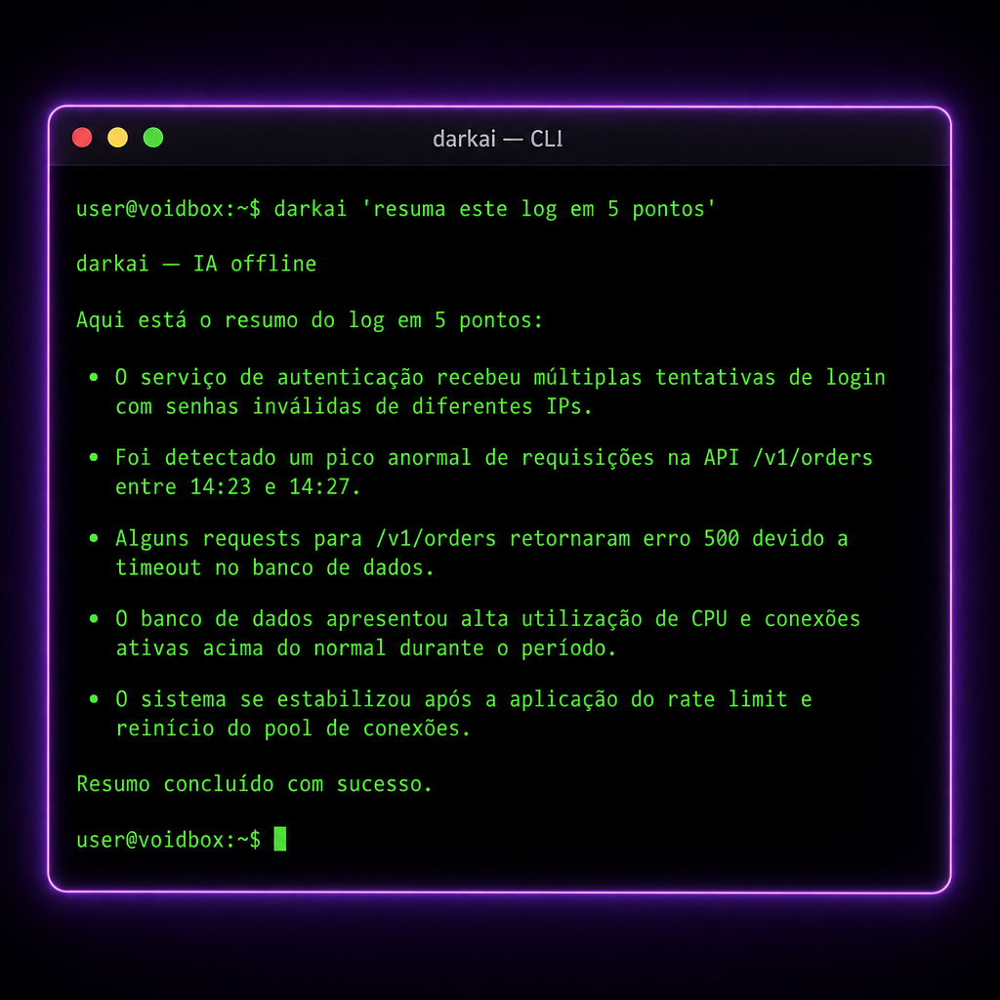

# 💻 Usando no seu terminal local (Mac / Linux / Windows)

> **📖 Pra quem é:** você quer usar `darkai` no SEU PC também, não só na VPS.
> **⏱️ Tempo:** 5 minutos.

---



## Sim, funciona no seu PC

O `darkai` é só um script bash + `curl`. Roda em qualquer lugar que tenha esses dois:

- ✅ macOS (nativo)
- ✅ Linux (nativo)
- ✅ Windows via **WSL** (Ubuntu no Windows)
- ✅ Windows via **Git Bash**
- ✅ Windows via **PowerShell** (com o script `.ps1` alternativo)

---

## Instalação — Mac ou Linux

### Opção A: instalador automático

```bash
curl -sSL https://raw.githubusercontent.com/SEU-USUARIO/CentralDark/main/docs/CONSCIENCIA/DARKAI/instalar-local.sh | bash
```

*(troque `SEU-USUARIO` pelo dono real do repo)*

### Opção B: manual (mais seguro)

1. Baixa o script:
   ```bash
   mkdir -p ~/.local/bin
   curl -o ~/.local/bin/darkai https://raw.githubusercontent.com/SEU-USUARIO/CentralDark/main/docs/CONSCIENCIA/DARKAI/darkai.sh
   chmod +x ~/.local/bin/darkai
   ```

2. Garante que `~/.local/bin` tá no PATH (adiciona no `~/.zshrc` ou `~/.bashrc`):
   ```bash
   export PATH="$HOME/.local/bin:$PATH"
   ```

3. Configura as variáveis (adiciona no mesmo arquivo `~/.zshrc` ou `~/.bashrc`):
   ```bash
   export DARKAI_URL="https://kagejpghnwdfymddwxuf.supabase.co/functions/v1/ai-proxy"
   export DARKAI_ANON_KEY="eyJhbGciOiJI...<sua_anon_key>..."
   export DARKAI_MODEL="google/gemini-3-flash-preview"
   ```

4. Recarrega:
   ```bash
   source ~/.zshrc   # ou ~/.bashrc
   ```

5. Testa:
   ```bash
   darkai "oi"
   ```

---

## Instalação — Windows (PowerShell)

Se você prefere não usar WSL, tem o script `instalar-windows.ps1`:

```powershell
# Abre PowerShell como administrador
Set-ExecutionPolicy -ExecutionPolicy RemoteSigned -Scope CurrentUser
.\instalar-windows.ps1
```

Depois configura as variáveis no PowerShell profile (`$PROFILE`):

```powershell
$env:DARKAI_URL = "https://kagejpghnwdfymddwxuf.supabase.co/functions/v1/ai-proxy"
$env:DARKAI_ANON_KEY = "eyJhbGci..."
$env:DARKAI_MODEL = "google/gemini-3-flash-preview"
```

---

## Instalação — Windows via WSL (recomendado)

WSL é o Ubuntu rodando dentro do Windows. Melhor experiência.

1. Instala WSL (uma vez só):
   ```powershell
   wsl --install
   ```

2. Depois de reiniciar, abre o Ubuntu e segue as instruções do Mac/Linux acima.

---

## Uso básico

```bash
# Pergunta simples
darkai "qual a capital do Japão?"

# Com system prompt
darkai --system "você é um revisor de código sênior" "revise: for i in range(10): print(i)"

# Trocar de modelo
darkai --model openai/gpt-5.4 "explica teoria da relatividade em 3 linhas"

# Via pipe (poderoso)
cat error.log | darkai "resuma os principais erros deste log"

# Salva resposta em arquivo
darkai "gere um script bash de backup" > backup.sh

# Listar modelos
darkai --list-models

# Ajuda
darkai --help
```

---

## Dica: alias curtos

Adiciona no `~/.zshrc`:

```bash
alias dk='darkai'
alias dkpro='darkai --model openai/gpt-5.4'
alias dkfast='darkai --model google/gemini-3.1-flash-lite'
```

Aí você usa:
```bash
dk "oi"
dkpro "analisa esse contrato: $(cat contrato.txt)"
```

---

## Segurança

- A `DARKAI_ANON_KEY` é a **anon key pública** do Supabase — pode ficar no seu `.zshrc` sem problema
- A `LOVABLE_API_KEY` (a valiosa) **NÃO** fica no seu PC — ela mora só na edge function
- Se alguém pegar sua `DARKAI_ANON_KEY`, o pior que faz é gastar seus créditos Lovable (dá pra rotacionar em 1 clique)

---

Próximo: [`05-USANDO-NA-VPS.md`](05-USANDO-NA-VPS.md)

---

## Conexões Rápidas

- [[00-LEIA-PRIMEIRO]] — portão de entrada
- [[MAPA-DO-CEREBRO]] — visão geral
- [[CONSCIENCIA]] — documento mestre
