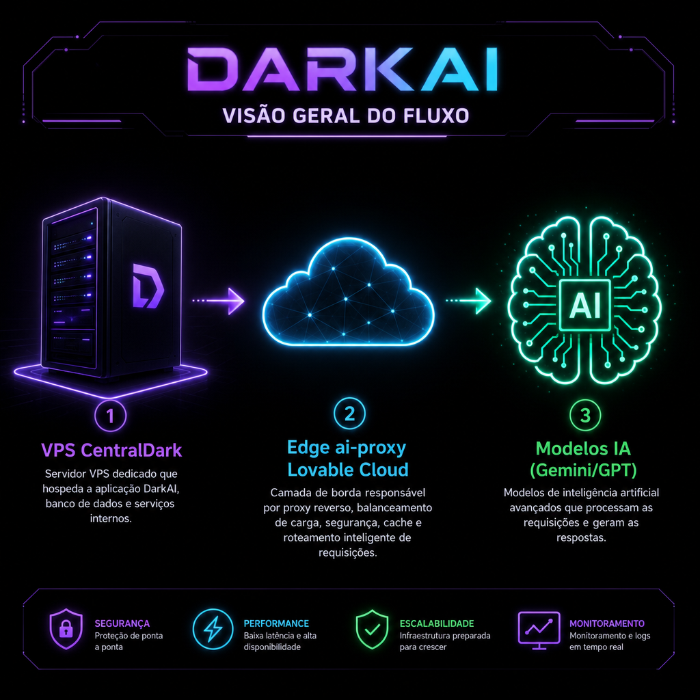
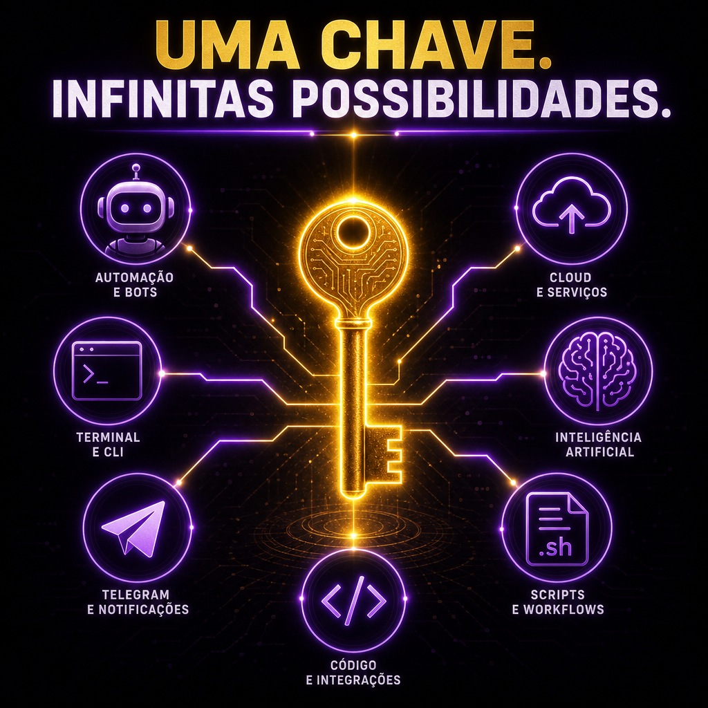

# 📚 DARKAI — Comece Aqui

> **📖 Pra quem é este arquivo:** você que abriu essa pasta pela primeira vez.
> **⏱️ Tempo de leitura:** 3 minutos.

---

## O que é isso aqui?

Uma pasta-tutorial completa sobre o **DARKAI** — o "cérebro compartilhado" que você criou pra sua VPS conversar com IAs (Gemini, GPT-5, etc.) usando **uma chave só** que fica segura na Lovable Cloud.

---

## Ordem de leitura recomendada

Se você é leigo e quer entender do zero, siga essa ordem:

| # | Arquivo | O que você aprende |
|---|---------|--------------------|
| 1 | [`01-O-QUE-E-DARKAI.md`](01-O-QUE-E-DARKAI.md) | O conceito em linguagem simples, com analogia |
| 2 | [`02-COMO-FUNCIONA-POR-DENTRO.md`](02-COMO-FUNCIONA-POR-DENTRO.md) | Como o fluxo funciona (com diagrama) |
| 3 | [`03-CATALOGO-DE-MODELOS.md`](03-CATALOGO-DE-MODELOS.md) | Todos os modelos IA disponíveis e quando usar cada um |
| 4 | [`04-USANDO-NO-TERMINAL-LOCAL.md`](04-USANDO-NO-TERMINAL-LOCAL.md) | Como usar no SEU PC (Mac/Linux/Windows) |
| 5 | [`05-USANDO-NA-VPS.md`](05-USANDO-NA-VPS.md) | Como instalar na VPS |
| 6 | [`06-ENSINANDO-OUTRAS-IAS.md`](06-ENSINANDO-OUTRAS-IAS.md) | Prompt pronto pra ensinar Claude/Cursor/ChatGPT a usar |
| 7 | [`07-EXEMPLOS-PRATICOS.md`](07-EXEMPLOS-PRATICOS.md) | 15+ exemplos do mundo real |
| 8 | [`08-TECNICAS-QUE-USO.md`](08-TECNICAS-QUE-USO.md) | Minhas técnicas de trabalho (Lovable) |
| 9 | [`09-ARQUITETURA-E-ORQUESTRACAO.md`](09-ARQUITETURA-E-ORQUESTRACAO.md) | Como organizo grandes tarefas |
| 10 | [`10-TROUBLESHOOTING.md`](10-TROUBLESHOOTING.md) | Erros comuns e como resolver |

---

## Arquivos técnicos (não precisa ler, só usar)

- `darkai.sh` — o script CLI em si (bash puro)
- `instalar-local.sh` — instalador pro seu PC (Mac/Linux)
- `instalar-windows.ps1` — instalador pro Windows PowerShell
- `exemplos/` — scripts de exemplo prontos
- `imagens/` — todas as imagens explicativas
- `CREDENCIAIS-TEMP.env` — **temporário**, deletar depois de salvar no pendrive

---

## Regra de ouro

> **Uma chave. Infinitas possibilidades.**

Todo o resto é detalhe. Se entender essa frase, entendeu o DARKAI.

