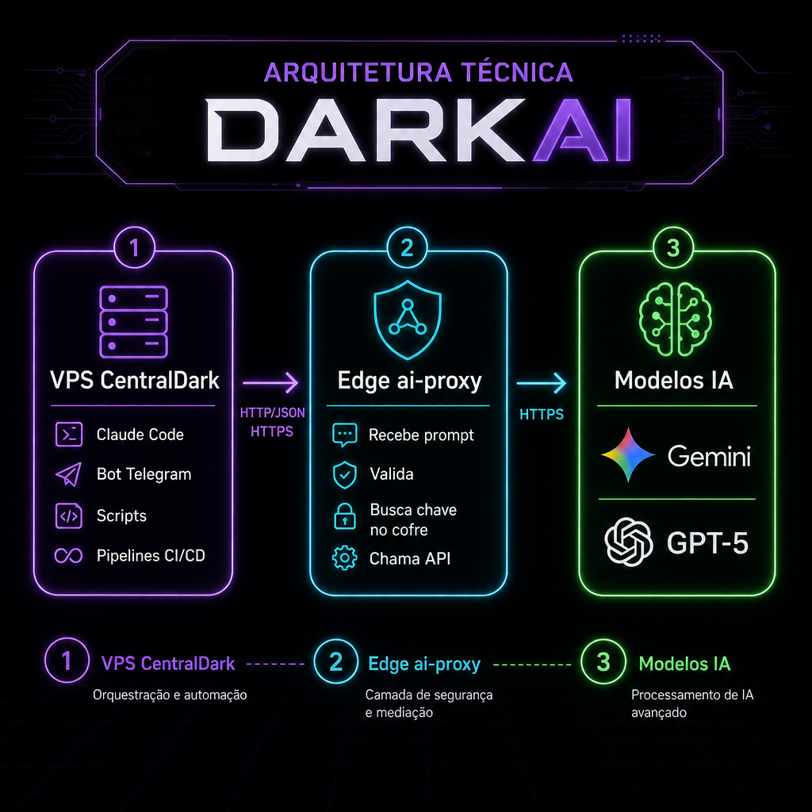

# ⚙️ Como funciona por dentro

> **📖 Pra quem é:** curiosos e IAs que precisam ensinar outras IAs.
> **⏱️ Tempo:** 7 minutos.

---

## O fluxo completo



### Passo a passo

1. **Você (ou um script, ou uma IA)** digita no terminal:
   ```bash
   darkai "resuma este log em 5 pontos"
   ```

2. **O script `darkai`** monta um JSON e faz um `POST` HTTPS pra edge function:
   ```
   POST https://kagejpghnwdfymddwxuf.supabase.co/functions/v1/ai-proxy
   Content-Type: application/json
   Authorization: Bearer <ANON_KEY>

   { "prompt": "resuma este log em 5 pontos" }
   ```

3. **A edge function `ai-proxy`** (código em `supabase/functions/ai-proxy/index.ts`):
   - Recebe o pedido
   - Valida o formato com Zod
   - **Busca a `LOVABLE_API_KEY` do cofre** (variável de ambiente segura)
   - Monta a requisição pro gateway Lovable AI

4. **Chama o gateway Lovable AI:**
   ```
   POST https://ai.gateway.lovable.dev/v1/chat/completions
   Authorization: Bearer <LOVABLE_API_KEY>

   { "model": "google/gemini-3-flash-preview", "messages": [...] }
   ```

5. **O gateway** repassa pro modelo real (Gemini na Google, GPT na OpenAI, etc.), pega a resposta.

6. **A resposta volta** o caminho todo em reverso:
   Modelo → Gateway → Edge → `darkai` → seu terminal.

---

## Por que essa arquitetura?

### Segurança
A `LOVABLE_API_KEY` **nunca** trafega pela VPS nem aparece em nenhum log seu. Ela vive só dentro da edge function, injetada em runtime pela Lovable Cloud. Se sua VPS for hackeada, o atacante **não pega a chave da IA**.

### Flexibilidade
A VPS só precisa saber **1 URL** e **1 chave pública** (a anon key do Supabase, que pode até ser exposta). Trocar de modelo, trocar de provider, adicionar rate limit, adicionar cache — tudo é feito na edge, sem mexer em 50 scripts na VPS.

### Custo centralizado
Toda chamada cai numa fatura só. Você vê no painel da Lovable quanto cada modelo custou no mês.

### Compatível com qualquer IA
Como a edge function fala HTTPS + JSON padrão, **qualquer** cliente consegue chamar. Claude Code, ChatGPT rodando local, bot Telegram, script bash — todos usam o mesmo `darkai`.

---

## O que a edge function faz exatamente

Código simplificado (versão real em `supabase/functions/ai-proxy/index.ts`):

```typescript
Deno.serve(async (req) => {
  // 1. Trata CORS
  if (req.method === "OPTIONS") return new Response("ok", { headers: corsHeaders });

  // 2. Valida input com Zod
  const { prompt, system, model } = BodySchema.parse(await req.json());

  // 3. Pega a chave do cofre (nunca sai daqui)
  const apiKey = Deno.env.get("LOVABLE_API_KEY");

  // 4. Chama o gateway Lovable AI
  const res = await fetch("https://ai.gateway.lovable.dev/v1/chat/completions", {
    method: "POST",
    headers: {
      "Authorization": `Bearer ${apiKey}`,
      "Content-Type": "application/json",
    },
    body: JSON.stringify({
      model: model ?? "google/gemini-3-flash-preview",
      messages: [
        ...(system ? [{ role: "system", content: system }] : []),
        { role: "user", content: prompt },
      ],
    }),
  });

  // 5. Trata rate limit e créditos esgotados
  if (res.status === 429) return json({ error: "rate_limit" }, 429);
  if (res.status === 402) return json({ error: "sem_creditos" }, 402);

  // 6. Devolve a resposta
  const data = await res.json();
  return json({ ok: true, content: data.choices[0].message.content, model, usage: data.usage });
});
```

É só isso. **60 linhas** protegem sua chave e destravam a IA pra todo mundo.

---

## Segurança em camadas

| Camada | O que protege |
|--------|---------------|
| HTTPS | Ninguém intercepta a chamada |
| Anon key do Supabase | Autentica quem tá chamando a edge |
| Zod validation | Rejeita payloads malformados |
| Chave no cofre da Cloud | `LOVABLE_API_KEY` nunca vaza pra fora da edge |
| Rate limit da Lovable AI | Evita abuso |
| Log de uso | Você vê tudo no painel |

---

Próximo: [`03-CATALOGO-DE-MODELOS.md`](03-CATALOGO-DE-MODELOS.md)
