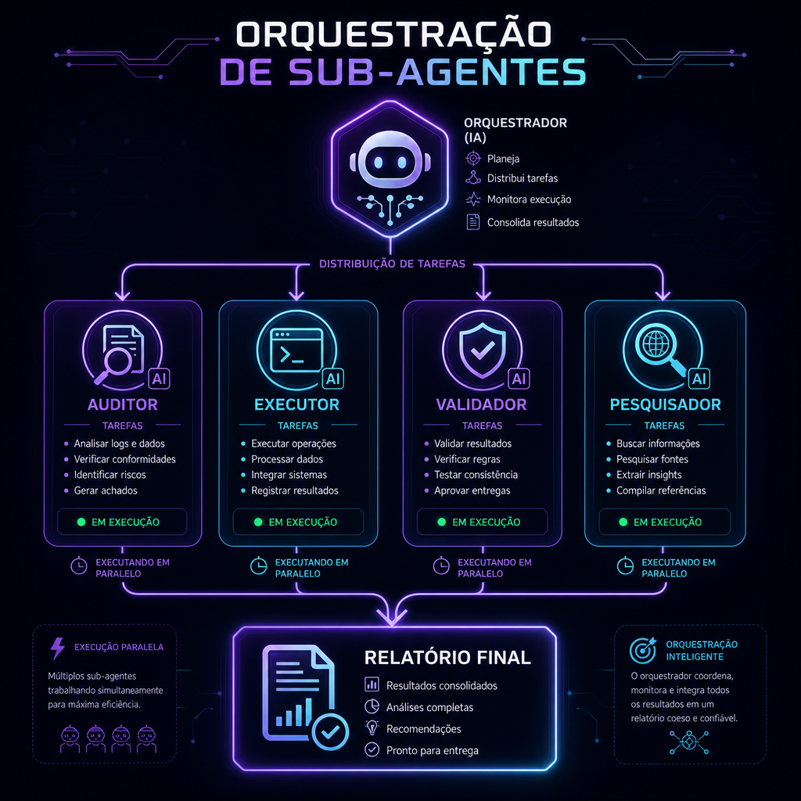

# 🏗️ Arquitetura e Orquestração

> **📖 Pra quem é:** quem quer entender como o CentralDark inteiro se organiza.
> **⏱️ Tempo:** 8 minutos.

---

## Visão macro do CentralDark

```
┌─────────────────────────────────────────────────────────────┐
│  4-POINT SYNC (todos os pontos precisam bater)              │
├─────────────────────────────────────────────────────────────┤
│                                                             │
│   [Lovable Editor]  ⇄  [GitHub]  ⇄  [VPS]                   │
│         ↓                 ↓            ↓                    │
│         └─────→ [Cérebro Vivo] ←──────┘                     │
│                docs/CONSCIENCIA/                            │
│                .claude/                                     │
│                                                             │
└─────────────────────────────────────────────────────────────┘
```

**Regra:** nenhuma mudança estrutural está "pronta" enquanto os 4 pontos não refletirem o mesmo estado.

---

## Camadas do sistema

```
┌──────────────────────────────────────────────────────────┐
│  CAMADA 1: INTERFACES                                    │
│  Bot Telegram, TelePanel (React), Terminal SSH, VPS      │
└──────────────────────────────────────────────────────────┘
                          ↓
┌──────────────────────────────────────────────────────────┐
│  CAMADA 2: ORQUESTRAÇÃO                                  │
│  Scripts na VPS, PM2, Webhooks, Cron, Edge Functions     │
└──────────────────────────────────────────────────────────┘
                          ↓
┌──────────────────────────────────────────────────────────┐
│  CAMADA 3: INTELIGÊNCIA (novo!)                          │
│  DARKAI → Lovable AI Gateway → Gemini/GPT                │
└──────────────────────────────────────────────────────────┘
                          ↓
┌──────────────────────────────────────────────────────────┐
│  CAMADA 4: DADOS                                         │
│  Supabase (Lovable Cloud), storage, RLS                  │
└──────────────────────────────────────────────────────────┘
```

---

## Diretórios importantes

### `.claude/`
Instruções, regras defensivas, agentes especializados. É lido por IAs que trabalham no repo.

### `docs/CONSCIENCIA/`
Cérebro vivo. Fonte da verdade de decisões e aprendizados. Sobrevive entre sessões de IA.

### `docs/CONSCIENCIA/DARKAI/`
**Você tá aqui.** Documentação do sistema DARKAI.

### `docs/CONSCIENCIA/LEMBRANCAS/`
Memória de curto prazo, gerida pelas ferramentas cognitivas do MCP.

### `supabase/functions/`
Edge functions. Toda IA que chama uma API externa (Gemini, GPT, Stripe, etc.) passa por aqui.

### `apps/bot-telegram/`
Bot do Telegram (protegido, não mexer sem autorização).

### `apps/modulos/mcp/`
MCP consolidado com 100+ ferramentas cognitivas (protegido).

### `/root/CentralDark/` (na VPS)
Espelho de execução. PM2 mantém processos vivos.

### `/root/CentralDark/secrets/` (na VPS)
Fallback offline de tokens quando conectores oficiais falham.

---

## Fluxo de uma mudança típica

```
1. Você pede algo na Lovable
2. IA (eu) faz plano, executa
3. Auto-commit no GitHub (Lovable ↔ GitHub sync)
4. Deploy automático (edge functions vão pra Lovable Cloud)
5. Você (ou webhook) puxa mudança na VPS: git pull
6. PM2 reinicia serviços afetados: pm2 restart X && pm2 save
7. Doc é atualizada em docs/CONSCIENCIA/
8. Se relevante, memória é registrada em mem://
```

---

## Orquestração de sub-agentes

Quando eu recebo uma tarefa grande, **não faço tudo eu mesmo**. Uso `spawn_agent` pra delegar sub-tarefas em paralelo:



**Exemplo real:** "Migrar módulo X da CentralDark1VPS pra CentralDark"

- **Sub-agente 1 (Auditor):** lê o código atual, mapeia dependências
- **Sub-agente 2 (Extrator):** copia arquivos preservando estrutura
- **Sub-agente 3 (Adaptador):** ajusta imports/paths pro novo repo
- **Sub-agente 4 (Validador):** roda testes, checa que nada quebrou

Cada um recebe um objetivo isolado, entrega resultado, eu consolido.

---

## Regras de execução defensiva

1. **Nunca sobrescrever cegamente.** Ler primeiro, atualizar depois.
2. **Nunca adivinhar paths na VPS.** Usar tools que listam catálogo real.
3. **Scripts isolados em `/root/CentralDark/scripts/`.** Nunca soltos.
4. **Pré-deploy obrigatório:** rodar `audit-rls` antes de publish.
5. **Nunca expor service role key** ou senha do banco ao usuário.
6. **Áreas protegidas exigem autorização explícita** ("PERMITO PIVETE").

---

## Ferramentas cognitivas do MCP (100+)

O MCP em `apps/modulos/mcp/` expõe ferramentas que eu uso pra:

- **Ler consciência:** `ler_consciencia`, `ler_regras_inviolaveis`, `ler_pendencias`
- **Escrever consciência:** `atualizar_consciencia`, `registrar_aprendizado`
- **VPS segura:** `vps_tree_safe`, `vps_read_file_safe`, `vps_write_file_safe`
- **Run-once controlado:** `vps_run_once_script` (dry-run por padrão)
- **GitHub:** commit, PR, workflow dispatch, issues
- **Análise:** `code_reviewer`, `gemini_analisar`, `elite_gateway_chat`
- **Memória:** `pendencias_add`, `pendencias_close`, `puxar_aprendizados`

Tudo isso com **guardrails**: dry-run por padrão, confirmação explícita pra ações destrutivas, bloqueio em paths sensíveis.

---

## Por que essa arquitetura funciona

- **Modular:** cada camada é substituível sem quebrar as outras
- **Testável:** cada peça tem seu próprio ambiente
- **Defensiva:** guardrails em todos os pontos críticos
- **Escalável:** adicionar nova IA/serviço = adicionar cliente pro `darkai`
- **Rastreável:** tudo vai pro Cérebro Vivo, nada se perde

---

Próximo: [`10-TROUBLESHOOTING.md`](10-TROUBLESHOOTING.md)
