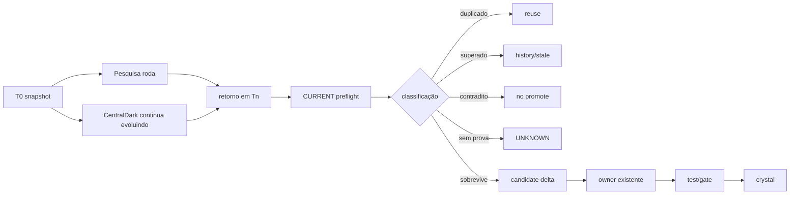

# 2026-10-03 — Compilador de cristal portátil + seleção temporal

## Intenção

Transformar a técnica desta sessão em capacidade reutilizável do owner já existente `.agents/skills/knowledge-compiler/`:

```text
CHEFE passa o cristal
→ Knowledge Compiler resolve owner/semântica
→ backend Python valida invariantes
→ adapta somente bindings
→ Windows | VMware | VPS
→ plano/hash/lock determinísticos
→ runtime
→ prova + contraprova
→ receipt
```

## Linhagem criptográfica do pacote

```text
v1 package SHA256
4da29cd8345591f25695909c2159dc54de393120c6f78673e2b0cd98689efde6
        │
        │ bytes evoluíram
        ▼
parent_package_sha256 preservado
        │
        ▼
sucessor local v2 SHA256
9e99657b37dbc99a474067957956ccb52067c142c3108558be79aa9e2bbee2f0
```

Lei: `CHANGED_BYTES_REQUIRE_NEW_SHA256=true`. Continuidade é lineage, não falsificação de hash.

## Owner real encontrado

A busca CURRENT encontrou:

```text
.agents/skills/knowledge-compiler/
├── SKILL.md
├── contract.json
├── crystal-route.json
├── scripts/compiler.mjs
├── tests/compiler.test.mjs
└── gate: .github/workflows/lupa-conformance.yml
```

Logo o Python não cria um segundo compilador conceitual. Ele entra como backend portátil/binding adapter:

```text
knowledge-compiler
        │
        ├── compiler.mjs        = compilador/validador owner existente
        │
        └── crystal-runtime-compiler.py
                 = backend portátil de runtime/bindings
```

## Seleção temporal da pesquisa atrasada

A Pesquisa Aprofundada recebeu fotografia anterior do sistema e retornou depois de #154/#155.



```text
RESEARCH_OUTPUT_IS_CANDIDATE_NOT_AUTHORITY=true
DELAY_IS_NOT_PROOF=true
RETURNING_RESEARCH_MUST_REENTER_CURRENT_PREFLIGHT=true
SURVIVAL_ACROSS_TIME_IS_SIGNAL_NOT_AUTOMATIC_CANON=true
```

## Ouro sobrevivente da arqueóloga

Promovido como delta/reforço:

1. `SSH_AUTH != PERSISTENT_HOSTKEY_TRUST`.
2. `ssh-keyscan` produz candidato; trust persistente exige âncora independente.
3. Após igualdade âncora/candidato, reutilizar o mesmo blob verificado evita verificar A e gravar B.
4. `QUEUED != RUNNER_ASSIGNMENT`.
5. Runner só é atribuído quando `runner_id > 0`, `runner_name != ""`, rota/label identifica VMware e machine-id do job coincide com a VMware.
6. Receipt machine-readable guarda fingerprints/hashes/resultados, nunca private key/token/senha.
7. Pesquisa atrasada reentra no CURRENT antes de promoção.

Não promovido automaticamente:

- novo script/owner paralelo só porque o relatório sugeriu;
- novo diretório `evidence/` sem resolver owner;
- estimativas de minutos;
- premissa de provedor;
- valores que o CURRENT já superou.

## Prova do backend na VMware

Os três arquivos canônicos foram relidos do `main`, materializados em diretório temporário e executados na CENTRALDARK-OS.

```text
CRYSTAL_RUNTIME_COMPILER_TEST=PASS

compiled_crystal_fingerprint=
d1fd0fc3f30b4e35ea864a24ec522cdaa227a1c19a9b4119cd20d1779538746e

lock_key=
dfc11b978498393ef13c42f2c583ef0ac0109c3d45585ff561ad2abcaa746d1f

proof_plan_hash=
85857899510cae71c0cc8cdb2973c232f291f9ac0e09bf7283c30ce50ec5c534

result_schema_hash=
75d56a005d5d50ad8bb3460fc0c77289827364807a22ce80ce475b6e854de9a3

effect_schema_hash=
1e1f8d17d66cc3374fcffaa481e0fe0fa218c06aee2566d6a8bdc303c7ec2c2e
```

Plano compilado:

```text
PLAN_SCHEMA=centraldark.compiled-plan.v2
TARGET=vmware
TEMPORAL_POLICY=RETURNING_RESEARCH_IS_CANDIDATE_NOT_AUTHORITY
SSH_TRUST=UNKNOWN_UNTIL_INDEPENDENT_ANCHOR
RUNNER_STATE=UNKNOWN_UNTIL_REAL_ASSIGNMENT
```

## Fórmula do compilador

```text
CRISTAL
= intenção comprimida
+ invariantes
+ sequência
+ prova esperada
+ contraprova
+ bindings permitidos
+ efeito esperado

PYTHON
= conhecimento executável / backend reproduzível

JSON
= cristal materializado

HASH
= identidade do material

LOCK
= compromisso com a identidade

RECEIPT
= efeito realmente provado no runtime
```

## Fronteira

```text
PYTHON_REPRODUZIU_HASH=PASS
!=
FORGE_RECONCILIATION_EXECUTED

COMPILED_TARGET_VMWARE=PASS
!=
PERSISTENT_HOSTKEY_TRUST

RUNNER_PLAN_COMPILED=PASS
!=
RUNNER_ASSIGNED_JOB
```

## NEXT_CURSOR

Rodar o cristal #156 em `inspect` contra a forge viva. Somente depois de classificar `LOCAL_GOLD / ALREADY_IN_MAIN / STALE / CONFLICT / UNKNOWN` decidir o delta mutável. Em paralelo, os dois gates independentes continuam separados: âncora host-key e assignment real do runner VMware.
