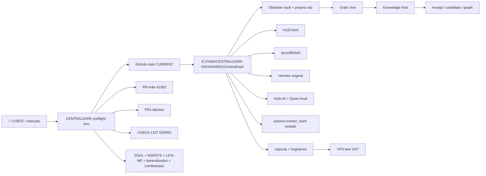
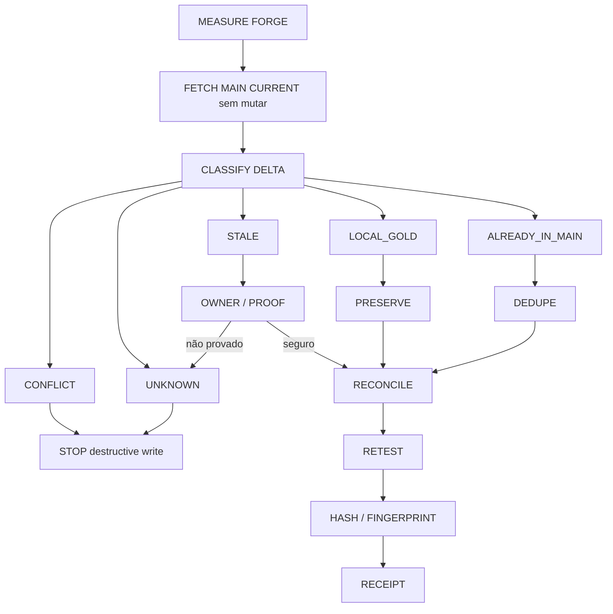

# 2026-10-03 — Cristal VMware Forge + Obsidian + sync preservativo da main

## Intenção do CHEFE

Transformar a sessão inteira em cristal reutilizável, sem arquitetura paralela:

```text
PREFLIGHT VIVO
→ BANCADA EXISTENTE
→ OBSIDIAN NA PRÓPRIA CENTRALDARK
→ HUD/BRAIN/Lembranças interligados
→ MAIN CURRENT entra por reconciliação preservativa
→ ouro local preservado
→ prova/contraprova/fingerprint/receipt
→ runner VMware isolado
→ replay VPS usando receita provada
```

## Topologia operacional



## Sync preservativo da main



## Fluxo Obsidian/HUD

```mermaid
flowchart TD
    ROOT[SHARED/CentralDark] --> HOME[Home.md]
    ROOT --> HUD[HUD.html]
    ROOT --> PEND[Pendências.md]
    ROOT --> BRAIN[docs/BRAIN]
    ROOT --> CONS[docs/CONSCIENCIA]
    ROOT --> DOT[.obsidian local]
    DOT --> PLUGIN[centraldark-grafo-vivo]
    PLUGIN --> API[/api/graph]
    PLUGIN --> HUB[/memoria/ingest]
    HUD --> L152[Lembrança #152]
    HUD --> BRAIN
    HOME --> L152
    PEND --> L152
```

## Bindings medidos nesta sessão

```text
FORGE_WINDOWS_PATH=E:\VMs\CENTRALDARK-OS\SHARED\CentralDark
GUEST_WRITE_ROUTE=/home/CENTRAKDARK-OS/vmware-shares/CENTRALDARK-SHARED/CentralDark
CASA_E_WIDE_ROUTE_WRITE=EIO
DEDICATED_CENTRALDARK_SHARED_WRITE=PASS
OBSIDIAN_VAULT_ROOT=CentralDark
DOT_OBSIDIAN_GIT_IGNORED=PASS
PLUGIN_OWNER=apps/modulos/obsidian-plugin-grafo-vivo
PLUGIN_BUILD_PRESENT=PASS
HUD_LINK_TO_LEARNING_152=PASS
HOME_LINK_TO_LEARNING_152=PASS
PENDENCIAS_LINK_TO_LEARNING_152=PASS
OLD_WINDOWS_DOT_OBSIDIAN_BYTES=UNKNOWN
```

## Receita reutilizável

Owner: `docs/ARQUITETURA/CENTRALDARK-TRIGGER-FABRIC/PROVEN-CLAIMS.lock.json#VMWARE_FORGE_OBSIDIAN_PRESERVE_GOLD_SYNC`

Fingerprint:

```text
dependency_fingerprint=557819f7b6230625330f8870cd41d69c1a16f21e3e40d644f00cd7aea4b9ff24
lock_key=90b98d0a64eca63a1da217b7c9de5072bcf107e3f2800768d10e78b26545c45b
proof_plan_hash=885608acd3366d0972a0207e316f445f36ca8eccaa024365e0da2fa442afad9a
result_schema_hash=8cd2c4e36f31316c6f65af6922e78c97a17a6cf6e2a0e6b88b60325cbfc3ca37
effect_schema_hash=1e1f8d17d66cc3374fcffaa481e0fe0fa218c06aee2566d6a8bdc303c7ec2c2e
```

## Prova requerida

```text
1. repo/remote/branch/HEAD da forja corretos
2. status local capturado antes de mutação
3. main CURRENT fetcha sem reset/checkout cego
4. merge-base e inventário diferencial gerados
5. LOCAL_GOLD e UNKNOWN não são sobrescritos
6. .obsidian permanece ignorada pelo Git
7. plugin existente continua loadable
8. HUD/Home/Pendências preservam links para memória/BRAIN
9. runner usa _work separado da forja
10. receipt separa PASS / CONFLICT / UNKNOWN / NEXT_CURSOR
```

## Contraprova

```text
SAME_HEAD_ON_TWO_PATHS != SAME_PHYSICAL_BACKING
HUD_MATERIALIZED != HUD_CURRENT_STATE_PROVEN
PLUGIN_BUILD_PRESENT != PLUGIN_RUNTIME_LOADED
OBSIDIAN_FILES_PRESENT != OLD_WINDOWS_VAULT_FULLY_MIGRATED
FETCH_MAIN != SAFE_RECONCILIATION
DIRTY != BROKEN
UNKNOWN != SAFE_TO_OVERWRITE
```

## Segurança

Nenhuma senha, token, PAT, Bearer, chave privada ou valor secreto entra neste cristal. Apenas nomes de bindings, caminhos, fingerprints públicos de receita e estados de presença/prova.

## NEXT_CURSOR

Executar a receita de inventário/reconciliação preservativa contra a `main` CURRENT; depois provar `runner_name` real do self-hosted VMware e usar o cristal #154 para o replay VPS sem Casa como salto.
