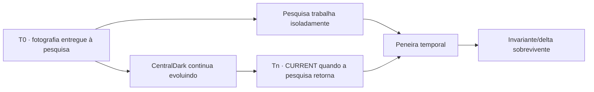

# 2026-10-03 — Fragmentos da “cabeça” externalizada: preservar o caminho, destilar o essencial e deixar o CURRENT selecionar

Status: **CHEFE_STATED_METHOD / SESSION_MEMORY**  
Data: **2026-10-03**  
Proveniência: **SEGREDO/CHEFE, explicitado em conversa**  
Owner desta memória: `docs/CONSCIENCIA/LEMBRANCAS/`  
Owners relacionados: `docs/CONSCIENCIA/MAPA-DO-CEREBRO.md`, `docs/BRAIN/`, `docs/CONSCIENCIA/APRENDIZADOS.md`, `docs/CONSCIENCIA/METACOGNICAO-OPERACIONAL.md`  
Promoção automática: **NÃO**  
Regra: **preservar o que já existe; acrescentar contexto/proveniência; CURRENT decide uso presente**

## O que “leia minha cabeça” significa na linguagem do CHEFE

Quando o CHEFE disser **“leia minha cabeça”** no contexto da CentralDark, a referência operacional é a cabeça **externalizada nos documentos**: BRAIN, CONSCIENCIA, mapas, Lembranças, Aprendizados, contratos e owners aplicáveis.

Isso não significa leitura literal da mente, consciência transferida ou acesso a raciocínio privado.

```text
"CABEÇA" NO CONTEXTO CENTRALDARK
→ DOCS/BRAIN + DOCS/CONSCIENCIA + OWNERS RELACIONADOS
→ FRAGMENTOS EXTERNALIZADOS PELO CHEFE
→ MÉTODO / VISÃO / PROVENIÊNCIA REGISTRADA
→ CURRENT + PROVA DECIDEM APLICAÇÃO PRESENTE

DOCS_ARE_EXTERNALIZED_METHOD_NOT_MIND_READING=true
```

## O método humano que alimenta a Casa

O CHEFE descreveu que coloca nesses documentos **fragmentos selecionados do que consegue perceber, associar, aprender, lembrar e formular**, tentando cristalizar o essencial do próprio modo de pensar sem precisar registrar tudo.

A unidade preservada não precisa ser uma conclusão pronta. Pode ser uma associação, experiência, intuição, correção, hipótese, imagem mental, regra prática ou conexão que pareça material.

```text
FRAGMENTO DO CHEFE
→ PRESERVAR PROVENIÊNCIA + EVENT_TIME
→ LIGAR AO FIO JÁ EXISTENTE
→ NÃO REESCREVER O PASSADO PARA PARECER MAIS CERTO
→ CONFRONTAR COM CURRENT / PROVA / CONTRAPROVA
→ DEDUPLICAR
→ DESTILAR SOMENTE O QUE SOBREVIVE
→ PROMOVER APENAS QUANDO HOUVER DELTA REUTILIZÁVEL
```

O objetivo declarado pelo CHEFE é **cristalizar o essencial**, não produzir uma cópia literal da mente humana.

## Lembrança não é Aprendizado; Aprendizado não é CURRENT

A distinção útil desta conversa:

```text
LEMBRANÇA
= preserva o fragmento e como ele foi entendido naquele tempo

APRENDIZADO
= destila o que sobreviveu a confronto/prova e ganhou uso reutilizável

CANÔNICO
= regra vigente promovida no owner correto

CURRENT / ESTADO VIVO
= realidade operacional observável agora
```

Logo:

```text
FRAGMENT_RECORDED != FACT_PROVEN
MEMORY_PRESERVED != CANON_PROMOTED
LEARNING_WRITTEN != RUNTIME_PASS
HISTORY_TRUE_AT_T != CURRENT_TRUE_NOW
```

A memória antiga não é destruída quando uma interpretação melhora. Preserva-se o que era conhecido/dito no tempo do evento e registra-se a correção, qualificação ou superação em camada posterior.

## O “quase Darwin” — seleção temporal deliberada

Durante esta sessão, uma Pesquisa Aprofundada recebeu uma fotografia do sistema em um instante anterior e foi deliberadamente deixada trabalhando enquanto a CentralDark continuava evoluindo.

A utilidade percebida pelo CHEFE não é tratar o relatório futuro como autoridade. É fazê-lo voltar **atrasado** e submetê-lo ao CURRENT que existir naquele momento.



Peneira quando o material atrasado retornar:

```text
JÁ EXISTE NO CURRENT
→ DEDUPE / REUSE

FOI SUPERADO
→ HISTORY / STALE

CONTRADIZ CURRENT COM PROVA MELHOR
→ NÃO PROMOVER

DEPENDE DE BINDING/ESTADO ANTIGO
→ REVALIDAR CONE AFETADO

NÃO HÁ EVIDÊNCIA SUFICIENTE
→ UNKNOWN

CONTINUA VÁLIDO APÓS A MUDANÇA
→ CANDIDATO A INVARIANTE / DELTA ÚTIL
```

O atraso, nesse desenho, pode funcionar como **pressão de contraprova temporal**. Isso não torna toda ideia sobrevivente automaticamente verdadeira; ela ainda precisa do owner, prova e critérios aplicáveis.

```text
DELAY_CAN_CREATE_TEMPORAL_TEST_PRESSURE=true
DELAY_IS_NOT_PROOF=true
RESEARCH_OUTPUT_IS_CANDIDATE_NOT_AUTHORITY=true
RETURNING_RESEARCH_MUST_REENTER_CURRENT_PREFLIGHT=true
SURVIVAL_ACROSS_TIME_IS_SIGNAL_NOT_AUTOMATIC_CANON=true
```

## Preservação sem distorção

Este registro não deve “embelezar” retrospectivamente o pensamento do CHEFE nem substituir documentos anteriores.

Regras desta memória:

```text
USER_STATED_FRAGMENT=PRESERVE_WITH_PROVENANCE
EVENT_TIME=PRESERVE
OLD_TRUE_AT_TIME=DO_NOT_ERASE
NEW_INTERPRETATION=ADD_LAYER_NOT_REWRITE_HISTORY
CORRECTION=MARK_WHAT_CHANGED_AND_WHY
CURRENT_GOVERNS_PRESENT
HISTORY_PRESERVES_PATH
REUSE_EXISTING_OWNER_BEFORE_CREATE
NO_PARALLEL_MEMORY_ARCHITECTURE
RAW_PRIVATE_REASONING_NOT_STORED
SECRETS_NOT_STORED
```

A frase “cristalizar o essencial da minha mente” é preservada aqui como **descrição/metáfora autorizada do CHEFE para o processo de externalização seletiva de método e visão**, não como alegação de cópia integral da mente.

## Como uma IA deve usar esses fragmentos

Ao receber uma fala curta, metáfora ou referência como “minha cabeça”, a IA deve:

1. recuperar o fio atual e os documentos pertinentes;
2. tratar os fragmentos registrados como proveniência e prior do método do CHEFE;
3. não substituir CURRENT por memória;
4. tentar falsificar a interpretação contra owners/prova;
5. preservar contradições históricas em vez de apagá-las;
6. responder usando somente o contexto material necessário;
7. registrar novo fragmento apenas quando houver valor de continuidade, sem engordar a Casa por repetição.

```text
FRAGMENTS_HELP_RECONSTRUCT_METHOD=true
FRAGMENTS_DO_NOT_GRANT_MIND_READING=true
PRECISE_RETRIEVAL_SMALL_CONTEXT=true
REPLAY_BEFORE_REDISCOVERY=true
CURRENT_OVER_HISTORY=true
UNKNOWN_IS_NOT_PASS=true
```

## Relação com o que já existia

Este registro **não cria um segundo cérebro nem uma nova memória**. Ele explicita e qualifica mecanismos já existentes:

- `LEMBRANCAS/README.md`: fragmentos úteis do que o CHEFE ensina, corrige, decide e aprende;
- `DOCS_ARE_EXTERNALIZED_METHOD_NOT_MIND_READING=true`;
- `#ACORDAR`: recuperar somente contexto relevante e comparar com estado vivo;
- `METACOGNICAO-OPERACIONAL`: confronto e autofalsificação antes de promoção;
- `Dream Review`: proposta derivada continua CANDIDATE até sobreviver;
- `CURRENT > HISTORY`;
- `REUSE_BEFORE_CREATE`.

## Próxima leitura

Quando este fragmento voltar a ser pertinente:

```text
LER_FRAGMENTO
→ LER_OWNER/CANON_ATUAL
→ MEDIR_CURRENT
→ COMPARAR
→ PRESERVAR_HISTÓRIA
→ ABSORVER_SÓ_DELTA_QUE_SOBREVIVE
```

Nenhuma promoção para Aprendizado novo foi feita neste registro. A sequência canônica permanece no learning vigente até existir delta/prova que justifique promoção.
