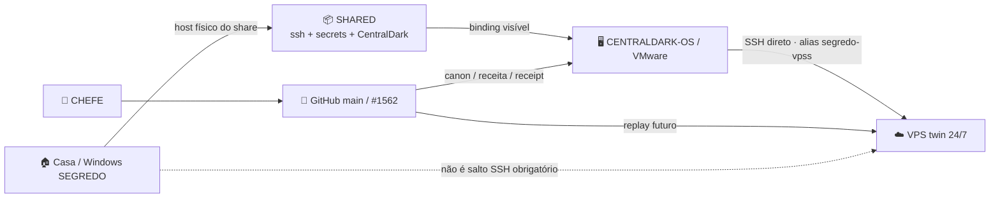
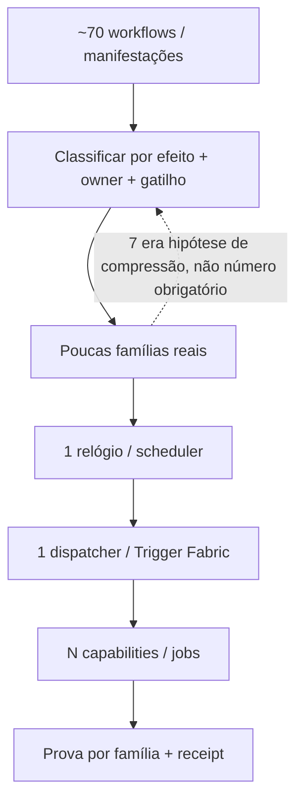
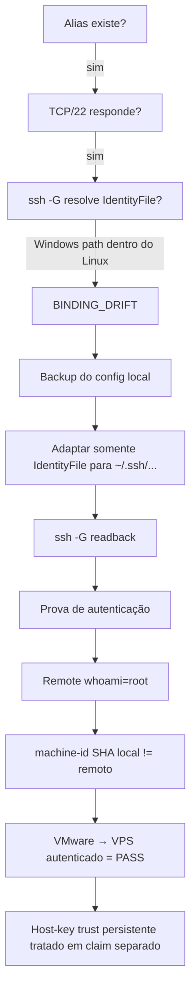

# 2026-10-03 — Receita VMware → VPS direto: binding de ambiente, prova de máquina distinta e fronteira de host key

Status: **SESSION_CRYSTAL / PROVEN_AUTH_PATH_WITH_HOSTKEY_TRUST_FRONTIER**  
Authority: **SEGREDO/CHEFE**  
Learning: **#154**  
Owner da receita: `docs/ARQUITETURA/CENTRALDARK-TRIGGER-FABRIC/PROVEN-CLAIMS.lock.json#VMWARE_VPS_DIRECT_SSH_BINDING_PATH`  
Regra: **REUSE_BEFORE_CREATE · ADAPTA_SOMENTE_BINDINGS_DO_AMBIENTE · CURRENT > HISTORY · UNKNOWN != PASS**

## 1. O que a sessão ensinou

A rota já existia. A chave já existia. A porta já respondia. O erro real era um **binding de caminho Windows carregado dentro do Linux**.

Antes da correção, a VMware tinha:

```text
Host segredo-vpss
HostName 89.117.78.124
User root
IdentityFile C:/Users/Administrador/.ssh/segredo_vps_ed25519
IdentitiesOnly yes
StrictHostKeyChecking accept-new
```

O arquivo de identidade correto já existia em:

```text
~/.ssh/segredo_vps_ed25519
```

A correção preservativa foi:

```text
C:/Users/Administrador/.ssh/segredo_vps_ed25519
→
~/.ssh/segredo_vps_ed25519
```

Isso prova uma lei operacional importante:

```text
BYTE_EQUAL_CROSS_OS_CONFIG != VALID_BINDING
SAME_RECIPE + DIFFERENT_ENVIRONMENT
→ ADAPT_ONLY_BINDING
→ KEEP_SEMANTICS
→ REPLAY_SAME_PROOF
```

## 2. Mermaid — topologia real



## 3. Mermaid — compressão por invariante



## 4. Mermaid — diagnóstico da rota SSH



## 5. Parâmetros observados nesta sessão

| Parâmetro | Valor / estado | Papel |
|---|---|---|
| `SSH_ALIAS` | `segredo-vpss` | rota lógica existente |
| `VPS_HOST` | `89.117.78.124` | binding de ambiente |
| `SSH_USER` | `root` | binding de autenticação |
| `SSH_CONFIG` | `~/.ssh/config` | binding local VMware |
| `IDENTITYFILE_BEFORE` | caminho Windows `C:/Users/Administrador/.ssh/...` | drift provado |
| `IDENTITYFILE_AFTER` | `~/.ssh/segredo_vps_ed25519` | binding Linux corrigido |
| `CONFIG_BACKUP` | `~/.ssh/config.pre-vm-binding-20261003` | rollback local |
| `KNOWN_HOSTS` | `~/.ssh/known_hosts` | trust store persistente |
| `SHARED_SSH_ROOT` | `/home/CENTRAKDARK-OS/SHARED/ssh` | fonte compartilhada de bindings |
| `SHARED_SECRETS_ROOT` | `/home/CENTRAKDARK-OS/SHARED/secrets` | cofre visível à VM |
| `VPS_TCP22` | PASS | rede alcançável |
| `SSH_AUTH_VMWARE_TO_VPS` | PASS | chave de login funciona após binding corrigido |
| `CASA_REQUIRED_AS_SSH_HOP` | NO | rota direta provada |
| `VM_MACHINE_ID_SHA256` | `0f9dd395682f32a0ca8ada9fe8ef5300e77bcdfd35764be90c38a1f004d43ad8` | prova de máquina local |
| `VPS_MACHINE_ID_SHA256` | `c61bd228339394e6631c851e234260a0c5b66359c2b9ed417a5895875fb5b93b` | prova de máquina remota distinta |
| `VPS_HOSTKEY_ED25519_OBSERVED` | `SHA256:KkbBd5sOR1boP8ldlWh45eWN2DY8RPjOHtXX+4FQhIE` | identidade pública observada |
| `PERSISTENT_HOSTKEY_TRUST` | UNKNOWN / não promovido | fronteira de segurança |

## 6. Parâmetros SSH usados na contraprova

A sessão separou **autenticação da chave de login** de **confiança persistente na host key**.

```text
BatchMode=yes
ConnectTimeout=7
UserKnownHostsFile=/dev/null
StrictHostKeyChecking=no
```

Esses dois últimos parâmetros foram usados **somente como probe temporário de isolamento** para provar que a chave de login funcionava independentemente do `known_hosts` stale.

```text
TEMP_HOSTKEY_BYPASS = PROOF_ONLY
TEMP_HOSTKEY_BYPASS != PERSISTENT_TRUST
DO_NOT_TURN_THIS_INTO_DEFAULT_RUNTIME_POLICY=true
```

## 7. Receita executável

```text
CAMINHO_JA_PROVADO
→ medir alias/config/porta
→ se a rota existe, NÃO criar outra
→ classificar erro: rede | auth | host-key | path/binding
→ ler ssh -G antes de culpar a chave
→ detectar binding de SO incorreto
→ backup do config local
→ adaptar SOMENTE IdentityFile para o path do guest
→ ssh -G readback
→ provar TCP/22
→ provar autenticação sem promover trust persistente
→ provar máquina remota distinta com machine-id SHA256
→ comparar resultado/formato/efeito
→ autenticação direta PASS = reutiliza cristal
→ host-key persistente continua claim separado até âncora independente
```

### Comandos/probes reutilizáveis

```bash
ssh -G segredo-vpss
ssh-keygen -F 89.117.78.124 -f ~/.ssh/known_hosts
ssh-keyscan -T 5 -t ed25519 89.117.78.124
sha256sum /etc/machine-id
```

Mutação permitida somente quando o readback provar binding errado:

```text
BACKUP_LOCAL_CONFIG
→ CHANGE_IDENTITYFILE_PATH_ONLY
→ chmod 600 ~/.ssh/config
→ ssh -G READBACK
```

## 8. Fingerprints da receita

```text
CLAIM_KEY=VMWARE_VPS_DIRECT_SSH_BINDING_PATH
DEPENDENCY_FINGERPRINT=a5e27b72a31829b5a911ca6170efd1dc87a0ee69b7c7ba2991930ea2ead57602
LOCK_KEY=564e2fa6a5b061bf316ff8d3074aeeb479399d0eabbb6ee327bb05149d85b541
PROOF_PLAN_HASH=851031cc65df288faba6e049c6a9eeba2a30e9f271dc369f6640aaad22db861c
RESULT_SCHEMA_HASH=2f6812101c896e69dad7806aa9b81c1d559519a79b3ea6cf68ad050b46f4e6e6
EFFECT_SCHEMA_HASH=8cb67c6207c2539b9e5d222db227c00a3367e3335f2bb8695d57cae0d11749b4
```

Bindings como IP, alias, absolute path, machine-id e host-key observada **não mudam a receita canônica**; quando mudam, exigem novo `environment_binding_report` e revalidação do cone afetado.

## 9. Contraprovas que sobreviveram

```text
SAME_HOSTNAME != SAME_MACHINE
BYTE_EQUAL_CONFIG != VALID_CROSS_OS_BINDING
KEY_FILE_PRESENT != KEY_BINDING_CORRECT
TCP22_PASS != SSH_AUTH_PASS
SSH_AUTH_PASS != PERSISTENT_HOSTKEY_TRUST
ROUTE_OFFLINE != HOST_DOWN
QUEUED != RUNNING
RUNNER_NAME_EMPTY != EXECUTOR_ASSIGNED
```

O hostname `CENTRALDARK-OS` apareceu dos dois lados. A distinção foi feita por SHA-256 de `/etc/machine-id`.

## 10. Segurança / segredos

Nenhum valor de token, senha, private key ou secret foi promovido ao Git. A receita registra:

```text
secret_presence_boolean
binding_path
public_host_fingerprint
non_secret_machine_identity_hash
proof_result
```

e não o conteúdo secreto.

## 11. Next cursor

```text
VALIDATE_VPS_HOSTKEY_BY_INDEPENDENT_AUTHORIZED_ANCHOR
→ UPDATE_ONLY_PERSISTENT_KNOWN_HOSTS_BINDING
→ REPLAY_SSH_WITH_NORMAL_STRICT_TRUST
→ REGISTER_VMWARE_GITHUB_RUNNER
→ PROVE runner_name REAL ON ONE SELF_HOSTED_JOB
→ COMPRESS/REBIND WORKFLOWS BY MEASURED_FAMILY
```
