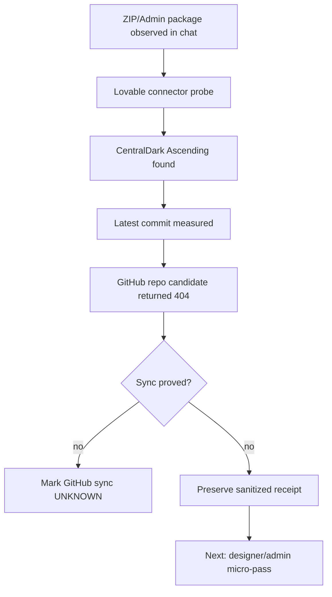

# Receipt — Lovable Admin Designer Anchor

Observed at UTC: 2026-09-25T06:11:00Z

Scope: preservar no ledger o achado do projeto Lovable usado como base visual/administrativa para a area admin do CHEFE, sem promover pacote bruto e sem criar arquitetura paralela.

## Fonte medida

- Connector: Lovable
- Workspace: CentralDark
- Project name: CentralDark Ascending
- Project ID: b80234c5-df19-4834-a19c-99b8fddcbc98
- Project status: ready
- Published: true
- Latest Lovable commit: 6191e382feccc0668bcd62adf3e703f56bb58ee8
- Preview URL: https://id-preview--b80234c5-df19-4834-a19c-99b8fddcbc98.lovable.app

## GitHub repo probe

- Requested candidate repo: ServerVpss/centraldark-instinto-superior
- GitHub connector result: 404 / not accessible in this connector scope
- Interpretation: GITHUB_404 does not prove LOVABLE_NOT_FOUND
- Correct route: Lovable must be measured with the Lovable connector; GitHub must be measured with the GitHub connector.

## Files observed in Lovable project

- .lovable/project.json
- AGENTS.md
- README.md
- src/routes/index.tsx
- src/components/site/SiteNav.tsx
- src/components/site/Hero.tsx
- src/components/site/Timeline.tsx
- src/components/site/LoopDiagram.tsx
- src/components/site/Gate.tsx
- src/components/site/Orchestration.tsx
- src/components/site/Modalities.tsx
- src/components/site/Seal.tsx
- src/components/site/Pack.tsx
- src/components/site/Ledger.tsx
- src/styles.css

## Edit history measured

- a9e203b276b2a8b6ef767dbeb92038d89e9825d5 — Criou site CentralDark completo — completed — 2026-08-10T11:30:18Z
- 6191e382feccc0668bcd62adf3e703f56bb58ee8 — Adicionou exportação estática — completed — 2026-09-21T17:31:22Z

## Decision

PASS:
- Lovable project exists and is ready.
- Project can be read through Lovable connector.
- Latest Lovable commit is known.
- PR-mae received conversation anchors for this delta.

UNKNOWN:
- Direct GitHub sync for ServerVpss/centraldark-instinto-superior is not proven.
- Lovable-to-GitHub writer route is not proven.
- VPS deployment from this Lovable project is not proven.

BLOCKED FROM GREEN:
- Treating visual connected state as synchronization proof.
- Uploading the raw ZIP/package to the canonical repo.
- Creating a second admin architecture instead of integrating through the existing CentralDark route.

## Mermaid

## Cadeados

- CURRENT_OVER_HISTORY=true
- UNKNOWN_IS_NOT_PASS=true
- GITHUB_404_IS_NOT_LOVABLE_NOT_FOUND=true
- LOVABLE_PROJECT_FOUND=true
- RAW_PACKAGE_NOT_PROMOTED=true
- ONE_SYSTEM_ONLY=true
- REUSE_BEFORE_CREATE=true

## NEXT_CURSOR

Start admin designer micro-pass from the existing Lovable project and preserve every proven delta through receipts. Do not claim GitHub sync until the Lovable-to-GitHub route is measured with a commit visible on the intended repository.
