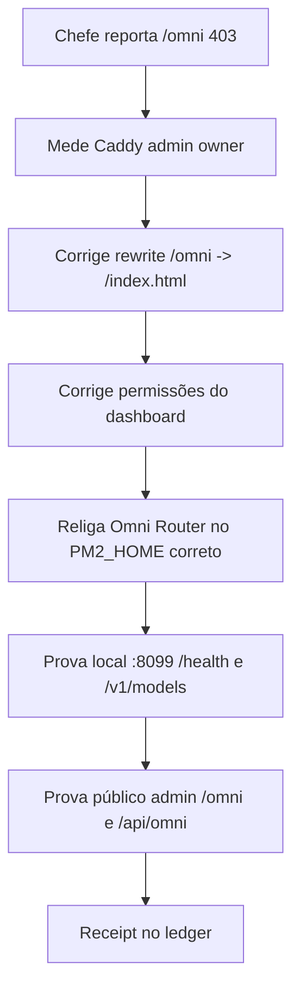

# Receipt — Omni Admin 403 Fixed

- observed_at_utc: 2026-09-25T04:55:07Z
- scope: admin.centralldark.com/omni + Omni Router 8099
- verdict: PASS

## Antes

```text
https://admin.centralldark.com/omni = 403
/api/omni/status = 502 quando :8099 estava offline
```

## Causa

```text
/var/www/centraldark-admin-omni tinha diretório/arquivo com permissão restrita.
Caddy servia /omni como file_server sem rewrite efetivo para /index.html.
Omni Router precisava ser restaurado no PM2_HOME do perfil correto.
```

## Correção aplicada na VPS

```text
/etc/caddy/centraldark-managed/root-imports/admin.Caddyfile
/var/www/centraldark-admin-omni/index.html
PM2_HOME=/root/.centraldark/mcp-auth/profiles/conta2/home/.pm2
centraldark-omni-router -> /root/CentralDark/scripts/launch_omni_router.py
```

## Prova final

```text
http://127.0.0.1:8099/health = 200
http://127.0.0.1:8099/v1/models = 200
https://admin.centralldark.com/omni = 200
https://admin.centralldark.com/omni/ = 200
https://admin.centralldark.com/api/omni/status = 200
https://admin.centralldark.com/api/omni/models = 200
Caddy = active
127.0.0.1:8099 = LISTEN
```

## Mermaid



## Cadeados

```text
SECRET_EXPOSED=false
UNKNOWN != PASS
HTML_ROUTE_PASS=true
API_ROUTE_PASS=true
OMNI_8099_PASS=true
```
