# 🎛️🍒 JUKEBOX CENTRALDARK — Catálogo da sessão e das capacidades conhecidas

> **CHEFE, funciona como uma jukebox de conhecimentos:** procurar por letra ou pelo número, abrir a fonte existente, conferir o que está realmente ativo e continuar pelo `NEXT_CURSOR`. Não é uma segunda IA, executor, HUD ou instalação. A música é a mesma: um Harness, um Cockpit, donos e provas.

**Snapshot verificado em:** 2026-10-21 · PR [#1895](https://github.com/ServerVpss/CentralDark/pull/1895) antes deste registro; HEAD inicial `b5daa3fbf4d2fbf26ef3cf75bda512928db794ed`.
**Objetivo:** condensar a **sessão corrente** e ligar fontes da **CentralDark ampla** sem inventar cobertura total de todo K:, F:, vault e o catálogo `.agents/skills/` não enumerado neste snapshot.
**Medições:** `141` ferramentas disponíveis no catálogo MCP (nomes/metadados); `13` rotas declaradas; `18` módulos no registry; `27` abas do código Cockpit; `4` skills na ferramenta `skill_listar` (somente `skills/`); mais botões, peles, temas, owners e deltas explicitamente listados abaixo.

## 0. Como usar sem adivinhar

- **Índice A–Z** → localizar nome do que quer; clique no código `[NNN]` para ir à ficha.
- **Índice numérico** → sequência fixa de `001` a `301` para localizar itens e registrar handoff sem renomear IDs.
- **Fonte** → abrir owner; se existir ferramenta viva, consultar catálogo e schema; validar somente o efeito da capacidade solicitada.
- **Estado** → `CATALOGADO`=nome/metadados consultados; `FONTE`=código ou histórico; `DOM`=visível em aba; `BRIDGE_PASS`=rede medida; `FALHA`=efeito adverso medido; `UNKNOWN`=sem contraprova. **Nenhum desses estados sozinho significa `FIXED_POINT`**.
- **Segurança** → sem tokens, segredos, material privado, OCR bruto, áudio bruto, hostnames expostos como credenciais ou documentação de ações perigosas. A lista de ferramentas NÃO é autorização para invocá-las.

### Convenção de identidade

`J001–J301` são referências **deste arquivo**, não números de aprendizado, versões de tools ou missões do HUD. Não alterar os 10 itens da `CENTRALDARK · MISSÃO MCP`.

### Mapa de relações (Mermaid)

```mermaid
flowchart LR
    C[CHEFE] --> H[Harness CentralDark]
    H --> UI[Cockpit + Builder + Shell]
    UI --> B[Browser abas/DOM]
    UI --> V[VS Code bancada]
    UI --> O[Obsidian original]
    H --> MCP[MCP Admin catálogo/rotas]
    H --> HE[Hermes executor autorizado]
    B --> E[Observação + Fonte + Contraprova]
    MCP --> E
    HE --> E
    E --> R[Receipt no owner existente]
    R --> N[NEXT_CURSOR / Jukebox]
    classDef falsegreen fill:#222,stroke:#888
```

## 1. 🎼 Índice alfabético A–Z (com ponte para a numeração)

| Letra | Item | Número | Tipo | Estado |
| --- | --- | ---: | --- | --- |
| # | !CALIBRAR | [231](#j231) | Aprendizado/decisão | `REGRA` |
| # | !CENTRALDARK / #ACORDAR | [230](#j230) | Aprendizado/decisão | `REGRA` |
| # | !META-LUPA / !META-GRILL | [233](#j233) | Aprendizado/decisão | `REGRA` |
| # | !MULTIBÚSSOLA | [232](#j232) | Aprendizado/decisão | `REGRA` |
| A | Abertura do Cockpit | [283](#j283) | Aprendizado/decisão | `DOM_LIDO` |
| A | Abrir ferramentas | [219](#j219) | Ação Harness | `DOM_E_FONTE_LIDOS` |
| A | Abrir terminal existente | [215](#j215) | Ação VS Code | `UI_OBSERVADA_EM_CAPTURA` |
| A | Acesso Browser sem Desktop Commander | [278](#j278) | Aprendizado/decisão | `PROVADO_PARA_DOM` |
| A | adicionar_pendencia | [001](#j001) | MCP tool | `CATALOGADO_2026-10-21` |
| A | Admin CentralDark | [193](#j193) | Aba Cockpit | `FONTE_E_DOM_LIDOS` |
| A | admin_commit_main | [002](#j002) | MCP tool | `CATALOGADO_2026-10-21` |
| A | admin_file_list | [003](#j003) | MCP tool | `CATALOGADO_2026-10-21` |
| A | admin_file_read | [004](#j004) | MCP tool | `CATALOGADO_2026-10-21` |
| A | admin_git_pull | [005](#j005) | MCP tool | `CATALOGADO_2026-10-21` |
| A | admin_git_status | [006](#j006) | MCP tool | `CATALOGADO_2026-10-21` |
| A | admin_pm2_list | [007](#j007) | MCP tool | `CATALOGADO_2026-10-21` |
| A | admin_pm2_logs | [008](#j008) | MCP tool | `CATALOGADO_2026-10-21` |
| A | admin_pm2_restart | [009](#j009) | MCP tool | `CATALOGADO_2026-10-21` |
| A | admin_shell_exec | [010](#j010) | MCP tool | `CATALOGADO_2026-10-21` |
| A | admin_vault_read | [011](#j011) | MCP tool | `CATALOGADO_2026-10-21` |
| A | admin_vault_write | [012](#j012) | MCP tool | `CATALOGADO_2026-10-21` |
| A | Agent Mode | [201](#j201) | Aba Cockpit | `FONTE_E_DOM_LIDOS` |
| A | AIONUI_MCP_STDIO | [142](#j142) | Rota | `ROTA_REGISTRADA_NAO_MEDIDA` |
| A | Alethe como referência funcional | [234](#j234) | Aprendizado/decisão | `REFERENCIA_VISUAL` |
| A | analise_de_estado_cognitivo | [013](#j013) | MCP tool | `CATALOGADO_2026-10-21` |
| A | antigravity-hub | [164](#j164) | Módulo | `REGISTRO_HISTORICO` |
| A | Aprendizados | [286](#j286) | Owner/artefato | `SOURCE_EXISTS` |
| A | atualizar_consciencia | [014](#j014) | MCP tool | `CATALOGADO_2026-10-21` |
| A | atualizar_painel | [015](#j015) | MCP tool | `CATALOGADO_2026-10-21` |
| A | Auto Sync nunca sincronizado | [270](#j270) | Aprendizado/decisão | `DOM_LIDO` |
| B | Biblioteca Cognitiva | [296](#j296) | Owner/artefato | `SOURCE_EXISTS` |
| B | Breu & Ouro [ouro] | [205](#j205) | Pele Cockpit | `ATIVA_NO_SELECTOR_FONTE` |
| B | Bridher Builder | [238](#j238) | Aprendizado/decisão | `HISTORICO_E_LOCAL_UNKNOWN` |
| B | Browser conectado: ler contexto | [236](#j236) | Aprendizado/decisão | `OBSERVADO` |
| B | Browser conectado: listar abas | [235](#j235) | Aprendizado/decisão | `OBSERVADO` |
| B | Browser ↔ GitHub: contraprova | [237](#j237) | Aprendizado/decisão | `APLICADO` |
| B | BUILD_WINDOWS != WEB_BUILD | [280](#j280) | Aprendizado/decisão | `REGRA` |
| B | Builder Bolt | [179](#j179) | Aba Cockpit | `FONTE_E_DOM_LIDOS` |
| B | Builder Bolt distinto do Builder Harness | [284](#j284) | Aprendizado/decisão | `REGRA` |
| B | Builder interno do Harness | [248](#j248) | Aprendizado/decisão | `INTENCAO` |
| B | Buscar módulos | [222](#j222) | Ação Harness | `DOM_E_FONTE_LIDOS` |
| C | Caixa de seleção de agente | [250](#j250) | Aprendizado/decisão | `REFERENCIA_VISUAL` |
| C | Caminhos do projeto | [282](#j282) | Aprendizado/decisão | `REGRA` |
| C | CAS_CLOUD_RELAY | [143](#j143) | Rota | `ROTA_REGISTRADA_NAO_MEDIDA` |
| C | Casa local processo | [272](#j272) | Aprendizado/decisão | `FRONTEIRA` |
| C | Casa SEGREDO Tailscale | [239](#j239) | Aprendizado/decisão | `BRIDGE_PASS` |
| C | casa-vps-ssh | [170](#j170) | Módulo | `REGISTRO_HISTORICO` |
| C | centraldark_data_ingest_policy | [016](#j016) | MCP tool | `CATALOGADO_2026-10-21` |
| C | centraldark-delegacao | [173](#j173) | Skill MCP | `CATALOGADO_SKILLS_SUBSET` |
| C | centraldark_deploy_apply_learning | [017](#j017) | MCP tool | `CATALOGADO_2026-10-21` |
| C | centraldark_deploy_capabilities | [018](#j018) | MCP tool | `CATALOGADO_2026-10-21` |
| C | centraldark_deploy_micro_fallback | [019](#j019) | MCP tool | `CATALOGADO_2026-10-21` |
| C | centraldark_deploy_recipe_status | [020](#j020) | MCP tool | `CATALOGADO_2026-10-21` |
| C | centraldark_deploy_root_gate | [021](#j021) | MCP tool | `CATALOGADO_2026-10-21` |
| C | centraldark_deploy_scratch_status | [022](#j022) | MCP tool | `CATALOGADO_2026-10-21` |
| C | CentralDark Estúdio — topo | [229](#j229) | Ação Harness | `DOM_E_FONTE_LIDOS` |
| C | CentralDark Gram | [181](#j181) | Aba Cockpit | `FONTE_E_DOM_LIDOS` |
| C | CentralDark Gram | [220](#j220) | Ação Harness | `DOM_E_FONTE_LIDOS` |
| C | centraldark_operational_snapshot | [023](#j023) | MCP tool | `CATALOGADO_2026-10-21` |
| C | chatgpt-cowork | [158](#j158) | Módulo | `REGISTRO_HISTORICO` |
| C | Claude | [186](#j186) | Aba Cockpit | `FONTE_E_DOM_LIDOS` |
| C | claude-code | [157](#j157) | Módulo | `REGISTRO_HISTORICO` |
| C | cloud-code | [162](#j162) | Módulo | `REGISTRO_HISTORICO` |
| C | Cockpit 8080 integrado VS Code | [258](#j258) | Aprendizado/decisão | `CAPTURA_UI` |
| C | CockpitShell | [289](#j289) | Owner/artefato | `SOURCE_EXISTS` |
| C | code_reviewer | [024](#j024) | MCP tool | `CATALOGADO_2026-10-21` |
| C | codex-app-server | [163](#j163) | Módulo | `REGISTRO_HISTORICO` |
| C | Cofre Tailscale | [241](#j241) | Aprendizado/decisão | `SOURCE_LOADER` |
| C | Compilar a extensão | [216](#j216) | Ação VS Code | `UI_OBSERVADA_EM_CAPTURA` |
| C | Conectar ao servidor | [211](#j211) | Ação VS Code | `UI_OBSERVADA_EM_CAPTURA` |
| C | Configurações do Harness | [276](#j276) | Aprendizado/decisão | `CAPTURA_UI` |
| C | Configurar Harness | [225](#j225) | Ação Harness | `DOM_E_FONTE_LIDOS` |
| C | Configurar moldura | [228](#j228) | Ação Harness | `DOM_E_FONTE_LIDOS` |
| C | consolidar_pensamento | [025](#j025) | MCP tool | `CATALOGADO_2026-10-21` |
| C | consultar_memoria_reserva | [026](#j026) | MCP tool | `CATALOGADO_2026-10-21` |
| C | Credencial Tailscale admin | [240](#j240) | Aprendizado/decisão | `FAIL_PROVIDER_API_AUTH` |
| D | deepseek | [155](#j155) | Módulo | `REGISTRO_HISTORICO` |
| D | deploy_status | [027](#j027) | MCP tool | `CATALOGADO_2026-10-21` |
| D | Design Center | [183](#j183) | Aba Cockpit | `FONTE_E_DOM_LIDOS` |
| D | Design Center com prévias globais | [257](#j257) | Aprendizado/decisão | `CODE_IN_PR_NOT_LIVE` |
| D | Design System | [298](#j298) | Owner/artefato | `SOURCE_EXISTS` |
| D | DesignCenter | [290](#j290) | Owner/artefato | `SOURCE_EXISTS` |
| D | Discos K / F / C | [242](#j242) | Aprendizado/decisão | `CONTRATO_CHEFE` |
| D | Downloads | [203](#j203) | Aba Cockpit | `FONTE_E_DOM_LIDOS` |
| D | Dream | [187](#j187) | Aba Cockpit | `FONTE_E_DOM_LIDOS` |
| E | elite_gateway_chat | [028](#j028) | MCP tool | `CATALOGADO_2026-10-21` |
| E | elite_gateway_logs | [029](#j029) | MCP tool | `CATALOGADO_2026-10-21` |
| E | elite_gateway_status | [030](#j030) | MCP tool | `CATALOGADO_2026-10-21` |
| E | Emerald · institucional [emerald] | [208](#j208) | Tema global | `PREVIA_SOURCE_PR` |
| E | Esmeralda [esmeralda] | [207](#j207) | Pele Cockpit | `ATIVA_NO_SELECTOR_FONTE` |
| E | Estado de pareamento VS Code | [251](#j251) | Aprendizado/decisão | `CAPTURA_UI` |
| E | Estrutura | [188](#j188) | Aba Cockpit | `FONTE_E_DOM_LIDOS` |
| E | Estúdio | [197](#j197) | Aba Cockpit | `FONTE_E_DOM_LIDOS` |
| E | Estúdio AionUI original | [243](#j243) | Aprendizado/decisão | `PR_SOURCE_RUNTIME_PENDING` |
| E | execute_command | [031](#j031) | MCP tool | `CATALOGADO_2026-10-21` |
| E | Exemplo CSS Alethe revogado | [256](#j256) | Aprendizado/decisão | `REVOGADO` |
| E | Extensão VS Code | [294](#j294) | Owner/artefato | `SOURCE_EXISTS` |
| F | fechar_pendencia | [032](#j032) | MCP tool | `CATALOGADO_2026-10-21` |
| F | figma | [160](#j160) | Módulo | `REGISTRO_HISTORICO` |
| F | figma_ler_arquivo | [033](#j033) | MCP tool | `CATALOGADO_2026-10-21` |
| F | figma_ler_node | [034](#j034) | MCP tool | `CATALOGADO_2026-10-21` |
| F | figma_status | [035](#j035) | MCP tool | `CATALOGADO_2026-10-21` |
| F | FIXED_POINT | [254](#j254) | Aprendizado/decisão | `REGRA` |
| F | Forge · Forja [forge] | [210](#j210) | Tema global | `PREVIA_SOURCE_PR` |
| F | Forja | [191](#j191) | Aba Cockpit | `FONTE_E_DOM_LIDOS` |
| G | gemini_analisar | [036](#j036) | MCP tool | `CATALOGADO_2026-10-21` |
| G | gemini_status | [037](#j037) | MCP tool | `CATALOGADO_2026-10-21` |
| G | Gênesis · Michelin | [185](#j185) | Aba Cockpit | `FONTE_E_DOM_LIDOS` |
| G | github_cancel_workflow_run | [038](#j038) | MCP tool | `CATALOGADO_2026-10-21` |
| G | github_check_token | [039](#j039) | MCP tool | `CATALOGADO_2026-10-21` |
| G | github_close_issue | [040](#j040) | MCP tool | `CATALOGADO_2026-10-21` |
| G | github_comment_issue | [041](#j041) | MCP tool | `CATALOGADO_2026-10-21` |
| G | github_commit | [042](#j042) | MCP tool | `CATALOGADO_2026-10-21` |
| G | github_create_branch | [043](#j043) | MCP tool | `CATALOGADO_2026-10-21` |
| G | github_create_issue | [044](#j044) | MCP tool | `CATALOGADO_2026-10-21` |
| G | github_create_or_update_file | [045](#j045) | MCP tool | `CATALOGADO_2026-10-21` |
| G | github_create_pull_request | [046](#j046) | MCP tool | `CATALOGADO_2026-10-21` |
| G | github_create_release_safe | [047](#j047) | MCP tool | `CATALOGADO_2026-10-21` |
| G | github_delete_branch_safe | [048](#j048) | MCP tool | `CATALOGADO_2026-10-21` |
| G | github_delete_file_safe | [049](#j049) | MCP tool | `CATALOGADO_2026-10-21` |
| G | github_delete_workflow_run | [050](#j050) | MCP tool | `CATALOGADO_2026-10-21` |
| G | github_dispatch | [051](#j051) | MCP tool | `CATALOGADO_2026-10-21` |
| G | github_dispatch_workflow | [052](#j052) | MCP tool | `CATALOGADO_2026-10-21` |
| G | github_get_actions_permissions | [053](#j053) | MCP tool | `CATALOGADO_2026-10-21` |
| G | github_get_file | [054](#j054) | MCP tool | `CATALOGADO_2026-10-21` |
| G | github_get_repo | [055](#j055) | MCP tool | `CATALOGADO_2026-10-21` |
| G | github_list_commits | [056](#j056) | MCP tool | `CATALOGADO_2026-10-21` |
| G | github_list_environments | [057](#j057) | MCP tool | `CATALOGADO_2026-10-21` |
| G | github_list_issues | [058](#j058) | MCP tool | `CATALOGADO_2026-10-21` |
| G | github_list_pull_requests | [059](#j059) | MCP tool | `CATALOGADO_2026-10-21` |
| G | github_list_repo_variables | [060](#j060) | MCP tool | `CATALOGADO_2026-10-21` |
| G | github_list_repos | [061](#j061) | MCP tool | `CATALOGADO_2026-10-21` |
| G | github_list_secrets_names | [062](#j062) | MCP tool | `CATALOGADO_2026-10-21` |
| G | github_list_webhooks | [063](#j063) | MCP tool | `CATALOGADO_2026-10-21` |
| G | github_list_workflow_runs | [064](#j064) | MCP tool | `CATALOGADO_2026-10-21` |
| G | github_list_workflows | [065](#j065) | MCP tool | `CATALOGADO_2026-10-21` |
| G | github_merge_pull_request | [066](#j066) | MCP tool | `CATALOGADO_2026-10-21` |
| G | github_read | [067](#j067) | MCP tool | `CATALOGADO_2026-10-21` |
| G | github_rerun_failed_jobs | [068](#j068) | MCP tool | `CATALOGADO_2026-10-21` |
| G | github_rerun_workflow_run | [069](#j069) | MCP tool | `CATALOGADO_2026-10-21` |
| G | GITHUB_RUNTIME | [144](#j144) | Rota | `ROTA_REGISTRADA_NAO_MEDIDA` |
| G | github_search_code | [070](#j070) | MCP tool | `CATALOGADO_2026-10-21` |
| G | github_set_repo_variable | [071](#j071) | MCP tool | `CATALOGADO_2026-10-21` |
| G | github_test_webhook | [072](#j072) | MCP tool | `CATALOGADO_2026-10-21` |
| G | github_upload_base64_file | [073](#j073) | MCP tool | `CATALOGADO_2026-10-21` |
| G | github_viewer | [074](#j074) | MCP tool | `CATALOGADO_2026-10-21` |
| G | Goals | [184](#j184) | Aba Cockpit | `FONTE_E_DOM_LIDOS` |
| G | Goals | [221](#j221) | Ação Harness | `DOM_E_FONTE_LIDOS` |
| H | hermes | [156](#j156) | Módulo | `REGISTRO_HISTORICO` |
| H | Hermes | [195](#j195) | Aba Cockpit | `FONTE_E_DOM_LIDOS` |
| H | HERMES_DELEGATED_COMMIT_PATH | [145](#j145) | Rota | `ROTA_REGISTRADA_NAO_MEDIDA` |
| H | Hermes — moldura | [224](#j224) | Ação Harness | `DOM_E_FONTE_LIDOS` |
| H | HERMES_SHELL | [146](#j146) | Rota | `ROTA_REGISTRADA_NAO_MEDIDA` |
| H | HTML Consolidation | [202](#j202) | Aba Cockpit | `FONTE_E_DOM_LIDOS` |
| I | Índice arquitetural | [299](#j299) | Owner/artefato | `SOURCE_EXISTS` |
| I | injetar_consciencia_centraldark | [075](#j075) | MCP tool | `CATALOGADO_2026-10-21` |
| I | instinto-casa-port-3000 | [166](#j166) | Módulo | `REGISTRO_HISTORICO` |
| I | Instinto Superior · padrão [default] | [204](#j204) | Pele Cockpit | `ATIVA_NO_SELECTOR_FONTE` |
| I | Inventário | [200](#j200) | Aba Cockpit | `FONTE_E_DOM_LIDOS` |
| J | Jukebox da sessão | [274](#j274) | Aprendizado/decisão | `CRIADO_EM_PR` |
| K | kit_boas_vindas | [076](#j076) | MCP tool | `CATALOGADO_2026-10-21` |
| K | kylin_audio_synthesize | [077](#j077) | MCP tool | `CATALOGADO_2026-10-21` |
| K | kylin_audio_transcribe | [078](#j078) | MCP tool | `CATALOGADO_2026-10-21` |
| K | kylin_image_analyze | [079](#j079) | MCP tool | `CATALOGADO_2026-10-21` |
| K | kylin_image_embedding | [080](#j080) | MCP tool | `CATALOGADO_2026-10-21` |
| K | kylin_native_status | [081](#j081) | MCP tool | `CATALOGADO_2026-10-21` |
| K | kylin_text_embedding | [082](#j082) | MCP tool | `CATALOGADO_2026-10-21` |
| K | kylin_video_analyze | [083](#j083) | MCP tool | `CATALOGADO_2026-10-21` |
| L | Lembranças (histórico) | [287](#j287) | Owner/artefato | `SOURCE_EXISTS` |
| L | ler_consciencia | [084](#j084) | MCP tool | `CATALOGADO_2026-10-21` |
| L | ler_instalador | [085](#j085) | MCP tool | `CATALOGADO_2026-10-21` |
| L | ler_pendencias | [086](#j086) | MCP tool | `CATALOGADO_2026-10-21` |
| L | ler_regras_inviolaveis | [087](#j087) | MCP tool | `CATALOGADO_2026-10-21` |
| L | linear_atualizar_issue | [088](#j088) | MCP tool | `CATALOGADO_2026-10-21` |
| L | linear_criar_issue | [089](#j089) | MCP tool | `CATALOGADO_2026-10-21` |
| L | linear_listar_ciclos | [090](#j090) | MCP tool | `CATALOGADO_2026-10-21` |
| L | linear_listar_equipes | [091](#j091) | MCP tool | `CATALOGADO_2026-10-21` |
| L | linear_listar_issues | [092](#j092) | MCP tool | `CATALOGADO_2026-10-21` |
| L | Live editing fabric | [253](#j253) | Aprendizado/decisão | `REGRA_SOURCE` |
| L | local_bridge_media_policy | [093](#j093) | MCP tool | `CATALOGADO_2026-10-21` |
| L | local_compute_status | [094](#j094) | MCP tool | `CATALOGADO_2026-10-21` |
| M | Mapa de abas e ações | [259](#j259) | Aprendizado/decisão | `DOM_E_SOURCE_LIDOS` |
| M | Mapa do Cérebro | [285](#j285) | Owner/artefato | `SOURCE_EXISTS` |
| M | Mapa PR #1873 | [180](#j180) | Aba Cockpit | `FONTE_E_DOM_LIDOS` |
| M | Mapear o VS Code | [217](#j217) | Ação VS Code | `UI_OBSERVADA_EM_CAPTURA` |
| M | MCP Admin provider | [297](#j297) | Owner/artefato | `SOURCE_EXISTS` |
| M | MCP Admin único | [260](#j260) | Aprendizado/decisão | `CATALOG_LIDO` |
| M | MCP_CASA_TO_VPS | [147](#j147) | Rota | `ROTA_REGISTRADA_NAO_MEDIDA` |
| M | MCP_REMOTE_OAUTH | [148](#j148) | Rota | `ROTA_REGISTRADA_NAO_MEDIDA` |
| M | MCP_VPS_NATIVE_HTTP | [149](#j149) | Rota | `ROTA_REGISTRADA_NAO_MEDIDA` |
| M | mermaid-skill | [174](#j174) | Skill MCP | `CATALOGADO_SKILLS_SUBSET` |
| M | Mesmo Harness várias superfícies | [252](#j252) | Aprendizado/decisão | `PRINCIPIO` |
| M | Minha Oficina | [182](#j182) | Aba Cockpit | `FONTE_E_DOM_LIDOS` |
| N | NeuroLink JSON derivado | [301](#j301) | Owner/artefato | `SOURCE_EXISTS` |
| N | NeuroLink numeração legada | [273](#j273) | Aprendizado/decisão | `REGRA` |
| N | notifications-recipe | [167](#j167) | Módulo | `REGISTRO_HISTORICO` |
| N | notion_anexar_paragrafo | [095](#j095) | MCP tool | `CATALOGADO_2026-10-21` |
| N | notion_buscar | [096](#j096) | MCP tool | `CATALOGADO_2026-10-21` |
| N | notion_criar_pagina | [097](#j097) | MCP tool | `CATALOGADO_2026-10-21` |
| N | notion_ler_pagina | [098](#j098) | MCP tool | `CATALOGADO_2026-10-21` |
| O | obsidian | [161](#j161) | Módulo | `REGISTRO_HISTORICO` |
| O | Obsidian | [196](#j196) | Aba Cockpit | `FONTE_E_DOM_LIDOS` |
| O | Obsidian e Casa | [275](#j275) | Aprendizado/decisão | `FRONTEIRA` |
| O | Obsidian Grafo Vivo | [245](#j245) | Aprendizado/decisão | `SOURCE_ONLY_RUNTIME_NOT_PROVEN` |
| O | Obsidian original | [244](#j244) | Aprendizado/decisão | `LINK_OPEN_ONLY` |
| O | Operational · HUD [operational] | [209](#j209) | Tema global | `PREVIA_SOURCE_PR` |
| O | Ops · Ciano [ops] | [206](#j206) | Pele Cockpit | `ATIVA_NO_SELECTOR_FONTE` |
| P | Pacotes | [227](#j227) | Ação Harness | `DOM_E_FONTE_LIDOS` |
| P | Parear este VS Code | [213](#j213) | Ação VS Code | `UI_OBSERVADA_EM_CAPTURA` |
| P | pendencias_add | [099](#j099) | MCP tool | `CATALOGADO_2026-10-21` |
| P | pendencias_close | [100](#j100) | MCP tool | `CATALOGADO_2026-10-21` |
| P | pendencias_list | [101](#j101) | MCP tool | `CATALOGADO_2026-10-21` |
| P | Permissões Forja | [192](#j192) | Aba Cockpit | `FONTE_E_DOM_LIDOS` |
| P | personal_context_remember | [102](#j102) | MCP tool | `CATALOGADO_2026-10-21` |
| P | personal_context_search | [103](#j103) | MCP tool | `CATALOGADO_2026-10-21` |
| P | personal_context_stats | [104](#j104) | MCP tool | `CATALOGADO_2026-10-21` |
| P | Pipeline Main-Pinned | [262](#j262) | Aprendizado/decisão | `CAPABILITY_CATALOG` |
| P | Plugin vs integração real | [277](#j277) | Aprendizado/decisão | `REGRA` |
| P | Portal | [178](#j178) | Aba Cockpit | `FONTE_E_DOM_LIDOS` |
| P | PR #1855 — MCP nativo | [265](#j265) | Aprendizado/decisão | `PR_MERGED_HISTORICO` |
| P | PR #1880 — VS Code | [263](#j263) | Aprendizado/decisão | `PR_OPEN_SOURCE` |
| P | PR #1895 — Shell | [264](#j264) | Aprendizado/decisão | `PR_OPEN_SOURCE` |
| P | pretty-mermaid | [175](#j175) | Skill MCP | `CATALOGADO_SKILLS_SUBSET` |
| P | provider_capabilities | [105](#j105) | MCP tool | `CATALOGADO_2026-10-21` |
| P | provider_credentials_status | [106](#j106) | MCP tool | `CATALOGADO_2026-10-21` |
| P | provider_mutate | [107](#j107) | MCP tool | `CATALOGADO_2026-10-21` |
| P | provider_read | [108](#j108) | MCP tool | `CATALOGADO_2026-10-21` |
| P | PTY PowerShell Alethe | [247](#j247) | Aprendizado/decisão | `FALHA_CAPTURA_USER` |
| P | puxar_aprendizados | [109](#j109) | MCP tool | `CATALOGADO_2026-10-21` |
| R | Raio-X | [189](#j189) | Aba Cockpit | `FONTE_E_DOM_LIDOS` |
| R | Rascunho UI ≠ executável | [267](#j267) | Aprendizado/decisão | `REGRA` |
| R | RDC_DESKTOP_COMMANDER | [150](#j150) | Rota | `LEGADO_OPCIONAL` |
| R | read_file | [110](#j110) | MCP tool | `CATALOGADO_2026-10-21` |
| R | Receipt A–Z preexistente | [300](#j300) | Owner/artefato | `SOURCE_EXISTS` |
| R | Recibos | [190](#j190) | Aba Cockpit | `FONTE_E_DOM_LIDOS` |
| R | Recibos por SHA | [281](#j281) | Aprendizado/decisão | `REGRA` |
| R | registrar_aprendizado | [111](#j111) | MCP tool | `CATALOGADO_2026-10-21` |
| R | Registro de módulos Harness | [288](#j288) | Owner/artefato | `SOURCE_EXISTS` |
| R | Regras Forja | [199](#j199) | Aba Cockpit | `FONTE_E_DOM_LIDOS` |
| R | Restaurar a bancada | [218](#j218) | Ação VS Code | `UI_OBSERVADA_EM_CAPTURA` |
| S | screenpipe-audio-casa | [169](#j169) | Módulo | `REGISTRO_HISTORICO` |
| S | SCREENPIPE_CLI_RECORDER | [151](#j151) | Rota | `ROTA_REGISTRADA_NAO_MEDIDA` |
| S | Screenpipe /health | [271](#j271) | Aprendizado/decisão | `DOM_SENSOR_HISTORICO` |
| S | SCREENPIPE_LOCAL_SENSOR | [152](#j152) | Rota | `ROTA_REGISTRADA_NAO_MEDIDA` |
| S | screenpipe-mcp | [165](#j165) | Módulo | `REGISTRO_HISTORICO` |
| S | search_files | [112](#j112) | MCP tool | `CATALOGADO_2026-10-21` |
| S | sentry_detalhe_issue | [113](#j113) | MCP tool | `CATALOGADO_2026-10-21` |
| S | sentry_listar_issues | [114](#j114) | MCP tool | `CATALOGADO_2026-10-21` |
| S | sentry_resolver_issue | [115](#j115) | MCP tool | `CATALOGADO_2026-10-21` |
| S | sentry_status_credenciais | [116](#j116) | MCP tool | `CATALOGADO_2026-10-21` |
| S | Shell CentralDark.exe | [246](#j246) | Aprendizado/decisão | `ALVO_NAO_PROVADO` |
| S | Sistema CentralDark | [194](#j194) | Aba Cockpit | `FONTE_E_DOM_LIDOS` |
| S | Sistemas | [223](#j223) | Ação Harness | `DOM_E_FONTE_LIDOS` |
| S | skill_atualizar | [117](#j117) | MCP tool | `CATALOGADO_2026-10-21` |
| S | skill_instalar | [118](#j118) | MCP tool | `CATALOGADO_2026-10-21` |
| S | skill_listar | [119](#j119) | MCP tool | `CATALOGADO_2026-10-21` |
| S | skill_status | [120](#j120) | MCP tool | `CATALOGADO_2026-10-21` |
| S | Skill workshop | [295](#j295) | Owner/artefato | `SOURCE_EXISTS` |
| S | Skills 900+ referência | [266](#j266) | Aprendizado/decisão | `NAO_MEDIDO` |
| S | Skills estendidas | [261](#j261) | Aprendizado/decisão | `CATALOG_SOURCE` |
| S | SSH_VPS_DIRECT | [153](#j153) | Rota | `ROTA_REGISTRADA_NAO_MEDIDA` |
| S | Status 1 erro do Cockpit | [269](#j269) | Aprendizado/decisão | `UI_ERRO_OBSERVADO` |
| S | supabase_contacts_check | [121](#j121) | MCP tool | `CATALOGADO_2026-10-21` |
| S | supabase_project_status | [122](#j122) | MCP tool | `CATALOGADO_2026-10-21` |
| S | supabase_projects | [123](#j123) | MCP tool | `CATALOGADO_2026-10-21` |
| S | supabase_schema_check | [124](#j124) | MCP tool | `CATALOGADO_2026-10-21` |
| S | Swarm Writer único | [255](#j255) | Aprendizado/decisão | `REGRA` |
| S | Sync — moldura | [226](#j226) | Ação Harness | `DOM_E_FONTE_LIDOS` |
| T | tailscale_bridge_status | [125](#j125) | MCP tool | `CATALOGADO_2026-10-21` |
| T | tailscale_devices_list | [126](#j126) | MCP tool | `CATALOGADO_2026-10-21` |
| T | tailscale_dns_nameservers | [127](#j127) | MCP tool | `CATALOGADO_2026-10-21` |
| T | tailscale_network_logs | [128](#j128) | MCP tool | `CATALOGADO_2026-10-21` |
| T | TAILSCALE_PRIVATE_ROUTE | [154](#j154) | Rota | `REDE_BROKER_PASS` |
| T | Tailscale provider ≠ Tailscale bridge | [279](#j279) | Aprendizado/decisão | `CONTRAPROVA` |
| T | tailscale_status | [129](#j129) | MCP tool | `CATALOGADO_2026-10-21` |
| T | Tela PTY existente no Alethe | [268](#j268) | Aprendizado/decisão | `CAPTURA_UI` |
| T | Tema Bolt | [292](#j292) | Owner/artefato | `SOURCE_EXISTS` |
| T | Testar a conexão | [212](#j212) | Ação VS Code | `UI_OBSERVADA_EM_CAPTURA` |
| T | teste_temporario_pivete | [130](#j130) | MCP tool | `CATALOGADO_2026-10-21` |
| T | Tokens Bolt | [293](#j293) | Owner/artefato | `SOURCE_EXISTS` |
| T | Tokens Cockpit | [291](#j291) | Owner/artefato | `SOURCE_EXISTS` |
| U | UI portugues brasileiro | [249](#j249) | Aprendizado/decisão | `REGRA_DOC` |
| U | Unigram | [198](#j198) | Aba Cockpit | `FONTE_E_DOM_LIDOS` |
| V | vault_list | [131](#j131) | MCP tool | `CATALOGADO_2026-10-21` |
| V | vault_read | [132](#j132) | MCP tool | `CATALOGADO_2026-10-21` |
| V | vault_read_all | [133](#j133) | MCP tool | `CATALOGADO_2026-10-21` |
| V | Ver status e PIDs | [214](#j214) | Ação VS Code | `UI_OBSERVADA_EM_CAPTURA` |
| V | Visão geral | [177](#j177) | Aba Cockpit | `FONTE_E_DOM_LIDOS` |
| V | voice-semantic | [168](#j168) | Módulo | `REGISTRO_HISTORICO` |
| V | vps_git_diff_safe | [134](#j134) | MCP tool | `CATALOGADO_2026-10-21` |
| V | vps_git_status | [135](#j135) | MCP tool | `CATALOGADO_2026-10-21` |
| V | vps_list_dir_safe | [136](#j136) | MCP tool | `CATALOGADO_2026-10-21` |
| V | vps_read_file_safe | [137](#j137) | MCP tool | `CATALOGADO_2026-10-21` |
| V | vps_run_once_script | [138](#j138) | MCP tool | `CATALOGADO_2026-10-21` |
| V | vps_tree_safe | [139](#j139) | MCP tool | `CATALOGADO_2026-10-21` |
| V | vps_write_file_safe | [140](#j140) | MCP tool | `CATALOGADO_2026-10-21` |
| V | vs-code-restore | [176](#j176) | Skill MCP | `CATALOGADO_SKILLS_SUBSET` |
| V | vscode | [159](#j159) | Módulo | `REGISTRO_HISTORICO` |
| V | vscode-remote-ssh | [172](#j172) | Módulo | `REGISTRO_HISTORICO` |
| V | vscode-restore | [171](#j171) | Módulo | `REGISTRO_HISTORICO` |
| Y | youtube_transcript | [141](#j141) | MCP tool | `CATALOGADO_2026-10-21` |

## 2. 🎚️ Índice numérico 001–301 (cada ficha tem evidência, limite e owner)

### J001 · adicionar_pendencia

- **Categoria:** MCP tool. **Estado:** `CATALOGADO_2026-10-21`.
- **O que há:** Adiciona uma tarefa ao arquivo docs/PENDENCIAS.md na seção de prioridade indicada. O servidor remove credenciais, caminhos in
- **Fonte / owner:** [MCP Admin catalog](../../../apps/modulos/mcp/src/modes/admin/tools/admin-provider-control.js).
- **Limite de prova:** A chamada ao catálogo lista a ferramenta; invocação e efeito NÃO são demonstrados.

### J002 · admin_commit_main

- **Categoria:** MCP tool. **Estado:** `CATALOGADO_2026-10-21`.
- **O que há:** ADMIN determinístico: cria UM commit diretamente na main de ServerVpss/CentralDark usando CAS de ref Git. Não cria branch/PR,
- **Fonte / owner:** [MCP Admin catalog](../../../apps/modulos/mcp/src/modes/admin/tools/admin-provider-control.js).
- **Limite de prova:** A chamada ao catálogo lista a ferramenta; invocação e efeito NÃO são demonstrados.

### J003 · admin_file_list

- **Categoria:** MCP tool. **Estado:** `CATALOGADO_2026-10-21`.
- **O que há:** ADMIN: lista arquivos e pastas de um caminho absoluto. Bloqueia path traversal e paths sensiveis (secrets, .ssh, shadow).
- **Fonte / owner:** [MCP Admin catalog](../../../apps/modulos/mcp/src/modes/admin/tools/admin-provider-control.js).
- **Limite de prova:** A chamada ao catálogo lista a ferramenta; invocação e efeito NÃO são demonstrados.

### J004 · admin_file_read

- **Categoria:** MCP tool. **Estado:** `CATALOGADO_2026-10-21`.
- **O que há:** ADMIN: le o conteudo de um arquivo por caminho absoluto (limite 512KB). Bloqueia paths sensiveis.
- **Fonte / owner:** [MCP Admin catalog](../../../apps/modulos/mcp/src/modes/admin/tools/admin-provider-control.js).
- **Limite de prova:** A chamada ao catálogo lista a ferramenta; invocação e efeito NÃO são demonstrados.

### J005 · admin_git_pull

- **Categoria:** MCP tool. **Estado:** `CATALOGADO_2026-10-21`.
- **O que há:** ADMIN DESTRUTIVO: executa git pull --ff-only no repo <caminho-vps> Exige confirmAdmin=CONFIRMO ADMIN.
- **Fonte / owner:** [MCP Admin catalog](../../../apps/modulos/mcp/src/modes/admin/tools/admin-provider-control.js).
- **Limite de prova:** A chamada ao catálogo lista a ferramenta; invocação e efeito NÃO são demonstrados.

### J006 · admin_git_status

- **Categoria:** MCP tool. **Estado:** `CATALOGADO_2026-10-21`.
- **O que há:** ADMIN: mostra git status curto, branch atual e ultimo commit do repo <caminho-vps>
- **Fonte / owner:** [MCP Admin catalog](../../../apps/modulos/mcp/src/modes/admin/tools/admin-provider-control.js).
- **Limite de prova:** A chamada ao catálogo lista a ferramenta; invocação e efeito NÃO são demonstrados.

### J007 · admin_pm2_list

- **Categoria:** MCP tool. **Estado:** `CATALOGADO_2026-10-21`.
- **O que há:** ADMIN: lista todos os processos PM2 (name, id, status, cpu, memoria, restarts, uptime).
- **Fonte / owner:** [MCP Admin catalog](../../../apps/modulos/mcp/src/modes/admin/tools/admin-provider-control.js).
- **Limite de prova:** A chamada ao catálogo lista a ferramenta; invocação e efeito NÃO são demonstrados.

### J008 · admin_pm2_logs

- **Categoria:** MCP tool. **Estado:** `CATALOGADO_2026-10-21`.
- **O que há:** ADMIN: retorna as ultimas N linhas de log (stdout/stderr) de um processo PM2 pelo nome ou id.
- **Fonte / owner:** [MCP Admin catalog](../../../apps/modulos/mcp/src/modes/admin/tools/admin-provider-control.js).
- **Limite de prova:** A chamada ao catálogo lista a ferramenta; invocação e efeito NÃO são demonstrados.

### J009 · admin_pm2_restart

- **Categoria:** MCP tool. **Estado:** `CATALOGADO_2026-10-21`.
- **O que há:** ADMIN DESTRUTIVO: reinicia um processo PM2 pelo nome ou id. Exige confirmAdmin=CONFIRMO ADMIN no dispatcher.
- **Fonte / owner:** [MCP Admin catalog](../../../apps/modulos/mcp/src/modes/admin/tools/admin-provider-control.js).
- **Limite de prova:** A chamada ao catálogo lista a ferramenta; invocação e efeito NÃO são demonstrados.

### J010 · admin_shell_exec

- **Categoria:** MCP tool. **Estado:** `CATALOGADO_2026-10-21`.
- **O que há:** ADMIN DESTRUTIVO endurecido: allowlist estrita (pm2, git, ls, cat, df, free, systemctl reload caddy). Sem shell/pipes/redirec
- **Fonte / owner:** [MCP Admin catalog](../../../apps/modulos/mcp/src/modes/admin/tools/admin-provider-control.js).
- **Limite de prova:** A chamada ao catálogo lista a ferramenta; invocação e efeito NÃO são demonstrados.

### J011 · admin_vault_read

- **Categoria:** MCP tool. **Estado:** `CATALOGADO_2026-10-21`.
- **O que há:** Capacidade sensível cadastrada; conteúdo e operação não reproduzidos.
- **Fonte / owner:** [MCP Admin catalog](../../../apps/modulos/mcp/src/modes/admin/tools/admin-provider-control.js).
- **Limite de prova:** A chamada ao catálogo lista a ferramenta; invocação e efeito NÃO são demonstrados.

### J012 · admin_vault_write

- **Categoria:** MCP tool. **Estado:** `CATALOGADO_2026-10-21`.
- **O que há:** EXCEÇÃO ADMIN EXPLÍCITA PARA GROK/NAVEGADOR: cria ou atualiza arquivo em <caminho-vps> pelo nome do arquivo. Use via mcp_admi
- **Fonte / owner:** [MCP Admin catalog](../../../apps/modulos/mcp/src/modes/admin/tools/admin-provider-control.js).
- **Limite de prova:** A chamada ao catálogo lista a ferramenta; invocação e efeito NÃO são demonstrados.

### J013 · analise_de_estado_cognitivo

- **Categoria:** MCP tool. **Estado:** `CATALOGADO_2026-10-21`.
- **O que há:** Analisa as últimas Lembranças pra inferir o FOCO e o projeto atual do Pivete, e sugere o nível de detalhe técnico ideal da re
- **Fonte / owner:** [MCP Admin catalog](../../../apps/modulos/mcp/src/modes/admin/tools/admin-provider-control.js).
- **Limite de prova:** A chamada ao catálogo lista a ferramenta; invocação e efeito NÃO são demonstrados.

### J014 · atualizar_consciencia

- **Categoria:** MCP tool. **Estado:** `CATALOGADO_2026-10-21`.
- **O que há:** Substitui uma seção inteira do documento docs/CONSCIENCIA/CONSCIENCIA.md (regras do projeto). Operação que reescreve conteúdo
- **Fonte / owner:** [MCP Admin catalog](../../../apps/modulos/mcp/src/modes/admin/tools/admin-provider-control.js).
- **Limite de prova:** A chamada ao catálogo lista a ferramenta; invocação e efeito NÃO são demonstrados.

### J015 · atualizar_painel

- **Categoria:** MCP tool. **Estado:** `CATALOGADO_2026-10-21`.
- **O que há:** Atualiza o Mega Painel do projeto (status.centralldark.com) editando painel-data.json na VPS e fazendo git commit+push automá
- **Fonte / owner:** [MCP Admin catalog](../../../apps/modulos/mcp/src/modes/admin/tools/admin-provider-control.js).
- **Limite de prova:** A chamada ao catálogo lista a ferramenta; invocação e efeito NÃO são demonstrados.

### J016 · centraldark_data_ingest_policy

- **Categoria:** MCP tool. **Estado:** `CATALOGADO_2026-10-21`.
- **O que há:** Mostra como JSONs/Markdown/PRs/issues/logs/agentics entram no Grafo Vivo sem virar arquitetura paralela e sem remover stream 
- **Fonte / owner:** [MCP Admin catalog](../../../apps/modulos/mcp/src/modes/admin/tools/admin-provider-control.js).
- **Limite de prova:** A chamada ao catálogo lista a ferramenta; invocação e efeito NÃO são demonstrados.

### J017 · centraldark_deploy_apply_learning

- **Categoria:** MCP tool. **Estado:** `CATALOGADO_2026-10-21`.
- **O que há:** Aplica aprendizado CURRENT da main na VPS pelo scratch canônico: lock, reset/clean somente do scratch, promoção do fileset co
- **Fonte / owner:** [MCP Admin catalog](../../../apps/modulos/mcp/src/modes/admin/tools/admin-provider-control.js).
- **Limite de prova:** A chamada ao catálogo lista a ferramenta; invocação e efeito NÃO são demonstrados.

### J018 · centraldark_deploy_capabilities

- **Categoria:** MCP tool. **Estado:** `CATALOGADO_2026-10-21`.
- **O que há:** Inventário vivo das capacidades operacionais CentralDark: fallback MAIN-PINNED, scratch único, gate raiz, recipe replay e apl
- **Fonte / owner:** [MCP Admin catalog](../../../apps/modulos/mcp/src/modes/admin/tools/admin-provider-control.js).
- **Limite de prova:** A chamada ao catálogo lista a ferramenta; invocação e efeito NÃO são demonstrados.

### J019 · centraldark_deploy_micro_fallback

- **Categoria:** MCP tool. **Estado:** `CATALOGADO_2026-10-21`.
- **O que há:** Executa microdeploy MAIN-PINNED do fileset causal de um owner aprovado, com scratch único, backup/rollback, restart isolado, 
- **Fonte / owner:** [MCP Admin catalog](../../../apps/modulos/mcp/src/modes/admin/tools/admin-provider-control.js).
- **Limite de prova:** A chamada ao catálogo lista a ferramenta; invocação e efeito NÃO são demonstrados.

### J020 · centraldark_deploy_recipe_status

- **Categoria:** MCP tool. **Estado:** `CATALOGADO_2026-10-21`.
- **O que há:** Lê a receita machine-consumable MAIN-PINNED e devolve status, bindings, sequência, locks e fingerprint sem redescobrir o cami
- **Fonte / owner:** [MCP Admin catalog](../../../apps/modulos/mcp/src/modes/admin/tools/admin-provider-control.js).
- **Limite de prova:** A chamada ao catálogo lista a ferramenta; invocação e efeito NÃO são demonstrados.

### J021 · centraldark_deploy_root_gate

- **Categoria:** MCP tool. **Estado:** `CATALOGADO_2026-10-21`.
- **O que há:** Executa o gate cruzado das 5 superfícies do ROOT-FILE contract e library-index v1.2.0; somente leitura.
- **Fonte / owner:** [MCP Admin catalog](../../../apps/modulos/mcp/src/modes/admin/tools/admin-provider-control.js).
- **Limite de prova:** A chamada ao catálogo lista a ferramenta; invocação e efeito NÃO são demonstrados.

### J022 · centraldark_deploy_scratch_status

- **Categoria:** MCP tool. **Estado:** `CATALOGADO_2026-10-21`.
- **O que há:** Mede o Single Reusable WorkTree: existência, SHA, dirty state e convergência com origin/main. Não limpa nem reseta.
- **Fonte / owner:** [MCP Admin catalog](../../../apps/modulos/mcp/src/modes/admin/tools/admin-provider-control.js).
- **Limite de prova:** A chamada ao catálogo lista a ferramenta; invocação e efeito NÃO são demonstrados.

### J023 · centraldark_operational_snapshot

- **Categoria:** MCP tool. **Estado:** `CATALOGADO_2026-10-21`.
- **O que há:** Lê o mesmo snapshot determinístico de heartbeat/logs/forensic usado pelo painel CentralDark. Nunca expõe conteúdo de secrets 
- **Fonte / owner:** [MCP Admin catalog](../../../apps/modulos/mcp/src/modes/admin/tools/admin-provider-control.js).
- **Limite de prova:** A chamada ao catálogo lista a ferramenta; invocação e efeito NÃO são demonstrados.

### J024 · code_reviewer

- **Categoria:** MCP tool. **Estado:** `CATALOGADO_2026-10-21`.
- **O que há:** Motor de Code Review Nível Principal Engineer. Executa análise de Big-O, segurança (OWASP), arquitetura (SOLID) e caça de bug
- **Fonte / owner:** [MCP Admin catalog](../../../apps/modulos/mcp/src/modes/admin/tools/admin-provider-control.js).
- **Limite de prova:** A chamada ao catálogo lista a ferramenta; invocação e efeito NÃO são demonstrados.

### J025 · consolidar_pensamento

- **Categoria:** MCP tool. **Estado:** `CATALOGADO_2026-10-21`.
- **O que há:** Grava um insight/regra/padrão nas Lembranças do Pivete. CHAME ISSO sempre que aprender algo novo sobre como o usuário pensa, 
- **Fonte / owner:** [MCP Admin catalog](../../../apps/modulos/mcp/src/modes/admin/tools/admin-provider-control.js).
- **Limite de prova:** A chamada ao catálogo lista a ferramenta; invocação e efeito NÃO são demonstrados.

### J026 · consultar_memoria_reserva

- **Categoria:** MCP tool. **Estado:** `CATALOGADO_2026-10-21`.
- **O que há:** Lê as Lembranças do Pivete (memória de curto prazo em docs/CONSCIENCIA/LEMBRANCAS). USE ISSO ANTES de responder qualquer pedi
- **Fonte / owner:** [MCP Admin catalog](../../../apps/modulos/mcp/src/modes/admin/tools/admin-provider-control.js).
- **Limite de prova:** A chamada ao catálogo lista a ferramenta; invocação e efeito NÃO são demonstrados.

### J027 · deploy_status

- **Categoria:** MCP tool. **Estado:** `CATALOGADO_2026-10-21`.
- **O que há:** Resumo unificado do estado do deploy: último commit no GitHub vs commit atual na VPS, status dos últimos workflows, processos
- **Fonte / owner:** [MCP Admin catalog](../../../apps/modulos/mcp/src/modes/admin/tools/admin-provider-control.js).
- **Limite de prova:** A chamada ao catálogo lista a ferramenta; invocação e efeito NÃO são demonstrados.

### J028 · elite_gateway_chat

- **Categoria:** MCP tool. **Estado:** `CATALOGADO_2026-10-21`.
- **O que há:** Envia uma mensagem ao Elite HTTP Gateway (ChatGPT via Zendriver headless) e retorna a resposta. O gateway roda em localhost:8
- **Fonte / owner:** [MCP Admin catalog](../../../apps/modulos/mcp/src/modes/admin/tools/admin-provider-control.js).
- **Limite de prova:** A chamada ao catálogo lista a ferramenta; invocação e efeito NÃO são demonstrados.

### J029 · elite_gateway_logs

- **Categoria:** MCP tool. **Estado:** `CATALOGADO_2026-10-21`.
- **O que há:** Lê as últimas linhas dos logs PM2 do Elite HTTP Gateway (stdout e stderr). Útil para diagnosticar erros do Zendriver, Cloudfl
- **Fonte / owner:** [MCP Admin catalog](../../../apps/modulos/mcp/src/modes/admin/tools/admin-provider-control.js).
- **Limite de prova:** A chamada ao catálogo lista a ferramenta; invocação e efeito NÃO são demonstrados.

### J030 · elite_gateway_status

- **Categoria:** MCP tool. **Estado:** `CATALOGADO_2026-10-21`.
- **O que há:** Verifica saúde do Elite HTTP Gateway: PM2 status, latência do endpoint /v1/models e se o processo está online. Fonte: PM2 + H
- **Fonte / owner:** [MCP Admin catalog](../../../apps/modulos/mcp/src/modes/admin/tools/admin-provider-control.js).
- **Limite de prova:** A chamada ao catálogo lista a ferramenta; invocação e efeito NÃO são demonstrados.

### J031 · execute_command

- **Categoria:** MCP tool. **Estado:** `CATALOGADO_2026-10-21`.
- **O que há:** Executa comando bash na VPS com stdout/stderr separados, timeout maximo de 60s, truncamento de output e respeito a MCP_ALLOW_
- **Fonte / owner:** [MCP Admin catalog](../../../apps/modulos/mcp/src/modes/admin/tools/admin-provider-control.js).
- **Limite de prova:** A chamada ao catálogo lista a ferramenta; invocação e efeito NÃO são demonstrados.

### J032 · fechar_pendencia

- **Categoria:** MCP tool. **Estado:** `CATALOGADO_2026-10-21`.
- **O que há:** Marca uma tarefa do arquivo docs/PENDENCIAS.md como concluída. O servidor remove credenciais e caminhos internos da nota fina
- **Fonte / owner:** [MCP Admin catalog](../../../apps/modulos/mcp/src/modes/admin/tools/admin-provider-control.js).
- **Limite de prova:** A chamada ao catálogo lista a ferramenta; invocação e efeito NÃO são demonstrados.

### J033 · figma_ler_arquivo

- **Categoria:** MCP tool. **Estado:** `CATALOGADO_2026-10-21`.
- **O que há:** Lê metadata/árvore de um arquivo Figma ou board FigJam por URL ou fileKey. Read-only.
- **Fonte / owner:** [MCP Admin catalog](../../../apps/modulos/mcp/src/modes/admin/tools/admin-provider-control.js).
- **Limite de prova:** A chamada ao catálogo lista a ferramenta; invocação e efeito NÃO são demonstrados.

### J034 · figma_ler_node

- **Categoria:** MCP tool. **Estado:** `CATALOGADO_2026-10-21`.
- **O que há:** Lê um node específico de Figma/FigJam. Aceita URL com node-id ou nodeId explícito.
- **Fonte / owner:** [MCP Admin catalog](../../../apps/modulos/mcp/src/modes/admin/tools/admin-provider-control.js).
- **Limite de prova:** A chamada ao catálogo lista a ferramenta; invocação e efeito NÃO são demonstrados.

### J035 · figma_status

- **Categoria:** MCP tool. **Estado:** `CATALOGADO_2026-10-21`.
- **O que há:** Mede deterministicamente se o conector Figma/FigJam do HUB está configurado e autenticado. Não expõe token.
- **Fonte / owner:** [MCP Admin catalog](../../../apps/modulos/mcp/src/modes/admin/tools/admin-provider-control.js).
- **Limite de prova:** A chamada ao catálogo lista a ferramenta; invocação e efeito NÃO são demonstrados.

### J036 · gemini_analisar

- **Categoria:** MCP tool. **Estado:** `CATALOGADO_2026-10-21`.
- **O que há:** Usa o Google Gemini (leitura rápida e vasta) para analisar, resumir ou responder sobre um texto/pergunta. Cérebro auxiliar: j
- **Fonte / owner:** [MCP Admin catalog](../../../apps/modulos/mcp/src/modes/admin/tools/admin-provider-control.js).
- **Limite de prova:** A chamada ao catálogo lista a ferramenta; invocação e efeito NÃO são demonstrados.

### J037 · gemini_status

- **Categoria:** MCP tool. **Estado:** `CATALOGADO_2026-10-21`.
- **O que há:** Verifica se a integração com o Google Gemini está funcionando (key presente + API responde). Não expõe a key.
- **Fonte / owner:** [MCP Admin catalog](../../../apps/modulos/mcp/src/modes/admin/tools/admin-provider-control.js).
- **Limite de prova:** A chamada ao catálogo lista a ferramenta; invocação e efeito NÃO são demonstrados.

### J038 · github_cancel_workflow_run

- **Categoria:** MCP tool. **Estado:** `CATALOGADO_2026-10-21`.
- **O que há:** Cancela um run em andamento do GitHub Actions.
- **Fonte / owner:** [MCP Admin catalog](../../../apps/modulos/mcp/src/modes/admin/tools/admin-provider-control.js).
- **Limite de prova:** A chamada ao catálogo lista a ferramenta; invocação e efeito NÃO são demonstrados.

### J039 · github_check_token

- **Categoria:** MCP tool. **Estado:** `CATALOGADO_2026-10-21`.
- **O que há:** Checa o token do GitHub atual: tipo (classic-pat / fine-grained-pat / oauth / github-app), scopes concedidos, expiração, rate
- **Fonte / owner:** [MCP Admin catalog](../../../apps/modulos/mcp/src/modes/admin/tools/admin-provider-control.js).
- **Limite de prova:** A chamada ao catálogo lista a ferramenta; invocação e efeito NÃO são demonstrados.

### J040 · github_close_issue

- **Categoria:** MCP tool. **Estado:** `CATALOGADO_2026-10-21`.
- **O que há:** Fecha uma issue existente no repositório oficial com comentário final opcional. Valida repo alvo, existência da issue e bloqu
- **Fonte / owner:** [MCP Admin catalog](../../../apps/modulos/mcp/src/modes/admin/tools/admin-provider-control.js).
- **Limite de prova:** A chamada ao catálogo lista a ferramenta; invocação e efeito NÃO são demonstrados.

### J041 · github_comment_issue

- **Categoria:** MCP tool. **Estado:** `CATALOGADO_2026-10-21`.
- **O que há:** Adiciona um comentário a uma issue ou pull request existente. Não é destrutivo.
- **Fonte / owner:** [MCP Admin catalog](../../../apps/modulos/mcp/src/modes/admin/tools/admin-provider-control.js).
- **Limite de prova:** A chamada ao catálogo lista a ferramenta; invocação e efeito NÃO são demonstrados.

### J042 · github_commit

- **Categoria:** MCP tool. **Estado:** `CATALOGADO_2026-10-21`.
- **O que há:** Cria um commit GitHub multi-arquivo e atualiza a branch. Bloqueia secrets e paths sensiveis. Default: ServerVpss/CentralDark.
- **Fonte / owner:** [MCP Admin catalog](../../../apps/modulos/mcp/src/modes/admin/tools/admin-provider-control.js).
- **Limite de prova:** A chamada ao catálogo lista a ferramenta; invocação e efeito NÃO são demonstrados.

### J043 · github_create_branch

- **Categoria:** MCP tool. **Estado:** `CATALOGADO_2026-10-21`.
- **O que há:** Cria uma branch nova a partir de outra (padrão: main). Não é destrutivo.
- **Fonte / owner:** [MCP Admin catalog](../../../apps/modulos/mcp/src/modes/admin/tools/admin-provider-control.js).
- **Limite de prova:** A chamada ao catálogo lista a ferramenta; invocação e efeito NÃO são demonstrados.

### J044 · github_create_issue

- **Categoria:** MCP tool. **Estado:** `CATALOGADO_2026-10-21`.
- **O que há:** Cria uma nova issue no repositório. Não é destrutivo (só cria).
- **Fonte / owner:** [MCP Admin catalog](../../../apps/modulos/mcp/src/modes/admin/tools/admin-provider-control.js).
- **Limite de prova:** A chamada ao catálogo lista a ferramenta; invocação e efeito NÃO são demonstrados.

### J045 · github_create_or_update_file

- **Categoria:** MCP tool. **Estado:** `CATALOGADO_2026-10-21`.
- **O que há:** Cria ou atualiza um arquivo no repositório via Contents API. Se o arquivo já existe, faz UPDATE (busca SHA atual); senão, CRE
- **Fonte / owner:** [MCP Admin catalog](../../../apps/modulos/mcp/src/modes/admin/tools/admin-provider-control.js).
- **Limite de prova:** A chamada ao catálogo lista a ferramenta; invocação e efeito NÃO são demonstrados.

### J046 · github_create_pull_request

- **Categoria:** MCP tool. **Estado:** `CATALOGADO_2026-10-21`.
- **O que há:** Cria um pull request entre duas branches. Não é destrutivo (só abre o PR).
- **Fonte / owner:** [MCP Admin catalog](../../../apps/modulos/mcp/src/modes/admin/tools/admin-provider-control.js).
- **Limite de prova:** A chamada ao catálogo lista a ferramenta; invocação e efeito NÃO são demonstrados.

### J047 · github_create_release_safe

- **Categoria:** MCP tool. **Estado:** `CATALOGADO_2026-10-21`.
- **O que há:** Cria release GitHub com confirmação literal.
- **Fonte / owner:** [MCP Admin catalog](../../../apps/modulos/mcp/src/modes/admin/tools/admin-provider-control.js).
- **Limite de prova:** A chamada ao catálogo lista a ferramenta; invocação e efeito NÃO são demonstrados.

### J048 · github_delete_branch_safe

- **Categoria:** MCP tool. **Estado:** `CATALOGADO_2026-10-21`.
- **O que há:** Deleta branch não principal com confirmação literal.
- **Fonte / owner:** [MCP Admin catalog](../../../apps/modulos/mcp/src/modes/admin/tools/admin-provider-control.js).
- **Limite de prova:** A chamada ao catálogo lista a ferramenta; invocação e efeito NÃO são demonstrados.

### J049 · github_delete_file_safe

- **Categoria:** MCP tool. **Estado:** `CATALOGADO_2026-10-21`.
- **O que há:** Deleta arquivo do repo com confirmação literal. Bloqueia secrets, sessões, WhatsApp/WuzAPI e backups.
- **Fonte / owner:** [MCP Admin catalog](../../../apps/modulos/mcp/src/modes/admin/tools/admin-provider-control.js).
- **Limite de prova:** A chamada ao catálogo lista a ferramenta; invocação e efeito NÃO são demonstrados.

### J050 · github_delete_workflow_run

- **Categoria:** MCP tool. **Estado:** `CATALOGADO_2026-10-21`.
- **O que há:** Deleta um run do histórico de Actions. DESTRUTIVO — apaga registro permanentemente.
- **Fonte / owner:** [MCP Admin catalog](../../../apps/modulos/mcp/src/modes/admin/tools/admin-provider-control.js).
- **Limite de prova:** A chamada ao catálogo lista a ferramenta; invocação e efeito NÃO são demonstrados.

### J051 · github_dispatch

- **Categoria:** MCP tool. **Estado:** `CATALOGADO_2026-10-21`.
- **O que há:** Dispara workflow_dispatch no GitHub Actions. Use para vps-ssh-exec.yml, deploys e automacoes com inputs.
- **Fonte / owner:** [MCP Admin catalog](../../../apps/modulos/mcp/src/modes/admin/tools/admin-provider-control.js).
- **Limite de prova:** A chamada ao catálogo lista a ferramenta; invocação e efeito NÃO são demonstrados.

### J052 · github_dispatch_workflow

- **Categoria:** MCP tool. **Estado:** `CATALOGADO_2026-10-21`.
- **O que há:** Dispara um workflow via workflow_dispatch (equivalente ao botão 'Run workflow'). Use o nome do arquivo (ex: 'sync-to-segredou
- **Fonte / owner:** [MCP Admin catalog](../../../apps/modulos/mcp/src/modes/admin/tools/admin-provider-control.js).
- **Limite de prova:** A chamada ao catálogo lista a ferramenta; invocação e efeito NÃO são demonstrados.

### J053 · github_get_actions_permissions

- **Categoria:** MCP tool. **Estado:** `CATALOGADO_2026-10-21`.
- **O que há:** Mostra permissões de GitHub Actions do repo.
- **Fonte / owner:** [MCP Admin catalog](../../../apps/modulos/mcp/src/modes/admin/tools/admin-provider-control.js).
- **Limite de prova:** A chamada ao catálogo lista a ferramenta; invocação e efeito NÃO são demonstrados.

### J054 · github_get_file

- **Categoria:** MCP tool. **Estado:** `CATALOGADO_2026-10-21`.
- **O que há:** Lê o conteúdo de um arquivo do repositório (decodificado em texto). Apenas leitura.
- **Fonte / owner:** [MCP Admin catalog](../../../apps/modulos/mcp/src/modes/admin/tools/admin-provider-control.js).
- **Limite de prova:** A chamada ao catálogo lista a ferramenta; invocação e efeito NÃO são demonstrados.

### J055 · github_get_repo

- **Categoria:** MCP tool. **Estado:** `CATALOGADO_2026-10-21`.
- **O que há:** Retorna metadados de um repositório (descrição, stars, branch padrão, etc). Apenas leitura.
- **Fonte / owner:** [MCP Admin catalog](../../../apps/modulos/mcp/src/modes/admin/tools/admin-provider-control.js).
- **Limite de prova:** A chamada ao catálogo lista a ferramenta; invocação e efeito NÃO são demonstrados.

### J056 · github_list_commits

- **Categoria:** MCP tool. **Estado:** `CATALOGADO_2026-10-21`.
- **O que há:** Lista os últimos N commits de uma branch. Útil pra ver o que mudou recentemente. Apenas leitura.
- **Fonte / owner:** [MCP Admin catalog](../../../apps/modulos/mcp/src/modes/admin/tools/admin-provider-control.js).
- **Limite de prova:** A chamada ao catálogo lista a ferramenta; invocação e efeito NÃO são demonstrados.

### J057 · github_list_environments

- **Categoria:** MCP tool. **Estado:** `CATALOGADO_2026-10-21`.
- **O que há:** Lista environments do repo.
- **Fonte / owner:** [MCP Admin catalog](../../../apps/modulos/mcp/src/modes/admin/tools/admin-provider-control.js).
- **Limite de prova:** A chamada ao catálogo lista a ferramenta; invocação e efeito NÃO são demonstrados.

### J058 · github_list_issues

- **Categoria:** MCP tool. **Estado:** `CATALOGADO_2026-10-21`.
- **O que há:** Lista issues de um repositório. Apenas leitura.
- **Fonte / owner:** [MCP Admin catalog](../../../apps/modulos/mcp/src/modes/admin/tools/admin-provider-control.js).
- **Limite de prova:** A chamada ao catálogo lista a ferramenta; invocação e efeito NÃO são demonstrados.

### J059 · github_list_pull_requests

- **Categoria:** MCP tool. **Estado:** `CATALOGADO_2026-10-21`.
- **O que há:** Lista pull requests de um repositório. Apenas leitura.
- **Fonte / owner:** [MCP Admin catalog](../../../apps/modulos/mcp/src/modes/admin/tools/admin-provider-control.js).
- **Limite de prova:** A chamada ao catálogo lista a ferramenta; invocação e efeito NÃO são demonstrados.

### J060 · github_list_repo_variables

- **Categoria:** MCP tool. **Estado:** `CATALOGADO_2026-10-21`.
- **O que há:** Lista GitHub Actions variables.
- **Fonte / owner:** [MCP Admin catalog](../../../apps/modulos/mcp/src/modes/admin/tools/admin-provider-control.js).
- **Limite de prova:** A chamada ao catálogo lista a ferramenta; invocação e efeito NÃO são demonstrados.

### J061 · github_list_repos

- **Categoria:** MCP tool. **Estado:** `CATALOGADO_2026-10-21`.
- **O que há:** Lista repositórios do usuário logado, ordenados por atualização mais recente. Apenas leitura.
- **Fonte / owner:** [MCP Admin catalog](../../../apps/modulos/mcp/src/modes/admin/tools/admin-provider-control.js).
- **Limite de prova:** A chamada ao catálogo lista a ferramenta; invocação e efeito NÃO são demonstrados.

### J062 · github_list_secrets_names

- **Categoria:** MCP tool. **Estado:** `CATALOGADO_2026-10-21`.
- **O que há:** Capacidade sensível cadastrada; conteúdo e operação não reproduzidos.
- **Fonte / owner:** [MCP Admin catalog](../../../apps/modulos/mcp/src/modes/admin/tools/admin-provider-control.js).
- **Limite de prova:** A chamada ao catálogo lista a ferramenta; invocação e efeito NÃO são demonstrados.

### J063 · github_list_webhooks

- **Categoria:** MCP tool. **Estado:** `CATALOGADO_2026-10-21`.
- **O que há:** Lista webhooks sem expor segredo.
- **Fonte / owner:** [MCP Admin catalog](../../../apps/modulos/mcp/src/modes/admin/tools/admin-provider-control.js).
- **Limite de prova:** A chamada ao catálogo lista a ferramenta; invocação e efeito NÃO são demonstrados.

### J064 · github_list_workflow_runs

- **Categoria:** MCP tool. **Estado:** `CATALOGADO_2026-10-21`.
- **O que há:** Lista os últimos runs do GitHub Actions (CI/CD), com status e conclusão. Apenas leitura.
- **Fonte / owner:** [MCP Admin catalog](../../../apps/modulos/mcp/src/modes/admin/tools/admin-provider-control.js).
- **Limite de prova:** A chamada ao catálogo lista a ferramenta; invocação e efeito NÃO são demonstrados.

### J065 · github_list_workflows

- **Categoria:** MCP tool. **Estado:** `CATALOGADO_2026-10-21`.
- **O que há:** Lista todos os workflows do repo (id + nome do arquivo + estado). Use pra descobrir o nome a passar pro dispatch.
- **Fonte / owner:** [MCP Admin catalog](../../../apps/modulos/mcp/src/modes/admin/tools/admin-provider-control.js).
- **Limite de prova:** A chamada ao catálogo lista a ferramenta; invocação e efeito NÃO são demonstrados.

### J066 · github_merge_pull_request

- **Categoria:** MCP tool. **Estado:** `CATALOGADO_2026-10-21`.
- **O que há:** Faz merge de um pull request (padrão: squash). DESTRUTIVO — altera o histórico da branch de destino.
- **Fonte / owner:** [MCP Admin catalog](../../../apps/modulos/mcp/src/modes/admin/tools/admin-provider-control.js).
- **Limite de prova:** A chamada ao catálogo lista a ferramenta; invocação e efeito NÃO são demonstrados.

### J067 · github_read

- **Categoria:** MCP tool. **Estado:** `CATALOGADO_2026-10-21`.
- **O que há:** Le arquivo do GitHub via API com limite de bytes. Default: ServerVpss/CentralDark. Nao retorna arquivo sensivel.
- **Fonte / owner:** [MCP Admin catalog](../../../apps/modulos/mcp/src/modes/admin/tools/admin-provider-control.js).
- **Limite de prova:** A chamada ao catálogo lista a ferramenta; invocação e efeito NÃO são demonstrados.

### J068 · github_rerun_failed_jobs

- **Categoria:** MCP tool. **Estado:** `CATALOGADO_2026-10-21`.
- **O que há:** Reexecuta APENAS os jobs que falharam de um run. Mais rápido que rerun completo.
- **Fonte / owner:** [MCP Admin catalog](../../../apps/modulos/mcp/src/modes/admin/tools/admin-provider-control.js).
- **Limite de prova:** A chamada ao catálogo lista a ferramenta; invocação e efeito NÃO são demonstrados.

### J069 · github_rerun_workflow_run

- **Categoria:** MCP tool. **Estado:** `CATALOGADO_2026-10-21`.
- **O que há:** Reexecuta TODOS os jobs de um run do GitHub Actions (equivalente ao botão 'Re-run all jobs'). Não destrutivo — cria nova exec
- **Fonte / owner:** [MCP Admin catalog](../../../apps/modulos/mcp/src/modes/admin/tools/admin-provider-control.js).
- **Limite de prova:** A chamada ao catálogo lista a ferramenta; invocação e efeito NÃO são demonstrados.

### J070 · github_search_code

- **Categoria:** MCP tool. **Estado:** `CATALOGADO_2026-10-21`.
- **O que há:** Busca por código dentro do(s) repositório(s). Use a sintaxe de busca do GitHub. Exemplo: 'foo repo:dono/repo language:typescr
- **Fonte / owner:** [MCP Admin catalog](../../../apps/modulos/mcp/src/modes/admin/tools/admin-provider-control.js).
- **Limite de prova:** A chamada ao catálogo lista a ferramenta; invocação e efeito NÃO são demonstrados.

### J071 · github_set_repo_variable

- **Categoria:** MCP tool. **Estado:** `CATALOGADO_2026-10-21`.
- **O que há:** Cria/atualiza Actions variable. Não usar para segredo.
- **Fonte / owner:** [MCP Admin catalog](../../../apps/modulos/mcp/src/modes/admin/tools/admin-provider-control.js).
- **Limite de prova:** A chamada ao catálogo lista a ferramenta; invocação e efeito NÃO são demonstrados.

### J072 · github_test_webhook

- **Categoria:** MCP tool. **Estado:** `CATALOGADO_2026-10-21`.
- **O que há:** Envia ping para webhook pelo ID.
- **Fonte / owner:** [MCP Admin catalog](../../../apps/modulos/mcp/src/modes/admin/tools/admin-provider-control.js).
- **Limite de prova:** A chamada ao catálogo lista a ferramenta; invocação e efeito NÃO são demonstrados.

### J073 · github_upload_base64_file

- **Categoria:** MCP tool. **Estado:** `CATALOGADO_2026-10-21`.
- **O que há:** Cria ou atualiza arquivo binário/texto pequeno via Contents API recebendo base64. Serve para PNG/SVG/assets. Bloqueia paths s
- **Fonte / owner:** [MCP Admin catalog](../../../apps/modulos/mcp/src/modes/admin/tools/admin-provider-control.js).
- **Limite de prova:** A chamada ao catálogo lista a ferramenta; invocação e efeito NÃO são demonstrados.

### J074 · github_viewer

- **Categoria:** MCP tool. **Estado:** `CATALOGADO_2026-10-21`.
- **O que há:** Mostra qual usuário GitHub está logado nesta sessão do MCP. Use pra confirmar identidade.
- **Fonte / owner:** [MCP Admin catalog](../../../apps/modulos/mcp/src/modes/admin/tools/admin-provider-control.js).
- **Limite de prova:** A chamada ao catálogo lista a ferramenta; invocação e efeito NÃO são demonstrados.

### J075 · injetar_consciencia_centraldark

- **Categoria:** MCP tool. **Estado:** `CATALOGADO_2026-10-21`.
- **O que há:** Retorna as regras de CONDUTA imutáveis da CentralDark (zero enrolação, pragmatismo, execução direta, foco, segurança). Toda I
- **Fonte / owner:** [MCP Admin catalog](../../../apps/modulos/mcp/src/modes/admin/tools/admin-provider-control.js).
- **Limite de prova:** A chamada ao catálogo lista a ferramenta; invocação e efeito NÃO são demonstrados.

### J076 · kit_boas_vindas

- **Categoria:** MCP tool. **Estado:** `CATALOGADO_2026-10-21`.
- **O que há:** PROFESSOR — chame isso primeiro ao conectar. Retorna apenas TL;DR e indice de caminhos vivos, sem despejar documentos inteiro
- **Fonte / owner:** [MCP Admin catalog](../../../apps/modulos/mcp/src/modes/admin/tools/admin-provider-control.js).
- **Limite de prova:** A chamada ao catálogo lista a ferramenta; invocação e efeito NÃO são demonstrados.

### J077 · kylin_audio_synthesize

- **Categoria:** MCP tool. **Estado:** `CATALOGADO_2026-10-21`.
- **O que há:** Sintetiza WAV no TTS nativo instalado (ZH/EN; PT-BR não comprovado).
- **Fonte / owner:** [MCP Admin catalog](../../../apps/modulos/mcp/src/modes/admin/tools/admin-provider-control.js).
- **Limite de prova:** A chamada ao catálogo lista a ferramenta; invocação e efeito NÃO são demonstrados.

### J078 · kylin_audio_transcribe

- **Categoria:** MCP tool. **Estado:** `CATALOGADO_2026-10-21`.
- **O que há:** Transcreve mídia autorizada com ASR nativo; até 120 segundos.
- **Fonte / owner:** [MCP Admin catalog](../../../apps/modulos/mcp/src/modes/admin/tools/admin-provider-control.js).
- **Limite de prova:** A chamada ao catálogo lista a ferramenta; invocação e efeito NÃO são demonstrados.

### J079 · kylin_image_analyze

- **Categoria:** MCP tool. **Estado:** `CATALOGADO_2026-10-21`.
- **O que há:** Metadados e OCR real com Tesseract instalado; não promete descrição visual generativa.
- **Fonte / owner:** [MCP Admin catalog](../../../apps/modulos/mcp/src/modes/admin/tools/admin-provider-control.js).
- **Limite de prova:** A chamada ao catálogo lista a ferramenta; invocação e efeito NÃO são demonstrados.

### J080 · kylin_image_embedding

- **Categoria:** MCP tool. **Estado:** `CATALOGADO_2026-10-21`.
- **O que há:** Embedding CLIP nativo da imagem; carrega somente o modelo instalado allowlisted.
- **Fonte / owner:** [MCP Admin catalog](../../../apps/modulos/mcp/src/modes/admin/tools/admin-provider-control.js).
- **Limite de prova:** A chamada ao catálogo lista a ferramenta; invocação e efeito NÃO são demonstrados.

### J081 · kylin_native_status

- **Categoria:** MCP tool. **Estado:** `CATALOGADO_2026-10-21`.
- **O que há:** Estado vivo do runtime Kylin/Triton existente.
- **Fonte / owner:** [MCP Admin catalog](../../../apps/modulos/mcp/src/modes/admin/tools/admin-provider-control.js).
- **Limite de prova:** A chamada ao catálogo lista a ferramenta; invocação e efeito NÃO são demonstrados.

### J082 · kylin_text_embedding

- **Categoria:** MCP tool. **Estado:** `CATALOGADO_2026-10-21`.
- **O que há:** Embedding nativo GTE de texto, mean pooling normalizado.
- **Fonte / owner:** [MCP Admin catalog](../../../apps/modulos/mcp/src/modes/admin/tools/admin-provider-control.js).
- **Limite de prova:** A chamada ao catálogo lista a ferramenta; invocação e efeito NÃO são demonstrados.

### J083 · kylin_video_analyze

- **Categoria:** MCP tool. **Estado:** `CATALOGADO_2026-10-21`.
- **O que há:** Analisa vídeo por amostragem OCR e ASR; até 120 segundos, 1 a 6 frames. Não gera vídeo.
- **Fonte / owner:** [MCP Admin catalog](../../../apps/modulos/mcp/src/modes/admin/tools/admin-provider-control.js).
- **Limite de prova:** A chamada ao catálogo lista a ferramenta; invocação e efeito NÃO são demonstrados.

### J084 · ler_consciencia

- **Categoria:** MCP tool. **Estado:** `CATALOGADO_2026-10-21`.
- **O que há:** Lê o documento mestre `docs/CONSCIENCIA/CONSCIENCIA.md` do repo CentralDark. Contém todas as regras invioláveis, tom de voz, 
- **Fonte / owner:** [MCP Admin catalog](../../../apps/modulos/mcp/src/modes/admin/tools/admin-provider-control.js).
- **Limite de prova:** A chamada ao catálogo lista a ferramenta; invocação e efeito NÃO são demonstrados.

### J085 · ler_instalador

- **Categoria:** MCP tool. **Estado:** `CATALOGADO_2026-10-21`.
- **O que há:** Lê o índice `docs/INSTALADOR/README.md` com a lista de todos os arquivos do instalador (arquitetura, dependências, portas, pa
- **Fonte / owner:** [MCP Admin catalog](../../../apps/modulos/mcp/src/modes/admin/tools/admin-provider-control.js).
- **Limite de prova:** A chamada ao catálogo lista a ferramenta; invocação e efeito NÃO são demonstrados.

### J086 · ler_pendencias

- **Categoria:** MCP tool. **Estado:** `CATALOGADO_2026-10-21`.
- **O que há:** Lê `docs/PENDENCIAS.md` — setor único de pendências do projeto. Use quando o usuário perguntar 'o que tá pendente?' ou 'o que
- **Fonte / owner:** [MCP Admin catalog](../../../apps/modulos/mcp/src/modes/admin/tools/admin-provider-control.js).
- **Limite de prova:** A chamada ao catálogo lista a ferramenta; invocação e efeito NÃO são demonstrados.

### J087 · ler_regras_inviolaveis

- **Categoria:** MCP tool. **Estado:** `CATALOGADO_2026-10-21`.
- **O que há:** Atalho rápido: lê só o `LEIA-ME-IA.md` da raiz do repo. Resumo das regras críticas em 1 página. Use no começo de cada convers
- **Fonte / owner:** [MCP Admin catalog](../../../apps/modulos/mcp/src/modes/admin/tools/admin-provider-control.js).
- **Limite de prova:** A chamada ao catálogo lista a ferramenta; invocação e efeito NÃO são demonstrados.

### J088 · linear_atualizar_issue

- **Categoria:** MCP tool. **Estado:** `CATALOGADO_2026-10-21`.
- **O que há:** Atualiza título, descrição, estado ou prioridade de uma issue.
- **Fonte / owner:** [MCP Admin catalog](../../../apps/modulos/mcp/src/modes/admin/tools/admin-provider-control.js).
- **Limite de prova:** A chamada ao catálogo lista a ferramenta; invocação e efeito NÃO são demonstrados.

### J089 · linear_criar_issue

- **Categoria:** MCP tool. **Estado:** `CATALOGADO_2026-10-21`.
- **O que há:** Cria uma issue no Linear. Precisa do teamId (use linear_listar_equipes pra descobrir).
- **Fonte / owner:** [MCP Admin catalog](../../../apps/modulos/mcp/src/modes/admin/tools/admin-provider-control.js).
- **Limite de prova:** A chamada ao catálogo lista a ferramenta; invocação e efeito NÃO são demonstrados.

### J090 · linear_listar_ciclos

- **Categoria:** MCP tool. **Estado:** `CATALOGADO_2026-10-21`.
- **O que há:** Lista ciclos (sprints) de uma equipe.
- **Fonte / owner:** [MCP Admin catalog](../../../apps/modulos/mcp/src/modes/admin/tools/admin-provider-control.js).
- **Limite de prova:** A chamada ao catálogo lista a ferramenta; invocação e efeito NÃO são demonstrados.

### J091 · linear_listar_equipes

- **Categoria:** MCP tool. **Estado:** `CATALOGADO_2026-10-21`.
- **O que há:** Lista equipes do workspace Linear (id, key, name) — útil pra criar issues.
- **Fonte / owner:** [MCP Admin catalog](../../../apps/modulos/mcp/src/modes/admin/tools/admin-provider-control.js).
- **Limite de prova:** A chamada ao catálogo lista a ferramenta; invocação e efeito NÃO são demonstrados.

### J092 · linear_listar_issues

- **Categoria:** MCP tool. **Estado:** `CATALOGADO_2026-10-21`.
- **O que há:** Lista issues do Linear. Filtros opcionais por equipe (teamKey), estado (stateName) e limite.
- **Fonte / owner:** [MCP Admin catalog](../../../apps/modulos/mcp/src/modes/admin/tools/admin-provider-control.js).
- **Limite de prova:** A chamada ao catálogo lista a ferramenta; invocação e efeito NÃO são demonstrados.

### J093 · local_bridge_media_policy

- **Categoria:** MCP tool. **Estado:** `CATALOGADO_2026-10-21`.
- **O que há:** Expõe a política canônica para áudio/vídeo/voz/desktop local no app bridge: escopo explícito, envelopes, logs e recibos sem v
- **Fonte / owner:** [MCP Admin catalog](../../../apps/modulos/mcp/src/modes/admin/tools/admin-provider-control.js).
- **Limite de prova:** A chamada ao catálogo lista a ferramenta; invocação e efeito NÃO são demonstrados.

### J094 · local_compute_status

- **Categoria:** MCP tool. **Estado:** `CATALOGADO_2026-10-21`.
- **O que há:** Inventaria, de forma read-only, CPU/GPU/RAM local disponível para ponte Casa↔VPS. Não agenda job, não executa GPU e não decla
- **Fonte / owner:** [MCP Admin catalog](../../../apps/modulos/mcp/src/modes/admin/tools/admin-provider-control.js).
- **Limite de prova:** A chamada ao catálogo lista a ferramenta; invocação e efeito NÃO são demonstrados.

### J095 · notion_anexar_paragrafo

- **Categoria:** MCP tool. **Estado:** `CATALOGADO_2026-10-21`.
- **O que há:** Adiciona um parágrafo no final de uma página Notion existente.
- **Fonte / owner:** [MCP Admin catalog](../../../apps/modulos/mcp/src/modes/admin/tools/admin-provider-control.js).
- **Limite de prova:** A chamada ao catálogo lista a ferramenta; invocação e efeito NÃO são demonstrados.

### J096 · notion_buscar

- **Categoria:** MCP tool. **Estado:** `CATALOGADO_2026-10-21`.
- **O que há:** Busca páginas/databases no Notion por texto livre.
- **Fonte / owner:** [MCP Admin catalog](../../../apps/modulos/mcp/src/modes/admin/tools/admin-provider-control.js).
- **Limite de prova:** A chamada ao catálogo lista a ferramenta; invocação e efeito NÃO são demonstrados.

### J097 · notion_criar_pagina

- **Categoria:** MCP tool. **Estado:** `CATALOGADO_2026-10-21`.
- **O que há:** Cria uma página no Notion. Passe parentPageId (página) OU parentDatabaseId (database).
- **Fonte / owner:** [MCP Admin catalog](../../../apps/modulos/mcp/src/modes/admin/tools/admin-provider-control.js).
- **Limite de prova:** A chamada ao catálogo lista a ferramenta; invocação e efeito NÃO são demonstrados.

### J098 · notion_ler_pagina

- **Categoria:** MCP tool. **Estado:** `CATALOGADO_2026-10-21`.
- **O que há:** Lê uma página do Notion (propriedades + blocos filhos).
- **Fonte / owner:** [MCP Admin catalog](../../../apps/modulos/mcp/src/modes/admin/tools/admin-provider-control.js).
- **Limite de prova:** A chamada ao catálogo lista a ferramenta; invocação e efeito NÃO são demonstrados.

### J099 · pendencias_add

- **Categoria:** MCP tool. **Estado:** `CATALOGADO_2026-10-21`.
- **O que há:** Adiciona um item de tarefa pendente ao arquivo docs/PENDENCIAS.md do projeto. Não envia informações pessoais nem credenciais 
- **Fonte / owner:** [MCP Admin catalog](../../../apps/modulos/mcp/src/modes/admin/tools/admin-provider-control.js).
- **Limite de prova:** A chamada ao catálogo lista a ferramenta; invocação e efeito NÃO são demonstrados.

### J100 · pendencias_close

- **Categoria:** MCP tool. **Estado:** `CATALOGADO_2026-10-21`.
- **O que há:** Marca um item do arquivo docs/PENDENCIAS.md como concluído. O servidor remove credenciais e caminhos internos do resumo antes
- **Fonte / owner:** [MCP Admin catalog](../../../apps/modulos/mcp/src/modes/admin/tools/admin-provider-control.js).
- **Limite de prova:** A chamada ao catálogo lista a ferramenta; invocação e efeito NÃO são demonstrados.

### J101 · pendencias_list

- **Categoria:** MCP tool. **Estado:** `CATALOGADO_2026-10-21`.
- **O que há:** Lê o arquivo docs/PENDENCIAS.md (setor único de pendências do projeto). Retorna o conteúdo cru pra inspeção. Apenas leitura.
- **Fonte / owner:** [MCP Admin catalog](../../../apps/modulos/mcp/src/modes/admin/tools/admin-provider-control.js).
- **Limite de prova:** A chamada ao catálogo lista a ferramenta; invocação e efeito NÃO são demonstrados.

### J102 · personal_context_remember

- **Categoria:** MCP tool. **Estado:** `CATALOGADO_2026-10-21`.
- **O que há:** Registra contexto sanitizado e durável no ledger privado compartilhado entre superfícies do CentralDark. Use para decisões, c
- **Fonte / owner:** [MCP Admin catalog](../../../apps/modulos/mcp/src/modes/admin/tools/admin-provider-control.js).
- **Limite de prova:** A chamada ao catálogo lista a ferramenta; invocação e efeito NÃO são demonstrados.

### J103 · personal_context_search

- **Categoria:** MCP tool. **Estado:** `CATALOGADO_2026-10-21`.
- **O que há:** Busca contexto pessoal relevante em sessões anteriores do CentralDark. Use antes de pedir ao SEGREDO/CHEFE que repita algo, a
- **Fonte / owner:** [MCP Admin catalog](../../../apps/modulos/mcp/src/modes/admin/tools/admin-provider-control.js).
- **Limite de prova:** A chamada ao catálogo lista a ferramenta; invocação e efeito NÃO são demonstrados.

### J104 · personal_context_stats

- **Categoria:** MCP tool. **Estado:** `CATALOGADO_2026-10-21`.
- **O que há:** Mede integridade, quantidade de memórias, sessões, conversas e fontes do ledger privado sem retornar o conteúdo armazenado.
- **Fonte / owner:** [MCP Admin catalog](../../../apps/modulos/mcp/src/modes/admin/tools/admin-provider-control.js).
- **Limite de prova:** A chamada ao catálogo lista a ferramenta; invocação e efeito NÃO são demonstrados.

### J105 · provider_capabilities

- **Categoria:** MCP tool. **Estado:** `CATALOGADO_2026-10-21`.
- **O que há:** Matriz canônica de capacidades oficiais Contabo/Cloudflare/Tailscale usadas pelo cockpit Admin. Não executa ação externa.
- **Fonte / owner:** [MCP Admin catalog](../../../apps/modulos/mcp/src/modes/admin/tools/admin-provider-control.js).
- **Limite de prova:** A chamada ao catálogo lista a ferramenta; invocação e efeito NÃO são demonstrados.

### J106 · provider_credentials_status

- **Categoria:** MCP tool. **Estado:** `CATALOGADO_2026-10-21`.
- **O que há:** Mostra somente CONFIGURED/MISSING das credenciais dos providers. Nunca devolve valores.
- **Fonte / owner:** [MCP Admin catalog](../../../apps/modulos/mcp/src/modes/admin/tools/admin-provider-control.js).
- **Limite de prova:** A chamada ao catálogo lista a ferramenta; invocação e efeito NÃO são demonstrados.

### J107 · provider_mutate

- **Categoria:** MCP tool. **Estado:** `CATALOGADO_2026-10-21`.
- **O que há:** Mutação allowlisted de provider. Permanece fail-closed até compensação runtime ser provada; exige confirmação admin no dispat
- **Fonte / owner:** [MCP Admin catalog](../../../apps/modulos/mcp/src/modes/admin/tools/admin-provider-control.js).
- **Limite de prova:** A chamada ao catálogo lista a ferramenta; invocação e efeito NÃO são demonstrados.

### J108 · provider_read

- **Categoria:** MCP tool. **Estado:** `CATALOGADO_2026-10-21`.
- **O que há:** Executa somente capability READ/FINANCIAL_READ/DEPRECATED allowlisted na API oficial do provider e redige campos sensíveis.
- **Fonte / owner:** [MCP Admin catalog](../../../apps/modulos/mcp/src/modes/admin/tools/admin-provider-control.js).
- **Limite de prova:** A chamada ao catálogo lista a ferramenta; invocação e efeito NÃO são demonstrados.

### J109 · puxar_aprendizados

- **Categoria:** MCP tool. **Estado:** `CATALOGADO_2026-10-21`.
- **O que há:** Versão enxuta do kit de boas-vindas: lista as fontes vivas de aprendizado e devolve só as escolhidas. Use no meio de uma conv
- **Fonte / owner:** [MCP Admin catalog](../../../apps/modulos/mcp/src/modes/admin/tools/admin-provider-control.js).
- **Limite de prova:** A chamada ao catálogo lista a ferramenta; invocação e efeito NÃO são demonstrados.

### J110 · read_file

- **Categoria:** MCP tool. **Estado:** `CATALOGADO_2026-10-21`.
- **O que há:** Le arquivo local com lazy loading, paginacao por linhas, tail seguro e limite de bytes. Arquivos grandes retornam as ultimas 
- **Fonte / owner:** [MCP Admin catalog](../../../apps/modulos/mcp/src/modes/admin/tools/admin-provider-control.js).
- **Limite de prova:** A chamada ao catálogo lista a ferramenta; invocação e efeito NÃO são demonstrados.

### J111 · registrar_aprendizado

- **Categoria:** MCP tool. **Estado:** `CATALOGADO_2026-10-21`.
- **O que há:** Anota um aprendizado novo em `docs/CONSCIENCIA/APRENDIZADOS.md` pra próxima IA conectada herdar. Use sempre que descobrir um 
- **Fonte / owner:** [MCP Admin catalog](../../../apps/modulos/mcp/src/modes/admin/tools/admin-provider-control.js).
- **Limite de prova:** A chamada ao catálogo lista a ferramenta; invocação e efeito NÃO são demonstrados.

### J112 · search_files

- **Categoria:** MCP tool. **Estado:** `CATALOGADO_2026-10-21`.
- **O que há:** Busca termos dentro da VPS sem abrir arquivos inteiros. Pula secrets, node_modules, .git, sessoes e arquivos grandes demais.
- **Fonte / owner:** [MCP Admin catalog](../../../apps/modulos/mcp/src/modes/admin/tools/admin-provider-control.js).
- **Limite de prova:** A chamada ao catálogo lista a ferramenta; invocação e efeito NÃO são demonstrados.

### J113 · sentry_detalhe_issue

- **Categoria:** MCP tool. **Estado:** `CATALOGADO_2026-10-21`.
- **O que há:** Detalhes de uma issue do Sentry pelo ID (numérico ou shortId).
- **Fonte / owner:** [MCP Admin catalog](../../../apps/modulos/mcp/src/modes/admin/tools/admin-provider-control.js).
- **Limite de prova:** A chamada ao catálogo lista a ferramenta; invocação e efeito NÃO são demonstrados.

### J114 · sentry_listar_issues

- **Categoria:** MCP tool. **Estado:** `CATALOGADO_2026-10-21`.
- **O que há:** Lista issues do Sentry. Filtros opcionais: project (slug), query (sintaxe Sentry), limit.
- **Fonte / owner:** [MCP Admin catalog](../../../apps/modulos/mcp/src/modes/admin/tools/admin-provider-control.js).
- **Limite de prova:** A chamada ao catálogo lista a ferramenta; invocação e efeito NÃO são demonstrados.

### J115 · sentry_resolver_issue

- **Categoria:** MCP tool. **Estado:** `CATALOGADO_2026-10-21`.
- **O que há:** Marca uma issue do Sentry como resolvida.
- **Fonte / owner:** [MCP Admin catalog](../../../apps/modulos/mcp/src/modes/admin/tools/admin-provider-control.js).
- **Limite de prova:** A chamada ao catálogo lista a ferramenta; invocação e efeito NÃO são demonstrados.

### J116 · sentry_status_credenciais

- **Categoria:** MCP tool. **Estado:** `CATALOGADO_2026-10-21`.
- **O que há:** Diagnóstico: mostra de onde o MCP vai pegar credencial do Sentry/Linear/Notion (cofre direto ou gateway), sem expor valores.
- **Fonte / owner:** [MCP Admin catalog](../../../apps/modulos/mcp/src/modes/admin/tools/admin-provider-control.js).
- **Limite de prova:** A chamada ao catálogo lista a ferramenta; invocação e efeito NÃO são demonstrados.

### J117 · skill_atualizar

- **Categoria:** MCP tool. **Estado:** `CATALOGADO_2026-10-21`.
- **O que há:** Força re-download de uma skill (mesma coisa que `skill_instalar`, mas o nome deixa explícito o intent de atualização). Use qu
- **Fonte / owner:** [MCP Admin catalog](../../../apps/modulos/mcp/src/modes/admin/tools/admin-provider-control.js).
- **Limite de prova:** A chamada ao catálogo lista a ferramenta; invocação e efeito NÃO são demonstrados.

### J118 · skill_instalar

- **Categoria:** MCP tool. **Estado:** `CATALOGADO_2026-10-21`.
- **O que há:** Retorna o conteúdo completo de uma skill CentralDark (SKILL.md + manifesto) pra IA cliente aplicar no próprio ambiente. Use q
- **Fonte / owner:** [MCP Admin catalog](../../../apps/modulos/mcp/src/modes/admin/tools/admin-provider-control.js).
- **Limite de prova:** A chamada ao catálogo lista a ferramenta; invocação e efeito NÃO são demonstrados.

### J119 · skill_listar

- **Categoria:** MCP tool. **Estado:** `CATALOGADO_2026-10-21`.
- **O que há:** Lista todas as skills CentralDark disponíveis no repo (pasta `skills/`). Retorna nome, descrição, versão e agentes compatívei
- **Fonte / owner:** [MCP Admin catalog](../../../apps/modulos/mcp/src/modes/admin/tools/admin-provider-control.js).
- **Limite de prova:** A chamada ao catálogo lista a ferramenta; invocação e efeito NÃO são demonstrados.

### J120 · skill_status

- **Categoria:** MCP tool. **Estado:** `CATALOGADO_2026-10-21`.
- **O que há:** Mostra o SHA atual de uma skill no repo. Compare com o SHA que a IA cliente tem instalado pra saber se precisa atualizar. Use
- **Fonte / owner:** [MCP Admin catalog](../../../apps/modulos/mcp/src/modes/admin/tools/admin-provider-control.js).
- **Limite de prova:** A chamada ao catálogo lista a ferramenta; invocação e efeito NÃO são demonstrados.

### J121 · supabase_contacts_check

- **Categoria:** MCP tool. **Estado:** `CATALOGADO_2026-10-21`.
- **O que há:** Verifica especificamente a tabela contacts e conta amostra por workspace. Apenas leitura; não importa contatos.
- **Fonte / owner:** [MCP Admin catalog](../../../apps/modulos/mcp/src/modes/admin/tools/admin-provider-control.js).
- **Limite de prova:** A chamada ao catálogo lista a ferramenta; invocação e efeito NÃO são demonstrados.

### J122 · supabase_project_status

- **Categoria:** MCP tool. **Estado:** `CATALOGADO_2026-10-21`.
- **O que há:** Mostra status sanitizado de um projeto Supabase pelo project_ref. Apenas leitura; não altera banco.
- **Fonte / owner:** [MCP Admin catalog](../../../apps/modulos/mcp/src/modes/admin/tools/admin-provider-control.js).
- **Limite de prova:** A chamada ao catálogo lista a ferramenta; invocação e efeito NÃO são demonstrados.

### J123 · supabase_projects

- **Categoria:** MCP tool. **Estado:** `CATALOGADO_2026-10-21`.
- **O que há:** Lista projetos Supabase via Management API usando token local seguro da VPS. Apenas leitura; nunca retorna token.
- **Fonte / owner:** [MCP Admin catalog](../../../apps/modulos/mcp/src/modes/admin/tools/admin-provider-control.js).
- **Limite de prova:** A chamada ao catálogo lista a ferramenta; invocação e efeito NÃO são demonstrados.

### J124 · supabase_schema_check

- **Categoria:** MCP tool. **Estado:** `CATALOGADO_2026-10-21`.
- **O que há:** Consulta OpenAPI REST do Supabase para verificar se tabelas existem no schema exposto. Apenas leitura.
- **Fonte / owner:** [MCP Admin catalog](../../../apps/modulos/mcp/src/modes/admin/tools/admin-provider-control.js).
- **Limite de prova:** A chamada ao catálogo lista a ferramenta; invocação e efeito NÃO são demonstrados.

### J125 · tailscale_bridge_status

- **Categoria:** MCP tool. **Estado:** `CATALOGADO_2026-10-21`.
- **O que há:** Mede a ponte Tailscale viva da VPS para a Casa reutilizando o OAuth Broker existente; retorna estado da tailnet e probes read
- **Fonte / owner:** [MCP Admin catalog](../../../apps/modulos/mcp/src/modes/admin/tools/admin-provider-control.js).
- **Limite de prova:** A chamada ao catálogo lista a ferramenta; invocação e efeito NÃO são demonstrados.

### J126 · tailscale_devices_list

- **Categoria:** MCP tool. **Estado:** `CATALOGADO_2026-10-21`.
- **O que há:** Lista devices do tailnet pela capability allowlisted existente devices.list. Somente leitura e resposta redigida.
- **Fonte / owner:** [MCP Admin catalog](../../../apps/modulos/mcp/src/modes/admin/tools/admin-provider-control.js).
- **Limite de prova:** A chamada ao catálogo lista a ferramenta; invocação e efeito NÃO são demonstrados.

### J127 · tailscale_dns_nameservers

- **Categoria:** MCP tool. **Estado:** `CATALOGADO_2026-10-21`.
- **O que há:** Le os nameservers DNS do tailnet pela capability allowlisted existente dns.nameservers. Somente leitura.
- **Fonte / owner:** [MCP Admin catalog](../../../apps/modulos/mcp/src/modes/admin/tools/admin-provider-control.js).
- **Limite de prova:** A chamada ao catálogo lista a ferramenta; invocação e efeito NÃO são demonstrados.

### J128 · tailscale_network_logs

- **Categoria:** MCP tool. **Estado:** `CATALOGADO_2026-10-21`.
- **O que há:** Le Network Flow Logs do Tailscale pela API oficial usando o cofre existente. Janela padrao 15 min, maximo 24h, sem expor cred
- **Fonte / owner:** [MCP Admin catalog](../../../apps/modulos/mcp/src/modes/admin/tools/admin-provider-control.js).
- **Limite de prova:** A chamada ao catálogo lista a ferramenta; invocação e efeito NÃO são demonstrados.

### J129 · tailscale_status

- **Categoria:** MCP tool. **Estado:** `CATALOGADO_2026-10-21`.
- **O que há:** Prova conectividade read-only com a API Tailscale pelo cofre existente e resume quantidade de devices e capacidades permitida
- **Fonte / owner:** [MCP Admin catalog](../../../apps/modulos/mcp/src/modes/admin/tools/admin-provider-control.js).
- **Limite de prova:** A chamada ao catálogo lista a ferramenta; invocação e efeito NÃO são demonstrados.

### J130 · teste_temporario_pivete

- **Categoria:** MCP tool. **Estado:** `CATALOGADO_2026-10-21`.
- **O que há:** Ferramenta temporária para testes rápidos solicitados por Pivete. Use com responsabilidade.
- **Fonte / owner:** [MCP Admin catalog](../../../apps/modulos/mcp/src/modes/admin/tools/admin-provider-control.js).
- **Limite de prova:** A chamada ao catálogo lista a ferramenta; invocação e efeito NÃO são demonstrados.

### J131 · vault_list

- **Categoria:** MCP tool. **Estado:** `CATALOGADO_2026-10-21`.
- **O que há:** Capacidade sensível cadastrada; conteúdo e operação não reproduzidos.
- **Fonte / owner:** [MCP Admin catalog](../../../apps/modulos/mcp/src/modes/admin/tools/admin-provider-control.js).
- **Limite de prova:** A chamada ao catálogo lista a ferramenta; invocação e efeito NÃO são demonstrados.

### J132 · vault_read

- **Categoria:** MCP tool. **Estado:** `CATALOGADO_2026-10-21`.
- **O que há:** Capacidade sensível cadastrada; conteúdo e operação não reproduzidos.
- **Fonte / owner:** [MCP Admin catalog](../../../apps/modulos/mcp/src/modes/admin/tools/admin-provider-control.js).
- **Limite de prova:** A chamada ao catálogo lista a ferramenta; invocação e efeito NÃO são demonstrados.

### J133 · vault_read_all

- **Categoria:** MCP tool. **Estado:** `CATALOGADO_2026-10-21`.
- **O que há:** Capacidade sensível cadastrada; conteúdo e operação não reproduzidos.
- **Fonte / owner:** [MCP Admin catalog](../../../apps/modulos/mcp/src/modes/admin/tools/admin-provider-control.js).
- **Limite de prova:** A chamada ao catálogo lista a ferramenta; invocação e efeito NÃO são demonstrados.

### J134 · vps_git_diff_safe

- **Categoria:** MCP tool. **Estado:** `CATALOGADO_2026-10-21`.
- **O que há:** Mostra git diff sanitizado de arquivos do repo. Apenas leitura. Limita tamanho da saída.
- **Fonte / owner:** [MCP Admin catalog](../../../apps/modulos/mcp/src/modes/admin/tools/admin-provider-control.js).
- **Limite de prova:** A chamada ao catálogo lista a ferramenta; invocação e efeito NÃO são demonstrados.

### J135 · vps_git_status

- **Categoria:** MCP tool. **Estado:** `CATALOGADO_2026-10-21`.
- **O que há:** Mostra git status curto, branch e último commit do repo da VPS. Apenas leitura.
- **Fonte / owner:** [MCP Admin catalog](../../../apps/modulos/mcp/src/modes/admin/tools/admin-provider-control.js).
- **Limite de prova:** A chamada ao catálogo lista a ferramenta; invocação e efeito NÃO são demonstrados.

### J136 · vps_list_dir_safe

- **Categoria:** MCP tool. **Estado:** `CATALOGADO_2026-10-21`.
- **O que há:** Lista diretório dentro das raízes permitidas, pulando paths sensíveis. Apenas leitura.
- **Fonte / owner:** [MCP Admin catalog](../../../apps/modulos/mcp/src/modes/admin/tools/admin-provider-control.js).
- **Limite de prova:** A chamada ao catálogo lista a ferramenta; invocação e efeito NÃO são demonstrados.

### J137 · vps_read_file_safe

- **Categoria:** MCP tool. **Estado:** `CATALOGADO_2026-10-21`.
- **O que há:** Lê arquivo de texto com limite de bytes e sanitização. Bloqueia .env, secrets, tokens, sessões, WhatsApp/WuzAPI, backups e ba
- **Fonte / owner:** [MCP Admin catalog](../../../apps/modulos/mcp/src/modes/admin/tools/admin-provider-control.js).
- **Limite de prova:** A chamada ao catálogo lista a ferramenta; invocação e efeito NÃO são demonstrados.

### J138 · vps_run_once_script

- **Categoria:** MCP tool. **Estado:** `CATALOGADO_2026-10-21`.
- **O que há:** Cria e executa um script run-once controlado na VPS, com logs em <caminho-vps> Por padrão é dry-run. Execução real exige CONF
- **Fonte / owner:** [MCP Admin catalog](../../../apps/modulos/mcp/src/modes/admin/tools/admin-provider-control.js).
- **Limite de prova:** A chamada ao catálogo lista a ferramenta; invocação e efeito NÃO são demonstrados.

### J139 · vps_tree_safe

- **Categoria:** MCP tool. **Estado:** `CATALOGADO_2026-10-21`.
- **O que há:** Mostra árvore curta de arquivos/pastas, pulando paths sensíveis, node_modules e .git. Apenas leitura.
- **Fonte / owner:** [MCP Admin catalog](../../../apps/modulos/mcp/src/modes/admin/tools/admin-provider-control.js).
- **Limite de prova:** A chamada ao catálogo lista a ferramenta; invocação e efeito NÃO são demonstrados.

### J140 · vps_write_file_safe

- **Categoria:** MCP tool. **Estado:** `CATALOGADO_2026-10-21`.
- **O que há:** Cria ou atualiza arquivo comum com backup e dry-run. NÃO use para <caminho-vps> Para secrets existe exceção admin explícita: 
- **Fonte / owner:** [MCP Admin catalog](../../../apps/modulos/mcp/src/modes/admin/tools/admin-provider-control.js).
- **Limite de prova:** A chamada ao catálogo lista a ferramenta; invocação e efeito NÃO são demonstrados.

### J141 · youtube_transcript

- **Categoria:** MCP tool. **Estado:** `CATALOGADO_2026-10-21`.
- **O que há:** Extrai legendas públicas de um vídeo YouTube usando o adaptador local. Não baixa vídeo/áudio, não usa API key própria e retor
- **Fonte / owner:** [MCP Admin catalog](../../../apps/modulos/mcp/src/modes/admin/tools/admin-provider-control.js).
- **Limite de prova:** A chamada ao catálogo lista a ferramenta; invocação e efeito NÃO são demonstrados.

### J142 · AIONUI_MCP_STDIO

- **Categoria:** Rota. **Estado:** `ROTA_REGISTRADA_NAO_MEDIDA`.
- **O que há:** MCP_CATALOG_AND_NATIVE_BINDINGS
- **Fonte / owner:** [rotas MCP](../../../docs/ARQUITETURA/CENTRALDARK-REMOTE-MCP-GATEWAY.md).
- **Limite de prova:** runtimeState do catálogo: MEASURE_AT_RUNTIME

### J143 · CAS_CLOUD_RELAY

- **Categoria:** Rota. **Estado:** `ROTA_REGISTRADA_NAO_MEDIDA`.
- **O que há:** REMOTE_AGENT_ORCHESTRATION
- **Fonte / owner:** [rotas MCP](../../../docs/ARQUITETURA/CENTRALDARK-REMOTE-MCP-GATEWAY.md).
- **Limite de prova:** runtimeState do catálogo: MEASURE_AT_RUNTIME

### J144 · GITHUB_RUNTIME

- **Categoria:** Rota. **Estado:** `ROTA_REGISTRADA_NAO_MEDIDA`.
- **O que há:** CANONICAL_RECORD_AND_MICRODEPLOY_ROUTE
- **Fonte / owner:** [rotas MCP](../../../docs/ARQUITETURA/CENTRALDARK-REMOTE-MCP-GATEWAY.md).
- **Limite de prova:** runtimeState do catálogo: MEASURE_AT_RUNTIME

### J145 · HERMES_DELEGATED_COMMIT_PATH

- **Categoria:** Rota. **Estado:** `ROTA_REGISTRADA_NAO_MEDIDA`.
- **O que há:** DELEGATED_TOOL_WRITE_COMMIT_PUSH_RECIPE
- **Fonte / owner:** [rotas MCP](../../../docs/ARQUITETURA/CENTRALDARK-REMOTE-MCP-GATEWAY.md).
- **Limite de prova:** runtimeState do catálogo: PASS_ON_PR1748_REPLAY_REQUIRED_FOR_CURRENT

### J146 · HERMES_SHELL

- **Categoria:** Rota. **Estado:** `ROTA_REGISTRADA_NAO_MEDIDA`.
- **O que há:** EXECUTION_BODY
- **Fonte / owner:** [rotas MCP](../../../docs/ARQUITETURA/CENTRALDARK-REMOTE-MCP-GATEWAY.md).
- **Limite de prova:** runtimeState do catálogo: MEASURE_AT_RUNTIME

### J147 · MCP_CASA_TO_VPS

- **Categoria:** Rota. **Estado:** `ROTA_REGISTRADA_NAO_MEDIDA`.
- **O que há:** execute_command / vps_run_once_script
- **Fonte / owner:** [rotas MCP](../../../docs/ARQUITETURA/CENTRALDARK-REMOTE-MCP-GATEWAY.md).
- **Limite de prova:** runtimeState do catálogo: MEASURE_AT_RUNTIME

### J148 · MCP_REMOTE_OAUTH

- **Categoria:** Rota. **Estado:** `ROTA_REGISTRADA_NAO_MEDIDA`.
- **O que há:** REMOTE_MCP_BRIDGE
- **Fonte / owner:** [rotas MCP](../../../docs/ARQUITETURA/CENTRALDARK-REMOTE-MCP-GATEWAY.md).
- **Limite de prova:** runtimeState do catálogo: MEASURE_AT_RUNTIME

### J149 · MCP_VPS_NATIVE_HTTP

- **Categoria:** Rota. **Estado:** `ROTA_REGISTRADA_NAO_MEDIDA`.
- **O que há:** MCP_CENTRALDARK
- **Fonte / owner:** [rotas MCP](../../../docs/ARQUITETURA/CENTRALDARK-REMOTE-MCP-GATEWAY.md).
- **Limite de prova:** runtimeState do catálogo: MEASURE_AT_RUNTIME

### J150 · RDC_DESKTOP_COMMANDER

- **Categoria:** Rota. **Estado:** `LEGADO_OPCIONAL`.
- **O que há:** CASA_DESKTOP_SHELL_FILES_PROCESS_CONTROL; NÃO é requisito de leitura das abas nem condição de conectividade.
- **Fonte / owner:** [rotas MCP](../../../docs/ARQUITETURA/CENTRALDARK-REMOTE-MCP-GATEWAY.md).
- **Limite de prova:** runtimeState do catálogo: MEASURE_AT_RUNTIME

### J151 · SCREENPIPE_CLI_RECORDER

- **Categoria:** Rota. **Estado:** `ROTA_REGISTRADA_NAO_MEDIDA`.
- **O que há:** ALWAYS_ON_LOCAL_CAPTURE_STATUS_SEARCH_PIPES
- **Fonte / owner:** [rotas MCP](../../../docs/ARQUITETURA/CENTRALDARK-REMOTE-MCP-GATEWAY.md).
- **Limite de prova:** runtimeState do catálogo: MEASURE_AT_RUNTIME

### J152 · SCREENPIPE_LOCAL_SENSOR

- **Categoria:** Rota. **Estado:** `ROTA_REGISTRADA_NAO_MEDIDA`.
- **O que há:** CASA_VISUAL_AUDIO_DESKTOP_SENSOR
- **Fonte / owner:** [rotas MCP](../../../docs/ARQUITETURA/CENTRALDARK-REMOTE-MCP-GATEWAY.md).
- **Limite de prova:** runtimeState do catálogo: MEASURE_AT_RUNTIME

### J153 · SSH_VPS_DIRECT

- **Categoria:** Rota. **Estado:** `ROTA_REGISTRADA_NAO_MEDIDA`.
- **O que há:** VPS_CONTROL_PLANE
- **Fonte / owner:** [rotas MCP](../../../docs/ARQUITETURA/CENTRALDARK-REMOTE-MCP-GATEWAY.md).
- **Limite de prova:** runtimeState do catálogo: MEASURE_AT_RUNTIME

### J154 · TAILSCALE_PRIVATE_ROUTE

- **Categoria:** Rota. **Estado:** `REDE_BROKER_PASS`.
- **O que há:** PRIVATE_TRANSPORT; ponte OAuth 8098 mediu Casa online/HTTP 200, sem controle de arquivos comprovado.
- **Fonte / owner:** [rotas MCP](../../../docs/ARQUITETURA/CENTRALDARK-REMOTE-MCP-GATEWAY.md).
- **Limite de prova:** runtimeState do catálogo: MEASURE_AT_RUNTIME

### J155 · deepseek

- **Categoria:** Módulo. **Estado:** `REGISTRO_HISTORICO`.
- **O que há:** Owner: apps/modulos/deepseek-harness; status no registro: PROVEN
- **Fonte / owner:** [registry do Harness](../../../apps/instinto-superior/config/harness-module-registry.json).
- **Limite de prova:** Uma anotação do registry não substitui readback do runtime atual.

### J156 · hermes

- **Categoria:** Módulo. **Estado:** `REGISTRO_HISTORICO`.
- **O que há:** Owner: apps/modulos/HERMES-CORE; status no registro: PROVEN
- **Fonte / owner:** [registry do Harness](../../../apps/instinto-superior/config/harness-module-registry.json).
- **Limite de prova:** Uma anotação do registry não substitui readback do runtime atual.

### J157 · claude-code

- **Categoria:** Módulo. **Estado:** `REGISTRO_HISTORICO`.
- **O que há:** Owner: external-vscode-owner; status no registro: PROCESS_SESSION_OBSERVED; evidência registrada: apps/instinto-superior/docs/INSTINTO-MANIFESTO-INCREMENTAL.md#d002
- **Fonte / owner:** [registry do Harness](../../../apps/instinto-superior/config/harness-module-registry.json).
- **Limite de prova:** Uma anotação do registry não substitui readback do runtime atual.

### J158 · chatgpt-cowork

- **Categoria:** Módulo. **Estado:** `REGISTRO_HISTORICO`.
- **O que há:** Owner: external-work-owner; status no registro: UNKNOWN
- **Fonte / owner:** [registry do Harness](../../../apps/instinto-superior/config/harness-module-registry.json).
- **Limite de prova:** Uma anotação do registry não substitui readback do runtime atual.

### J159 · vscode

- **Categoria:** Módulo. **Estado:** `REGISTRO_HISTORICO`.
- **O que há:** Owner: apps/modulos/HERMES-CORE/extensions/hermes-vscode-router-provider; status no registro: PROVEN
- **Fonte / owner:** [registry do Harness](../../../apps/instinto-superior/config/harness-module-registry.json).
- **Limite de prova:** Uma anotação do registry não substitui readback do runtime atual.

### J160 · figma

- **Categoria:** Módulo. **Estado:** `REGISTRO_HISTORICO`.
- **O que há:** Owner: Figma connector; status no registro: PROVEN
- **Fonte / owner:** [registry do Harness](../../../apps/instinto-superior/config/harness-module-registry.json).
- **Limite de prova:** Uma anotação do registry não substitui readback do runtime atual.

### J161 · obsidian

- **Categoria:** Módulo. **Estado:** `REGISTRO_HISTORICO`.
- **O que há:** Owner: apps/modulos/obsidian-plugin-grafo-vivo; status no registro: UNKNOWN
- **Fonte / owner:** [registry do Harness](../../../apps/instinto-superior/config/harness-module-registry.json).
- **Limite de prova:** Uma anotação do registry não substitui readback do runtime atual.

### J162 · cloud-code

- **Categoria:** Módulo. **Estado:** `REGISTRO_HISTORICO`.
- **O que há:** Owner: VS Code Cloud Code extension; status no registro: PROCESS_OBSERVED; evidência registrada: apps/instinto-superior/docs/INSTINTO-MANIFESTO-INCREMENTAL.md#d002
- **Fonte / owner:** [registry do Harness](../../../apps/instinto-superior/config/harness-module-registry.json).
- **Limite de prova:** Uma anotação do registry não substitui readback do runtime atual.

### J163 · codex-app-server

- **Categoria:** Módulo. **Estado:** `REGISTRO_HISTORICO`.
- **O que há:** Owner: OpenAI ChatGPT VS Code extension; status no registro: PROCESS_OBSERVED; evidência registrada: apps/instinto-superior/docs/INSTINTO-MANIFESTO-INCREMENTAL.md#d002
- **Fonte / owner:** [registry do Harness](../../../apps/instinto-superior/config/harness-module-registry.json).
- **Limite de prova:** Uma anotação do registry não substitui readback do runtime atual.

### J164 · antigravity-hub

- **Categoria:** Módulo. **Estado:** `REGISTRO_HISTORICO`.
- **O que há:** Owner: VS Code Antigravity extension; status no registro: PROCESS_OBSERVED; evidência registrada: apps/instinto-superior/docs/INSTINTO-MANIFESTO-INCREMENTAL.md#d002
- **Fonte / owner:** [registry do Harness](../../../apps/instinto-superior/config/harness-module-registry.json).
- **Limite de prova:** Uma anotação do registry não substitui readback do runtime atual.

### J165 · screenpipe-mcp

- **Categoria:** Módulo. **Estado:** `REGISTRO_HISTORICO`.
- **O que há:** Owner: .agents/skills/screenpipe-live-observer; status no registro: PROCESS_OBSERVED; evidência registrada: apps/instinto-superior/docs/INSTINTO-MANIFESTO-INCREMENTAL.md#d002
- **Fonte / owner:** [registry do Harness](../../../apps/instinto-superior/config/harness-module-registry.json).
- **Limite de prova:** Uma anotação do registry não substitui readback do runtime atual.

### J166 · instinto-casa-port-3000

- **Categoria:** Módulo. **Estado:** `REGISTRO_HISTORICO`.
- **O que há:** Owner: apps/instinto-superior; status no registro: PORT_PROCESS_PROVEN; evidência registrada: docs/BRAIN/07-APRENDIZADOS-MEMORIAS/03-APRENDIZADOS/2026-10-15-CIRCUITO-IPHONE-TAILSCALE-CASA-COCKPIT.md
- **Fonte / owner:** [registry do Harness](../../../apps/instinto-superior/config/harness-module-registry.json).
- **Limite de prova:** Uma anotação do registry não substitui readback do runtime atual.

### J167 · notifications-recipe

- **Categoria:** Módulo. **Estado:** `REGISTRO_HISTORICO`.
- **O que há:** Owner: apps/instinto-superior/src/components/central/CentralNotificacoes.tsx; status no registro: SOURCE_PROVED_DISPATCH_NOT_CONNECTED; evidência registrada: apps/instinto-superior/src/hooks/useNotificationsLog.ts
- **Fonte / owner:** [registry do Harness](../../../apps/instinto-superior/config/harness-module-registry.json).
- **Limite de prova:** Uma anotação do registry não substitui readback do runtime atual.

### J168 · voice-semantic

- **Categoria:** Módulo. **Estado:** `REGISTRO_HISTORICO`.
- **O que há:** Owner: .claude/skills/synced/voice-semantic-classifier/SKILL.md; status no registro: UNKNOWN
- **Fonte / owner:** [registry do Harness](../../../apps/instinto-superior/config/harness-module-registry.json).
- **Limite de prova:** Uma anotação do registry não substitui readback do runtime atual.

### J169 · screenpipe-audio-casa

- **Categoria:** Módulo. **Estado:** `REGISTRO_HISTORICO`.
- **O que há:** Owner: .agents/skills/screenpipe-live-observer/SKILL.md; status no registro: UNKNOWN; evidência registrada: apps/instinto-superior/src/lib/cockpit.functions.ts
- **Fonte / owner:** [registry do Harness](../../../apps/instinto-superior/config/harness-module-registry.json).
- **Limite de prova:** Uma anotação do registry não substitui readback do runtime atual.

### J170 · casa-vps-ssh

- **Categoria:** Módulo. **Estado:** `REGISTRO_HISTORICO`.
- **O que há:** Owner: scripts/remote-bridge/canonical/CENTRALDARK-VPS-UPDATE.ps1; status no registro: HISTORICAL_TRANSPORT_PROVEN_CURRENT_UNKNOWN; evidência registrada: docs/receipts/SSH-CASA-VPS-LOCK-20261014.md
- **Fonte / owner:** [registry do Harness](../../../apps/instinto-superior/config/harness-module-registry.json).
- **Limite de prova:** Uma anotação do registry não substitui readback do runtime atual.

### J171 · vscode-restore

- **Categoria:** Módulo. **Estado:** `REGISTRO_HISTORICO`.
- **O que há:** Owner: VS Code extension CentralDark VS Code Restore 0.1.4 (Casa SEGREDO); status no registro: HISTORICAL_INSTALL_PROVEN_CURRENT_UNKNOWN; evidência registrada: capturas da sessão do Windows fornecidas pelo CHEFE 2026-10-17
- **Fonte / owner:** [registry do Harness](../../../apps/instinto-superior/config/harness-module-registry.json).
- **Limite de prova:** Uma anotação do registry não substitui readback do runtime atual.

### J172 · vscode-remote-ssh

- **Categoria:** Módulo. **Estado:** `REGISTRO_HISTORICO`.
- **O que há:** Owner: Microsoft VS Code Remote-SSH 0.128.0 (Casa SEGREDO); status no registro: HISTORICAL_INSTALL_AND_TRANSPORT_PROVEN_CURRENT_UNKNOWN; evidência registrada: docs/receipts/SSH-CASA-VPS-LOCK-20261014.md
- **Fonte / owner:** [registry do Harness](../../../apps/instinto-superior/config/harness-module-registry.json).
- **Limite de prova:** Uma anotação do registry não substitui readback do runtime atual.

### J173 · centraldark-delegacao

- **Categoria:** Skill MCP. **Estado:** `CATALOGADO_SKILLS_SUBSET`.
- **O que há:** v1.1.0; Delegar tarefas do Builder com escritor único e prova.; sha f3d4f3b450beedac6fe9d48124ea23ddb2eb964a
- **Fonte / owner:** [skills/](../../../skills/).
- **Limite de prova:** `skill_listar` lista somente a árvore `skills/`; `.agents/skills/` tem outro universo.

### J174 · mermaid-skill

- **Categoria:** Skill MCP. **Estado:** `CATALOGADO_SKILLS_SUBSET`.
- **O que há:** v1.1.0; Generate Mermaid diagrams (.mmd) and export to PNG/SVG/PDF using mmdc CLI or Kroki API. USE THIS SKILL when user me; sha 11e18adbb2007f1f2ab3945bcd12639491c99c6c
- **Fonte / owner:** [skills/](../../../skills/).
- **Limite de prova:** `skill_listar` lista somente a árvore `skills/`; `.agents/skills/` tem outro universo.

### J175 · pretty-mermaid

- **Categoria:** Skill MCP. **Estado:** `CATALOGADO_SKILLS_SUBSET`.
- **O que há:** v0.0.0; ／; sha 30b048560ee71e79ed2685ccd7bb77c695481a21
- **Fonte / owner:** [skills/](../../../skills/).
- **Limite de prova:** `skill_listar` lista somente a árvore `skills/`; `.agents/skills/` tem outro universo.

### J176 · vs-code-restore

- **Categoria:** Skill MCP. **Estado:** `CATALOGADO_SKILLS_SUBSET`.
- **O que há:** v0.1.3; Restaura a bancada do workspace CentralDark no VS Code (terminais, abas e checagem de extensoes) a partir do mapa s; sha f742816ce68811120fac0948dc1af11633b7e4d2
- **Fonte / owner:** [skills/](../../../skills/).
- **Limite de prova:** `skill_listar` lista somente a árvore `skills/`; `.agents/skills/` tem outro universo.

### J177 · Visão geral

- **Categoria:** Aba Cockpit. **Estado:** `FONTE_E_DOM_LIDOS`.
- **O que há:** ID interno `visao`; renderização observada na aba conectada em 21/10. Handler de ação independente.
- **Fonte / owner:** [CockpitShell](../../../apps/instinto-superior/src/components/central/CockpitShell.tsx).
- **Limite de prova:** Presence != process or deployed binary.

### J178 · Portal

- **Categoria:** Aba Cockpit. **Estado:** `FONTE_E_DOM_LIDOS`.
- **O que há:** ID interno `portal`; renderização observada na aba conectada em 21/10. Handler de ação independente.
- **Fonte / owner:** [CockpitShell](../../../apps/instinto-superior/src/components/central/CockpitShell.tsx).
- **Limite de prova:** Presence != process or deployed binary.

### J179 · Builder Bolt

- **Categoria:** Aba Cockpit. **Estado:** `FONTE_E_DOM_LIDOS`.
- **O que há:** ID interno `builder-bolt`; renderização observada na aba conectada em 21/10. Handler de ação independente.
- **Fonte / owner:** [CockpitShell](../../../apps/instinto-superior/src/components/central/CockpitShell.tsx).
- **Limite de prova:** Presence != process or deployed binary.

### J180 · Mapa PR #1873

- **Categoria:** Aba Cockpit. **Estado:** `FONTE_E_DOM_LIDOS`.
- **O que há:** ID interno `pr1873`; renderização observada na aba conectada em 21/10. Handler de ação independente.
- **Fonte / owner:** [CockpitShell](../../../apps/instinto-superior/src/components/central/CockpitShell.tsx).
- **Limite de prova:** Presence != process or deployed binary.

### J181 · CentralDark Gram

- **Categoria:** Aba Cockpit. **Estado:** `FONTE_E_DOM_LIDOS`.
- **O que há:** ID interno `gram`; renderização observada na aba conectada em 21/10. Handler de ação independente.
- **Fonte / owner:** [CockpitShell](../../../apps/instinto-superior/src/components/central/CockpitShell.tsx).
- **Limite de prova:** Presence != process or deployed binary.

### J182 · Minha Oficina

- **Categoria:** Aba Cockpit. **Estado:** `FONTE_E_DOM_LIDOS`.
- **O que há:** ID interno `sync`; renderização observada na aba conectada em 21/10. Handler de ação independente.
- **Fonte / owner:** [CockpitShell](../../../apps/instinto-superior/src/components/central/CockpitShell.tsx).
- **Limite de prova:** Presence != process or deployed binary.

### J183 · Design Center

- **Categoria:** Aba Cockpit. **Estado:** `FONTE_E_DOM_LIDOS`.
- **O que há:** ID interno `design`; renderização observada na aba conectada em 21/10. Handler de ação independente.
- **Fonte / owner:** [CockpitShell](../../../apps/instinto-superior/src/components/central/CockpitShell.tsx).
- **Limite de prova:** Presence != process or deployed binary.

### J184 · Goals

- **Categoria:** Aba Cockpit. **Estado:** `FONTE_E_DOM_LIDOS`.
- **O que há:** ID interno `goals`; renderização observada na aba conectada em 21/10. Handler de ação independente.
- **Fonte / owner:** [CockpitShell](../../../apps/instinto-superior/src/components/central/CockpitShell.tsx).
- **Limite de prova:** Presence != process or deployed binary.

### J185 · Gênesis · Michelin

- **Categoria:** Aba Cockpit. **Estado:** `FONTE_E_DOM_LIDOS`.
- **O que há:** ID interno `genesis`; renderização observada na aba conectada em 21/10. Handler de ação independente.
- **Fonte / owner:** [CockpitShell](../../../apps/instinto-superior/src/components/central/CockpitShell.tsx).
- **Limite de prova:** Presence != process or deployed binary.

### J186 · Claude

- **Categoria:** Aba Cockpit. **Estado:** `FONTE_E_DOM_LIDOS`.
- **O que há:** ID interno `claude-notifications`; renderização observada na aba conectada em 21/10. Handler de ação independente.
- **Fonte / owner:** [CockpitShell](../../../apps/instinto-superior/src/components/central/CockpitShell.tsx).
- **Limite de prova:** Presence != process or deployed binary.

### J187 · Dream

- **Categoria:** Aba Cockpit. **Estado:** `FONTE_E_DOM_LIDOS`.
- **O que há:** ID interno `dream-reviewer`; renderização observada na aba conectada em 21/10. Handler de ação independente.
- **Fonte / owner:** [CockpitShell](../../../apps/instinto-superior/src/components/central/CockpitShell.tsx).
- **Limite de prova:** Presence != process or deployed binary.

### J188 · Estrutura

- **Categoria:** Aba Cockpit. **Estado:** `FONTE_E_DOM_LIDOS`.
- **O que há:** ID interno `arquitetura`; renderização observada na aba conectada em 21/10. Handler de ação independente.
- **Fonte / owner:** [CockpitShell](../../../apps/instinto-superior/src/components/central/CockpitShell.tsx).
- **Limite de prova:** Presence != process or deployed binary.

### J189 · Raio-X

- **Categoria:** Aba Cockpit. **Estado:** `FONTE_E_DOM_LIDOS`.
- **O que há:** ID interno `raioxvivo`; renderização observada na aba conectada em 21/10. Handler de ação independente.
- **Fonte / owner:** [CockpitShell](../../../apps/instinto-superior/src/components/central/CockpitShell.tsx).
- **Limite de prova:** Presence != process or deployed binary.

### J190 · Recibos

- **Categoria:** Aba Cockpit. **Estado:** `FONTE_E_DOM_LIDOS`.
- **O que há:** ID interno `recibos`; renderização observada na aba conectada em 21/10. Handler de ação independente.
- **Fonte / owner:** [CockpitShell](../../../apps/instinto-superior/src/components/central/CockpitShell.tsx).
- **Limite de prova:** Presence != process or deployed binary.

### J191 · Forja

- **Categoria:** Aba Cockpit. **Estado:** `FONTE_E_DOM_LIDOS`.
- **O que há:** ID interno `forja`; renderização observada na aba conectada em 21/10. Handler de ação independente.
- **Fonte / owner:** [CockpitShell](../../../apps/instinto-superior/src/components/central/CockpitShell.tsx).
- **Limite de prova:** Presence != process or deployed binary.

### J192 · Permissões Forja

- **Categoria:** Aba Cockpit. **Estado:** `FONTE_E_DOM_LIDOS`.
- **O que há:** ID interno `gram-permissions`; renderização observada na aba conectada em 21/10. Handler de ação independente.
- **Fonte / owner:** [CockpitShell](../../../apps/instinto-superior/src/components/central/CockpitShell.tsx).
- **Limite de prova:** Presence != process or deployed binary.

### J193 · Admin CentralDark

- **Categoria:** Aba Cockpit. **Estado:** `FONTE_E_DOM_LIDOS`.
- **O que há:** ID interno `admin`; renderização observada na aba conectada em 21/10. Handler de ação independente.
- **Fonte / owner:** [CockpitShell](../../../apps/instinto-superior/src/components/central/CockpitShell.tsx).
- **Limite de prova:** Presence != process or deployed binary.

### J194 · Sistema CentralDark

- **Categoria:** Aba Cockpit. **Estado:** `FONTE_E_DOM_LIDOS`.
- **O que há:** ID interno `sistema`; renderização observada na aba conectada em 21/10. Handler de ação independente.
- **Fonte / owner:** [CockpitShell](../../../apps/instinto-superior/src/components/central/CockpitShell.tsx).
- **Limite de prova:** Presence != process or deployed binary.

### J195 · Hermes

- **Categoria:** Aba Cockpit. **Estado:** `FONTE_E_DOM_LIDOS`.
- **O que há:** ID interno `hermes`; renderização observada na aba conectada em 21/10. Handler de ação independente.
- **Fonte / owner:** [CockpitShell](../../../apps/instinto-superior/src/components/central/CockpitShell.tsx).
- **Limite de prova:** Presence != process or deployed binary.

### J196 · Obsidian

- **Categoria:** Aba Cockpit. **Estado:** `FONTE_E_DOM_LIDOS`.
- **O que há:** ID interno `obsidian`; renderização observada na aba conectada em 21/10. Handler de ação independente.
- **Fonte / owner:** [CockpitShell](../../../apps/instinto-superior/src/components/central/CockpitShell.tsx).
- **Limite de prova:** Presence != process or deployed binary.

### J197 · Estúdio

- **Categoria:** Aba Cockpit. **Estado:** `FONTE_E_DOM_LIDOS`.
- **O que há:** ID interno `aionui`; renderização observada na aba conectada em 21/10. Handler de ação independente.
- **Fonte / owner:** [CockpitShell](../../../apps/instinto-superior/src/components/central/CockpitShell.tsx).
- **Limite de prova:** Presence != process or deployed binary.

### J198 · Unigram

- **Categoria:** Aba Cockpit. **Estado:** `FONTE_E_DOM_LIDOS`.
- **O que há:** ID interno `unigram`; renderização observada na aba conectada em 21/10. Handler de ação independente.
- **Fonte / owner:** [CockpitShell](../../../apps/instinto-superior/src/components/central/CockpitShell.tsx).
- **Limite de prova:** Presence != process or deployed binary.

### J199 · Regras Forja

- **Categoria:** Aba Cockpit. **Estado:** `FONTE_E_DOM_LIDOS`.
- **O que há:** ID interno `forja-regras`; renderização observada na aba conectada em 21/10. Handler de ação independente.
- **Fonte / owner:** [CockpitShell](../../../apps/instinto-superior/src/components/central/CockpitShell.tsx).
- **Limite de prova:** Presence != process or deployed binary.

### J200 · Inventário

- **Categoria:** Aba Cockpit. **Estado:** `FONTE_E_DOM_LIDOS`.
- **O que há:** ID interno `forja-inventario`; renderização observada na aba conectada em 21/10. Handler de ação independente.
- **Fonte / owner:** [CockpitShell](../../../apps/instinto-superior/src/components/central/CockpitShell.tsx).
- **Limite de prova:** Presence != process or deployed binary.

### J201 · Agent Mode

- **Categoria:** Aba Cockpit. **Estado:** `FONTE_E_DOM_LIDOS`.
- **O que há:** ID interno `agent-mode`; renderização observada na aba conectada em 21/10. Handler de ação independente.
- **Fonte / owner:** [CockpitShell](../../../apps/instinto-superior/src/components/central/CockpitShell.tsx).
- **Limite de prova:** Presence != process or deployed binary.

### J202 · HTML Consolidation

- **Categoria:** Aba Cockpit. **Estado:** `FONTE_E_DOM_LIDOS`.
- **O que há:** ID interno `html-consolidation`; renderização observada na aba conectada em 21/10. Handler de ação independente.
- **Fonte / owner:** [CockpitShell](../../../apps/instinto-superior/src/components/central/CockpitShell.tsx).
- **Limite de prova:** Presence != process or deployed binary.

### J203 · Downloads

- **Categoria:** Aba Cockpit. **Estado:** `FONTE_E_DOM_LIDOS`.
- **O que há:** ID interno `downloads`; renderização observada na aba conectada em 21/10. Handler de ação independente.
- **Fonte / owner:** [CockpitShell](../../../apps/instinto-superior/src/components/central/CockpitShell.tsx).
- **Limite de prova:** Presence != process or deployed binary.

### J204 · Instinto Superior · padrão [default]

- **Categoria:** Pele Cockpit. **Estado:** `ATIVA_NO_SELECTOR_FONTE`.
- **O que há:** Persistência `centraldark.cockpit.pele`; seleção real do usuário não lida agora. Sem quinta pele.
- **Fonte / owner:** [Design Center](../../../apps/instinto-superior/src/components/central/DesignCenter.tsx).
- **Limite de prova:** Quatro IDs exatos preservados no DesignCenter.tsx.

### J205 · Breu & Ouro [ouro]

- **Categoria:** Pele Cockpit. **Estado:** `ATIVA_NO_SELECTOR_FONTE`.
- **O que há:** Persistência `centraldark.cockpit.pele`; seleção real do usuário não lida agora. Sem quinta pele.
- **Fonte / owner:** [Design Center](../../../apps/instinto-superior/src/components/central/DesignCenter.tsx).
- **Limite de prova:** Quatro IDs exatos preservados no DesignCenter.tsx.

### J206 · Ops · Ciano [ops]

- **Categoria:** Pele Cockpit. **Estado:** `ATIVA_NO_SELECTOR_FONTE`.
- **O que há:** Persistência `centraldark.cockpit.pele`; seleção real do usuário não lida agora. Sem quinta pele.
- **Fonte / owner:** [Design Center](../../../apps/instinto-superior/src/components/central/DesignCenter.tsx).
- **Limite de prova:** Quatro IDs exatos preservados no DesignCenter.tsx.

### J207 · Esmeralda [esmeralda]

- **Categoria:** Pele Cockpit. **Estado:** `ATIVA_NO_SELECTOR_FONTE`.
- **O que há:** Persistência `centraldark.cockpit.pele`; seleção real do usuário não lida agora. Sem quinta pele.
- **Fonte / owner:** [Design Center](../../../apps/instinto-superior/src/components/central/DesignCenter.tsx).
- **Limite de prova:** Quatro IDs exatos preservados no DesignCenter.tsx.

### J208 · Emerald · institucional [emerald]

- **Categoria:** Tema global. **Estado:** `PREVIA_SOURCE_PR`.
- **O que há:** Tema original do Bolt/Shell; amostra de fundo #f0fdf4; prévia isolada no Design Center PR #1895, não ativa no Cockpit atual.
- **Fonte / owner:** [tokens do Bolt](../../../apps/modulos/Bolt/source/app/styles/variables.scss).
- **Limite de prova:** Não persistir novo tema nem fundir sem decisão do CHEFE.

### J209 · Operational · HUD [operational]

- **Categoria:** Tema global. **Estado:** `PREVIA_SOURCE_PR`.
- **O que há:** Tema original do Bolt/Shell; amostra de fundo #05070d; prévia isolada no Design Center PR #1895, não ativa no Cockpit atual.
- **Fonte / owner:** [tokens do Bolt](../../../apps/modulos/Bolt/source/app/styles/variables.scss).
- **Limite de prova:** Não persistir novo tema nem fundir sem decisão do CHEFE.

### J210 · Forge · Forja [forge]

- **Categoria:** Tema global. **Estado:** `PREVIA_SOURCE_PR`.
- **O que há:** Tema original do Bolt/Shell; amostra de fundo #100d07; prévia isolada no Design Center PR #1895, não ativa no Cockpit atual.
- **Fonte / owner:** [tokens do Bolt](../../../apps/modulos/Bolt/source/app/styles/variables.scss).
- **Limite de prova:** Não persistir novo tema nem fundir sem decisão do CHEFE.

### J211 · Conectar ao servidor

- **Categoria:** Ação VS Code. **Estado:** `UI_OBSERVADA_EM_CAPTURA`.
- **O que há:** Ação do painel CentralDark · Vibe Coding na captura do CHEFE; não prova sucesso do handler.
- **Fonte / owner:** [extensão VS Code](../../../skills/vs-code-restore/src/extension.ts).
- **Limite de prova:** Extensão pode operar independentemente da aba do Cockpit.

### J212 · Testar a conexão

- **Categoria:** Ação VS Code. **Estado:** `UI_OBSERVADA_EM_CAPTURA`.
- **O que há:** Ação do painel CentralDark · Vibe Coding na captura do CHEFE; não prova sucesso do handler.
- **Fonte / owner:** [extensão VS Code](../../../skills/vs-code-restore/src/extension.ts).
- **Limite de prova:** Extensão pode operar independentemente da aba do Cockpit.

### J213 · Parear este VS Code

- **Categoria:** Ação VS Code. **Estado:** `UI_OBSERVADA_EM_CAPTURA`.
- **O que há:** Ação do painel CentralDark · Vibe Coding na captura do CHEFE; não prova sucesso do handler.
- **Fonte / owner:** [extensão VS Code](../../../skills/vs-code-restore/src/extension.ts).
- **Limite de prova:** Extensão pode operar independentemente da aba do Cockpit.

### J214 · Ver status e PIDs

- **Categoria:** Ação VS Code. **Estado:** `UI_OBSERVADA_EM_CAPTURA`.
- **O que há:** Ação do painel CentralDark · Vibe Coding na captura do CHEFE; não prova sucesso do handler.
- **Fonte / owner:** [extensão VS Code](../../../skills/vs-code-restore/src/extension.ts).
- **Limite de prova:** Extensão pode operar independentemente da aba do Cockpit.

### J215 · Abrir terminal existente

- **Categoria:** Ação VS Code. **Estado:** `UI_OBSERVADA_EM_CAPTURA`.
- **O que há:** Ação do painel CentralDark · Vibe Coding na captura do CHEFE; não prova sucesso do handler.
- **Fonte / owner:** [extensão VS Code](../../../skills/vs-code-restore/src/extension.ts).
- **Limite de prova:** Extensão pode operar independentemente da aba do Cockpit.

### J216 · Compilar a extensão

- **Categoria:** Ação VS Code. **Estado:** `UI_OBSERVADA_EM_CAPTURA`.
- **O que há:** Ação do painel CentralDark · Vibe Coding na captura do CHEFE; não prova sucesso do handler.
- **Fonte / owner:** [extensão VS Code](../../../skills/vs-code-restore/src/extension.ts).
- **Limite de prova:** Extensão pode operar independentemente da aba do Cockpit.

### J217 · Mapear o VS Code

- **Categoria:** Ação VS Code. **Estado:** `UI_OBSERVADA_EM_CAPTURA`.
- **O que há:** Ação do painel CentralDark · Vibe Coding na captura do CHEFE; não prova sucesso do handler.
- **Fonte / owner:** [extensão VS Code](../../../skills/vs-code-restore/src/extension.ts).
- **Limite de prova:** Extensão pode operar independentemente da aba do Cockpit.

### J218 · Restaurar a bancada

- **Categoria:** Ação VS Code. **Estado:** `UI_OBSERVADA_EM_CAPTURA`.
- **O que há:** Ação do painel CentralDark · Vibe Coding na captura do CHEFE; não prova sucesso do handler.
- **Fonte / owner:** [extensão VS Code](../../../skills/vs-code-restore/src/extension.ts).
- **Limite de prova:** Extensão pode operar independentemente da aba do Cockpit.

### J219 · Abrir ferramentas

- **Categoria:** Ação Harness. **Estado:** `DOM_E_FONTE_LIDOS`.
- **O que há:** Posição: left; evento do React existente; apenas presença/DOM comprovados.
- **Fonte / owner:** [CockpitShell](../../../apps/instinto-superior/src/components/central/CockpitShell.tsx).
- **Limite de prova:** Não criar novos handlers sem necessidade.

### J220 · CentralDark Gram

- **Categoria:** Ação Harness. **Estado:** `DOM_E_FONTE_LIDOS`.
- **O que há:** Posição: left; evento do React existente; apenas presença/DOM comprovados.
- **Fonte / owner:** [CockpitShell](../../../apps/instinto-superior/src/components/central/CockpitShell.tsx).
- **Limite de prova:** Não criar novos handlers sem necessidade.

### J221 · Goals

- **Categoria:** Ação Harness. **Estado:** `DOM_E_FONTE_LIDOS`.
- **O que há:** Posição: left; evento do React existente; apenas presença/DOM comprovados.
- **Fonte / owner:** [CockpitShell](../../../apps/instinto-superior/src/components/central/CockpitShell.tsx).
- **Limite de prova:** Não criar novos handlers sem necessidade.

### J222 · Buscar módulos

- **Categoria:** Ação Harness. **Estado:** `DOM_E_FONTE_LIDOS`.
- **O que há:** Posição: left; evento do React existente; apenas presença/DOM comprovados.
- **Fonte / owner:** [CockpitShell](../../../apps/instinto-superior/src/components/central/CockpitShell.tsx).
- **Limite de prova:** Não criar novos handlers sem necessidade.

### J223 · Sistemas

- **Categoria:** Ação Harness. **Estado:** `DOM_E_FONTE_LIDOS`.
- **O que há:** Posição: right; evento do React existente; apenas presença/DOM comprovados.
- **Fonte / owner:** [CockpitShell](../../../apps/instinto-superior/src/components/central/CockpitShell.tsx).
- **Limite de prova:** Não criar novos handlers sem necessidade.

### J224 · Hermes — moldura

- **Categoria:** Ação Harness. **Estado:** `DOM_E_FONTE_LIDOS`.
- **O que há:** Posição: right; evento do React existente; apenas presença/DOM comprovados.
- **Fonte / owner:** [CockpitShell](../../../apps/instinto-superior/src/components/central/CockpitShell.tsx).
- **Limite de prova:** Não criar novos handlers sem necessidade.

### J225 · Configurar Harness

- **Categoria:** Ação Harness. **Estado:** `DOM_E_FONTE_LIDOS`.
- **O que há:** Posição: right; evento do React existente; apenas presença/DOM comprovados.
- **Fonte / owner:** [CockpitShell](../../../apps/instinto-superior/src/components/central/CockpitShell.tsx).
- **Limite de prova:** Não criar novos handlers sem necessidade.

### J226 · Sync — moldura

- **Categoria:** Ação Harness. **Estado:** `DOM_E_FONTE_LIDOS`.
- **O que há:** Posição: bottom; evento do React existente; apenas presença/DOM comprovados.
- **Fonte / owner:** [CockpitShell](../../../apps/instinto-superior/src/components/central/CockpitShell.tsx).
- **Limite de prova:** Não criar novos handlers sem necessidade.

### J227 · Pacotes

- **Categoria:** Ação Harness. **Estado:** `DOM_E_FONTE_LIDOS`.
- **O que há:** Posição: bottom; evento do React existente; apenas presença/DOM comprovados.
- **Fonte / owner:** [CockpitShell](../../../apps/instinto-superior/src/components/central/CockpitShell.tsx).
- **Limite de prova:** Não criar novos handlers sem necessidade.

### J228 · Configurar moldura

- **Categoria:** Ação Harness. **Estado:** `DOM_E_FONTE_LIDOS`.
- **O que há:** Posição: bottom; evento do React existente; apenas presença/DOM comprovados.
- **Fonte / owner:** [CockpitShell](../../../apps/instinto-superior/src/components/central/CockpitShell.tsx).
- **Limite de prova:** Não criar novos handlers sem necessidade.

### J229 · CentralDark Estúdio — topo

- **Categoria:** Ação Harness. **Estado:** `DOM_E_FONTE_LIDOS`.
- **O que há:** Posição: top; evento do React existente; apenas presença/DOM comprovados.
- **Fonte / owner:** [CockpitShell](../../../apps/instinto-superior/src/components/central/CockpitShell.tsx).
- **Limite de prova:** Não criar novos handlers sem necessidade.

### J230 · !CENTRALDARK / #ACORDAR

- **Categoria:** Aprendizado/decisão. **Estado:** `REGRA`.
- **O que há:** Gatilho de intenção: recuperar owner, CURRENT, último checkpoint e NEXT_CURSOR antes de redescobrir.
- **Fonte / owner:** [Mapa do Cérebro](../MAPA-DO-CEREBRO.md).
- **Limite de prova:** Proveniência em fonte/histórico desta sessão; estado não implica execução atual.

### J231 · !CALIBRAR

- **Categoria:** Aprendizado/decisão. **Estado:** `REGRA`.
- **O que há:** Usar método operacional CentralDark e medir estado por sensor, não por histórico.
- **Fonte / owner:** [Mapa do Cérebro](../MAPA-DO-CEREBRO.md).
- **Limite de prova:** Proveniência em fonte/histórico desta sessão; estado não implica execução atual.

### J232 · !MULTIBÚSSOLA

- **Categoria:** Aprendizado/decisão. **Estado:** `REGRA`.
- **O que há:** Comparar rotas/evidências discriminantes para decidir o menor DELTA.
- **Fonte / owner:** [Mapa do Cérebro](../MAPA-DO-CEREBRO.md).
- **Limite de prova:** Proveniência em fonte/histórico desta sessão; estado não implica execução atual.

### J233 · !META-LUPA / !META-GRILL

- **Categoria:** Aprendizado/decisão. **Estado:** `REGRA`.
- **O que há:** Separar observação, prova de causalidade, contraprova e riscos.
- **Fonte / owner:** [Mapa do Cérebro](../MAPA-DO-CEREBRO.md).
- **Limite de prova:** Proveniência em fonte/histórico desta sessão; estado não implica execução atual.

### J234 · Alethe como referência funcional

- **Categoria:** Aprendizado/decisão. **Estado:** `REFERENCIA_VISUAL`.
- **O que há:** Home de Builder, seletor de agente, configurações, multiabas e painel inferior; NÃO importar paleta violeta.
- **Fonte / owner:** [Design System](../ARQUITETURA/DESIGN-SISTEMA.md).
- **Limite de prova:** Proveniência em fonte/histórico desta sessão; estado não implica execução atual.

### J235 · Browser conectado: listar abas

- **Categoria:** Aprendizado/decisão. **Estado:** `OBSERVADO`.
- **O que há:** Rota preferencial: Browser.list_tabs; 10 abas vistas na sessão; não depende do Desktop Commander.
- **Fonte / owner:** [Aprendizados](../APRENDIZADOS.md).
- **Limite de prova:** Proveniência em fonte/histórico desta sessão; estado não implica execução atual.

### J236 · Browser conectado: ler contexto

- **Categoria:** Aprendizado/decisão. **Estado:** `OBSERVADO`.
- **O que há:** Browser.get_tab_context(aba) leu texto e controles DOM do Cockpit 8080.
- **Fonte / owner:** [Aprendizados](../APRENDIZADOS.md).
- **Limite de prova:** Proveniência em fonte/histórico desta sessão; estado não implica execução atual.

### J237 · Browser ↔ GitHub: contraprova

- **Categoria:** Aprendizado/decisão. **Estado:** `APLICADO`.
- **O que há:** Cruzar DOM renderizado com CockpitShell.tsx e registry, preservando STATUS por camada.
- **Fonte / owner:** [Aprendizados](../APRENDIZADOS.md).
- **Limite de prova:** Proveniência em fonte/histórico desta sessão; estado não implica execução atual.

### J238 · Bridher Builder

- **Categoria:** Aprendizado/decisão. **Estado:** `HISTORICO_E_LOCAL_UNKNOWN`.
- **O que há:** Quatro layouts UMA/DIVIDIR/3 PAINÉIS e várias abas descritos em docs; diretório F:\\_worktrees\\Nova pasta\\... não lido nesta sessão.
- **Fonte / owner:** [arquitetura do Harness](../../../docs/ARQUITETURA/INSTINTO-SUPERIOR-HARNESS-MODULOS.md).
- **Limite de prova:** Proveniência em fonte/histórico desta sessão; estado não implica execução atual.

### J239 · Casa SEGREDO Tailscale

- **Categoria:** Aprendizado/decisão. **Estado:** `BRIDGE_PASS`.
- **O que há:** Ponte OAuth retornou 200, nó SEGREDO online; RDP 3389 OPEN; SSH 22 CLOSED_OR_FILTERED.
- **Fonte / owner:** [rotas MCP](../../../docs/ARQUITETURA/CENTRALDARK-REMOTE-MCP-GATEWAY.md).
- **Limite de prova:** Proveniência em fonte/histórico desta sessão; estado não implica execução atual.

### J240 · Credencial Tailscale admin

- **Categoria:** Aprendizado/decisão. **Estado:** `FAIL_PROVIDER_API_AUTH`.
- **O que há:** tailscale_status HTTP 401; bridge.status 200; autenticação de API admin não comprovada.
- **Fonte / owner:** [recibo #1855](https://github.com/ServerVpss/CentralDark/pull/1855#issuecomment-6321099122).
- **Limite de prova:** Proveniência em fonte/histórico desta sessão; estado não implica execução atual.

### J241 · Cofre Tailscale

- **Categoria:** Aprendizado/decisão. **Estado:** `SOURCE_LOADER`.
- **O que há:** Prioridade: /root/CentralDark/secrets/tailscale.env → apps/modulos/mcp/.env → processo; nunca mostrar valores.
- **Fonte / owner:** [MCP Admin catalog](../../../apps/modulos/mcp/src/modes/admin/tools/admin-provider-control.js).
- **Limite de prova:** Proveniência em fonte/histórico desta sessão; estado não implica execução atual.

### J242 · Discos K / F / C

- **Categoria:** Aprendizado/decisão. **Estado:** `CONTRATO_CHEFE`.
- **O que há:** K:\ raiz Git/Forja, F:\ scratch/peso/junctions K lógico, C:\ sem escrita intencional de automação.
- **Fonte / owner:** [PR #1873](https://github.com/ServerVpss/CentralDark/pull/1873#issuecomment-6316911838).
- **Limite de prova:** Proveniência em fonte/histórico desta sessão; estado não implica execução atual.

### J243 · Estúdio AionUI original

- **Categoria:** Aprendizado/decisão. **Estado:** `PR_SOURCE_RUNTIME_PENDING`.
- **O que há:** AionUI v2.2.2 em overlay / protótipo; build Windows + internalização total sem prova.
- **Fonte / owner:** [PR #1895](https://github.com/ServerVpss/CentralDark/pull/1895).
- **Limite de prova:** Proveniência em fonte/histórico desta sessão; estado não implica execução atual.

### J244 · Obsidian original

- **Categoria:** Aprendizado/decisão. **Estado:** `LINK_OPEN_ONLY`.
- **O que há:** No Cockpit existe abertura via obsidian://; integração real de janela Win32 dentro do Shell não foi provada.
- **Fonte / owner:** [CockpitShell](../../../apps/instinto-superior/src/components/central/CockpitShell.tsx).
- **Limite de prova:** Proveniência em fonte/histórico desta sessão; estado não implica execução atual.

### J245 · Obsidian Grafo Vivo

- **Categoria:** Aprendizado/decisão. **Estado:** `SOURCE_ONLY_RUNTIME_NOT_PROVEN`.
- **O que há:** Vault acessível=false, bidirecional=false no sensor MCP atual; nunca confundir docs no Git com Obsidian sincronizado.
- **Fonte / owner:** [grafo vivo](../../../apps/modulos/obsidian-plugin-grafo-vivo/).
- **Limite de prova:** Proveniência em fonte/histórico desta sessão; estado não implica execução atual.

### J246 · Shell CentralDark.exe

- **Categoria:** Aprendizado/decisão. **Estado:** `ALVO_NAO_PROVADO`.
- **O que há:** Quadrante completo desejado: Cockpit central, VS Code/terminais, Obsidian original, builder interno, Harness múltiplo.
- **Fonte / owner:** [PR #1895](https://github.com/ServerVpss/CentralDark/pull/1895).
- **Limite de prova:** Proveniência em fonte/histórico desta sessão; estado não implica execução atual.

### J247 · PTY PowerShell Alethe

- **Categoria:** Aprendizado/decisão. **Estado:** `FALHA_CAPTURA_USER`.
- **O que há:** Captura mostra erro Win32 3 ao criar processo/cwd (path inválido `Some(K:\\0)`); depurar caminho e bind antes de afirmar que é falta do PowerShell.
- **Fonte / owner:** [receipts](./).
- **Limite de prova:** Proveniência em fonte/histórico desta sessão; estado não implica execução atual.

### J248 · Builder interno do Harness

- **Categoria:** Aprendizado/decisão. **Estado:** `INTENCAO`.
- **O que há:** Seletor de agentes, projeto K:\, modo e comando natural; não substituir Builder Bolt de sites.
- **Fonte / owner:** [PR #1895](https://github.com/ServerVpss/CentralDark/pull/1895).
- **Limite de prova:** Proveniência em fonte/histórico desta sessão; estado não implica execução atual.

### J249 · UI portugues brasileiro

- **Categoria:** Aprendizado/decisão. **Estado:** `REGRA_DOC`.
- **O que há:** Ações humanas na UI; códigos/UNKNOWN/PIDs em detalhes técnicos; desligado != erro.
- **Fonte / owner:** [aprendizado #211](../APRENDIZADOS.md).
- **Limite de prova:** Proveniência em fonte/histórico desta sessão; estado não implica execução atual.

### J250 · Caixa de seleção de agente

- **Categoria:** Aprendizado/decisão. **Estado:** `REFERENCIA_VISUAL`.
- **O que há:** Claude, Codex, GitHub Copilot, Cursor, Antigravity e OpenCode vistos em screenshot Alethe; não prova CLI autenticado.
- **Fonte / owner:** [PR #1895](https://github.com/ServerVpss/CentralDark/pull/1895).
- **Limite de prova:** Proveniência em fonte/histórico desta sessão; estado não implica execução atual.

### J251 · Estado de pareamento VS Code

- **Categoria:** Aprendizado/decisão. **Estado:** `CAPTURA_UI`.
- **O que há:** Segredo de pareamento mínimo 32 chars na extensão; segredo jamais no chat.
- **Fonte / owner:** [PR #1880](https://github.com/ServerVpss/CentralDark/pull/1880).
- **Limite de prova:** Proveniência em fonte/histórico desta sessão; estado não implica execução atual.

### J252 · Mesmo Harness várias superfícies

- **Categoria:** Aprendizado/decisão. **Estado:** `PRINCIPIO`.
- **O que há:** Casa/VS Code/Web/Desktop com um owner por capacidade, sem duplicar executor.
- **Fonte / owner:** [Mapa do Cérebro](../MAPA-DO-CEREBRO.md).
- **Limite de prova:** Proveniência em fonte/histórico desta sessão; estado não implica execução atual.

### J253 · Live editing fabric

- **Categoria:** Aprendizado/decisão. **Estado:** `REGRA_SOURCE`.
- **O que há:** Capturar árvore atual → localizar por nome/role/aria → focar/rolar → acionar → aguardar → ler efeito → readback.
- **Fonte / owner:** [live-editing skill](../../../.agents/skills/centraldark-live-editing-fabric/SKILL.md).
- **Limite de prova:** Proveniência em fonte/histórico desta sessão; estado não implica execução atual.

### J254 · FIXED_POINT

- **Categoria:** Aprendizado/decisão. **Estado:** `REGRA`.
- **O que há:** Só selar com SHA/CI/efeito runtime/contraprova causal; verde histórico não é verde atual.
- **Fonte / owner:** [Mapa do Cérebro](../MAPA-DO-CEREBRO.md).
- **Limite de prova:** Proveniência em fonte/histórico desta sessão; estado não implica execução atual.

### J255 · Swarm Writer único

- **Categoria:** Aprendizado/decisão. **Estado:** `REGRA`.
- **O que há:** Papéis auditor/planejador, executor e testador, escritor único por escopo, independentemente de quantidade de agentes.
- **Fonte / owner:** [Mapa do Cérebro](../MAPA-DO-CEREBRO.md).
- **Limite de prova:** Proveniência em fonte/histórico desta sessão; estado não implica execução atual.

### J256 · Exemplo CSS Alethe revogado

- **Categoria:** Aprendizado/decisão. **Estado:** `REVOGADO`.
- **O que há:** Paleta violeta era do app referência; não altera quatro peles nem três temas.
- **Fonte / owner:** [Design System corrigido](../ARQUITETURA/DESIGN-SISTEMA.md).
- **Limite de prova:** Proveniência em fonte/histórico desta sessão; estado não implica execução atual.

### J257 · Design Center com prévias globais

- **Categoria:** Aprendizado/decisão. **Estado:** `CODE_IN_PR_NOT_LIVE`.
- **O que há:** 3 miniaturas emerald, operational, forge em branch; Casa ainda não carregou.
- **Fonte / owner:** [Design Center](../../../apps/instinto-superior/src/components/central/DesignCenter.tsx).
- **Limite de prova:** Proveniência em fonte/histórico desta sessão; estado não implica execução atual.

### J258 · Cockpit 8080 integrado VS Code

- **Categoria:** Aprendizado/decisão. **Estado:** `CAPTURA_UI`.
- **O que há:** Captura comprova site renderizado na aba interna do VS Code; não prova binário CentralDark.exe.
- **Fonte / owner:** [CockpitShell](../../../apps/instinto-superior/src/components/central/CockpitShell.tsx).
- **Limite de prova:** Proveniência em fonte/histórico desta sessão; estado não implica execução atual.

### J259 · Mapa de abas e ações

- **Categoria:** Aprendizado/decisão. **Estado:** `DOM_E_SOURCE_LIDOS`.
- **O que há:** CockpitShell com 27 TabsTrigger e molduras laterais/topo/base; IDs precisam conservar handlers.
- **Fonte / owner:** [CockpitShell](../../../apps/instinto-superior/src/components/central/CockpitShell.tsx).
- **Limite de prova:** Proveniência em fonte/histórico desta sessão; estado não implica execução atual.

### J260 · MCP Admin único

- **Categoria:** Aprendizado/decisão. **Estado:** `CATALOG_LIDO`.
- **O que há:** 141 ferramentas/13 rotas na consulta; entrada mcp_admin_call é dispatcher único.
- **Fonte / owner:** [MCP Admin catalog](../../../apps/modulos/mcp/src/modes/admin/tools/admin-provider-control.js).
- **Limite de prova:** Proveniência em fonte/histórico desta sessão; estado não implica execução atual.

### J261 · Skills estendidas

- **Categoria:** Aprendizado/decisão. **Estado:** `CATALOG_SOURCE`.
- **O que há:** .agents/skills/skill-workshop/CATALOG.md: catálogo externo com referências; fora do subconjunto de quatro skills/.
- **Fonte / owner:** [skill-workshop](../../../.agents/skills/skill-workshop/CATALOG.md).
- **Limite de prova:** Proveniência em fonte/histórico desta sessão; estado não implica execução atual.

### J262 · Pipeline Main-Pinned

- **Categoria:** Aprendizado/decisão. **Estado:** `CAPABILITY_CATALOG`.
- **O que há:** Receita+scratch+lock+microdeploy existentes, não inventar segundo sistema.
- **Fonte / owner:** [microdeploy](../../../docs/CONSCIENCIA/MICRO-DEPLOY/MAIN-PINNED-RUNTIME-FAST-PATH-FALLBACK.json).
- **Limite de prova:** Proveniência em fonte/histórico desta sessão; estado não implica execução atual.

### J263 · PR #1880 — VS Code

- **Categoria:** Aprendizado/decisão. **Estado:** `PR_OPEN_SOURCE`.
- **O que há:** Extensão vs-code-restore, Vibe Coding, pareamento e terminal; onsite pairing sem prova atual.
- **Fonte / owner:** [PR #1880](https://github.com/ServerVpss/CentralDark/pull/1880).
- **Limite de prova:** Proveniência em fonte/histórico desta sessão; estado não implica execução atual.

### J264 · PR #1895 — Shell

- **Categoria:** Aprendizado/decisão. **Estado:** `PR_OPEN_SOURCE`.
- **O que há:** Integração Shell, Cockpit, AionUI/Obsidian, tema previews; não é deploy da Casa.
- **Fonte / owner:** [PR #1895](https://github.com/ServerVpss/CentralDark/pull/1895).
- **Limite de prova:** Proveniência em fonte/histórico desta sessão; estado não implica execução atual.

### J265 · PR #1855 — MCP nativo

- **Categoria:** Aprendizado/decisão. **Estado:** `PR_MERGED_HISTORICO`.
- **O que há:** Bridge nativa e readbacks; API administrativa Tailscale 401 permaneceu bloqueio.
- **Fonte / owner:** [PR #1855](https://github.com/ServerVpss/CentralDark/pull/1855).
- **Limite de prova:** Proveniência em fonte/histórico desta sessão; estado não implica execução atual.

### J266 · Skills 900+ referência

- **Categoria:** Aprendizado/decisão. **Estado:** `NAO_MEDIDO`.
- **O que há:** Catálogo amplo foi mencionado; não afirmar 900+ instalado nem ativo sem inventário material atual.
- **Fonte / owner:** [skill workshop](../../../.agents/skills/skill-workshop/CATALOG.md).
- **Limite de prova:** Proveniência em fonte/histórico desta sessão; estado não implica execução atual.

### J267 · Rascunho UI ≠ executável

- **Categoria:** Aprendizado/decisão. **Estado:** `REGRA`.
- **O que há:** Site Vite, Electron do Bolt, Code OSS/VS Code e janela nativa Obsidian são capacidades distintas.
- **Fonte / owner:** [PR #1895](https://github.com/ServerVpss/CentralDark/pull/1895).
- **Limite de prova:** Proveniência em fonte/histórico desta sessão; estado não implica execução atual.

### J268 · Tela PTY existente no Alethe

- **Categoria:** Aprendizado/decisão. **Estado:** `CAPTURA_UI`.
- **O que há:** Menu Revelar, Abrir VS Code, Focus, adicionar à tela atual; screenshot prova opções, não execução.
- **Fonte / owner:** [PR #1895](https://github.com/ServerVpss/CentralDark/pull/1895).
- **Limite de prova:** Proveniência em fonte/histórico desta sessão; estado não implica execução atual.

### J269 · Status 1 erro do Cockpit

- **Categoria:** Aprendizado/decisão. **Estado:** `UI_ERRO_OBSERVADO`.
- **O que há:** Badge `1 erro` visível na Sala de Controle; origem do erro ainda desconhecida.
- **Fonte / owner:** [CockpitShell](../../../apps/instinto-superior/src/components/central/CockpitShell.tsx).
- **Limite de prova:** Proveniência em fonte/histórico desta sessão; estado não implica execução atual.

### J270 · Auto Sync nunca sincronizado

- **Categoria:** Aprendizado/decisão. **Estado:** `DOM_LIDO`.
- **O que há:** UI `Nunca sincronizado` não é prova de Git desatualizado; separar UI de Git SHA.
- **Fonte / owner:** [CockpitShell](../../../apps/instinto-superior/src/components/central/CockpitShell.tsx).
- **Limite de prova:** Proveniência em fonte/histórico desta sessão; estado não implica execução atual.

### J271 · Screenpipe /health

- **Categoria:** Aprendizado/decisão. **Estado:** `DOM_SENSOR_HISTORICO`.
- **O que há:** DOM contém saída do sensor GET /health 200 e ffmpeg/ffprobe ok, contexto datado; runtime atual deve ser remedido.
- **Fonte / owner:** [CockpitShell](../../../apps/instinto-superior/src/components/central/CockpitShell.tsx).
- **Limite de prova:** Proveniência em fonte/histórico desta sessão; estado não implica execução atual.

### J272 · Casa local processo

- **Categoria:** Aprendizado/decisão. **Estado:** `FRONTEIRA`.
- **O que há:** Tailscale online não implica sessão Shell executável/PTY, acesso ao F: ou acesso ao vault.
- **Fonte / owner:** [Aprendizados](../APRENDIZADOS.md).
- **Limite de prova:** Proveniência em fonte/histórico desta sessão; estado não implica execução atual.

### J273 · NeuroLink numeração legada

- **Categoria:** Aprendizado/decisão. **Estado:** `REGRA`.
- **O que há:** Nunca renumerar capítulos históricos; UID estável e índice derivado, não afirmar atualização automática.
- **Fonte / owner:** [lineage](../APRENDIZADOS-NEUROLINK-LINEAGE.json).
- **Limite de prova:** Proveniência em fonte/histórico desta sessão; estado não implica execução atual.

### J274 · Jukebox da sessão

- **Categoria:** Aprendizado/decisão. **Estado:** `CRIADO_EM_PR`.
- **O que há:** Índice A–Z + 001–N; vista derivada de owners existentes, sem segunda engine nem autoridade de runtime.
- **Fonte / owner:** [Mapa do Cérebro](../MAPA-DO-CEREBRO.md).
- **Limite de prova:** Proveniência em fonte/histórico desta sessão; estado não implica execução atual.

### J275 · Obsidian e Casa

- **Categoria:** Aprendizado/decisão. **Estado:** `FRONTEIRA`.
- **O que há:** Qualquer catálogo versionado no GitHub continua distinto de arquivo sincronizado no vault K:\.
- **Fonte / owner:** [Mapa do Cérebro](../MAPA-DO-CEREBRO.md).
- **Limite de prova:** Proveniência em fonte/histórico desta sessão; estado não implica execução atual.

### J276 · Configurações do Harness

- **Categoria:** Aprendizado/decisão. **Estado:** `CAPTURA_UI`.
- **O que há:** Conta, Organização, Aparência, Controle remoto, Recursos, Plugins, Terminal e integrações vistos no Alethe são referência funcional.
- **Fonte / owner:** [PR #1895](https://github.com/ServerVpss/CentralDark/pull/1895).
- **Limite de prova:** Proveniência em fonte/histórico desta sessão; estado não implica execução atual.

### J277 · Plugin vs integração real

- **Categoria:** Aprendizado/decisão. **Estado:** `REGRA`.
- **O que há:** Botão presente e link externo não demonstram plugin instalado, bridge autorizada ou aplicativo internalizado.
- **Fonte / owner:** [PR #1895](https://github.com/ServerVpss/CentralDark/pull/1895).
- **Limite de prova:** Proveniência em fonte/histórico desta sessão; estado não implica execução atual.

### J278 · Acesso Browser sem Desktop Commander

- **Categoria:** Aprendizado/decisão. **Estado:** `PROVADO_PARA_DOM`.
- **O que há:** Listagem de abas e DOM do Cockpit feitos diretamente com Browser, sem usar conector Desktop Commander.
- **Fonte / owner:** [Aprendizados](../APRENDIZADOS.md).
- **Limite de prova:** Proveniência em fonte/histórico desta sessão; estado não implica execução atual.

### J279 · Tailscale provider ≠ Tailscale bridge

- **Categoria:** Aprendizado/decisão. **Estado:** `CONTRAPROVA`.
- **O que há:** 401 da API de controle não nega 200 da ponte e Casa online.
- **Fonte / owner:** [rotas MCP](../../../docs/ARQUITETURA/CENTRALDARK-REMOTE-MCP-GATEWAY.md).
- **Limite de prova:** Proveniência em fonte/histórico desta sessão; estado não implica execução atual.

### J280 · BUILD_WINDOWS != WEB_BUILD

- **Categoria:** Aprendizado/decisão. **Estado:** `REGRA`.
- **O que há:** npm build Vite de site não prova CentralDark.exe com editor/Obsidian integrados.
- **Fonte / owner:** [PR #1895](https://github.com/ServerVpss/CentralDark/pull/1895).
- **Limite de prova:** Proveniência em fonte/histórico desta sessão; estado não implica execução atual.

### J281 · Recibos por SHA

- **Categoria:** Aprendizado/decisão. **Estado:** `REGRA`.
- **O que há:** Medição fica atrelada a commit exato, origem, horário, sensor e contraprova; CI queued != PASS.
- **Fonte / owner:** [Aprendizados](../APRENDIZADOS.md).
- **Limite de prova:** Proveniência em fonte/histórico desta sessão; estado não implica execução atual.

### J282 · Caminhos do projeto

- **Categoria:** Aprendizado/decisão. **Estado:** `REGRA`.
- **O que há:** K:\ raiz única; não criar K:\CentralDark; F:\ para bytes e worktrees; C:\ sem scratch intencional.
- **Fonte / owner:** [Mapa do Cérebro](../MAPA-DO-CEREBRO.md).
- **Limite de prova:** Proveniência em fonte/histórico desta sessão; estado não implica execução atual.

### J283 · Abertura do Cockpit

- **Categoria:** Aprendizado/decisão. **Estado:** `DOM_LIDO`.
- **O que há:** http://127.0.0.1:8080/sala-controle navegável quando servidor Casa ativo.
- **Fonte / owner:** [CockpitShell](../../../apps/instinto-superior/src/components/central/CockpitShell.tsx).
- **Limite de prova:** Proveniência em fonte/histórico desta sessão; estado não implica execução atual.

### J284 · Builder Bolt distinto do Builder Harness

- **Categoria:** Aprendizado/decisão. **Estado:** `REGRA`.
- **O que há:** Builder Bolt para sites; Builder central administra vários agentes/harnesses, terminus.
- **Fonte / owner:** [PR #1895](https://github.com/ServerVpss/CentralDark/pull/1895).
- **Limite de prova:** Proveniência em fonte/histórico desta sessão; estado não implica execução atual.

### J285 · Mapa do Cérebro

- **Categoria:** Owner/artefato. **Estado:** `SOURCE_EXISTS`.
- **O que há:** Fonte existente, ler em vez de criar autoridade paralela.
- **Fonte / owner:** [arquivo](../../../docs/CONSCIENCIA/MAPA-DO-CEREBRO.md).
- **Limite de prova:** A existência no branch não mede consumo no runtime.

### J286 · Aprendizados

- **Categoria:** Owner/artefato. **Estado:** `SOURCE_EXISTS`.
- **O que há:** Fonte existente, ler em vez de criar autoridade paralela.
- **Fonte / owner:** [arquivo](../../../docs/CONSCIENCIA/APRENDIZADOS.md).
- **Limite de prova:** A existência no branch não mede consumo no runtime.

### J287 · Lembranças (histórico)

- **Categoria:** Owner/artefato. **Estado:** `SOURCE_EXISTS`.
- **O que há:** Fonte existente, ler em vez de criar autoridade paralela.
- **Fonte / owner:** [arquivo](../../../docs/CONSCIENCIA/LEMBRANCAS/LEMBRANCAS.md).
- **Limite de prova:** A existência no branch não mede consumo no runtime.

### J288 · Registro de módulos Harness

- **Categoria:** Owner/artefato. **Estado:** `SOURCE_EXISTS`.
- **O que há:** Fonte existente, ler em vez de criar autoridade paralela.
- **Fonte / owner:** [arquivo](../../../apps/instinto-superior/config/harness-module-registry.json).
- **Limite de prova:** A existência no branch não mede consumo no runtime.

### J289 · CockpitShell

- **Categoria:** Owner/artefato. **Estado:** `SOURCE_EXISTS`.
- **O que há:** Fonte existente, ler em vez de criar autoridade paralela.
- **Fonte / owner:** [arquivo](../../../apps/instinto-superior/src/components/central/CockpitShell.tsx).
- **Limite de prova:** A existência no branch não mede consumo no runtime.

### J290 · DesignCenter

- **Categoria:** Owner/artefato. **Estado:** `SOURCE_EXISTS`.
- **O que há:** Fonte existente, ler em vez de criar autoridade paralela.
- **Fonte / owner:** [arquivo](../../../apps/instinto-superior/src/components/central/DesignCenter.tsx).
- **Limite de prova:** A existência no branch não mede consumo no runtime.

### J291 · Tokens Cockpit

- **Categoria:** Owner/artefato. **Estado:** `SOURCE_EXISTS`.
- **O que há:** Fonte existente, ler em vez de criar autoridade paralela.
- **Fonte / owner:** [arquivo](../../../apps/instinto-superior/src/styles.css).
- **Limite de prova:** A existência no branch não mede consumo no runtime.

### J292 · Tema Bolt

- **Categoria:** Owner/artefato. **Estado:** `SOURCE_EXISTS`.
- **O que há:** Fonte existente, ler em vez de criar autoridade paralela.
- **Fonte / owner:** [arquivo](../../../apps/modulos/Bolt/source/app/lib/stores/theme.ts).
- **Limite de prova:** A existência no branch não mede consumo no runtime.

### J293 · Tokens Bolt

- **Categoria:** Owner/artefato. **Estado:** `SOURCE_EXISTS`.
- **O que há:** Fonte existente, ler em vez de criar autoridade paralela.
- **Fonte / owner:** [arquivo](../../../apps/modulos/Bolt/source/app/styles/variables.scss).
- **Limite de prova:** A existência no branch não mede consumo no runtime.

### J294 · Extensão VS Code

- **Categoria:** Owner/artefato. **Estado:** `SOURCE_EXISTS`.
- **O que há:** Fonte existente, ler em vez de criar autoridade paralela.
- **Fonte / owner:** [arquivo](../../../skills/vs-code-restore/src/extension.ts).
- **Limite de prova:** A existência no branch não mede consumo no runtime.

### J295 · Skill workshop

- **Categoria:** Owner/artefato. **Estado:** `SOURCE_EXISTS`.
- **O que há:** Fonte existente, ler em vez de criar autoridade paralela.
- **Fonte / owner:** [arquivo](../../../.agents/skills/skill-workshop/CATALOG.md).
- **Limite de prova:** A existência no branch não mede consumo no runtime.

### J296 · Biblioteca Cognitiva

- **Categoria:** Owner/artefato. **Estado:** `SOURCE_EXISTS`.
- **O que há:** Fonte existente, ler em vez de criar autoridade paralela.
- **Fonte / owner:** [arquivo](../../../docs/BRAIN/03-DOCUMENTACAO/02-BIBLIOTECA/README.md).
- **Limite de prova:** A existência no branch não mede consumo no runtime.

### J297 · MCP Admin provider

- **Categoria:** Owner/artefato. **Estado:** `SOURCE_EXISTS`.
- **O que há:** Fonte existente, ler em vez de criar autoridade paralela.
- **Fonte / owner:** [arquivo](../../../apps/modulos/mcp/src/modes/admin/tools/admin-provider-control.js).
- **Limite de prova:** A existência no branch não mede consumo no runtime.

### J298 · Design System

- **Categoria:** Owner/artefato. **Estado:** `SOURCE_EXISTS`.
- **O que há:** Fonte existente, ler em vez de criar autoridade paralela.
- **Fonte / owner:** [arquivo](../../../docs/CONSCIENCIA/ARQUITETURA/DESIGN-SISTEMA.md).
- **Limite de prova:** A existência no branch não mede consumo no runtime.

### J299 · Índice arquitetural

- **Categoria:** Owner/artefato. **Estado:** `SOURCE_EXISTS`.
- **O que há:** Fonte existente, ler em vez de criar autoridade paralela.
- **Fonte / owner:** [arquivo](../../../docs/ARQUITETURA/00-INDICE-HIERARQUIA-CAPACIDADES.md).
- **Limite de prova:** A existência no branch não mede consumo no runtime.

### J300 · Receipt A–Z preexistente

- **Categoria:** Owner/artefato. **Estado:** `SOURCE_EXISTS`.
- **O que há:** Fonte existente, ler em vez de criar autoridade paralela.
- **Fonte / owner:** [arquivo](../../../docs/CONSCIENCIA/RECEIPTS/2026-10-18-PR1852-sessao-hermes-casa-vps-rastro-alfabetico-numerico.md).
- **Limite de prova:** A existência no branch não mede consumo no runtime.

### J301 · NeuroLink JSON derivado

- **Categoria:** Owner/artefato. **Estado:** `SOURCE_EXISTS`.
- **O que há:** Fonte existente, ler em vez de criar autoridade paralela.
- **Fonte / owner:** [arquivo](../../../docs/CONSCIENCIA/APRENDIZADOS-NEUROLINK-LINEAGE.json).
- **Limite de prova:** A existência no branch não mede consumo no runtime.

## 3. Painel de cobertura (não é progresso do HUD)

| Categoria | Quantidade nesta jukebox | Fonte de contagem |
| --- | ---: | --- |
| MCP tool | 141 | catálogo MCP agora |
| Rota | 13 | rotas do catálogo |
| Módulo | 18 | registry |
| Skill MCP | 4 | skill_listar |
| Aba Cockpit | 27 | CockpitShell |
| Pele Cockpit | 4 | DesignCenter |
| Tema global | 3 | tema Bolt + PR |
| Ação VS Code | 8 | fonte/captura |
| Ação Harness | 11 | fonte/captura |
| Aprendizado/decisão | 55 | sessão e fontes |
| Owner/artefato | 17 | sessão e fontes |
| **Total de fichas** | **301** | **Índice derivado; contagens de categorias distintas não são todas ferramentas únicas** |

## 4. Fronteiras de prova e lacunas que não podem desaparecer

1. **Casa/Tailscale:** `tailscale_bridge_status=PASS/200` só prova conexão da ponte; API administrativa `tailscale_status=PROVIDER_HTTP_401`; não criar correção de auth sem token administrativamente autorizado.
2. **Browser:** `list_tabs` + `get_tab_context` leram DOM do Cockpit 8080 e abas existentes; não usar Desktop Commander como pré-requisito. Não inferir alterações de arquivos F:, janelas Win32, CI, áudio, PIDs ou execução de ações por texto DOM.
3. **MCP:** os 141 registros são **inventário enumerado**, não testes executados. Rotas cadastrais 13 não equivalem a 13 conexões ativas.
4. **Skills:** as 4 da ferramenta `skill_listar` NÃO incluem a biblioteca extensa `.agents/skills/`, suas fontes pinadas nem catálogo externo. Esse universo deve ser indexado posteriormente pela fonte canônica própria; não inventar 900/995 instaladas.
5. **Cockpit:** 27 abas no source e vistas no DOM, mas integração nativa do Obsidian, AionUI/Estúdio, Builder múltiplo e Shell executável ainda precisam de build e contraprova.
6. **Tema:** quatro peles do Cockpit `default/ouro/ops/esmeralda`; três **prévias** globais `emerald/operational/forge`; nenhuma fusão, quinto tema ou paleta violeta autorizada.
7. **PTY:** captura de erro Alethe Win32 erro 3 revela falha específica de caminho de trabalho, não prova de falta de PowerShell nem autoriza alterar C:\.
8. **Histórico:** o recibo 18/10 [A–Z + 01–32](./2026-10-18-PR1852-sessao-hermes-casa-vps-rastro-alfabetico-numerico.md) é evidência histórica; não promova verde antigo automaticamente.
9. **Disco/autoridade:** K:\ raiz e código, F:\ scratch, Obsidian vault atual não acessível pelo sensor. Nenhum espelho GitHub é confirmação automática de sincronização local.
10. **Roteamento:** `OWNER + MESMA_RECIPE + FINGERPRINT + CONTRAPROVA + RECEIPT`, writer único, sem segundo sistema.

## 5. Gravação e próximo passo

**CURRENT:** catálogo textual indexado no GitHub/PR; nenhuma aplicação frontend instalada, nenhum drawer no Cockpit, nenhum deploy na Casa ou VPS por este documento.

**NEXT_CURSOR:** `RELER_JUKEBOX_AZ_001N → IDENTIFICAR_CAPACIDADE_ALVO → RESOLVER_OWNER_REAL → CONSULTAR_STATUS_RUNTIME_FRESH → EXECUTAR_SOMENTE_SE_AUTORIZADO → READBACK → ATUALIZAR_FICHA_DERIVADA → COMPARAR → FIXED_POINT`.

**Fontes mestras:** [[MAPA-DO-CEREBRO]] · [[APRENDIZADOS]] · [[CONSCIENCIA]] · [Biblioteca Cognitiva](../../BRAIN/03-DOCUMENTACAO/02-BIBLIOTECA/README.md) · [Hierarquia de Capacidades](../../ARQUITETURA/00-INDICE-HIERARQUIA-CAPACIDADES.md).

**AVISO:** artefato estrutural da sessão; números e rótulos atuais foram observados na consulta ao catálogo, mas devem ser remensurados em cada execução. `UNKNOWN != PASS`; `CATALOGED != EXECUTED`; `COMMITTED != DEPLOYED`.

<!-- CENTRALDARK_JUKEBOX_ORDER_ENFORCEMENT_20261021 -->
## 6. 🔒 Regra obrigatória de ordem — gate A–Z + J001–JNNN

**Problema corrigido:** a primeira versão tinha **33 posições fora da ordenação alfabética determinística**. Foram reordenadas na branch **sem renumerar J001–J301**. Link funcionar NÃO era prova de ordem correta.

**Validador executável reutilizado:** `scripts/trigger-fabric/verify_jukebox.py` dentro de `scripts/trigger-fabric/verify_repo_contract.py`, que já é chamado pela esteira existente `.github/workflows/porta-de-entrada.yml` em PR/push. Não cria workflow, daemon, memória ou executor.

**Checks fail-closed em cada execução desse contrato:**
- Índice A–Z e títulos com **ordem determinística** (normalização de acentos, pontuação e case).
- Relação 1:1 entre índice alfabético e ficha numérica; link `#jNNN` aponta para a âncora de mesmo ID; nenhum título divergente.
- IDs sequenciais **J001 até JNNN**, sem buracos/duplicatas/reutilização.
- **Identidade histórica J001–J301 congelada** por fingerprint `FNV64=83f1dfa563d66705` dos pares `ID + título`; mudanças nessa base precisam de migração deliberada e prova, nunca auto-renumeração.
- Fichas com categoria/estado presentes; `NEXT_CURSOR` e `UNKNOWN != PASS` preservados.
- `--self-test` injeta cinco mutações adversariais para confirmar reprovação real.

**Uso:** `python3 scripts/trigger-fabric/verify_jukebox.py --check .`, ou `npm run verify:centraldark-contract` (gatilho canônico mais amplo). O validador **somente lê**, não reordena de surpresa e não reescreve IDs. O índice A–Z é vista derivada reordenável; a numeração é identidade estável; adição nova recebe `J302` e entra na posição alfabética correspondente.

**Fronteira de garantia:** o código do guard e seu vínculo com a esteira foram conferidos na branch. Um push/PR aciona a esteira existente conforme configuração do GitHub; **resultado de CI / branch protection ainda depende da execução e da leitura do job no mesmo SHA**. Commit sozinho não prova gate executado na Casa, nem significa publicação no Cockpit.

**NEXT_CURSOR:** `CI_EXACT_HEAD → JUKEBOX_ORDER_PASS → AUTO_FAIL_ON_DRIFT → OWNER_READBACK → CHECKPOINT`.
<!-- /CENTRALDARK_JUKEBOX_ORDER_ENFORCEMENT_20261021 -->

<!-- CENTRALDARK_JUKEBOX_ROUTE_RECOVERY_20261112 -->
## 7. Delta de preservação — site original, Sala de Controle e Omni (12/11/2026)

**Este é um adendo de leitura ao catálogo, não uma ficha J302 nem mudança de identidade.** J001–J301, seus títulos, a ordem A–Z e o fingerprint `83f1dfa563d66705` permanecem intactos. A Jukebox aponta para os owners e para a [fronteira causal de prova](../../ARQUITETURA/EVIDENCE-ENVELOPE-CAUSAL.md#recuperação-de-rotas-legadas--leitura-causal-de-12112026), sem virar outro router ou executor.

| Peça reaproveitada | Owner / fonte | Estado observado e interpretação |
| --- | --- | --- |
| Site original da Casa | [`src/main.tsx`](../../../src/main.tsx), [`src/App.tsx`](../../../src/App.tsx) | `SOURCE_EXISTS`: entrypoint usa `src/App.tsx`; a rota legada não está nesse roteador |
| Sala antiga / Overclock | [`src/paginas/admin-cockpit/SalaControle.tsx`](../../../src/paginas/admin-cockpit/SalaControle.tsx) | `SOURCE_EXISTS`: preservar interface e comparar funcionalidades; parte dos dados ainda é mock |
| Registro legado de rotas | [`src/app/rotas/rotas-admin.tsx`](../../../src/app/rotas/rotas-admin.tsx) | `REGISTERED_NOT_MOUNTED_IN_ACTIVE_ENTRY`: `/admin/cockpit` e `/preview/cockpit` declarados em outra composição |
| Cockpit atual | [`sala-controle.tsx`](../../../apps/instinto-superior/src/routes/_authenticated/sala-controle.tsx) e [`CockpitShell.tsx`](../../../apps/instinto-superior/src/components/central/CockpitShell.tsx) | `SOURCE_EXISTS`: Sala atual com verificação administrativa; serviço da VMware ativo em `:8080` |
| Omni Router | [`centraldark_omni_router.py`](../../../apps/modulos/elite-gateway/scripts/centraldark_omni_router.py) | `RUNTIME_HEALTH_200` em `:8099/health`; é API, não página React |

**Contraprova read-only (12/11/2026):** na VMware, `:8080/admin/cockpit` = 404; `:8099/admin/cockpit` = 404; `:8099/health` = 200; `:8099/docs` = 200. A existência do código antigo não implica rota publicada; o 404 não autoriza descartar arquivos. A auditoria anterior de `api.centralldark.com` com HTTP 525 é histórica e precisa de nova medição TLS antes de inferir falha de endpoint.

**Reuso antes de criar:** usar a Sala de Controle autenticada já existente como destino de compatibilidade para os endereços antigos, no owner real de roteamento do Cockpit; recuperar capacidades da interface legada somente após comparar dependências, autorizações e dados. Não abrir painel, iframe, porta, subdomínio, event bus ou motor paralelo. Não substituir um 404 por página genérica 200.

**Limite de prova:** `ROUTE_COMPAT=PENDING`; `AUTH_PROOF=UNKNOWN`; `UI_VISUAL_PROOF=UNKNOWN`; `LIVE_DATA=UNKNOWN`; `DEPLOY=NOT_EXECUTED`. A Casa tinha `main` local 4 commits à frente e 182 atrás do `origin/main` conhecido, e este arquivo tinha modificação local de frontmatter. Preservar esse delta local e reconciliar sem `reset --hard`, `clean` ou sobrescrita; essa medição é snapshot, não status permanente.

**Reuso do índice:** [J258](#j258) (Cockpit 8080), [J274](#j274) (Jukebox), [J289](#j289) (CockpitShell), [J299](#j299) (índice arquitetural). A documentação causal fica no owner `docs/ARQUITETURA/EVIDENCE-ENVELOPE-CAUSAL.md`; a normalização de eventos continua em `supabase/functions/_shared/evidence-envelope.mjs`.

**NEXT_CURSOR:** `PRESERVAR_DELTAS_CASA → RESOLVER_OWNER_DO_ALIAS → CORRIGIR_MENOR_DELTA → TESTAR_HTTP_AUTH_UI_DADOS → REGRESSAO → COMMIT_CONFORME_PROTECOES → READBACK_SHA → RECONCILIAR_CASA → FIXED_POINT`. `UNKNOWN != PASS`; `DOCUMENTED != EXECUTED`; `MERGED != DEPLOYED`.
<!-- /CENTRALDARK_JUKEBOX_ROUTE_RECOVERY_20261112 -->
