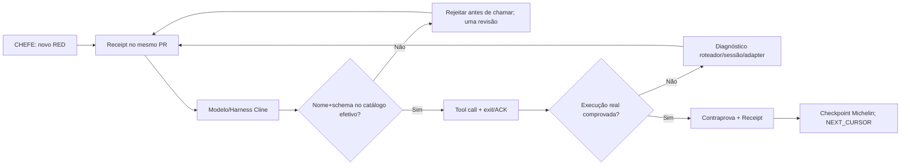

# 🧠 PR DOS RED 🔴 — Cline Tool Calling / roteamento de ferramentas
**INTENT_ID:** CENTRALDARK-MICHELIN-50-FIXED-POINT  
**Owner:** mesmo `centraldark-live-editing-fabric` + Tool Call Lens/ZENDRIVE existentes.  
**Data:** 2026-10-22 (evidência de prints do CHEFE).  
**Escopo:** correção causal do despacho de ferramentas no Cline; não reiniciar 50 passos, não instalar outra IA, não alterar Cline upstream sem prova.  

## Contrato de captura contínua no MESMO PR
Cada novo RED do CHEFE acrescenta uma entrada nesta caderneta, atualiza a skill/guarda equivalente existente quando houver causa comprovada, testa a contraprova e publica commit *na mesma branch/PR*. Nunca abrir PR novo a cada print; conservar histórico. Se o mesmo erro reaparecer com mesmo fingerprint, agregar recorrência ao RED existente. Se houver falha distinta, atribuir próximo número consecutivo sem adivinhar. Registrar `SOURCE`, `TIMESTAMP` (se medido), `MODEL` (se conhecido), `SESSION_ID`, `TOOL_NAME`, `ADVERTISED_TOOLS`, `ERROR`, `OBSERVED_LAYER`, `COUNTERPROOF`, `STATUS`, `RECEIPT`.

**Estados:** 🔴 CAPTURED → 🟠 TRIAGED → 🟡 FIX_CANDIDATE → 🧪 TESTED → 🟢 PROVEN_FIXED; captura e commit de documentação **não** significam correção do runtime.

## 🔴 RED #001 — ferramenta inventada
- **Evidência:** screenshot 2026-10-22 do passo 01/50 (CHEFE).
- **Sintoma:** `AI_NoSuchToolError` para `ask_ou_bot` e `read_arch`. Repetição até circuit-breaker do Cline.
- **Camada:** `CLINE_MODEL_TO_TOOL_ROUTING`, antes de execução da ferramenta. Não comprova falha de SSH/MCP/VPS.
- **Causa observável:** nome solicitado não pertence ao catálogo **efetivamente anunciado naquela sessão**.
- **Regra corretiva:** escolher somente nome exato e schema do inventário atual da MESMA superfície/sessão. Proibir tradução livre de nomes (p. ex. `read_arch` → suposto alias). Logar rejeição e trocar estratégia uma vez, sem looping de tool names.
- **Contraprova pendente:** tool call válida com retorno/exit code + arquivo/estado alvo medido no Windows Casa.
- **Fingerprint:** `AI_NoSuchToolError|NOT_ADVERTISED|ask_ou_bot,read_arch|CLINE`.
- **Status:** 🟠 TRIAGED; correção de runtime ainda não provada.

## 🔴 RED #002 — ferramentas até anunciadas são rejeitadas
- **Evidência:** screenshot de 2026-10-22 com oito tool calls rejeitadas consecutivamente; última captura CHEFE aponta repetição.
- **Sintoma:** `read_files`, `read_file`, `comando_shel`, `run_commands` e `comando_shell` rejeitados `before execution`. A mensagem do mesmo dispatcher declara, entre outras, `read_files` e `run_commands` como **available tools**.
- **Camada:** falha antes do runtime do comando/arquivo; `CLINE_MODEL_TOOL_REGISTRY_OR_DISPATCH_ADAPTER`.
- **Diagnóstico discriminante:** `read_file` e `comando_shel` não constam do catálogo. Porém `read_files` e `run_commands` **constam do texto de disponibilidade e mesmo assim falharam**; isso **não** pode ser resolvido somente escolhendo um nome da lista. Suspeitar de catálogo exposto diferente do resolver/despachante de chamadas, conversão de nome, schema não carregado, aliases/harness ou estado da sessão/compaction — sem declarar causalidade fechada antes de contraprova.
- **Regra corretiva:** obter inventário *efetivo* de ferramenta/namespace e schema da sessão ativa; fazer um probe inofensivo por identificador canônico+args exatos; se rejeitado de novo, abrir `TOOL_REGISTRY_PARITY_BLOCKED` e **interromper tentativas de sinônimos**. Reconectar/reidratar somente por rota autorizada e com confirmação do catálogo antes do replay; preservar checkpoint 01/50.
- **Contraprova pendente:** mesma ferramenta passa pelo router e devolve resultado real; teste do estado do arquivo `LEIA-ME-IA.md` no checkout correto; readback em T0/T1.
- **Fingerprint:** `AI_NoSuchToolError|ADVERTISED_BUT_REJECTED|read_files,run_commands|CLINE`.
- **Status:** 🔴 CAPTURED / 🟡 ROOT_CAUSE_UNVERIFIED.

## Arquitetura existente (não criar outro MCP)

## Handoff e critérios Michelin
**Construir:** registrar falha individual com fingerprint, corrigir contrato de rota exata.  
**Integrar:** ampliar owner `.agents/skills/centraldark-live-editing-fabric/SKILL.md` + regra `AGENTS.md`, sem segunda cabeça.  
**Provar:** testes de guarda e tool call real no Cline Casa; `SOURCE_COMMITTED != CLINE_SESSION_LOADED != TOOL_EXECUTED`.  

**CURRENT:** 2 fingerprints capturados; runtime corrigido **UNKNOWN**, `50_MICROSTEPS_COMPLETED=0` até readback.  
**NEXT_CURSOR:** `PR_DOS_RED_STATIC_TEST → SESSION_TOOL_REGISTRY_READBACK → ONE_SAFE_CALL → REPLAY_STEP_01 → RECEIPT → CONTINUE_02_TO_50`.
## 🧪 Contraprovas discriminantes desta revisão
- `scripts/ci/centraldark-toolcall-red-guard.mjs`: módulo puro, independente de provedor; nenhum comando shell, secret, HTTP request, restart, bypass ou integração não autorizada.
- `scripts/ci/centraldark-toolcall-red-guard.test.mjs`: **9 testes Node definidos**, incluindo `NOT_ADVERTISED`, `ADVERTISED_BUT_REJECTED`, `TOOL_REGISTRY_PARITY_BLOCKED`, `RETRY_LOOP_BLOCKED`, identidade da recorrência, `NO_FAKE_PROOF`.
- **READBACK ISOLADO V8:** código da branch recuperado pelo GitHub, 10/10 asserts manuais PASS no módulo puro (blob `ef2b2cf8a73f8af20c6b5d2f2bb23e32923092a5`). Esse teste não equivale a `node --test` no CI.
- **CI OWNERSHIP:** workflow existente `.github/workflows/centraldark-validate.yml` agora inclui `node --test scripts/ci/centraldark-toolcall-red-guard.test.mjs` no job de validação canônica. Job precisa passar no SHA final para selo.
- **Cline runtime:** esquema carregado na sessão do Cline e correção efetiva do resolver permanecem `UNKNOWN`; precisa de chamada real por uma ferramenta autorizada com resultado não vazio e prova do arquivo-alvo. Não presumir que ler `AGENTS.md` alterou a lista de ferramentas.
- **DEDUP:** capturas adicionais de `AI_NoSuchToolError` com os mesmos nomes e a mesma superfície são recorrências de #001/#002, não novo ID sem fingerprint/camada diferente.

**FIXED_POINT:** NÃO. **MVP de fonte:** módulo + testes + skill + política + workflow no PR.  
**NEXT_CURSOR:** `CI_SAME_HEAD → CLINE_TOOL_SCHEMA_LIVE → AUTH_SAFE_CALL_READBACK → RED_001_002_CLOSURE → MICHELIN_01_50`.

## 🔴 RED Realtime — Supabase/GitHub source bridge

**Provas materiais no Supabase CentralDark, banco EXISTENTE (sem alterar policy):**
- Evento catalogado: `public.notification_events.event_key=centraldark.red.toolcall.v1`, ID `851ff008-86f5-46bc-92c5-de0b0ac63deb`.
- `public.notifications_log` contém RED #001 `c1f609ff-a814-4871-a864-261174b468c2` e RED #002 `1e5589a2-1da7-491d-b813-cdd4d768097b`, resultado de `INSERT ... RETURNING` da sessão administrativa.
- Tipo `erro`, `proof_state=FAIL_OBSERVED`, `publication_mode=MANUAL_OBSERVED_PROJECTION`, origem `cline_toolcall_red`, link PR #1903; **não** foram eventos de um watcher já em operação.
- RLS na tabela: `SELECT` só `authenticated` com `has_role(auth.uid(),'admin')`; tabela já incluída em `supabase_realtime`. Sem alteração de schema nem política.

**Implementação candidata versionada neste PR:**
- `apps/instinto-superior/src/components/central/CentralNotificacoes.tsx`: filtro RED, contador, link validado do PR, sem segundo feed. Consumidor atual `useNotificationsLog` já reconcilia por SELECT RLS + subscription Realtime.
- `scripts/ci/centraldark-red-intake.mjs` normaliza eventos modelo-agnósticos, fingerprint sha256, IDs e campos sanitizados.
- `scripts/ci/centraldark-red-dispatch.mjs` envia `repository_dispatch` via GitHub API quando um executor autorizado observar erro e existir token no secret store do host.
- `scripts/ci/centraldark-red-publish.mjs` valida repo/PR/branch, de-duplica por fingerprint, comenta no PR, faz commit CAS apenas no receipt e então projeta em `notifications_log` via chave no job; não imprime logs ou secrets.
- `.github/workflows/centraldark-pr-dos-red.yml`: `repository_dispatch`/`workflow_dispatch` via GitHub Actions *default branch*, com `contents: write`, `issues: write` e Supabase secret server-only. Source em PR draft **não ativa o evento** até promoção segura à main.
- `scripts/ci/centraldark-red-intake.test.mjs` + `centraldark-validate.yml`: testes deterministas condicionados ao CI do SHA exato, sem declarar E2E.

**Importante:** `https://api.centralldark.com` continua API oficial do control plane, mas nenhuma rota `POST /reds` foi comprovada no gateway. Não inventar HTTP 200, nem declarar que o tráfego do RED atravessa essa API: atual transporte de publicação proposto é `GitHub API → Supabase REST/Realtime`, com fingerprints correlacionados no PR. Precisa de owner/canonical gateway antes de alterar rota pública.

**Gates pendentes:** `CI_SAME_SHA`, secret/vars do Actions sem exibição, merge autorizado, hook de origem Cline que realmente dispare evento (PostToolUse pode não observar rejeição antes da execução), GitHub comment automático, Supabase row automático, browser/admin realtime e contraprova. `FIXED_POINT=NOT_ACHIEVED`.

## 🔴 RED #003 — Shell/Working Directory da Casa fora do checkout

- **Evidência:** captura do CHEFE com execução real de `run_commands` no Cline.
- **Sintoma A:** `fatal: not a git repository (or any of the parent directories): .git` ao iniciar em `C:\\root\\CentralDark`.
- **Sintoma B:** comandos PowerShell com quoting/escape falham `Unexpected token 'c' in expression or statement`. O mesmo Cline recorreu posteriormente a comandos de leitura em `K:`, onde encontrou arquivos canônicos.
- **Classe nova:** `SHELL_CONTEXT_ERROR` / `COMMAND_FAILED`, independente do RED #001 (tool alucinada) e #002 (anunciada/rejeitada).
- **Camada:** Cline `run_commands` realmente despachou; falha ocorre **dentro do shell** e contexto de workspace, não é `AI_NoSuchToolError`.
- **Fingerprint causal:** `CLINE|CASA|SHELL_CONTEXT_ERROR|COMMAND_FAILED|run_commands`.
- **Causa material:** diretório atual divergente do repositório versionado e command-line construída com quoting incorreto.
- **Guarda corretiva:** antes de `git status`, medir `Get-Location`, `git -C 'K:\\' rev-parse --show-toplevel` e o owner; não presumir que `C:\\root\\CentralDark` ou `K:\\docs` sejam repositório Git. Para PowerShell, usar parâmetros nativos e `-LiteralPath`, sem construir comandos com aspas aninhadas no JSON. Distinguir erros de shell de falhas MCP.
- **Contraprova pendente:** `git -C <checkout real> rev-parse --show-toplevel` + `git status --short --branch` com exit 0 no mesmo checkout, depois retomar Michelin passo 01/50.
- **Status:** 🔴 CAPTURED → 🟠 TRIAGED, `FIX_PROVEN=UNKNOWN`.
- **Origem:** screenshot da Casa (Cline com `run_commands` concluído, comando Git falhou por cwd); sem leitura de secrets.
