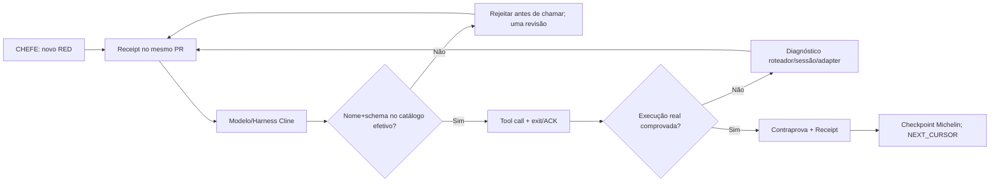

# 🧠 PR DOS RED 🔴 — Cline Tool Calling / roteamento de ferramentas
**INTENT_ID:** CENTRALDARK-MICHELIN-50-FIXED-POINT  
**Owner:** mesmo `centraldark-live-editing-fabric` + Tool Call Lens/ZENDRIVE existentes.  
**Data:** 2026-10-22 (evidência de prints do CHEFE).  
**Escopo:** correção causal do despacho de ferramentas no Cline; não reiniciar 50 passos, não instalar outra IA, não alterar Cline upstream sem prova.  

## Contrato de captura contínua no MESMO PR
Cada novo RED do CHEFE acrescenta uma entrada nesta caderneta, atualiza a skill/guarda equivalente existente quando houver causa comprovada, testa a contraprova e publica commit *na mesma branch/PR*. Nunca abrir PR novo a cada print; conservar histórico. Se o mesmo erro reaparecer com mesmo fingerprint, agregar recorrência ao RED existente. Se houver falha distinta, atribuir próximo número consecutivo sem adivinhar. Registrar `SOURCE`, `TIMESTAMP` (se medido), `MODEL` (se conhecido), `SESSION_ID`, `TOOL_NAME`, `ADVERTISED_TOOLS`, `ERROR`, `OBSERVED_LAYER`, `COUNTERPROOF`, `STATUS`, `RECEIPT`.

**Estados:** 🔴 CAPTURED → 🟠 TRIAGED → 🟡 FIX_CANDIDATE → 🧪 TESTED → 🟢 PROVEN_FIXED; captura e commit de documentação **não** significam correção do runtime.

## 🔴 RED #001 — ferramenta inventada
- **Evidência:** screenshot 2026-10-22 do passo 01/50 (CHEFE).
- **Sintoma:** `AI_NoSuchToolError` para `ask_ou_bot` e `read_arch`. Repetição até circuit-breaker do Cline.
- **Camada:** `CLINE_MODEL_TO_TOOL_ROUTING`, antes de execução da ferramenta. Não comprova falha de SSH/MCP/VPS.
- **Causa observável:** nome solicitado não pertence ao catálogo **efetivamente anunciado naquela sessão**.
- **Regra corretiva:** escolher somente nome exato e schema do inventário atual da MESMA superfície/sessão. Proibir tradução livre de nomes (p. ex. `read_arch` → suposto alias). Logar rejeição e trocar estratégia uma vez, sem looping de tool names.
- **Contraprova pendente:** tool call válida com retorno/exit code + arquivo/estado alvo medido no Windows Casa.
- **Fingerprint:** `AI_NoSuchToolError|NOT_ADVERTISED|ask_ou_bot,read_arch|CLINE`.
- **Status:** 🟠 TRIAGED; correção de runtime ainda não provada.

## 🔴 RED #002 — ferramentas até anunciadas são rejeitadas
- **Evidência:** screenshot de 2026-10-22 com oito tool calls rejeitadas consecutivamente; última captura CHEFE aponta repetição.
- **Sintoma:** `read_files`, `read_file`, `comando_shel`, `run_commands` e `comando_shell` rejeitados `before execution`. A mensagem do mesmo dispatcher declara, entre outras, `read_files` e `run_commands` como **available tools**.
- **Camada:** falha antes do runtime do comando/arquivo; `CLINE_MODEL_TOOL_REGISTRY_OR_DISPATCH_ADAPTER`.
- **Diagnóstico discriminante:** `read_file` e `comando_shel` não constam do catálogo. Porém `read_files` e `run_commands` **constam do texto de disponibilidade e mesmo assim falharam**; isso **não** pode ser resolvido somente escolhendo um nome da lista. Suspeitar de catálogo exposto diferente do resolver/despachante de chamadas, conversão de nome, schema não carregado, aliases/harness ou estado da sessão/compaction — sem declarar causalidade fechada antes de contraprova.
- **Regra corretiva:** obter inventário *efetivo* de ferramenta/namespace e schema da sessão ativa; fazer um probe inofensivo por identificador canônico+args exatos; se rejeitado de novo, abrir `TOOL_REGISTRY_PARITY_BLOCKED` e **interromper tentativas de sinônimos**. Reconectar/reidratar somente por rota autorizada e com confirmação do catálogo antes do replay; preservar checkpoint 01/50.
- **Contraprova pendente:** mesma ferramenta passa pelo router e devolve resultado real; teste do estado do arquivo `LEIA-ME-IA.md` no checkout correto; readback em T0/T1.
- **Fingerprint:** `AI_NoSuchToolError|ADVERTISED_BUT_REJECTED|read_files,run_commands|CLINE`.
- **Status:** 🔴 CAPTURED / 🟡 ROOT_CAUSE_UNVERIFIED.

## Arquitetura existente (não criar outro MCP)

## Handoff e critérios Michelin
**Construir:** registrar falha individual com fingerprint, corrigir contrato de rota exata.  
**Integrar:** ampliar owner `.agents/skills/centraldark-live-editing-fabric/SKILL.md` + regra `AGENTS.md`, sem segunda cabeça.  
**Provar:** testes de guarda e tool call real no Cline Casa; `SOURCE_COMMITTED != CLINE_SESSION_LOADED != TOOL_EXECUTED`.  

**CURRENT:** 2 fingerprints capturados; runtime corrigido **UNKNOWN**, `50_MICROSTEPS_COMPLETED=0` até readback.  
**NEXT_CURSOR:** `PR_DOS_RED_STATIC_TEST → SESSION_TOOL_REGISTRY_READBACK → ONE_SAFE_CALL → REPLAY_STEP_01 → RECEIPT → CONTINUE_02_TO_50`.
