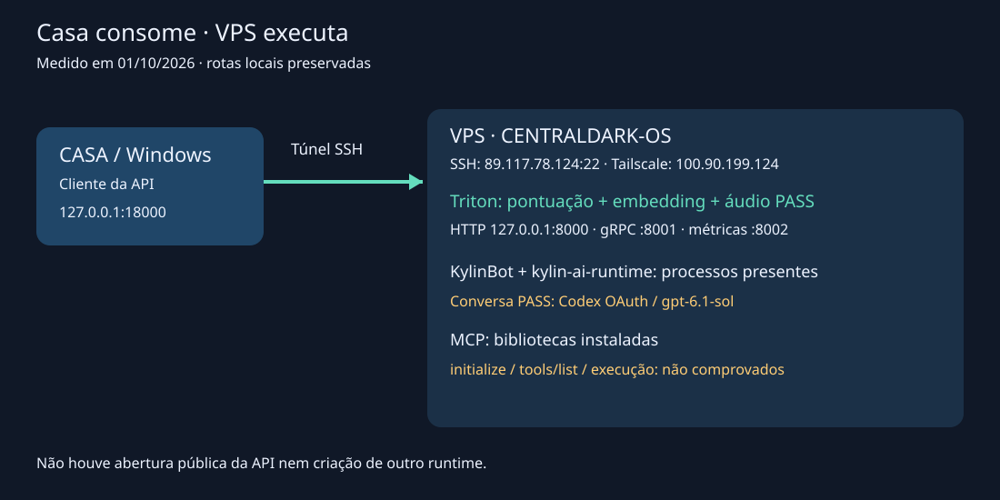
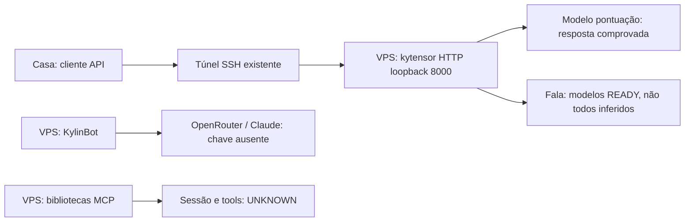

# Casa → API nativa da IA na VPS

Medição: **01/10/2026, aproximadamente 15:15–15:18 BRT**. Casa é cliente da API neste momento; a execução nativa fica na VPS. O papel futuro de laboratório/GPU no plano não é requisito do uso atual.



## Primeira medição — antes da remediação abaixo

| Componente | Resultado medido |
|---|---|
| VPS | CENTRALDARK-OS, openKylin; SSH existente respondeu |
| kytensor | Serviço enabled/active; Triton 2.49.0; HTTP responde |
| Inferência local | PASS: modelo de pontuação transformou `你好今天系统运行正常吗` em `你好，今天系统运行正常吗？` |
| Casa → VPS | PASS: túnel SSH temporário e GET `/v2` retornaram Triton 2.49.0; túnel de teste encerrado |
| Modelos | Entradas READY de fala/pontuação/model_bank; OCR UNAVAILABLE/unloaded; embeddings/outros sem READY no índice observado |
| LLM local | Biblioteca `kytensor-llm` instalada; configuração default cita `llm_Qwen-2.5-3b_1.0`; esse modelo não apareceu no índice e não foi encontrado GGUF nas três pastas examinadas. Geração local não comprovada |
| KylinBot | Daemon e workspace existentes; teste single-shot falhou: OpenRouter API key not set; modelo selecionado `anthropic/claude-sonnet-4` |
| kylin-ai-runtime | Processo presente; resposta conversacional própria ainda não comprovada |
| MCP nativo | `libkysdk-mcp` com bibliotecas cliente/servidor instaladas; sessão initialize, tools/list e execução não testadas |

**Conclusão:** há inferência nativa funcionando na VPS. Ainda não há prova de chatbot local completo ou MCP operacional. Plugin DeepSeek/Qwen instalado não comprova conta autenticada nem pesos carregados. Nenhuma credencial foi copiada para este documento.

## Rotas e uso

| Rota | Papel e disponibilidade |
|---|---|
| `89.117.78.124:22` / alias SSH `segredo-vpss` | Administração e túnel usados neste teste |
| `100.90.199.124` | IP Tailscale observado da VPS; SSH por este endereço deve ser testado antes de substituir o alias |
| VPS `127.0.0.1:8000` | API HTTP Triton, loopback; não acessível diretamente da Casa |
| VPS `127.0.0.1:8001` | Listener gRPC do mesmo processo; handshake gRPC não testado |
| VPS `127.0.0.1:8002` | Listener auxiliar do mesmo processo; conteúdo de métricas não testado |
| Casa `127.0.0.1:18000` | Endpoint local enquanto o túnel abaixo estiver aberto |
| `/root/.kylinbot/gateway.sock` | Socket Unix presente; não é uma API HTTP da Casa |

No PowerShell da Casa, mantenha este comando aberto durante o uso:

```powershell
ssh -N -o ExitOnForwardFailure=yes -L 127.0.0.1:18000:127.0.0.1:8000 segredo-vpss
```

Em outro terminal:

```powershell
Invoke-RestMethod http://127.0.0.1:18000/v2
Invoke-WebRequest http://127.0.0.1:18000/v2/health/ready
Invoke-RestMethod -Method Post -ContentType 'application/json' -Body '{}' http://127.0.0.1:18000/v2/repository/index
$payload = @{ inputs = @(@{ name='text_no_punc'; shape=@(1,1); datatype='BYTES'; data=@('你好今天系统运行正常吗') }); outputs=@(@{name='OUTPUT0'}) } | ConvertTo-Json -Depth 8
Invoke-RestMethod -Method Post -ContentType 'application/json; charset=utf-8' -Body ([Text.Encoding]::UTF8.GetBytes($payload)) http://127.0.0.1:18000/v2/models/ensemble-punc_ct-transformer_nonstreaming/infer
```

A requisição de inferência veio do `config.pbtxt` e da resposta real desse modelo. Não é endpoint OpenAI chat/completions. Fechar o SSH encerra a rota; não foi instalado serviço permanente de túnel.

## Diagrama de execução



## Próximo cursor

1. Identificar o owner de configuração ativo do `kylin-ai-runtime` e a rota real de conversa antes de criar adaptador.
2. Medir se o LLM citado tem pesos disponíveis e qual backend o carrega; não baixar outro modelo por inferência.
3. Reutilizar autenticação autorizada existente se disponível e testar uma resposta de conversa. O teste atual do KylinBot falhou sem chave.
4. Descobrir transporte MCP existente e provar initialize → tools/list → uma chamada de leitura.
5. Só depois ligar o cockpit/cliente da Casa a essas capacidades comprovadas.

Owner operacional de acesso: [SSH/VPS](05-SSH-VPS.md). Plano recuperável: [inventário vigente](../ARQUITETURA/CENTRALDARK-INSTINTO-SUPERIOR-OS/INVENTARIO-KERNEL-PROPRIO.md). Serviços ativos não equivalem a resposta de todos os modelos.

## Remedição após ativação — 01/10/2026 15:21 BRT

- Embedding `ensemble-embd_gte-base_uint8-text` carregado pelo endpoint existente `/v2/repository/models/{name}/load`; inferência PASS, tensor `[1,8,768]`, 6.144 valores. Pesos ONNX já estavam instalados; não houve download de outro modelo.
- TTS `ensemble-tts_melo`: inferência PASS, saída Audio `[1,41506]`, amostras não nulas. Sequência Triton com `sequence_id`, `sequence_start=true`, `sequence_end=true`. Não prova captura/reprodução física de microfone/alto-falante.
- Autenticação Codex existente da Casa importada pelo comando nativo `auth login --provider openai-codex --import`; arquivo transitório apagado. Perfil OAuth armazenado pelo próprio KylinBot, sem token no Git.
- Conversa PASS com provider `openai-codex`, modelo `gpt-6.1-sol`: `CENTRALDARK_OK`. Após configuração persistente, consulta sem overrides respondeu `CENTRALDARK_DEFAULT_OK`.
- A execução do agente é nativa na VPS; esse modelo de conversa é remoto via OAuth. Não confundir com LLM de pesos locais, que segue sem inferência comprovada.

O esquema local exige `[providers] fallback="openai-codex"` e `[providers.models.openai-codex]` com `name="openai-codex"`, `model="gpt-6.1-sol"`, `requires_openai_auth=true`, `wire_api="responses"`. Config anterior foi preservada. Alias arbitrário `centraldark` foi rejeitado por esta versão, apesar do esquema aceitar o campo; usar rota que passou.

Pesquisa complementar: [configuração upstream](https://github.com/zeroclaw-labs/zeroclaw/blob/master/docs/book/src/providers/configuration.md) e [discussão estrangeira sobre confusão de providers](https://www.reddit.com/r/openclaw/comments/1r5yg9m/need_help_getting_zeroclaw_to_use_anything_except/). Fóruns são pistas; schema, help e inferência do binário instalado determinam o procedimento.

## Ponte da main para o runtime nativo

Owner: `scripts/vps/kylin-native-bind.py`. Aplica referências via symlinks no workspace existente, preserva arquivos anteriores, valida o SHA e grava receipt local. Não duplica SOUL nem instala outro agente. Reaplica idempotentemente a mesma fonte; testar o agente lendo as regras é obrigatório. Microdeploy existente: `scripts/vps/main-pinned-microdeploy.sh`; exige checkout Git e processos PM2 já provisionados. Não declarar microdeploy PASS se esses consumers estiverem ausentes.


## Verificação upstream oficial — openKylin 3.0 como substrate compartilhado de IA/MCP

Data da verificação: 2026-10-01. Fonte externa oficial; não substitui a medição do runtime desta VPS.

Fontes:
- https://www.openkylin.top/news/4098-cn.html
- https://www.openkylin.top/news/4083-cn.html
- https://www.openkylin.top/news/4122-cn.html
- https://gitee.com/openkylin/kylin-ai-subsystem-plugin/blob/upstream/subsystempackagemanager.h
- https://gitee.com/openkylin/kylin-ai-runtime/pulls/31
- https://gitee.com/openkylin/kylin-aiassistant/pulls/456

O openKylin 3.0 documenta uma arquitetura unificada que inclui modelos, memória, ferramentas, permissões do sistema e capacidades do desktop. A publicação oficial afirma que KylinBot e outros agentes podem chamar capacidades do desktop diretamente por MCP, sem depender de simulação de clique. O pacote do subsistema lista runtime, document-QA, document service, vector engine, embedding, speech, vision e GenAI/NLP; o runtime possui suporte upstream a múltiplas conexões NLP distinguíveis por sessionId. O AI Assistant atual também verifica a disponibilidade do AI subsystem/runtime antes de criar a janela principal.

O AgentOS oficial amplia a mesma direção com system agent, desktop-operation agent/CUA, unified model inference service, agent runtime, task management, voz e suporte explícito a modelos de Embedding. Isso reforça a leitura de substrate compartilhado; não cria prova de que cada janela, aba, pasta ou lixeira instancia um LLM próprio.

```text
OPENKYLIN_SHARED_AI_SUBSTRATE=OFFICIAL_DOCUMENTED
DESKTOP_CAPABILITY_MCP=OFFICIAL_DOCUMENTED
AGENT_DIRECT_DESKTOP_CAPABILITY_CALL=OFFICIAL_DOCUMENTED
AI_RUNTIME_MULTI_SESSION=UPSTREAM_DOCUMENTED
SUBSYSTEM_EMBEDDING_VECTOR_SPEECH_VISION_NLP=UPSTREAM_SOURCE_PROVED
AGENTOS_SYSTEM_AGENT_CUA_RUNTIME_INFERENCE_VOICE_EMBEDDING=OFFICIAL_DOCUMENTED

WINDOW_OR_TAB_CAN_BE_AI_CAPABILITY_CLIENT=SUPPORTED_INTERPRETATION
EACH_WINDOW_OR_TAB_SPAWNS_DISTINCT_LLM=NOT_PROVEN
PACKAGE_OR_DOC_PRESENT != LOCAL_RUNTIME_EFFECT
OFFICIAL_ARCHITECTURE != CURRENT_VPS_TOOL_LIST
```

### Consequência canônica para a CentralDark

Não instalar uma IA por aplicativo. Tratar KylinBot, AI Assistant, UKUI, File Manager, busca, voz, clipboard e demais componentes como consumidores/provedores de capabilities do mesmo corpo openKylin quando a capability for medida.

```text
CHEFE_INTENT
→ CENTRALDARK_CORE
→ CAPABILITY/SECTOR_ROUTER
→ REUSE_NATIVE_OPENKYLIN_CAPABILITY
→ SHARED_AI_SUBSYSTEM/RUNTIME
→ MODEL | EMBEDDING | VECTOR | SPEECH | VISION | MCP_DESKTOP
→ EFFECT
→ READBACK
→ REALITY_JUDGE
→ LEARNING_DELTA
```

Próximo discriminante permanece material: descobrir no CENTRALDARK-OS o catálogo MCP realmente exposto e provar `initialize → tools/list → uma tool de leitura`. Documentação oficial de MCP não transforma essa execução em PASS.


## Direção CURRENT — IA nativa primeiro

Intenção confirmada pelo CHEFE em 2026-10-01: a rota principal deve consumir a IA/capabilities nativas do próprio openKylin/CENTRALDARK-OS. A rota cloud `openai-codex/gpt-6.1-sol` permanece como evidência histórica de que o KylinBot consegue conversar por provider remoto, mas não é o alvo desta integração.

```text
NATIVE_AI_FIRST=true
PRIMARY_TARGET=OPENKYLIN_SHARED_AI_SUBSYSTEM
PRIMARY_CAPABILITY_SURFACES=KYTENSOR_TRITON_V2|KYLIN_AI_RUNTIME|NATIVE_MCP|EMBEDDING|VECTOR|SPEECH|VISION|DOCUMENT_SERVICES
REMOTE_LLM_ROUTE=FALLBACK_OR_SEPARATE_CAPABILITY
OPENROUTER_MISSING_KEY=NOT_NATIVE_AI_BLOCKER
OPENAI_COMPATIBLE_UI_FIELD != NATIVE_OPENKYLIN_ROUTE
REUSE_EXISTING_NATIVE_OWNER_BEFORE_ADAPTER=true
```

Rota nativa já provada neste owner na VPS:

```text
VPS_LOCAL_KYTENSOR_HTTP=127.0.0.1:8000
TRITON_V2_READY=PASS
NATIVE_EMBEDDING_INFERENCE=PASS
NATIVE_TTS_INFERENCE=PASS
```

Ainda não provado como equivalente a chat local completo:

```text
NATIVE_LOCAL_LLM_CHAT=UNKNOWN
NATIVE_MCP_INITIALIZE_TOOLS_CALL=UNKNOWN
AIONUI_NATIVE_BINDING=UNKNOWN
```

Próxima prova: medir no twin local/VPS a capability nativa pelo protocolo real, executar uma chamada material e somente depois bindar Hermes/AionUi. Não pedir chave de provider externo para fechar um claim nativo.


## VMware CURRENT — Hermes + Kylin native/cloud route — 03/10/2026

Medição feita no twin local `CENTRALDARK-OS`, não na VPS. O objetivo foi provar um modelo Kylin já disponível e preparar o binding do Hermes original sem instalar runtime paralelo.

```text
HERMES_VERSION=vgit.ca952a5
HERMES_PROVIDER_CURRENT=nous
NOUS_PAID_ROUTE=CREDITS_EXHAUSTED
KYLIN_DEEPSEEK_R1_PACKAGE=INSTALLED
KYLIN_DEEPSEEK_V3_PACKAGE=INSTALLED
KYLIN_CLOUD_ENABLED=PASS
KYLIN_CLOUD_CURRENT_MODEL=kylin-deepseek-r1
KYLIN_NATIVE_SDK=/usr/lib/x86_64-linux-gnu/libkysdk-genai-nlp.so.1
KYLIN_NATIVE_RESPONSE=PASS
KYLIN_NATIVE_RESPONSE_TEXT=LOCAL_QWEN_OK
HERMES_USING_KYLIN_NATIVE=UNKNOWN
```

Discriminante importante: `deepseek-r1` e `kylin-deepseek-r1` não se comportaram igual. O primeiro inicializou a sessão mas retornou erro 10 sem texto; o segundo fechou `INIT=0 → DONE=True → TEXT=LOCAL_QWEN_OK`. Portanto o binding nominal do Kylin faz parte da prova.

O provider `custom` do Hermes já suporta endpoint OpenAI-compatible. O menor delta escolhido foi um bridge loopback para adaptar `genai_text_*`, sem Ollama/vLLM/llama.cpp. O arquivo `~/.hermes/kylin_openai_bridge.py` ainda não passou health por erro local de Python no acesso a `XDG_RUNTIME_DIR`; logo `BRIDGE_FILE_EXISTS != BRIDGE_RUNNING` e `KYLIN_NATIVE_RESPONSE=PASS != HERMES_KYLIN_BINDING_PASS`.

Next cursor: corrigir o bridge existente, provar `/health`, `/v1/models`, chat `BRIDGE_OK`, então configurar Hermes `provider=custom`, loopback `127.0.0.1:18435/v1`, modelo `kylin-deepseek-r1` e exigir `HERMES_VM_OK`.


## Fechamento CURRENT — Hermes + Kylin + AionUi agêntico — 04/10/2026

O estado `HERMES_USING_KYLIN_NATIVE=UNKNOWN` registrado na medição VMware de 03/10 permanece histórico daquele instante. Em prova posterior no runtime CENTRALDARK-OS, a rota abaixo fechou funcionalmente:

```text
AionUi
→ Hermes Agent v0.21.5+6146.g46904a3
→ provider custom
→ http://127.0.0.1:18435/v1
→ bridge local [backend=kylin-native-sdk]
→ Kylin native GenAI SDK
→ kylin-deepseek-r1
→ resposta
```

Readbacks preservados no receipt de sessão:
- bridge `/health=200`;
- `/v1/models=200` com `kylin-deepseek-r1`;
- chat do bridge → `HERMES_KYLIN_BRIDGE_OK`;
- AionUi conversando pelo endpoint custom;
- Hermes emitiu tool call estruturada `read_file` para o `AGENTS.md` do projeto;
- Triton `live=200`, `ready=200`;
- HERMES-CORE `health=200`, versão `5.0`.

```text
HERMES_KYLIN_BINDING_PASS=PASS
AIONUI_HERMES_KYLIN_ROUTE=PASS
HERMES_AGENT_TOOL_CALL_READ_FILE_EMITTED=PASS
HERMES_PLUS_LOCAL_KYLIN_PLUS_AGENTIC_CAPABILITY=PROVEN_FUNCTIONAL
ALL_HERMES_TOOLS_PROVEN=NO
CURRENT_OVER_HISTORY=true
```

Owner de evidência: `docs/CONSCIENCIA/RECEIPTS/2026-10-04-kylin-native-hermes-routes-session.md`.
PR-mãe receipt: `#1562 / 5975848027`.


## Selo de rota CURRENT — Casa SEGREDO → VPS por SSH do Git — 11/10/2026

<!-- CENTRALDARK_SSH_GIT_CLIENT_PASS_20261011 -->

Medição independente da sessão **2026-10-11T20:38:03Z**, executada por Remote Desktop Commander na Casa **SEGREDO**, PowerShell 7, sem alteração de configuração nem de arquivos da VPS. Este selo atualiza **somente o binding SSH da Casa para a VPS**; não promove deploy, sincronização do HUD, A2A ou estado global.

| Item | Resultado medido |
|---|---|
| Origem | Windows Casa SEGREDO, `C:\\Users\\Administrador` |
| Perfil SSH | `Segredo-VPS` — alias presente em `C:\\Users\\Administrador\\.ssh\\config` (também existe `segredo-vpss`) |
| Destino | `89.117.78.124:22`, usuário `root` |
| Chave | `C:\\Users\\Administrador\\.ssh\\segredo_vps_ed25519` (arquivo presente; **sem expor seu conteúdo**) |
| Binário comprovado | `C:\\Program Files\\Git\\usr\\bin\\ssh.exe` — OpenSSH_10.3p1 |
| SSH nativo do Windows | `C:\\Windows\\System32\\OpenSSH\\ssh.exe`: `-V` e `-G` retornaram **255** sem diagnóstico útil nesta sessão; causa interna ainda **UNKNOWN** |
| Rede Casa → VPS | TCP `89.117.78.124:22` **OPEN** no teste da Casa |
| Comando de prova remoto | `hostname; id -un` via `Segredo-VPS`, com `BatchMode=yes`, `ConnectTimeout=8`, `StrictHostKeyChecking=yes` e `IdentitiesOnly=yes` |
| Readback remoto | `CENTRALDARK-OS` / `root` |
| Resultado | `SSH_EXIT=0`, `SSH_STDERR_LINE_COUNT=0` |

Para acesso interativo no PowerShell da Casa, reutilizar:

```powershell
& "C:\\Program Files\\Git\\usr\\bin\\ssh.exe" Segredo-VPS
```

**Veredito por escopo:** `CASA_TO_VPS_SSH_GIT=PASS`; `WINDOWS_NATIVE_SSH_BINARY=FAIL_OBSERVED`; `HERMES_A2A_ROUNDTRIP=UNKNOWN`; `VPS_HUD_CHECKOUT_SYNC=UNKNOWN`. Uma rota SSH que passou **não** comprova nenhum outro serviço.

**NEXT_CURSOR:** reutilizar a rota SSH do Git para medições autorizadas Casa→VPS; preservar o worktree sujo e as modificações locais antes de qualquer reconciliação Git. Não criar segundo Hermes ou segundo owner por causa deste transporte.
