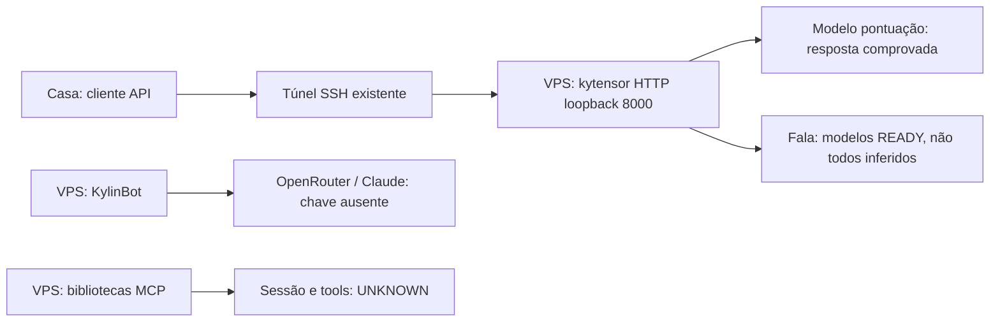

# Casa → API nativa da IA na VPS

Medição: **01/10/2026, aproximadamente 15:15–15:18 BRT**. Casa é cliente da API neste momento; a execução nativa fica na VPS. O papel futuro de laboratório/GPU no plano não é requisito do uso atual.


## Primeira medição — antes da remediação abaixo

| Componente | Resultado medido |
|---|---|
| VPS | CENTRALDARK-OS, openKylin; SSH existente respondeu |
| kytensor | Serviço enabled/active; Triton 2.49.0; HTTP responde |
| Inferência local | PASS: modelo de pontuação transformou `你好今天系统运行正常吗` em `你好，今天系统运行正常吗？` |
| Casa → VPS | PASS: túnel SSH temporário e GET `/v2` retornaram Triton 2.49.0; túnel de teste encerrado |
| Modelos | Entradas READY de fala/pontuação/model_bank; OCR UNAVAILABLE/unloaded; embeddings/outros sem READY no índice observado |
| LLM local | Biblioteca `kytensor-llm` instalada; configuração default cita `llm_Qwen-2.5-3b_1.0`; esse modelo não apareceu no índice e não foi encontrado GGUF nas três pastas examinadas. Geração local não comprovada |
| KylinBot | Daemon e workspace existentes; teste single-shot falhou: OpenRouter API key not set; modelo selecionado `anthropic/claude-sonnet-4` |
| kylin-ai-runtime | Processo presente; resposta conversacional própria ainda não comprovada |
| MCP nativo | `libkysdk-mcp` com bibliotecas cliente/servidor instaladas; sessão initialize, tools/list e execução não testadas |

**Conclusão:** há inferência nativa funcionando na VPS. Ainda não há prova de chatbot local completo ou MCP operacional. Plugin DeepSeek/Qwen instalado não comprova conta autenticada nem pesos carregados. Nenhuma credencial foi copiada para este documento.

## Rotas e uso

| Rota | Papel e disponibilidade |
|---|---|
| `89.117.78.124:22` / alias SSH `segredo-vpss` | Administração e túnel usados neste teste |
| `100.90.199.124` | IP Tailscale observado da VPS; SSH por este endereço deve ser testado antes de substituir o alias |
| VPS `127.0.0.1:8000` | API HTTP Triton, loopback; não acessível diretamente da Casa |
| VPS `127.0.0.1:8001` | Listener gRPC do mesmo processo; handshake gRPC não testado |
| VPS `127.0.0.1:8002` | Listener auxiliar do mesmo processo; conteúdo de métricas não testado |
| Casa `127.0.0.1:18000` | Endpoint local enquanto o túnel abaixo estiver aberto |
| `/root/.kylinbot/gateway.sock` | Socket Unix presente; não é uma API HTTP da Casa |

No PowerShell da Casa, mantenha este comando aberto durante o uso:

```powershell
ssh -N -o ExitOnForwardFailure=yes -L 127.0.0.1:18000:127.0.0.1:8000 segredo-vpss
```

Em outro terminal:

```powershell
Invoke-RestMethod http://127.0.0.1:18000/v2
Invoke-WebRequest http://127.0.0.1:18000/v2/health/ready
Invoke-RestMethod -Method Post -ContentType 'application/json' -Body '{}' http://127.0.0.1:18000/v2/repository/index
$payload = @{ inputs = @(@{ name='text_no_punc'; shape=@(1,1); datatype='BYTES'; data=@('你好今天系统运行正常吗') }); outputs=@(@{name='OUTPUT0'}) } | ConvertTo-Json -Depth 8
Invoke-RestMethod -Method Post -ContentType 'application/json; charset=utf-8' -Body ([Text.Encoding]::UTF8.GetBytes($payload)) http://127.0.0.1:18000/v2/models/ensemble-punc_ct-transformer_nonstreaming/infer
```

A requisição de inferência veio do `config.pbtxt` e da resposta real desse modelo. Não é endpoint OpenAI chat/completions. Fechar o SSH encerra a rota; não foi instalado serviço permanente de túnel.

## Diagrama de execução



## Próximo cursor

1. Identificar o owner de configuração ativo do `kylin-ai-runtime` e a rota real de conversa antes de criar adaptador.
2. Medir se o LLM citado tem pesos disponíveis e qual backend o carrega; não baixar outro modelo por inferência.
3. Reutilizar autenticação autorizada existente se disponível e testar uma resposta de conversa. O teste atual do KylinBot falhou sem chave.
4. Descobrir transporte MCP existente e provar initialize → tools/list → uma chamada de leitura.
5. Só depois ligar o cockpit/cliente da Casa a essas capacidades comprovadas.

Owner operacional de acesso: [SSH/VPS](05-SSH-VPS.md). Plano recuperável: [inventário vigente](../ARQUITETURA/CENTRALDARK-INSTINTO-SUPERIOR-OS/INVENTARIO-KERNEL-PROPRIO.md). Serviços ativos não equivalem a resposta de todos os modelos.

## Remedição após ativação — 01/10/2026 15:21 BRT

- Embedding `ensemble-embd_gte-base_uint8-text` carregado pelo endpoint existente `/v2/repository/models/{name}/load`; inferência PASS, tensor `[1,8,768]`, 6.144 valores. Pesos ONNX já estavam instalados; não houve download de outro modelo.
- TTS `ensemble-tts_melo`: inferência PASS, saída Audio `[1,41506]`, amostras não nulas. Sequência Triton com `sequence_id`, `sequence_start=true`, `sequence_end=true`. Não prova captura/reprodução física de microfone/alto-falante.
- Autenticação Codex existente da Casa importada pelo comando nativo `auth login --provider openai-codex --import`; arquivo transitório apagado. Perfil OAuth armazenado pelo próprio KylinBot, sem token no Git.
- Conversa PASS com provider `openai-codex`, modelo `gpt-6.1-sol`: `CENTRALDARK_OK`. Após configuração persistente, consulta sem overrides respondeu `CENTRALDARK_DEFAULT_OK`.
- A execução do agente é nativa na VPS; esse modelo de conversa é remoto via OAuth. Não confundir com LLM de pesos locais, que segue sem inferência comprovada.

O esquema local exige `[providers] fallback="openai-codex"` e `[providers.models.openai-codex]` com `name="openai-codex"`, `model="gpt-6.1-sol"`, `requires_openai_auth=true`, `wire_api="responses"`. Config anterior foi preservada. Alias arbitrário `centraldark` foi rejeitado por esta versão, apesar do esquema aceitar o campo; usar rota que passou.

Pesquisa complementar: [configuração upstream](https://github.com/zeroclaw-labs/zeroclaw/blob/master/docs/book/src/providers/configuration.md) e [discussão estrangeira sobre confusão de providers](https://www.reddit.com/r/openclaw/comments/1r5yg9m/need_help_getting_zeroclaw_to_use_anything_except/). Fóruns são pistas; schema, help e inferência do binário instalado determinam o procedimento.

## Ponte da main para o runtime nativo

Owner: `scripts/vps/kylin-native-bind.py`. Aplica referências via symlinks no workspace existente, preserva arquivos anteriores, valida o SHA e grava receipt local. Não duplica SOUL nem instala outro agente. Reaplica idempotentemente a mesma fonte; testar o agente lendo as regras é obrigatório. Microdeploy existente: `scripts/vps/main-pinned-microdeploy.sh`; exige checkout Git e processos PM2 já provisionados. Não declarar microdeploy PASS se esses consumers estiverem ausentes.
