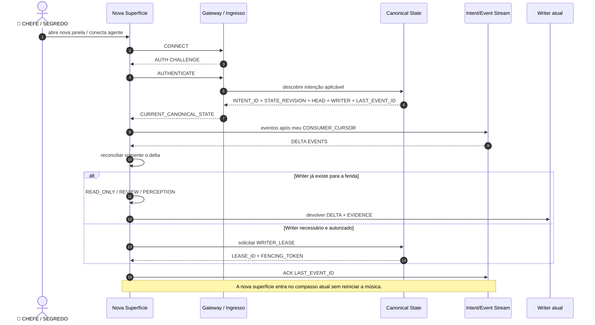
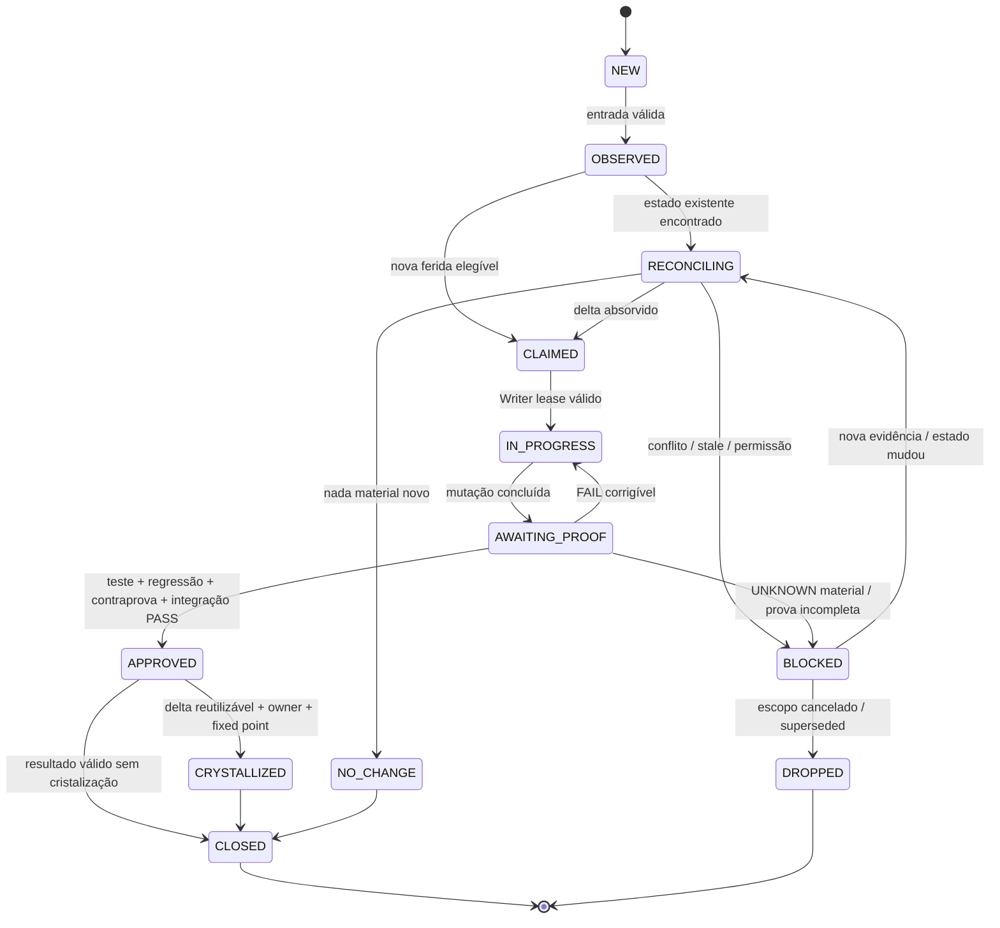
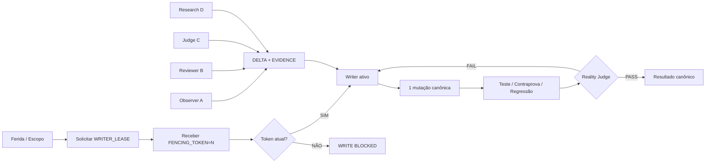
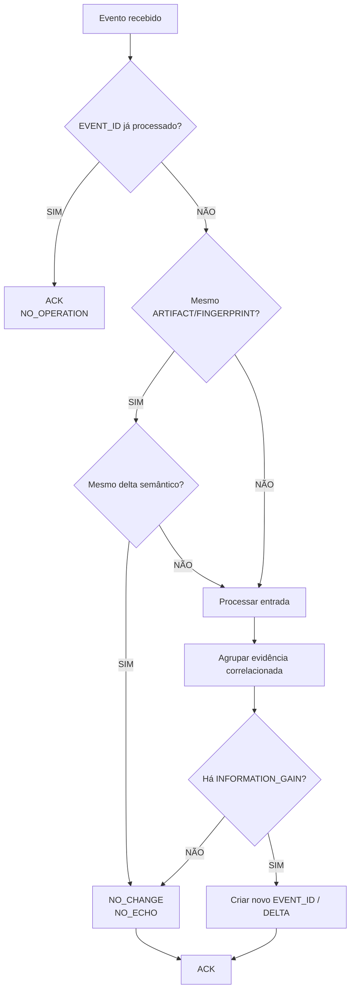
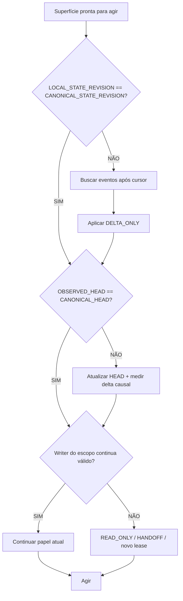
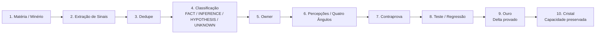
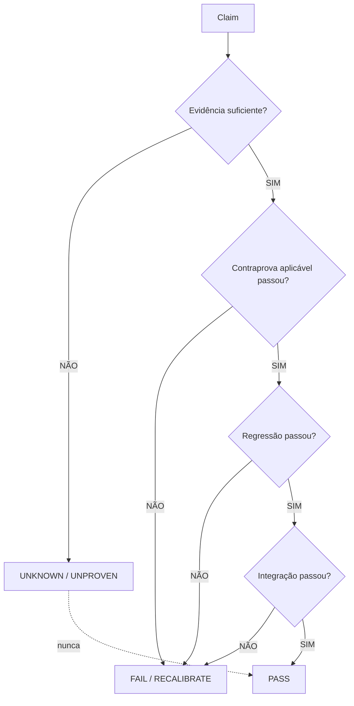
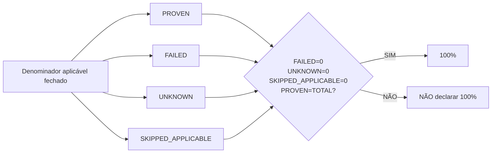
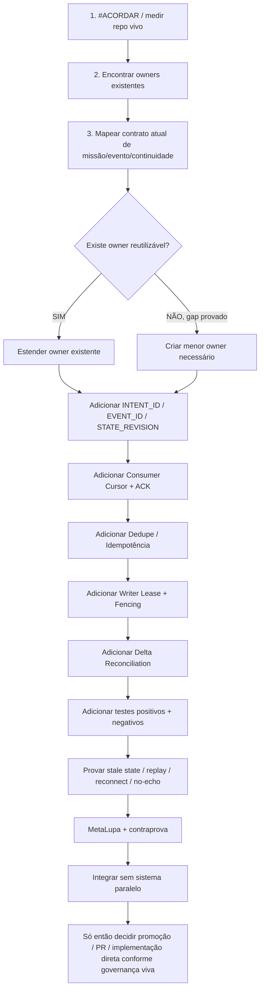

# CENTRALDARK — MERMAID VIVO DE SINCRONIA GLOBAL

> 👑 **CHEFE / SEGREDO** = humano, dono da intenção e autoridade final.  
> Este arquivo é **arquitetura/contrato**, não prova de implementação.  
> Objetivo: impedir perda de contexto entre janelas, agentes, plataformas e ferramentas.

## Como ler

- **Canção** = `INTENT_ID`
- **Compasso** = `STATE_REVISION`
- **Batida** = `EVENT_ID`
- **Partitura** = `CANONICAL_STATE`
- **Instrumentos** = superfícies/agentes/modelos
- **Caneta** = `WRITER_LEASE`
- **Ouvido** = `CONSUMER_CURSOR`
- **Dissonância** = conflito material
- **Ouro** = delta provado
- **Cristal** = capacidade reutilizável consolidada
- **Silêncio** = `NO_CHANGE` / `FIXED_POINT`

## Regras invariantes

```text
CHEFE_SEGREDO_IS_FINAL_AUTHORITY=true
MANY_SURFACES=true
ONE_CANONICAL_INTENT=true
ONE_CANONICAL_STATE=true
PARALLEL_PERCEPTION=true
ONE_WRITER_PER_WOUND=true
SERIALIZED_MUTATION=true
REALITY_JUDGES=true
EVIDENCE_FIRST=true
UNKNOWN_IS_NOT_PASS=true
DELTA_ONLY=true
NO_ECHO=true
ACK_REQUIRED=true
ORDER_IS_SACRED=true
IDEMPOTENT_BY_DESIGN=true
REUSE_BEFORE_CREATE=true
NO_PARALLEL_SYSTEM=true
```

---

## 1. MAPA MESTRE — UMA BANDA, UMA CANÇÃO

```mermaid
flowchart TB

    CHEFE["👑 CHEFE / SEGREDO<br/>HUMANO • INTENÇÃO • AUTORIDADE FINAL"]

    subgraph FONTES["FONTES DE ENTRADA — QUALQUER LUGAR"]
        direction LR
        HUMAN["Humano"]
        CHATGPT["ChatGPT"]
        GROK["Grok"]
        CLAUDE["Claude"]
        GEMINI["Gemini"]
        ABACUS["Abacus"]
        OPENROUTER["OpenRouter"]
        HERMES["Hermes"]
        TELEGRAM["Telegram"]
        MOBILE["App / Mobile"]
        CLI["CLI / Terminal"]
        APIEXT["API / Webhook"]
        FILES["Texto / PDF / DOCX / Código"]
        MEDIA["Imagem / Áudio / Vídeo"]
        OBS["Logs / Métricas / Browser / Runtime"]
    end

    CHEFE -->|"intenção / comando"| FONTES

    subgraph INGRESS["INGRESSO UNIVERSAL"]
        direction TB
        AUTH["Autenticar / Autorizar"]
        VALIDATE["Validar / Sanitizar"]
        CLASSIFY["Classificar entrada"]
        META["Extrair metadados"]
        FP["Fingerprint / SHA-256"]
        TRACE["Trace / Source / Timestamp"]
        AUTH --> VALIDATE --> CLASSIFY --> META --> FP --> TRACE
    end

    FONTES --> INGRESS

    subgraph ENVELOPE["ENVELOPE CANÔNICO"]
        direction LR
        INTENT["INTENT_ID<br/>INTENT_FINGERPRINT<br/>INTENT_EPOCH"]
        EVENT["EVENT_ID<br/>PARENT_EVENT_ID<br/>EVENT_TYPE"]
        ARTIFACT["ARTIFACT_ID<br/>ARTIFACT_FINGERPRINT"]
        CAUSAL["TRAIL_ID<br/>MISSION_ID<br/>SOURCE_SURFACE"]
        TIME["EVENT_TIME<br/>OBSERVATION_TIME"]
        HEAD["CANONICAL_HEAD<br/>OBSERVED_HEAD"]
        REV["STATE_REVISION"]
    end

    INGRESS --> ENVELOPE

    subgraph BUS["BARRAMENTO GLOBAL DE INTENÇÕES & EVENTOS"]
        direction LR
        ORDER["Ordenação"]
        DEDUPE["Dedupe"]
        PERSIST["Persistência / Replay"]
        ACK["ACK / Cursor"]
        IDEMP["Idempotência"]
        ORDER --> DEDUPE --> PERSIST --> ACK --> IDEMP
    end

    ENVELOPE --> BUS

    subgraph STATE["ESTADO CANÔNICO DA INTENÇÃO"]
        direction TB
        STATEID["INTENT_ID"]
        PHASE["CURRENT_PHASE"]
        STATEREV["STATE_REVISION"]
        STATEHEAD["CANONICAL_HEAD"]
        WRITER["WRITER + WRITER_SCOPE"]
        LASTEVENT["LAST_EVENT_ID"]
        LASTDELTA["LAST_MATERIAL_DELTA"]
        CONV["CONVERGENCE_STATE"]
        STATEID --> PHASE --> STATEREV --> STATEHEAD --> WRITER --> LASTEVENT --> LASTDELTA --> CONV
    end

    BUS --> STATE

    subgraph ORCH["ORQUESTRAÇÃO DA BANDA — MANY ARMS, ONE SONG"]
        direction LR
        META_LUPA["Ângulo 1<br/>MetaLupa<br/>Lógica / Hipóteses"]
        COUNTER["Ângulo 2<br/>Contraprova<br/>Regressão / Falso Verde"]
        IMPLEMENT["Ângulo 3<br/>Implementação<br/>Owner / Código / Integração"]
        SIMPLE["Ângulo 4<br/>Menos É Mais<br/>Simplificação / Dedupe"]
        OBSERVER["Observador<br/>READ_ONLY"]
    end

    STATE --> META_LUPA
    STATE --> COUNTER
    STATE --> IMPLEMENT
    STATE --> SIMPLE
    STATE --> OBSERVER

    subgraph CONVERGE["CONVERGÊNCIA DELTA-ONLY"]
        direction TB
        NORMALIZE["Normalizar evidências"]
        CLUSTER["Agrupar evidência correlacionada"]
        MATERIAL["Separar MATERIAL / NO_CHANGE / UNKNOWN"]
        TESTDISC["Teste discriminante quando há conflito"]
        NORMALIZE --> CLUSTER --> MATERIAL --> TESTDISC
    end

    META_LUPA --> CONVERGE
    COUNTER --> CONVERGE
    IMPLEMENT --> CONVERGE
    SIMPLE --> CONVERGE
    OBSERVER --> CONVERGE

    subgraph WRITE["MUTAÇÃO SERIALIZADA"]
        direction TB
        LEASE["WRITER_LEASE<br/>+ FENCING_TOKEN"]
        ONEWRITE["1 Writer por ferida / escopo"]
        MUTATE["Menor mutação autorizada"]
        LEASE --> ONEWRITE --> MUTATE
    end

    CONVERGE -->|"delta material"| WRITE
    CONVERGE -->|"NO_CHANGE"| SILENCE["SILÊNCIO<br/>não ecoa / não repete"]

    subgraph PROOF["REALITY JUDGE"]
        direction TB
        TEST["Teste"]
        REG["Regressão"]
        COUNTERPROOF["Contraprova"]
        INTEGRATION["Integração"]
        VERDICT{"Tudo aplicável passou?"}
        TEST --> REG --> COUNTERPROOF --> INTEGRATION --> VERDICT
    end

    WRITE --> PROOF

    VERDICT -->|"NÃO"| STATE
    VERDICT -->|"SIM"| GOLD["💎 OURO<br/>Delta comprovado"]

    GOLD --> CRYSTAL["🔷 CRISTAL<br/>Capacidade reutilizável integrada"]
    CRYSTAL --> INC["STATE_REVISION++"]
    INC --> NEWEVENT["Novo EVENT_ID"]
    NEWEVENT --> BUS

    subgraph SURFACES["N SUPERFÍCIES / CONSUMIDORES"]
        direction LR
        S1["ChatGPT / janela"]
        S2["Grok / janela"]
        S3["Hermes"]
        S4["Telegram"]
        S5["CLI"]
        S6["App / Web"]
        S7["Canva / Figma / Notion<br/>representação"]
        SN["Outras / futuras"]
    end

    BUS --> SURFACES
    SURFACES -->|"ACK + DELTA observado"| BUS

    %% Leis
    RULES["LEIS DA BANDA<br/>WINDOW != MISSION<br/>SAME_INTENT → SAME_INTENT_ID<br/>PARALLEL_PERCEPTION<br/>SERIAL_MUTATION<br/>NO_ECHO<br/>UNKNOWN != PASS<br/>REALITY = JUDGE"]
    RULES -. governa .-> BUS
    RULES -. governa .-> ORCH
    RULES -. governa .-> WRITE
    RULES -. governa .-> PROOF
```



---

## 2. ENTRADA DE NOVA JANELA / AGENTE



---

## 3. MÁQUINA DE ESTADOS DA INTENÇÃO



---

## 4. WRITER ÚNICO + FENCING



---

## 5. DEDUPE / ANTI-ECO / IDEMPOTÊNCIA



---

## 6. RECONCILIAÇÃO DE ESTADO



---

## 7. MINÉRIO → OURO → CRISTAL



---

## 8. FAIL-CLOSED



---

## 9. REGRA DE 100%



---

## 10. ORDEM DE IMPLEMENTAÇÃO QUANDO FOR VIRAR CÓDIGO



---

## 11. CHECK FINAL DA BANDA

```text
[ ] UMA INTENÇÃO TEM UM INTENT_ID
[ ] TODA ALTERAÇÃO CAUSAL TEM EVENT_ID
[ ] TODO CONSUMIDOR POSSUI CURSOR
[ ] EVENTO REPETIDO NÃO REPETE EFEITO
[ ] MESMO ARTEFATO É DEDUPLICADO
[ ] EVIDÊNCIA CORRELACIONADA NÃO VIRA PROVA INDEPENDENTE
[ ] STATE_REVISION IMPEDE AGENTE STALE
[ ] HEAD É RECONCILIADO ANTES DE MUTAÇÃO
[ ] SOMENTE UM WRITER POSSUI LEASE POR FERIDA
[ ] FENCING TOKEN BLOQUEIA WRITER ANTIGO
[ ] PERCEPÇÃO PODE SER PARALELA
[ ] MUTAÇÃO DO MESMO ESCOPO NÃO É PARALELA
[ ] UNKNOWN NÃO VIRA PASS
[ ] NO_CHANGE NÃO GERA ECO
[ ] NOVA JANELA ENTRA PELO ESTADO ATUAL
[ ] RECONEXÃO RETOMA DO CURSOR
[ ] REPLAY NÃO DUPLICA MUTAÇÃO
[ ] REALIDADE / TESTE DESEMPATA CONFLITO
[ ] OURO EXIGE PROVA
[ ] CRISTAL EXIGE REUSO + OWNER + INTEGRAÇÃO
[ ] 100% SÓ COM DENOMINADOR FECHADO
```

---

## FIO DA MISSÃO

```text
👑 CHEFE / SEGREDO
→ UMA INTENÇÃO
→ INTENT_ID
→ EVENTOS ORDENADOS
→ ESTADO CANÔNICO
→ N SUPERFÍCIES
→ PERCEPÇÕES PARALELAS
→ DEDUPE
→ TESTE DISCRIMINANTE
→ UMA CANETA POR FERIDA
→ REALIDADE JULGA
→ OURO
→ CRISTAL
→ STATE_REVISION++
→ TODA A BANDA RECONCILIA
→ NO_CHANGE = SILÊNCIO
→ A MÚSICA CONTINUA
```

> **UMA BANDA · UMA CANÇÃO · UM COMPASSO · N SUPERFÍCIES**  
> **VERDADE PRIMÁRIA · EVIDÊNCIA SUPREMA · REALIDADE DECIDE**
