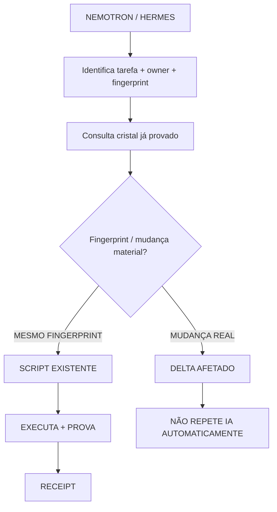

# Delegação determinística por cristal provado — Nemotron / Hermes (vault)

Espelho de segurança física no vault do Obsidian (raiz `K:\`), pasta `memarmaids/diagramas`.
Transcrição do fluxograma fornecido pelo CHEFE em 2026-10-24, em **Mermaid nativo para Obsidian**.

## Vínculos de rastro (PR / commit)
- Owner da receita (não duplica owner): `docs/ARQUITETURA/CENTRALDARK-TRIGGER-FABRIC/PROVEN-EXECUTABLE-RECIPE.yml`
- PR filho (receita): [#1681](https://github.com/ServerVpss/CentralDark/pull/1681)
- PR mãe (ledger): [#1562](https://github.com/ServerVpss/CentralDark/pull/1562)
- Commit de prova: `c132b8ce261b07efccbc1f0c09ca09ae29f935e2`
- HEAD desta gravação: `6965186fb138112ccdaca32ea7c6f2a0047c55ac` (branch `fix/cockpitshell-jsx`, merge de `origin/main`)

## Fluxograma Mermaid

## Receita — reuse before create
- Lock existente: `docs/ARQUITETURA/CENTRALDARK-TRIGGER-FABRIC/PROVEN-DETERMINISTIC-LOCK.yml`
- Runner canônico: `scripts/trigger-fabric/centraldark_full_trigger_boot.py` (`replay`, `replay-run`)
- Delegador: `scripts/trigger-fabric/proven_script_delegate.py`
- Teste: `scripts/trigger-fabric/test_proven_script_delegate.py`

**Regra:** IA DESCOBRE UMA VEZ → SCRIPT PROVADO EXECUTA N VEZES → IA SÓ VOLTA COM DELTA REAL. UNKNOWN != PASS.

## Comprovante de gravação física (este arquivo)
- Gravação realizada em `K:/memarmaids/diagramas/PROVEN-SCRIPT-DELEGATION.md`.
- Readback efetuado e conteúdo conferido (ver leitura de retorno abaixo).
- Estado anterior (sessão passada): `vault_write_state = UNKNOWN`, `configured_vault=null`, `vault_accessible_from_this_runtime=false`.
- Estado atual: vault acessível em `K:\` (`.obsidian/` presente com `app.json`/`core-plugins.json`/`workspace.json`); pasta `memarmaids/diagramas` **não existia previamente e foi criada**; escrita e readback confirmados.

NEXT_CURSOR: manter este espelho sincronizado com `docs/.../PROVEN-SCRIPT-DELEGATION.md`; não criar engine, runtime, plugin ou owner paralelo.
