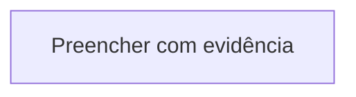
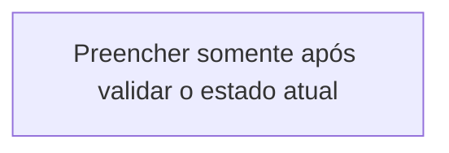

# MISSÃO OFICIAL — Inventário FULL + Diagnóstico Profissional da Infraestrutura CentralDark

**Solicitante:** Pivete  
**Tipo:** Diagnóstico Técnico Profissional + Análise de Refatoração  
**Modo:** 100% READ-ONLY sobre a infraestrutura  
**Autorização de escrita/alteração na infraestrutura:** NENHUMA  
**Método obrigatório:** Técnica da Lupa Premium  
**Lei Zero:** Nenhum agente age por conta própria. Autorização não se presume.  
**Kill-switch:** TRAVA / PARA / !CALIBRA  
**Estado:** aguardando autorização explícita do Pivete para iniciar a coleta

---

## 0. Finalidade deste prompt

Este documento prepara uma missão de diagnóstico técnico completo da infraestrutura CentralDark.

Ele **não autoriza a execução imediata da missão**.  
A coleta só começa depois de uma ordem explícita do Pivete para executar este prompt.

Ao ser executado, o trabalho deve permanecer em **modo read-only sobre a infraestrutura**. A única escrita permitida é a criação do relatório final em um workspace isolado, sem alterar repositório, VPS, serviços, configurações, dados ou produção.

---

# 1. Autoridade, modo e travas

**Solicitante e autoridade final:** Pivete  
**Tipo:** inventário técnico, diagnóstico profissional e base para refatoração futura  
**Modo:** 100% READ-ONLY sobre a infraestrutura  
**Autorização para alterar infraestrutura:** nenhuma  
**Autorização para correções:** nenhuma  
**Autorização para deploy, restart, reload, reset, kill ou migração:** nenhuma  
**Risco da missão:** R3 — análise de infraestrutura crítica e metadados sensíveis  
**Método obrigatório:** Técnica da Lupa Premium  
**Lei Zero:** nenhum agente age por conta própria; autorização não se presume  
**Kill-switches:** `TRAVA`, `PARA`, `!CALIBRA`

## 1.1 Semântica dos kill-switches

Ao receber qualquer kill-switch:

1. interromper imediatamente novas coletas;
2. não executar mais comandos ou chamadas;
3. preservar somente o que já foi coletado;
4. informar o último ponto concluído;
5. listar evidências já obtidas;
6. declarar o que ficou pendente;
7. aguardar nova ordem do Pivete.

O kill-switch não autoriza rollback, restart, limpeza ou qualquer outra ação.

## 1.2 Limite de escrita

É proibido escrever no ambiente auditado.

Não criar, editar ou remover:

- arquivos da VPS;
- configurações;
- branches;
- commits;
- issues;
- PRs;
- tabelas;
- registros de banco;
- serviços;
- containers;
- usuários;
- chaves;
- cron jobs;
- regras de firewall;
- DNS;
- Caddy;
- PM2;
- systemd.

A única escrita permitida é:

```text
um arquivo Markdown final
→ criado fora da infraestrutura auditada
→ contendo somente informações sanitizadas
```

---

# 2. Regra de Ouro

> Quando já existe uma estrutura válida, não criar outra para competir com ela. Ler, preservar, unir, corrigir e evoluir o que existe.

Aplicar durante todo o diagnóstico:

1. evidência primeiro;
2. correção mínima — apenas como recomendação futura, nunca como execução nesta missão;
3. preservar o que já funciona;
4. não criar arquitetura paralela;
5. não inventar caminhos, portas, serviços ou estados;
6. diferenciar fato, inferência e hipótese;
7. registrar o ouro sem duplicar fontes da verdade.

Esta missão não deve desenhar uma arquitetura nova antes de compreender a arquitetura real.

---

# 3. Objetivo da missão

Produzir um levantamento profissional, honesto, rastreável e tecnicamente defensável da infraestrutura CentralDark, identificando:

- organização estrutural;
- rotas, hosts e subdomínios;
- reverse proxies;
- portas, binds, PIDs e processos;
- PM2, ecosystem e processos fantasmas;
- Docker, systemd, cron e outros gerenciadores;
- pastas, módulos, scripts e nomes divergentes;
- serviços online que não executam trabalho real;
- snippets, configurações e componentes dormentes;
- kill-switches;
- portas mortas;
- dependências críticas;
- divergência entre Git, arquivos implantados e estado executado;
- localização de arquivos e nomes de variáveis sensíveis, sem valores;
- observabilidade, logs e sinais de saúde;
- riscos operacionais;
- pontos que impedem organização profissional;
- base comprovada para uma futura refatoração segura.

O resultado deve mostrar:

```text
o que existe
→ o que realmente está ativo
→ o que está funcional
→ o que está divergente
→ o que não pôde ser validado
→ qual seria a menor direção de organização futura
```

---

# 4. Não objetivos

Nesta missão, não:

- corrigir;
- reorganizar;
- renomear;
- migrar;
- deletar;
- reiniciar;
- recarregar;
- matar processo;
- alterar proxy;
- trocar porta;
- alterar DNS;
- atualizar dependência;
- instalar pacote;
- executar deploy;
- editar ecosystem;
- aplicar Caddyfile;
- alterar `.env`;
- rotacionar credencial;
- enviar relatório automaticamente para Telegram;
- afirmar que uma proposta de arquitetura já foi aprovada.

A missão entrega diagnóstico e orientação. A execução futura exige outra autorização.

---

# 5. Técnica da Lupa Premium — aplicação obrigatória

Antes, durante e depois da coleta, aplicar:

```text
Fonte da verdade
→ classificação de risco
→ Zoom Out
→ Zoom In
→ Feynman
→ cenários de validação
→ prova
→ veredito
→ registro
```

## 5.1 Zoom Out

Verificar:

- o levantamento cobre o problema real?
- “FULL” é comprovável ou apenas uma palavra?
- as fontes consultadas permitem afirmar completude?
- a análise separa estado real de arquitetura desejada?
- existe viés causado por nomes, documentos ou hipóteses anteriores?
- a recomendação preserva serviços funcionais?
- a organização futura evita estrutura concorrente?
- o relatório ajuda a missão atual ou abre frentes desnecessárias?

## 5.2 Zoom In

Verificar:

- cada achado possui evidência?
- o processo real corresponde ao nome?
- o script existe?
- o bind e a porta foram observados?
- o processo executa trabalho real ou apenas aparece online?
- PM2, Docker, systemd e processos diretos foram correlacionados?
- os call sites e dependências foram localizados quando relevante?
- o relatório evita expor secrets?
- o estado observado está ligado a horário e fonte?
- a recomendação futura possui correção mínima, regressão e rollback?
- fatos e hipóteses estão separados?

## 5.3 Feynman

Para cada achado crítico, explicar em linguagem simples:

1. o que deveria acontecer;
2. o que foi observado;
3. por que existe divergência;
4. qual é o impacto;
5. como provar;
6. qual seria a menor correção futura;
7. o que não deve ser alterado ainda.

Se o achado não puder ser explicado assim, ele ainda não está pronto para o relatório executivo.

---

# 6. Fonte da verdade e identidade da execução

Antes da coleta, preencher:

```text
DATA/HORA DE INÍCIO:
COORDENADOR:
AGENTE COLETOR:
REVISORES:
HOST/AMBIENTE AUDITADO:
REPOSITÓRIO DE REFERÊNCIA:
BRANCH DE REFERÊNCIA:
COMMIT/HEAD_SHA DE REFERÊNCIA:
DOCUMENTOS CANÔNICOS LOCALIZADOS:
LIMITAÇÕES DE ACESSO:
```

## 6.1 Prioridade de fontes

Usar esta ordem:

1. estado observado diretamente no ambiente;
2. configuração ativa carregada pelo serviço;
3. processo, bind, socket e script executado;
4. configuração declarada;
5. repositório e documentação canônica;
6. snippets dormentes;
7. comentários históricos;
8. hipóteses herdadas.

Quando duas fontes divergirem, registrar ambas e declarar qual representa o estado executado.

## 6.2 Completude honesta

Só usar a palavra **completo** quando a cobertura das fontes for comprovada.

Caso falte acesso a DNS, Cloudflare, host, namespace, usuário, container ou diretório:

```text
STATUS: NÃO VALIDADO
MOTIVO: [limitação]
IMPACTO: [o que pode estar faltando]
COMO VALIDAR: [fonte necessária]
```

Não transformar ausência de acesso em ausência de componente.

---

# 7. Protocolo de evidência

Cada achado deve receber um identificador:

```text
E-001, E-002, E-003...
```

## 7.1 Registro mínimo da evidência

| Campo | Conteúdo obrigatório |
|---|---|
| ID | `E-NNN` |
| Data/hora | horário da observação |
| Fonte | comando, arquivo, API ou painel |
| Escopo | host, processo, serviço ou arquivo |
| Resultado sanitizado | somente dado necessário |
| Status | confirmado, inferido ou não validado |
| Correlação | serviço, porta, PID, script, host ou configuração relacionada |
| Observação | limitação ou conflito |

## 7.2 Linguagem obrigatória

### Confirmado

Observado diretamente e reproduzível.

### Inferido

Conclusão lógica baseada em uma ou mais evidências, ainda sem confirmação direta.

### Não validado

Não foi possível comprovar com as fontes disponíveis.

Formato:

```text
EVIDÊNCIA:
INFERÊNCIA:
HIPÓTESE:
COMO CONFIRMAR:
```

É proibido escrever hipótese como fato.

## 7.3 Prova ligada ao estado auditado

Quando existir repositório implantado, relacionar:

```text
repositório
→ branch
→ commit
→ arquivo
→ processo
→ porta
→ rota
→ resposta observada
```

Se não for possível ligar a cadeia, declarar a quebra de rastreabilidade.

---

# 8. Segurança e proteção de informações sensíveis

## 8.1 Regra absoluta

Nunca expor:

- valor de variável;
- token;
- API key;
- password;
- cookie;
- header de autenticação;
- chave privada;
- conteúdo de `.env`;
- conteúdo de `/proc/*/environ`;
- credencial de banco;
- segredo em comando;
- segredo em log;
- segredo em URL;
- segredo em artefato;
- segredo em evidência.

## 8.2 Arquivos sensíveis

Ao localizar arquivos como:

```text
.env
.env.*
*secret*
*token*
*key*
keys.json
credentials*
service-account*
```

registrar somente:

- caminho;
- proprietário;
- permissões;
- tamanho;
- data de modificação;
- nomes das variáveis, quando puderem ser extraídos sem ler ou reproduzir valores;
- possível vínculo com serviço.

Não copiar linhas completas.

## 8.3 Saídas perigosas

Não colar saída bruta de:

- `pm2 jlist`;
- `pm2 env`;
- `docker inspect`;
- `systemctl show` com Environment;
- dumps de processo;
- `/proc/PID/environ`;
- arquivos `.env`;
- logs não sanitizados;
- histórico de shell;
- comandos contendo credenciais.

Extrair apenas os campos seguros necessários.

## 8.4 Processos e command lines

Linhas de comando podem conter credenciais.

No relatório:

- preservar binário e script;
- sanitizar argumentos;
- substituir valores sensíveis por `[REDACTED]`;
- não reproduzir query strings ou headers privados.

## 8.5 Ações proibidas de segurança

Não:

- pedir secrets ao Pivete;
- testar credencial;
- autenticar em serviço novo sem autorização;
- rotacionar chave;
- revogar acesso;
- copiar arquivo sensível;
- enviar informação para serviço externo;
- fazer upload de logs;
- publicar relatório.

---

# 9. Limites técnicos da coleta read-only

## 9.1 Permitido

Somente consultas que não alterem estado, como:

- listar diretórios e metadados;
- consultar sockets e processos;
- ler configurações não sensíveis;
- consultar status;
- obter campos seguros de PM2, Docker e systemd;
- consultar logs sanitizados;
- comparar arquivos e referências;
- realizar probes mínimos de saúde previamente existentes;
- consultar Git em modo leitura;
- verificar existência de scripts;
- calcular hashes de arquivos quando necessário;
- gerar o relatório fora do ambiente auditado.

## 9.2 Proibido

Incluindo, mas não limitado a:

```text
restart
reload
start
stop
kill
pkill
rm
mv
cp para o ambiente
chmod
chown
truncate
tee
redirecionamento >
sed -i
perl -pi
git add
git commit
git push
git reset
git clean
docker restart
docker compose up/down
pm2 restart/reload/delete/save
systemctl start/stop/restart/enable/disable
ufw/iptables/nft alterando regras
caddy reload
migração
DDL/DML
curl com método mutável
POST/PUT/PATCH/DELETE
```

Não executar scanner agressivo, brute force, load test ou varredura externa.

## 9.3 Probes funcionais

Um probe read-only só é permitido quando:

- usa endpoint seguro;
- não cria dado;
- não dispara missão real;
- não envia mensagem;
- não chama cliente;
- não consome volume significativo;
- não altera fila;
- não usa secret novo;
- é necessário para distinguir “online” de “funcional”.

Caso um teste funcional exija escrita, registrar como recomendação futura e não executar.

---

# 10. Coordenação multiagente

Antes de usar múltiplos agentes:

1. localizar e ler a fonte canônica de `REGRA-OFICIAL-MULTI-AGENTE-SEMANTICO`;
2. não inventar outra regra concorrente;
3. usar um coordenador;
4. usar um único coletor por alvo para evitar comandos duplicados;
5. limitar revisores ao necessário;
6. revisores analisam a mesma evidência sanitizada;
7. um juiz/Critic consolida o veredito;
8. Pivete ratifica qualquer etapa crítica futura.

Se a regra canônica não puder ser localizada:

```text
STATUS: LIMITAÇÃO
AÇÃO: seguir modo de agente único
```

Não criar nova orquestração para compensar ausência documental.

---

# 11. Escopo obrigatório do inventário

## 11.1 Pré-flight e limites

Levantar:

- identidade do host;
- sistema operacional;
- timezone;
- uptime;
- usuários/escopos acessíveis, sem enumerar secrets;
- namespaces relevantes;
- diretórios-base;
- limitações de permissão;
- data e hora da coleta.

Objetivo: provar em qual ambiente o relatório se baseia.

---

## 11.2 Hosts, DNS, subdomínios e certificados

Mapear, quando as fontes permitirem:

- hosts `*.centralldark.com`;
- registros observáveis;
- hosts declarados no Caddy;
- hosts referenciados no repositório;
- certificados presentes;
- hosts ativos;
- hosts configurados mas sem destino;
- hosts dormentes;
- hosts não validados;
- divergência entre DNS, proxy e serviço.

Distinguir:

| Estado | Definição |
|---|---|
| Ativo e funcional | resolve, roteia e entrega comportamento esperado |
| Ativo superficial | responde, mas funcionalidade não foi comprovada |
| Configurado | aparece em configuração ativa |
| Dormente | existe em snippet ou arquivo não carregado |
| Porta morta | destino não possui listener observado |
| Não validado | fonte insuficiente |
| Divergente | DNS, proxy e processo não concordam |

Não afirmar “todos os subdomínios” sem cobertura das fontes de DNS e configuração.

---

## 11.3 Caddy, reverse proxies e rotas

Levantar:

- configuração principal;
- imports;
- snippets;
- arquivos carregados;
- arquivos não carregados;
- `reverse_proxy`;
- `handle`;
- `handle_path`;
- `respond`;
- redirects;
- upstreams;
- health checks;
- kill-switches;
- rotas 503;
- rotas 404;
- rotas para portas sem listener;
- rotas duplicadas;
- precedência ambígua;
- hosts com configuração conflitante.

Para cada rota:

| Host / Path | Origem da regra | Tipo | Upstream | Listener observado | Probe seguro | Estado | Evidência |
|---|---|---|---|---|---|---|---|

Não aplicar nem validar configuração por reload.

---

## 11.4 Portas, sockets, PIDs e processos

Criar mapa:

```text
porta
→ bind
→ protocolo
→ PID
→ processo real
→ script/binário
→ gerenciador
→ serviço declarado
→ rota consumidora
```

Tabela:

| Porta | Bind | Protocolo | PID | Processo real | Script/binário | Gerenciador | Nome declarado | Estado | Evidência |
|---|---|---|---|---|---|---|---|---|---|

Identificar:

- listeners públicos desnecessários;
- serviços somente em loopback;
- portas duplicadas;
- processos fora de gerenciador;
- processos sem listener quando deveriam expor porta;
- listeners sem rota;
- rotas sem listeners;
- processos com argumentos sanitizados;
- processos órfãos;
- processos zumbis;
- processos de desenvolvimento em produção;
- scripts inexistentes;
- binários inesperados.

---

## 11.5 PM2 vs ecosystem

Comparar:

```text
ecosystem declarado
↔ lista PM2 sanitizada
↔ script existente
↔ cwd real
↔ processo real
↔ listener
↔ comportamento observável
```

Levantar:

- nome PM2;
- namespace;
- id;
- status;
- uptime;
- restarts;
- script;
- cwd;
- interpreter;
- modo;
- instâncias;
- porta, quando observável com segurança;
- existência do script;
- divergências.

### Definições de processo fantasma

| Tipo | Definição |
|---|---|
| Fantasma de script | PM2 aponta para script inexistente |
| Fantasma de função | processo online, mas não realiza sua função |
| Fantasma de porta | serviço deveria ouvir, mas não existe listener |
| Fantasma de nome | nome declarado não representa o processo real |
| Fantasma de configuração | existe no ecosystem, mas não está carregado |
| Processo extraviado | está ativo fora do ecosystem esperado |
| Duplicado | duas instâncias cumprem a mesma responsabilidade sem justificativa |

Status online não prova saúde funcional.

Não copiar o ambiente bruto do PM2.

---

## 11.6 Docker, systemd, cron e outros gerenciadores

Mapear:

### Docker

- containers;
- imagem;
- status;
- health;
- portas;
- volumes;
- redes;
- política de restart;
- processo principal;
- vínculo com serviço;
- duplicação com PM2/systemd.

Sem expor `Env`.

### systemd

- unidades relacionadas;
- estado;
- arquivo unit;
- ExecStart sanitizado;
- restart policy;
- dependências;
- serviços duplicados.

Sem expor Environment.

### cron e timers

- jobs;
- usuário;
- agenda;
- script;
- existência do script;
- sobreposição;
- risco de automação esquecida.

Não executar job.

### Outros

- supervisord;
- tmux/screen persistente;
- scripts de boot;
- GitHub runners;
- watchers;
- serviços customizados.

---

## 11.7 Estrutura de pastas, módulos e scripts

Mapear prioritariamente:

- `/root/CentralDark/apps`;
- `/root/CentralDark/infra`;
- diretório real do repositório;
- diretórios de runtime;
- diretórios de logs;
- módulos Hermes;
- gateways;
- proxies;
- web UI;
- memória;
- MCP;
- OAuth;
- painéis;
- builders;
- integrações.

Não presumir que esses caminhos existem. Confirmar antes.

Avaliar:

- organização;
- duplicação;
- nomes enganosos;
- scripts ausentes;
- código abandonado;
- cópias paralelas;
- diretórios fora do repositório;
- symlinks;
- artefatos gerados misturados com fonte;
- logs e dados dentro da árvore de código;
- divergência entre nome e função;
- arquivos implantados que não correspondem ao Git;
- configurações ativas fora da árvore esperada.

Tabela:

| Caminho | Função observada | Dono/Permissão | Referenciado por | Estado | Problema | Evidência |
|---|---|---|---|---|---|---|

---

## 11.8 Git, deploy e divergência entre fonte e runtime

Em modo leitura, verificar:

- repositório esperado;
- branch atual;
- commit atual;
- worktree limpa ou suja;
- arquivos não rastreados;
- divergência local/remoto;
- script executado pertence a qual commit;
- código executado fora do Git;
- múltiplas cópias do repositório;
- branches implantadas;
- artefatos gerados;
- deploy parcialmente aplicado.

Não:

- fazer checkout;
- resetar;
- limpar;
- puxar;
- commitar;
- enviar.

Se a VPS estiver em branch divergente ou worktree suja, registrar risco, sem corrigir.

---

## 11.9 Variáveis de ambiente e arquivos sensíveis

Localizar, sem expor valores:

- `.env`;
- `.env.*`;
- arquivos de secrets;
- keys;
- credentials;
- arquivos de serviço;
- referências a variáveis em configs;
- variáveis esperadas pelo código;
- possíveis duplicações de fonte.

Tabela:

| Nome da variável | Arquivo/local | Serviço relacionado | Duplicada? | Permissão do arquivo | Observação |
|---|---|---|---|---|---|

Regras:

- nunca incluir valor;
- nunca incluir hash de secret;
- nunca incluir comprimento do valor se isso elevar risco;
- não colar linha completa;
- não copiar comentários sensíveis;
- não afirmar que uma variável funciona;
- diferenciar “declarada”, “referenciada” e “carregada”, quando possível sem exposição.

---

## 11.10 Logs, observabilidade e saúde real

Mapear:

- fonte de logs;
- rotação;
- retenção;
- tamanho;
- erros recorrentes;
- correlation IDs;
- métricas;
- health endpoints;
- traces;
- alertas;
- silêncio operacional;
- falso verde.

Para cada serviço crítico, responder:

1. existe processo?
2. existe listener?
3. existe rota?
4. existe resposta superficial?
5. existe prova funcional segura?
6. existe log ou métrica coerente?
7. a falha é diagnosticável?
8. há alerta?

Classificar:

| Saúde | Definição |
|---|---|
| Comprovada | fluxo seguro de ponta a ponta validado |
| Parcial | processo, listener e resposta; função completa não provada |
| Aparente | apenas status verde |
| Falha | erro observado |
| Não validada | evidência insuficiente |

---

## 11.11 Rede, exposição e firewall

Em modo passivo/read-only, verificar:

- binds públicos;
- binds locais;
- portas expostas;
- proxy esperado;
- firewall declarado;
- regras observáveis;
- serviços acessíveis diretamente;
- duplicação de exposição;
- portas administrativas abertas;
- inconsistência IPv4/IPv6.

Não alterar firewall e não executar varredura agressiva.

---

## 11.12 Recursos, armazenamento e continuidade

Levantar, sem stress test:

- uso de CPU;
- memória;
- swap;
- disco;
- inodes;
- diretórios de maior crescimento;
- logs sem rotação;
- volumes;
- mounts;
- limites;
- reinícios;
- OOM observado;
- indícios de saturação.

Sobre backups:

- localizar configuração e evidência de existência;
- não restaurar;
- não baixar;
- não abrir conteúdo sensível;
- não declarar backup válido apenas porque um arquivo existe.

Classificar backup como:

```text
declarado
observado
recentemente gerado
restauração não validada
```

---

## 11.13 Inconsistências graves e hipóteses herdadas

Investigar explicitamente, sem presumir verdade:

- `EliteHTTP` versus processo real;
- `LovableBridge` possivelmente fantasma;
- snippets Caddy dormentes versus configuração principal;
- kill-switches manuais;
- processos PM2 online sem função;
- nomes de serviço que não correspondem ao código;
- portas históricas ainda referenciadas;
- múltiplos gateways ou proxies com responsabilidade sobreposta.

Registrar cada item como:

```text
HIPÓTESE HERDADA:
EVIDÊNCIA ENCONTRADA:
STATUS:
IMPACTO:
CONCLUSÃO:
```

---

# 12. Hipótese de arquitetura herdada — preservar, mas não tratar como fato

Existe uma intenção anterior de centralizar provedores e serviços em:

```text
api.centralldark.com
```

com roteamento por paths.

Essa ideia deve ser **avaliada após o inventário**, não usada para moldar artificialmente o diagnóstico.

## 12.1 Mapeamentos herdados a validar

| Path pretendido | Serviço/porta herdados | Status inicial |
|---|---|---|
| `/v1/*` | ArsenalAdapter `:8090` | NÃO VALIDADO |
| `/anthropic/*` | elite-anthropic-proxy `:8082` | NÃO VALIDADO |
| `/arsenal/*` | ArsenalProxy `:8083` | NÃO VALIDADO |
| `/lovable/*` | LovableBridge `:8099` | NÃO VALIDADO |
| `/memoria/*` | Memoria `:3101` | NÃO VALIDADO |
| `/mcp/*` | MCP `:9100` | NÃO VALIDADO |
| `/oauth/*` | OAuthBroker `:8098` | NÃO VALIDADO |
| `/grafo/*` | GraphPanel `:3030` | NÃO VALIDADO |
| `/builder/*` | ArtifactsBuilder `:3090` | NÃO VALIDADO |
| `/health` | Healthcheck | NÃO VALIDADO |

Regras:

- preservar a intenção;
- verificar se os serviços existem;
- verificar se as portas são reais;
- verificar sobreposição;
- verificar autenticação;
- verificar compatibilidade de paths;
- verificar impacto em clientes;
- não propor aplicação de Caddy;
- não declarar essa arquitetura como alvo final sem evidência.

Se a centralização for tecnicamente válida, apresentar como **proposta futura condicionada**.  
Se não for, explicar o motivo e propor a menor evolução do que já existe.

---

# 13. Cenários obrigatórios de validação do inventário

## Cenário A — rota declarada com upstream morto

Provar:

```text
regra ativa
→ upstream configurado
→ ausência de listener
→ status da rota
```

Não iniciar o upstream.

## Cenário B — processo PM2 verde sem função comprovada

Provar:

```text
status PM2
→ script real
→ listener
→ log/métrica
→ probe funcional seguro, quando possível
```

Se o probe exigir escrita, classificar como saúde parcial.

## Cenário C — processo fora do ecosystem

Correlacionar:

```text
PID
→ binário/script
→ gerenciador
→ porta
→ rota
→ origem no Git
```

## Cenário D — serviço duplicado

Provar que dois componentes executam responsabilidade semelhante e identificar se existe justificativa.

## Cenário E — configuração dormente

Provar:

```text
arquivo existe
→ não é importado/carregado
→ ainda referencia host/porta
→ risco de confusão
```

## Cenário F — variável sensível duplicada

Registrar somente nomes e caminhos, sem valores, e indicar conflito potencial.

## Cenário G — falso “FULL”

Ao final, verificar se todas as fontes necessárias foram cobertas. Se não, trocar o status para:

```text
INVENTÁRIO PARCIAL COM COBERTURA DECLARADA
```

É proibido chamar de FULL quando há lacunas materiais.

---

# 14. Estrutura obrigatória do relatório final

Gerar exatamente **um arquivo Markdown**.

Nome:

```text
INVENTARIO-FULL-DIAGNOSTICO-CENTRALDARK-AAAA-MM-DD.md
```

Preencher todos os campos. Quando não houver evidência, usar `NÃO VALIDADO`, nunca deixar lacuna silenciosa.

```markdown
# Inventário FULL + Diagnóstico de Infraestrutura — CentralDark

**Data/Hora de início:**  
**Data/Hora de término:**  
**Solicitante:** Pivete  
**Modo:** 100% READ-ONLY sobre a infraestrutura  
**Risco:** R3  
**Coordenador:**  
**Agente coletor:**  
**Revisores:**  
**Host/ambiente:**  
**Repositório/branch/commit de referência:**  
**Status da missão:**  
**Cobertura declarada:**  
**Método:** Técnica da Lupa Premium  

---

## 1. Resumo Executivo

### Estado Geral
[Descrição direta, baseada em evidências.]

### Nível de Desorganização
- [ ] Crítico
- [ ] Alto
- [ ] Médio
- [ ] Controlado
- [ ] Não classificável por falta de evidência

### Saúde Operacional
- [ ] Comprovada
- [ ] Parcial
- [ ] Aparente
- [ ] Falha
- [ ] Não validada

### Principais Riscos Identificados
1. 
2. 
3. 
4. 
5. 

### Conclusão Rápida
[Uma frase clara, sem teatralidade.]

---

## 2. Cobertura, Fontes e Limitações

### Fontes consultadas
| Fonte | Cobertura | Data/hora | Limitação |
|---|---|---|---|
| | | | |

### Fontes não acessíveis
- 

### O que “FULL” significa nesta execução
- 

### Lacunas que impedem completude absoluta
- 

---

## 3. Catálogo de Evidências

| ID | Data/hora | Fonte | Escopo | Resultado sanitizado | Status |
|---|---|---|---|---|---|
| E-001 | | | | | |

---

## 4. Mapa Real de Hosts, DNS e Subdomínios

| Host | Fonte DNS | Configuração de proxy | Certificado | Estado | Evidência | Observação |
|---|---|---|---|---|---|---|
| | | | | | | |

### Hosts ativos e funcionais
- 

### Hosts ativos superficialmente
- 

### Hosts configurados
- 

### Hosts dormentes
- 

### Hosts não validados
- 

---

## 5. Mapa Real de Caddy, Rotas e Reverse Proxies

| Host / Path | Arquivo/regra | Tipo | Upstream | Listener | Probe | Estado | Evidência |
|---|---|---|---|---|---|---|---|
| | | | | | | | |

### Kill-switches ativos
- 

### Rotas com `respond 503`
- 

### Rotas apontando para portas mortas
- 

### Regras duplicadas ou com precedência ambígua
- 

### Snippets dormentes
- 

---

## 6. Mapa de Portas, Sockets e Processos

| Porta | Bind | Protocolo | PID | Processo real | Script/binário | Gerenciador | Nome declarado | Estado | Evidência |
|---|---|---|---|---|---|---|---|---|---|
| | | | | | | | | | |

### Processos órfãos
- 

### Processos fora de gerenciador
- 

### Listeners sem rota
- 

### Rotas sem listener
- 

### Binds públicos que exigem revisão futura
- 

---

## 7. PM2 vs Ecosystem — Realidade vs Declaração

### Processos correlacionados

| Nome PM2 | Namespace | Script | CWD | Porta | Restarts | Função comprovada? | Estado | Evidência |
|---|---|---|---|---|---|---|---|---|
| | | | | | | | | |

### Processos fantasmas

| Nome | Tipo de fantasma | Motivo | Risco | Evidência |
|---|---|---|---|---|
| | | | | |

### Divergências com `ecosystem.config.cjs`
- 

### Processos declarados e não carregados
- 

### Processos carregados e não declarados
- 

---

## 8. Docker, systemd, Cron e Outros Gerenciadores

### Docker

| Container | Imagem | Processo | Portas | Volumes | Health | Função | Evidência |
|---|---|---|---|---|---|---|---|
| | | | | | | | |

### systemd

| Unidade | ExecStart sanitizado | Estado | Restart policy | Função | Evidência |
|---|---|---|---|---|---|
| | | | | | |

### Cron e timers

| Usuário | Agenda | Script | Existe? | Sobreposição | Evidência |
|---|---|---|---|---|---|
| | | | | | |

### Outros processos persistentes
- 

---

## 9. Estrutura de Pastas, Módulos e Scripts

### Mapa

| Caminho | Função observada | Referenciado por | Dono/permissão | Estado | Problema | Evidência |
|---|---|---|---|---|---|---|
| | | | | | | |

### O que está organizado
- 

### O que está confuso, mal nomeado ou espalhado
- 

### Pastas e scripts referenciados que não existem
- 

### Cópias paralelas ou código fora da fonte da verdade
- 

### Divergências entre nome e função real
- 

---

## 10. Git, Deploy e Divergência entre Fonte e Runtime

| Item | Estado observado | Risco | Evidência |
|---|---|---|---|
| Repositório | | | |
| Branch | | | |
| Commit | | | |
| Worktree | | | |
| Código executado | | | |
| Divergência local/remoto | | | |

### Arquivos executados fora do Git
- 

### Múltiplas cópias do repositório
- 

### Deploy parcial ou não rastreável
- 

---

## 11. Variáveis e Arquivos Sensíveis — Somente Localização

| Variável | Arquivo/local | Serviço | Estado conhecido | Permissão | Observação |
|---|---|---|---|---|---|
| | | | | | |

### Arquivos sensíveis localizados

| Caminho | Tipo | Proprietário | Permissão | Serviço relacionado |
|---|---|---|---|---|
| | | | | |

> Nenhum valor sensível deve aparecer neste relatório.

---

## 12. Logs, Observabilidade e Saúde Real

| Serviço | Processo | Listener | Rota | Probe seguro | Logs/métricas | Saúde | Evidência |
|---|---|---|---|---|---|---|---|
| | | | | | | | |

### Serviços com falso verde
- 

### Falhas recorrentes
- 

### Lacunas de observabilidade
- 

### Logs sem rotação ou crescimento anormal
- 

---

## 13. Rede, Exposição e Firewall

| Porta/serviço | Bind | Exposição observada | Proxy esperado | Regra observada | Risco | Evidência |
|---|---|---|---|---|---|---|
| | | | | | | |

### Exposições diretas que exigem revisão futura
- 

### Divergência IPv4/IPv6
- 

### Limitações de validação
- 

---

## 14. Recursos, Armazenamento e Continuidade

### Recursos

| Métrica | Estado | Limite/risco | Evidência |
|---|---|---|---|
| CPU | | | |
| Memória | | | |
| Swap | | | |
| Disco | | | |
| Inodes | | | |

### Diretórios de crescimento relevante
- 

### Backups

| Backup/configuração | Observado | Recência | Restauração validada? | Evidência |
|---|---|---|---|---|
| | | | | |

> A existência de arquivo não comprova restauração.

---

## 15. Inconsistências Graves

1. 
2. 
3. 
4. 
5. 
6. 
7. 
8. 
9. 
10. 

Para cada item, informar:

```text
EVIDÊNCIA:
IMPACTO:
RISCO:
CAUSA PROVÁVEL:
COMO CONFIRMAR:
```

---

## 16. Validação das Hipóteses Herdadas

### EliteHTTP
- Hipótese:
- Evidência:
- Status:
- Conclusão:

### LovableBridge
- Hipótese:
- Evidência:
- Status:
- Conclusão:

### Snippets Caddy dormentes
- Hipótese:
- Evidência:
- Status:
- Conclusão:

### Centralização em `api.centralldark.com`

| Path herdado | Serviço/porta herdados | Estado real | Preservar? | Evidência |
|---|---|---|---|---|
| `/v1/*` | ArsenalAdapter `:8090` | | | |
| `/anthropic/*` | elite-anthropic-proxy `:8082` | | | |
| `/arsenal/*` | ArsenalProxy `:8083` | | | |
| `/lovable/*` | LovableBridge `:8099` | | | |
| `/memoria/*` | Memoria `:3101` | | | |
| `/mcp/*` | MCP `:9100` | | | |
| `/oauth/*` | OAuthBroker `:8098` | | | |
| `/grafo/*` | GraphPanel `:3030` | | | |
| `/builder/*` | ArtifactsBuilder `:3090` | | | |
| `/health` | Healthcheck | | | |

---

## 17. Visão Ideal Organizada — Somente Após o Diagnóstico

### Princípios

- preservar o que funciona;
- eliminar responsabilidade duplicada;
- definir uma fonte da verdade;
- centralizar somente quando comprovadamente vantajoso;
- manter fallback, circuit breaker e observabilidade;
- reduzir exposição;
- facilitar rollback;
- evitar big bang.

### Arquitetura-alvo condicionada

[Descrever somente com base nos achados.]

### Diagrama do estado atual



### Diagrama da proposta futura



### Esboço Caddy futuro — NÃO EXECUTÁVEL

```caddy
# Gerar apenas se a centralização for aprovada pela análise.
# Usar placeholders para destinos ainda não comprovados.
# Não aplicar nesta missão.
```

### O que a estrutura futura resolveria
- 

### O que ela poderia quebrar
- 

### O que deve ser preservado
- 

---

## 18. Recomendações Profissionais — Sem Execução

Cada recomendação deve usar:

```text
PRIORIDADE:
EVIDÊNCIA:
PROBLEMA:
IMPACTO:
CORREÇÃO MÍNIMA FUTURA:
DEPENDÊNCIAS:
REGRESSÃO NECESSÁRIA:
ROLLBACK FUTURO:
AUTORIZAÇÃO NECESSÁRIA:
O QUE NÃO MEXER:
```

### Prioridade crítica
1. 

### Prioridade alta
1. 
2. 
3. 

### Prioridade média
1. 
2. 

### Prioridade baixa
1. 

### O que NÃO mexer agora
- 

---

## 19. Aplicação da Técnica da Lupa Premium

**VEREDITO:**  
APROVAR DIAGNÓSTICO | CONDICIONAR | CORRIGIR | BLOQUEAR

**RISCO:**  
R3

**NOTA:**  
__/100

**FONTE DA VERDADE:**  
-

**PROBLEMA REAL:**  
-

**EVIDÊNCIAS PRINCIPAIS:**  
-

**INFERÊNCIAS:**  
-

**HIPÓTESES NÃO COMPROVADAS:**  
-

**O QUE ESTÁ CERTO E DEVE SER PRESERVADO:**  
-

**FALHAS ENCONTRADAS:**  
-

**BLOQUEIOS:**  
-

**CORREÇÃO MÍNIMA FUTURA:**  
-

**CENÁRIOS DE VALIDAÇÃO:**  
-

**REGRESSÃO FUTURA:**  
-

**ROLLBACK FUTURO:**  
-

**SEGURANÇA:**  
-

**FEYNMAN — EXPLICAÇÃO SIMPLES:**  
-

**PENDÊNCIAS:**  
-

**PRÓXIMO PASSO:**  
-

**REGISTRO:**  
-

**FIO DA MISSÃO:**  
inventário → diagnóstico → aprovação do Pivete → plano mínimo → validação → registro

---

## 20. Encerramento

- Missão executada em **100% READ-ONLY sobre a infraestrutura**.
- Nenhuma correção foi executada.
- Nenhum serviço foi reiniciado, recarregado, parado ou alterado.
- Nenhum arquivo da infraestrutura foi criado, editado ou removido.
- Nenhum commit, branch, PR ou deploy foi criado.
- Nenhum secret ou valor sensível foi exposto.
- Hipóteses foram separadas de fatos.
- Lacunas de cobertura foram declaradas.
- O relatório foi criado como único artefato autorizado.

**Fim do relatório.**
```

---

# 15. Critérios de aceitação da missão

A entrega só pode ser declarada concluída quando:

- [ ] todas as seções obrigatórias foram preenchidas;
- [ ] lacunas estão marcadas como `NÃO VALIDADO`;
- [ ] cada achado material possui evidência `E-NNN`;
- [ ] nenhum secret aparece;
- [ ] nenhuma saída bruta perigosa foi copiada;
- [ ] nenhuma correção foi executada;
- [ ] estado real e arquitetura ideal estão separados;
- [ ] hipóteses herdadas foram preservadas e verificadas;
- [ ] processos verdes foram diferenciados de processos funcionais;
- [ ] PM2, ecosystem, processo, porta e script foram correlacionados;
- [ ] Git e runtime foram comparados;
- [ ] recomendações usam correção mínima;
- [ ] recomendações críticas incluem regressão e rollback futuros;
- [ ] a Técnica da Lupa foi preenchida;
- [ ] a conclusão declara o escopo real da cobertura;
- [ ] foi gerado apenas um arquivo `.md`.

Se qualquer item crítico falhar, o veredito deve ser:

```text
CORRIGIR ou BLOQUEAR
```

---

# 16. Forma de entrega

## 16.1 Entrega desta missão

Gerar um único arquivo:

```text
INVENTARIO-FULL-DIAGNOSTICO-CENTRALDARK-AAAA-MM-DD.md
```

Entregar no canal em que a missão foi autorizada.

## 16.2 Telegram

O destino histórico `@srver1bot` é preservado como possível canal futuro, porém:

> **não enviar automaticamente ao Telegram.**

O envio ao Telegram exige uma segunda autorização explícita do Pivete depois da revisão do relatório.

## 16.3 Sem resumos paralelos

Não criar:

- segundo relatório;
- relatório “executivo” separado;
- arquivo de evidências separado;
- nova regra;
- nova arquitetura canônica;
- documento concorrente.

As evidências e o veredito devem ficar no único relatório.

---

# 17. Ordem de execução futura

Somente após autorização explícita:

```text
1. carregar a skill tecnica-da-lupa-premium;
2. confirmar modo read-only;
3. identificar fonte da verdade;
4. registrar limitações;
5. coletar evidências sanitizadas;
6. correlacionar infraestrutura;
7. testar somente probes read-only seguros;
8. revisar achados;
9. aplicar Feynman;
10. preencher veredito da Lupa;
11. gerar um único relatório;
12. aguardar revisão do Pivete;
```

Até receber essa autorização:

```text
NÃO INICIAR A COLETA DA INFRAESTRUTURA
```

---

# ANEXO A — Prova de aplicação da Técnica da Lupa Premium a este prompt

## A.1 Fonte da verdade da revisão

```text
SKILL:
tecnica-da-lupa-premium

ARTEFATO CANÔNICO:
PROMPT-INVENTARIO-FULL-CENTRALDARK.md

TIPO DE OPERAÇÃO:
incorporação + refino + síntese + crítica

ESCOPO:
somente edição e validação do arquivo Markdown

EXECUÇÃO DE INFRAESTRUTURA:
NENHUMA
```

Não foi criado número de versão, arquivo sucessor ou prompt concorrente.  
O mesmo artefato foi corrigido e fortalecido.

## A.2 Classificação

**Risco da edição:** R1 — alteração documental, reversível e sem efeito operacional  
**Risco da missão descrita:** R3 — futura leitura de infraestrutura crítica e metadados sensíveis

## A.3 Falhas encontradas e correções incorporadas

| Falha encontrada | Risco | Correção incorporada |
|---|---|---|
| “FULL” sem definição de cobertura | falso senso de completude | cobertura e limitações tornadas obrigatórias |
| arquitetura ideal pré-decidida | viés de confirmação | arquitetura herdada passou a ser hipótese a validar |
| portas históricas tratadas como fatos | inventário contaminado | portas preservadas como `NÃO VALIDADO` |
| conclusão prevista antes da coleta | aprovação sem prova | status depende dos critérios de aceitação |
| escrita “nenhuma” versus geração do relatório | contradição operacional | escrita limitada ao único artefato fora da infraestrutura |
| Telegram obrigatório | ação externa sem autorização específica | envio exige autorização posterior do Pivete |
| proibição genérica de ferramenta em vez de operação | regra imprecisa | operações mutáveis foram explicitamente proibidas |
| saídas brutas de PM2/Docker potencialmente sensíveis | exposição de secrets | extração sanitizada tornou-se obrigatória |
| processo verde confundido com saúde funcional | falso verde | saúde real foi separada de status aparente |
| ausência de Docker, systemd, cron, Git e runtime | inventário profissional incompleto | escopo foi ampliado sem criar missão paralela |
| falta de IDs de evidência | baixa rastreabilidade | catálogo `E-NNN` tornou-se obrigatório |
| hipótese sem estado explícito | hipótese podia virar fato | estados confirmado, inferido e não validado foram definidos |
| recomendações sem regressão e rollback | risco de refatoração futura | campos obrigatórios foram adicionados |
| início automático da coleta | risco de execução não autorizada | prompt passou a aguardar ordem explícita |
| configuração Caddy pronta para copiar | risco de aplicação acidental | virou esboço futuro não executável |
| campo numérico de versão criado na revisão | quebra da Regra de Ouro | removido; o mesmo artefato permanece canônico |

## A.4 Gates estruturais executados

| Gate | Resultado |
|---|---|
| Um único artefato canônico | PASS |
| Sem número de versão criado | PASS |
| Regra de Ouro preservada | PASS |
| Modo read-only explícito | PASS |
| Coleta depende de autorização | PASS |
| Fonte da verdade obrigatória | PASS |
| Cobertura e limitações declaradas | PASS |
| Fato, inferência e hipótese separados | PASS |
| IDs de evidência obrigatórios | PASS |
| Proteção de valores sensíveis | PASS |
| Saídas brutas perigosas bloqueadas | PASS |
| PM2 verde não aceito como prova funcional | PASS |
| Docker, systemd, cron e runtime cobertos | PASS |
| Git e código executado correlacionados | PASS |
| Arquitetura herdada preservada como hipótese | PASS |
| Portas herdadas preservadas como não validadas | PASS |
| EliteHTTP e LovableBridge preservados no escopo | PASS |
| Recomendações exigem correção mínima | PASS |
| Regressão e rollback futuros exigidos | PASS |
| Telegram depende de autorização posterior | PASS |
| Um único relatório final | PASS |
| Blocos Markdown balanceados | PASS |
| Nenhum valor sensível óbvio incorporado | PASS |
| Prova anexada ao próprio artefato | PASS |

**Resultado:** `24/24 gates estruturais PASS`

## A.5 Limite da prova

Os gates comprovam que o **prompt** contém as proteções e estruturas exigidas pela Técnica da Lupa Premium.

Eles não comprovam:

- que a infraestrutura já foi auditada;
- que os serviços estão saudáveis;
- que as portas herdadas estão corretas;
- que o inventário futuro será completo sem acesso às fontes necessárias;
- que não existem riscos desconhecidos.

A prova operacional só poderá existir depois da execução read-only autorizada e da coleta de evidências reais.

## A.6 Veredito da Lupa sobre este artefato

```text
VEREDITO:
APTO PARA REVISÃO E AUTORIZAÇÃO DO PIVETE

RISCO:
R1 na edição documental
R3 na missão futura

VALIDAÇÃO:
24/24 gates estruturais PASS

BLOQUEIOS DOCUMENTAIS CONHECIDOS:
nenhum

EXECUÇÃO REALIZADA:
nenhuma

PENDÊNCIA:
autorização explícita do Pivete para iniciar a coleta read-only

FIO DA MISSÃO:
artefato único corrigido
→ revisão do Pivete
→ autorização
→ inventário read-only
→ prova operacional
→ registro
```
